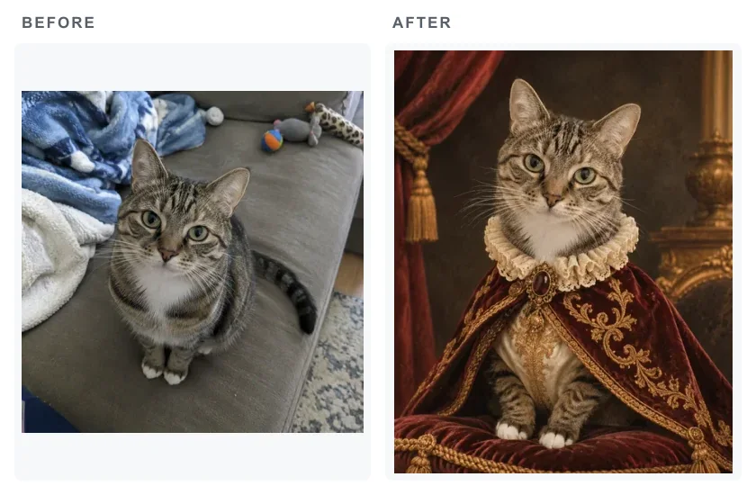
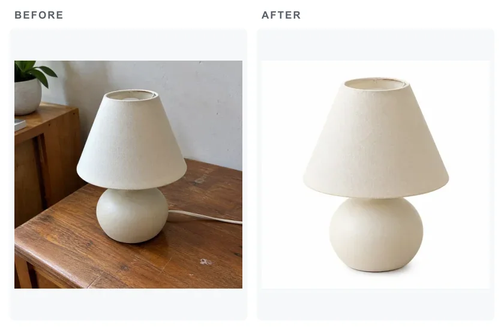
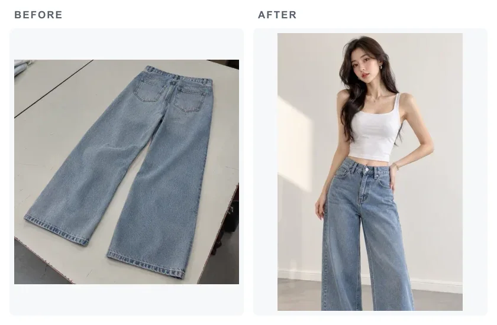
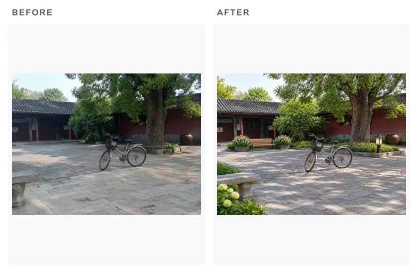

# Awesome Photo Skills

[中文](README.md) · [English](README.en.md) · [Português](README.pt.md) · [Español](README.es.md) · [Français](README.fr.md) · [Deutsch](README.de.md) · [عربي](README.ar.md) · [русский](README.ru.md) · [日本語](README.ja.md) · [हिंदी](README.hi.md)

**أنشئ عملاً فنيًا أصليًا من النص، أو حوّل صورك إلى صور شخصية وأعمال فنية للحيوانات الأليفة وصور منتجات ومساحات مُعاد تصميمها.**

استكشف 246 نموذجًا للصور و100 نموذج مطالبة قابل لإعادة الاستخدام — **50 يعمل مع النص وحده، دون الحاجة إلى صورة مرجعية**.

[تصفح 50 مطالبة نصية فقط →](./docs/ar/guides/text-only.md)

<table>
<tr><td width="33%" valign="top"> <strong>تحويل حيوان أليف إلى صورة ملكية أو تاريخية</strong> <a href="./docs/ar/cases/i028-turn-a-pet-into-a-royal-or-historical-portrait.md#public-prompt">عرض موجه</a> · <a href="https://dearsketch.com/ar/intent/i028-turn-a-pet-into-a-royal-or-historical-portrait.html?utm_source=github&amp;utm_medium=readme-en&amp;utm_campaign=dearsketch-public-cases&amp;utm_content=i028_cta">إنشاء عبر الإنترنت</a></td><td width="33%" valign="top"> <strong>تحويل الصورة الشخصية إلى صورة رمزية كرتونية</strong> <a href="./docs/ar/cases/i047-turn-a-portrait-photo-into-a-cartoon-avatar.md#public-prompt">عرض موجه</a> · <a href="https://dearsketch.com/ar/intent/i047-turn-a-portrait-photo-into-a-cartoon-avatar.html?utm_source=github&amp;utm_medium=readme-en&amp;utm_campaign=dearsketch-public-cases&amp;utm_content=i047_cta">إنشاء عبر الإنترنت</a></td><td width="33%" valign="top"> <strong>تحويل صورة منتج عادية إلى صورة قائمة بخلفية بيضاء</strong> <a href="./docs/ar/cases/i065-turn-an-ordinary-product-photo-into-a-white-background-listing-image.md#public-prompt">عرض موجه</a> · <a href="https://dearsketch.com/ar/intent/i065-turn-an-ordinary-product-photo-into-a-white-background-listing-image.html?utm_source=github&amp;utm_medium=readme-en&amp;utm_campaign=dearsketch-public-cases&amp;utm_content=i065_cta">إنشاء عبر الإنترنت</a></td></tr>
<tr><td width="33%" valign="top"> <strong>معاينة الأنماط الداخلية المختلفة في صورة الغرفة</strong> <a href="./docs/ar/cases/i169-preview-different-interior-styles-in-a-room-photo.md#public-prompt">عرض موجه</a> · <a href="https://dearsketch.com/ar/intent/i169-preview-different-interior-styles-in-a-room-photo.html?utm_source=github&amp;utm_medium=readme-en&amp;utm_campaign=dearsketch-public-cases&amp;utm_content=i169_cta">إنشاء عبر الإنترنت</a></td><td width="33%" valign="top"> <strong>قم بتحويل صورة المنزل إلى لوحة مائية أو تذكار فني خطي</strong> <a href="./docs/ar/cases/i030-turn-a-house-photo-into-a-watercolor-or-line-art-keepsake.md#public-prompt">عرض موجه</a> · <a href="https://dearsketch.com/ar/intent/i030-turn-a-house-photo-into-a-watercolor-or-line-art-keepsake.html?utm_source=github&amp;utm_medium=readme-en&amp;utm_campaign=dearsketch-public-cases&amp;utm_content=i030_cta">إنشاء عبر الإنترنت</a></td><td width="33%" valign="top"> <strong>تحويل الملابس المسطحة إلى صورة على عارضة الأزياء</strong> <a href="./docs/ar/cases/i089-turn-flat-lay-clothing-into-an-on-model-image.md#public-prompt">عرض موجه</a> · <a href="https://dearsketch.com/ar/intent/i089-turn-flat-lay-clothing-into-an-on-model-image.html?utm_source=github&amp;utm_medium=readme-en&amp;utm_campaign=dearsketch-public-cases&amp;utm_content=i089_cta">إنشاء عبر الإنترنت</a></td></tr>
<tr><td width="33%" valign="top"> <strong>تحويل صورة الزوجين إلى عمل فني للذكرى السنوية</strong> <a href="./docs/ar/cases/i022-turn-a-couple-s-photo-into-anniversary-artwork.md#public-prompt">عرض موجه</a> · <a href="https://dearsketch.com/ar/intent/i022-turn-a-couple-s-photo-into-anniversary-artwork.html?utm_source=github&amp;utm_medium=readme-en&amp;utm_campaign=dearsketch-public-cases&amp;utm_content=i022_cta">إنشاء عبر الإنترنت</a></td><td width="33%" valign="top"> <strong>تحويل الشخص إلى شخصية العمل المعبأة</strong> <a href="./docs/ar/cases/i050-turn-a-person-into-a-packaged-action-figure.md#public-prompt">عرض موجه</a> · <a href="https://dearsketch.com/ar/intent/i050-turn-a-person-into-a-packaged-action-figure.html?utm_source=github&amp;utm_medium=readme-en&amp;utm_campaign=dearsketch-public-cases&amp;utm_content=i050_cta">إنشاء عبر الإنترنت</a></td><td width="33%" valign="top"> <strong>ضع منتجًا في مشهد واقعي لأسلوب الحياة</strong> <a href="./docs/ar/cases/i067-place-a-product-in-a-realistic-lifestyle-scene.md#public-prompt">عرض موجه</a> · <a href="https://dearsketch.com/ar/intent/i067-place-a-product-in-a-realistic-lifestyle-scene.html?utm_source=github&amp;utm_medium=readme-en&amp;utm_campaign=dearsketch-public-cases&amp;utm_content=i067_cta">إنشاء عبر الإنترنت</a></td></tr>
</table>

**[تصفح جميع الأمثلة](https://dearsketch.com/ar/?utm_source=github&utm_medium=readme-en&utm_campaign=dearsketch-public-cases&utm_content=home_gallery#library) · [الإنشاء باستخدام صوري الخاصة →](https://dearsketch.com/ar/?utm_source=github&utm_medium=readme-en&utm_campaign=dearsketch-public-cases&utm_content=home_hero)**

توضح المواد المرجعية وأمثلة النتائج الاتجاهات المرئية. تمت كتابة القوالب العامة حديثًا ولم يتم اختبارها جيليًا مقابل هذه الصور.

## تصفح حسب الفئة

[الحيوانات الأليفة والعائلة](#pets-family) · [صور شخصية وأسلوب](#people) · [المنتجات والتجارة](#products) · [المنازل والمساحات](#spaces) · [الملصقات والملصقات تصميم](#design)

### الحيوانات الأليفة والعائلة

<table>
<tr><td width="50%" valign="top"> <strong>تحويل حيوان أليف إلى صورة ملكية أو تاريخية</strong> <a href="./docs/ar/cases/i028-turn-a-pet-into-a-royal-or-historical-portrait.md#public-prompt">عرض موجه</a> · <a href="https://dearsketch.com/ar/intent/i028-turn-a-pet-into-a-royal-or-historical-portrait.html?utm_source=github&amp;utm_medium=readme-en&amp;utm_campaign=dearsketch-public-cases&amp;utm_content=i028_cta">إنشاء عبر الإنترنت</a></td><td width="50%" valign="top"> <strong>تحويل صورة حيوان أليف إلى صورة مخصصة</strong> <a href="./docs/ar/cases/i026-turn-a-pet-photo-into-a-custom-portrait.md#public-prompt">عرض موجه</a> · <a href="https://dearsketch.com/ar/intent/i026-turn-a-pet-photo-into-a-custom-portrait.html?utm_source=github&amp;utm_medium=readme-en&amp;utm_campaign=dearsketch-public-cases&amp;utm_content=i026_cta">إنشاء عبر الإنترنت</a></td></tr>
<tr><td width="50%" valign="top"> <strong>تحويل صورة الزوجين إلى عمل فني للذكرى السنوية</strong> <a href="./docs/ar/cases/i022-turn-a-couple-s-photo-into-anniversary-artwork.md#public-prompt">عرض موجه</a> · <a href="https://dearsketch.com/ar/intent/i022-turn-a-couple-s-photo-into-anniversary-artwork.html?utm_source=github&amp;utm_medium=readme-en&amp;utm_campaign=dearsketch-public-cases&amp;utm_content=i022_cta">إنشاء عبر الإنترنت</a></td><td width="50%" valign="top"> <strong>اجمع الصور العائلية المنفصلة في صورة عائلية واحدة</strong> <a href="./docs/ar/cases/i017-combine-separate-family-photos-into-one-family-portrait.md#public-prompt">عرض موجه</a> · <a href="https://dearsketch.com/ar/intent/i017-combine-separate-family-photos-into-one-family-portrait.html?utm_source=github&amp;utm_medium=readme-en&amp;utm_campaign=dearsketch-public-cases&amp;utm_content=i017_cta">إنشاء عبر الإنترنت</a></td></tr>
</table>

[تصفح هذه المجموعة →](./docs/ar/guides/pets-family.md)

### صور وأسلوب

<table>
<tr><td width="50%" valign="top"> <strong>أنشئ لقطة رأس احترافية على LinkedIn من صورة شخصية</strong> <a href="./docs/ar/cases/i001-create-a-professional-linkedin-headshot-from-a-selfie.md#public-prompt">عرض موجه</a> · <a href="https://dearsketch.com/ar/intent/i001-create-a-professional-linkedin-headshot-from-a-selfie.html?utm_source=github&amp;utm_medium=readme-en&amp;utm_campaign=dearsketch-public-cases&amp;utm_content=i001_cta">إنشاء عبر الإنترنت</a></td><td width="50%" valign="top"> <strong>تحويل الصورة الشخصية إلى صورة رمزية كرتونية</strong> <a href="./docs/ar/cases/i047-turn-a-portrait-photo-into-a-cartoon-avatar.md#public-prompt">عرض موجه</a> · <a href="https://dearsketch.com/ar/intent/i047-turn-a-portrait-photo-into-a-cartoon-avatar.html?utm_source=github&amp;utm_medium=readme-en&amp;utm_campaign=dearsketch-public-cases&amp;utm_content=i047_cta">إنشاء عبر الإنترنت</a></td></tr>
<tr><td width="50%" valign="top"> <strong>استبدل الملابس غير الرسمية بالملابس المهنية</strong> <a href="./docs/ar/cases/i015-replace-casual-clothing-with-professional-attire.md#public-prompt">عرض موجه</a> · <a href="https://dearsketch.com/ar/intent/i015-replace-casual-clothing-with-professional-attire.html?utm_source=github&amp;utm_medium=readme-en&amp;utm_campaign=dearsketch-public-cases&amp;utm_content=i015_cta">إنشاء عبر الإنترنت</a></td><td width="50%" valign="top"> <strong>تحويل الشخص إلى شخصية العمل المعبأة</strong> <a href="./docs/ar/cases/i050-turn-a-person-into-a-packaged-action-figure.md#public-prompt">عرض موجه</a> · <a href="https://dearsketch.com/ar/intent/i050-turn-a-person-into-a-packaged-action-figure.html?utm_source=github&amp;utm_medium=readme-en&amp;utm_campaign=dearsketch-public-cases&amp;utm_content=i050_cta">إنشاء عبر الإنترنت</a></td></tr>
</table>

[تصفح هذه المجموعة →](./docs/ar/guides/people.md)

### المنتجات والتجارة

<table>
<tr><td width="50%" valign="top"> <strong>تحويل صورة منتج عادية إلى صورة قائمة بخلفية بيضاء</strong> <a href="./docs/ar/cases/i065-turn-an-ordinary-product-photo-into-a-white-background-listing-image.md#public-prompt">عرض موجه</a> · <a href="https://dearsketch.com/ar/intent/i065-turn-an-ordinary-product-photo-into-a-white-background-listing-image.html?utm_source=github&amp;utm_medium=readme-en&amp;utm_campaign=dearsketch-public-cases&amp;utm_content=i065_cta">إنشاء عبر الإنترنت</a></td><td width="50%" valign="top"> <strong>ضع منتجًا في مشهد واقعي لأسلوب الحياة</strong> <a href="./docs/ar/cases/i067-place-a-product-in-a-realistic-lifestyle-scene.md#public-prompt">عرض موجه</a> · <a href="https://dearsketch.com/ar/intent/i067-place-a-product-in-a-realistic-lifestyle-scene.html?utm_source=github&amp;utm_medium=readme-en&amp;utm_campaign=dearsketch-public-cases&amp;utm_content=i067_cta">إنشاء عبر الإنترنت</a></td></tr>
<tr><td width="50%" valign="top"> <strong>تحويل الملابس المسطحة إلى صورة على عارضة الأزياء</strong> <a href="./docs/ar/cases/i089-turn-flat-lay-clothing-into-an-on-model-image.md#public-prompt">عرض موجه</a> · <a href="https://dearsketch.com/ar/intent/i089-turn-flat-lay-clothing-into-an-on-model-image.html?utm_source=github&amp;utm_medium=readme-en&amp;utm_campaign=dearsketch-public-cases&amp;utm_content=i089_cta">إنشاء عبر الإنترنت</a></td><td width="50%" valign="top"> <strong>تحويل صورة عادية إلى لقطة منتج احترافية في الاستوديو</strong> <a href="./docs/ar/cases/i068-turn-an-ordinary-photo-into-a-professional-studio-product-shot.md#public-prompt">عرض موجه</a> · <a href="https://dearsketch.com/ar/intent/i068-turn-an-ordinary-photo-into-a-professional-studio-product-shot.html?utm_source=github&amp;utm_medium=readme-en&amp;utm_campaign=dearsketch-public-cases&amp;utm_content=i068_cta">إنشاء عبر الإنترنت</a></td></tr>
</table>

[تصفح هذه المجموعة →](./docs/ar/guides/products.md)

### المنازل والمساحات

<table>
<tr><td width="50%" valign="top"> <strong>معاينة الأنماط الداخلية المختلفة في صورة الغرفة</strong> <a href="./docs/ar/cases/i169-preview-different-interior-styles-in-a-room-photo.md#public-prompt">عرض موجه</a> · <a href="https://dearsketch.com/ar/intent/i169-preview-different-interior-styles-in-a-room-photo.html?utm_source=github&amp;utm_medium=readme-en&amp;utm_campaign=dearsketch-public-cases&amp;utm_content=i169_cta">إنشاء عبر الإنترنت</a></td><td width="50%" valign="top"> <strong>قم بتحويل صورة المنزل إلى لوحة مائية أو تذكار فني خطي</strong> <a href="./docs/ar/cases/i030-turn-a-house-photo-into-a-watercolor-or-line-art-keepsake.md#public-prompt">عرض موجه</a> · <a href="https://dearsketch.com/ar/intent/i030-turn-a-house-photo-into-a-watercolor-or-line-art-keepsake.html?utm_source=github&amp;utm_medium=readme-en&amp;utm_campaign=dearsketch-public-cases&amp;utm_content=i030_cta">إنشاء عبر الإنترنت</a></td></tr>
<tr><td width="50%" valign="top"> <strong>قم بتجهيز عقار فارغ تقريبًا بالأثاث والديكور</strong> <a href="./docs/ar/cases/i175-virtually-stage-an-empty-property-with-furniture-and-decor.md#public-prompt">عرض موجه</a> · <a href="https://dearsketch.com/ar/intent/i175-virtually-stage-an-empty-property-with-furniture-and-decor.html?utm_source=github&amp;utm_medium=readme-en&amp;utm_campaign=dearsketch-public-cases&amp;utm_content=i175_cta">إنشاء عبر الإنترنت</a></td><td width="50%" valign="top"> <strong>قم بإنشاء مفهوم تحول المناظر الطبيعية من صورة الفناء</strong> <a href="./docs/ar/cases/i178-create-a-landscape-makeover-concept-from-a-yard-photo.md#public-prompt">عرض موجه</a> · <a href="https://dearsketch.com/ar/intent/i178-create-a-landscape-makeover-concept-from-a-yard-photo.html?utm_source=github&amp;utm_medium=readme-en&amp;utm_campaign=dearsketch-public-cases&amp;utm_content=i178_cta">إنشاء عبر الإنترنت</a></td></tr>
</table>

[تصفح هذه المجموعة →](./docs/ar/guides/spaces.md)

### الملصقات والتصميم

<table>
<tr><td width="50%" valign="top"> <strong>إنشاء صورة مصغرة لفيديو يوتيوب</strong> <a href="./docs/ar/cases/i106-create-a-youtube-video-thumbnail.md#public-prompt">عرض موجه</a> · <a href="https://dearsketch.com/ar/intent/i106-create-a-youtube-video-thumbnail.html?utm_source=github&amp;utm_medium=readme-en&amp;utm_campaign=dearsketch-public-cases&amp;utm_content=i106_cta">إنشاء عبر الإنترنت</a></td><td width="50%" valign="top"> <strong>إنشاء ملصق ترويجي من موضوع ونسخه</strong> <a href="./docs/ar/cases/i107-create-a-promotional-poster-from-a-topic-and-copy.md#public-prompt">عرض موجه</a> · <a href="https://dearsketch.com/ar/intent/i107-create-a-promotional-poster-from-a-topic-and-copy.html?utm_source=github&amp;utm_medium=readme-en&amp;utm_campaign=dearsketch-public-cases&amp;utm_content=i107_cta">إنشاء عبر الإنترنت</a></td></tr>
<tr><td width="50%" valign="top"> <strong>قم بإنشاء رأس رسالة إخبارية أو غلاف مقال</strong> <a href="./docs/ar/cases/i119-create-a-newsletter-header-or-article-cover.md#public-prompt">عرض موجه</a> · <a href="https://dearsketch.com/ar/intent/i119-create-a-newsletter-header-or-article-cover.html?utm_source=github&amp;utm_medium=readme-en&amp;utm_campaign=dearsketch-public-cases&amp;utm_content=i119_cta">إنشاء عبر الإنترنت</a></td><td width="50%" valign="top"> <strong>أنشئ مفاهيم الشعار من وصف العلامة التجارية</strong> <a href="./docs/ar/cases/i126-create-logo-concepts-from-a-brand-description.md#public-prompt">عرض موجه</a> · <a href="https://dearsketch.com/ar/intent/i126-create-logo-concepts-from-a-brand-description.html?utm_source=github&amp;utm_medium=readme-en&amp;utm_campaign=dearsketch-public-cases&amp;utm_content=i126_cta">إنشاء عبر الإنترنت</a></td></tr>
</table>

[تصفح هذه المجموعة →](./docs/ar/guides/design.md)

## اصنع صورتك الأولى

1. **اختر تأثيرًا.** افتح حالة وتحقق من المدخلات المطلوبة.
2. **اختر أداتك.** انسخ المطالبة الخاصة بها إلى أداة الصور الخاصة بك، أو افتح المهمة المطابقة على dearsketch.
3. **استخدم المواد الخاصة بك.** بالنسبة للملخصات النصية فقط، املأ التفاصيل المكتوبة؛ لمهام التصوير، قم بإرفاق الصور المطلوبة. قم بتحرير المطالبة وإنشاء صورة واحدة.

[كل public prompts](./docs/ar/prompts.md) · [بداية سريعة مفصلة](./docs/ar/quickstart.md)

## استخدم مع وكيل AI

تساعد مهارة photo-editing الاختيارية الوكيل على اختيار مهمة وإعداد المدخلات والتعليمات.

[التثبيت والاستخدام](./docs/ar/quickstart.md#agent-skill) · [SKILL.md](./skills/photo-editing/SKILL.md)

## ساهم وتعلم المزيد

[ ساهم بمثال ](./CONTRIBUTING.en.md) · [ التحديثات ](./CHANGELOG.en.md) · [ ملاحظات الإدخال والصور ](./docs/ar/content-policy.md) · [ البيانات المنظمة ](./data/cases.json)

تحتاج بعض المهام إلى عدة صور مرجعية؛ يبدأ البعض بالنص. الأمثلة لا تضمن نتيجة مماثلة. قم بمراجعة الملف الفعلي للتأكد من دقة النص والشفافية ومتطلبات الإنتاج. تم توضيح أذونات إعادة استخدام الصور في سياسة المحتوى. مميزات الموقع والأسعار تابعوا الموقع.

