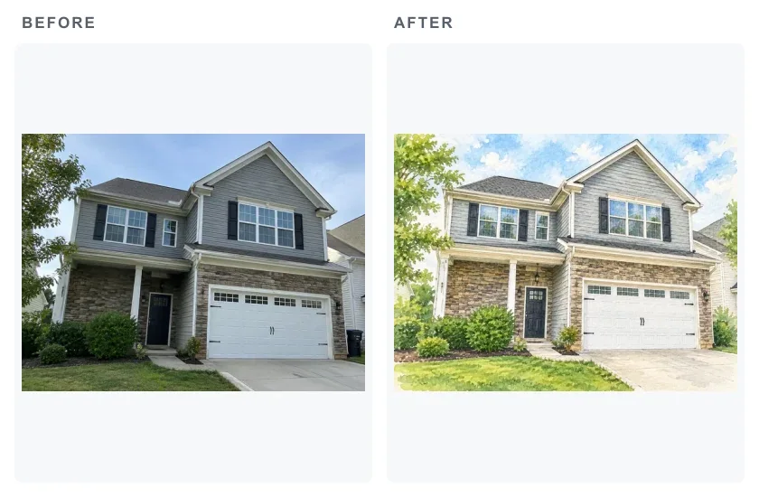
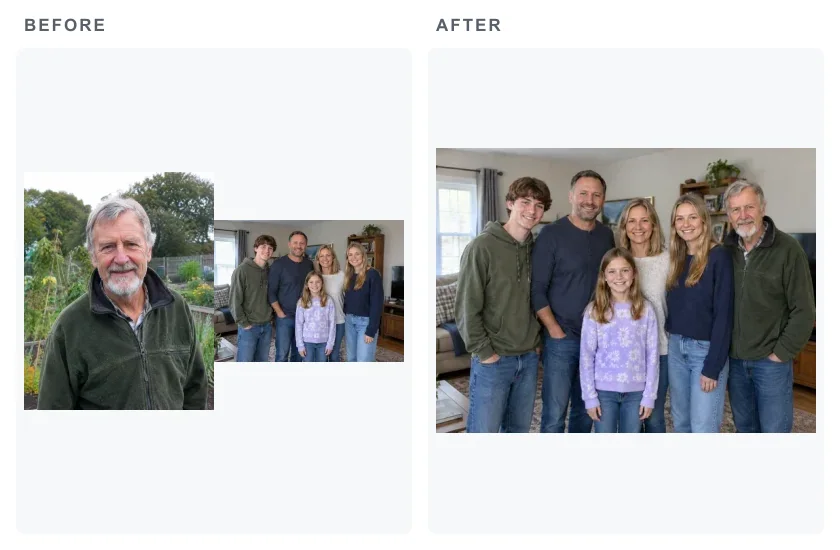

# Awesome Photo Skills

[中文](README.md) · [English](README.en.md) · [Português](README.pt.md) · [Español](README.es.md) · [Français](README.fr.md) · [Deutsch](README.de.md) · [عربي](README.ar.md) · [русский](README.ru.md) · [日本語](README.ja.md) · [हिंदी](README.hi.md)

**Erstellen Sie originelle Kunstwerke aus Texten oder verwandeln Sie Ihre Fotos in Porträts, Tierkunst, Produktbilder und neu gestaltete Räume.**

Entdecken Sie 246 Bildbeispiele und 100 wiederverwendbare Eingabeaufforderungsvorlagen – **50 funktionieren nur mit Text, kein Referenzbild erforderlich**.

[Durchsuchen Sie 50 Nur-Text-Eingabeaufforderungen →](./docs/de/guides/text-only.md)

<table>
<tr><td width="33%" valign="top"> <strong>Verwandeln Sie ein Haustier in ein königliches oder historisches Porträt</strong> <a href="./docs/de/cases/i028-turn-a-pet-into-a-royal-or-historical-portrait.md#public-prompt">Eingabeaufforderung anzeigen</a> · <a href="https://dearsketch.com/de/intent/i028-turn-a-pet-into-a-royal-or-historical-portrait.html?utm_source=github&amp;utm_medium=readme-en&amp;utm_campaign=dearsketch-public-cases&amp;utm_content=i028_cta">Online erstellen</a></td><td width="33%" valign="top"> <strong>Verwandeln Sie ein Porträtfoto in einen Cartoon-Avatar</strong> <a href="./docs/de/cases/i047-turn-a-portrait-photo-into-a-cartoon-avatar.md#public-prompt">Eingabeaufforderung anzeigen</a> · <a href="https://dearsketch.com/de/intent/i047-turn-a-portrait-photo-into-a-cartoon-avatar.html?utm_source=github&amp;utm_medium=readme-en&amp;utm_campaign=dearsketch-public-cases&amp;utm_content=i047_cta">Online erstellen</a></td><td width="33%" valign="top"> <strong>Verwandeln Sie ein gewöhnliches Produktfoto in ein Listingbild mit weißem Hintergrund</strong> <a href="./docs/de/cases/i065-turn-an-ordinary-product-photo-into-a-white-background-listing-image.md#public-prompt">Eingabeaufforderung anzeigen</a> · <a href="https://dearsketch.com/de/intent/i065-turn-an-ordinary-product-photo-into-a-white-background-listing-image.html?utm_source=github&amp;utm_medium=readme-en&amp;utm_campaign=dearsketch-public-cases&amp;utm_content=i065_cta">Online erstellen</a></td></tr>
<tr><td width="33%" valign="top"> <strong>Sehen Sie sich verschiedene Einrichtungsstile auf einem Raumfoto an</strong> <a href="./docs/de/cases/i169-preview-different-interior-styles-in-a-room-photo.md#public-prompt">Eingabeaufforderung anzeigen</a> · <a href="https://dearsketch.com/de/intent/i169-preview-different-interior-styles-in-a-room-photo.html?utm_source=github&amp;utm_medium=readme-en&amp;utm_campaign=dearsketch-public-cases&amp;utm_content=i169_cta">Online erstellen</a></td><td width="33%" valign="top"> <strong>Verwandeln Sie ein Hausfoto in ein Aquarell- oder Strichzeichnungen-Andenken</strong> <a href="./docs/de/cases/i030-turn-a-house-photo-into-a-watercolor-or-line-art-keepsake.md#public-prompt">Eingabeaufforderung anzeigen</a> · <a href="https://dearsketch.com/de/intent/i030-turn-a-house-photo-into-a-watercolor-or-line-art-keepsake.html?utm_source=github&amp;utm_medium=readme-en&amp;utm_campaign=dearsketch-public-cases&amp;utm_content=i030_cta">Online erstellen</a></td><td width="33%" valign="top"> <strong>Verwandeln Sie flach liegende Kleidung in ein Modelbild</strong> <a href="./docs/de/cases/i089-turn-flat-lay-clothing-into-an-on-model-image.md#public-prompt">Eingabeaufforderung anzeigen</a> · <a href="https://dearsketch.com/de/intent/i089-turn-flat-lay-clothing-into-an-on-model-image.html?utm_source=github&amp;utm_medium=readme-en&amp;utm_campaign=dearsketch-public-cases&amp;utm_content=i089_cta">Online erstellen</a></td></tr>
<tr><td width="33%" valign="top"> <strong>Verwandeln Sie das Foto eines Paares in ein Jubiläumskunstwerk</strong> <a href="./docs/de/cases/i022-turn-a-couple-s-photo-into-anniversary-artwork.md#public-prompt">Eingabeaufforderung anzeigen</a> · <a href="https://dearsketch.com/de/intent/i022-turn-a-couple-s-photo-into-anniversary-artwork.html?utm_source=github&amp;utm_medium=readme-en&amp;utm_campaign=dearsketch-public-cases&amp;utm_content=i022_cta">Online erstellen</a></td><td width="33%" valign="top"> <strong>Verwandeln Sie eine Person in eine verpackte Actionfigur</strong> <a href="./docs/de/cases/i050-turn-a-person-into-a-packaged-action-figure.md#public-prompt">Eingabeaufforderung anzeigen</a> · <a href="https://dearsketch.com/de/intent/i050-turn-a-person-into-a-packaged-action-figure.html?utm_source=github&amp;utm_medium=readme-en&amp;utm_campaign=dearsketch-public-cases&amp;utm_content=i050_cta">Online erstellen</a></td><td width="33%" valign="top"> <strong>Platzieren Sie ein Produkt in einer realistischen Lifestyle-Szene</strong> <a href="./docs/de/cases/i067-place-a-product-in-a-realistic-lifestyle-scene.md#public-prompt">Eingabeaufforderung anzeigen</a> · <a href="https://dearsketch.com/de/intent/i067-place-a-product-in-a-realistic-lifestyle-scene.html?utm_source=github&amp;utm_medium=readme-en&amp;utm_campaign=dearsketch-public-cases&amp;utm_content=i067_cta">Online erstellen</a></td></tr>
</table>

**[Alle Beispiele durchsuchen](https://dearsketch.com/de/?utm_source=github&utm_medium=readme-en&utm_campaign=dearsketch-public-cases&utm_content=home_gallery#library) · [Mit meinen eigenen Fotos erstellen →](https://dearsketch.com/de/?utm_source=github&utm_medium=readme-en&utm_campaign=dearsketch-public-cases&utm_content=home_hero)**

Referenzmaterialien und Ergebnisbeispiele veranschaulichen visuelle Anweisungen. Öffentliche Vorlagen sind neu geschrieben und wurden nicht anhand dieser Bilder einem Generierungstest unterzogen.

## Nach Kategorie durchsuchen

[Haustiere und Familie](#pets-family) · [Porträts und Stil](#people) · [Produkte und Handel](#products) · [Häuser und Räume](#spaces) · [Poster und design](#design)

### Haustiere und Familie

<table>
<tr><td width="50%" valign="top"> <strong>Verwandeln Sie ein Haustier in ein königliches oder historisches Porträt</strong> <a href="./docs/de/cases/i028-turn-a-pet-into-a-royal-or-historical-portrait.md#public-prompt">Eingabeaufforderung anzeigen</a> · <a href="https://dearsketch.com/de/intent/i028-turn-a-pet-into-a-royal-or-historical-portrait.html?utm_source=github&amp;utm_medium=readme-en&amp;utm_campaign=dearsketch-public-cases&amp;utm_content=i028_cta">Online erstellen</a></td><td width="50%" valign="top"> <strong>Verwandeln Sie ein Haustierfoto in ein individuelles Porträt</strong> <a href="./docs/de/cases/i026-turn-a-pet-photo-into-a-custom-portrait.md#public-prompt">Eingabeaufforderung anzeigen</a> · <a href="https://dearsketch.com/de/intent/i026-turn-a-pet-photo-into-a-custom-portrait.html?utm_source=github&amp;utm_medium=readme-en&amp;utm_campaign=dearsketch-public-cases&amp;utm_content=i026_cta">Online erstellen</a></td></tr>
<tr><td width="50%" valign="top"> <strong>Verwandeln Sie das Foto eines Paares in ein Jubiläumskunstwerk</strong> <a href="./docs/de/cases/i022-turn-a-couple-s-photo-into-anniversary-artwork.md#public-prompt">Eingabeaufforderung anzeigen</a> · <a href="https://dearsketch.com/de/intent/i022-turn-a-couple-s-photo-into-anniversary-artwork.html?utm_source=github&amp;utm_medium=readme-en&amp;utm_campaign=dearsketch-public-cases&amp;utm_content=i022_cta">Online erstellen</a></td><td width="50%" valign="top"> <strong>Kombinieren Sie einzelne Familienfotos zu einem Familienporträt</strong> <a href="./docs/de/cases/i017-combine-separate-family-photos-into-one-family-portrait.md#public-prompt">Eingabeaufforderung anzeigen</a> · <a href="https://dearsketch.com/de/intent/i017-combine-separate-family-photos-into-one-family-portrait.html?utm_source=github&amp;utm_medium=readme-en&amp;utm_campaign=dearsketch-public-cases&amp;utm_content=i017_cta">Online erstellen</a></td></tr>
</table>

[Durchsuchen Sie diese Sammlung →](./docs/de/guides/pets-family.md)

### Porträts & Stil

<table>
<tr><td width="50%" valign="top"> <strong>Erstellen Sie aus einem Selfie ein professionelles LinkedIn-Foto</strong> <a href="./docs/de/cases/i001-create-a-professional-linkedin-headshot-from-a-selfie.md#public-prompt">Eingabeaufforderung anzeigen</a> · <a href="https://dearsketch.com/de/intent/i001-create-a-professional-linkedin-headshot-from-a-selfie.html?utm_source=github&amp;utm_medium=readme-en&amp;utm_campaign=dearsketch-public-cases&amp;utm_content=i001_cta">Online erstellen</a></td><td width="50%" valign="top"> <strong>Verwandeln Sie ein Porträtfoto in einen Cartoon-Avatar</strong> <a href="./docs/de/cases/i047-turn-a-portrait-photo-into-a-cartoon-avatar.md#public-prompt">Eingabeaufforderung anzeigen</a> · <a href="https://dearsketch.com/de/intent/i047-turn-a-portrait-photo-into-a-cartoon-avatar.html?utm_source=github&amp;utm_medium=readme-en&amp;utm_campaign=dearsketch-public-cases&amp;utm_content=i047_cta">Online erstellen</a></td></tr>
<tr><td width="50%" valign="top"> <strong>Ersetzen Sie Freizeitkleidung durch Berufskleidung</strong> <a href="./docs/de/cases/i015-replace-casual-clothing-with-professional-attire.md#public-prompt">Eingabeaufforderung anzeigen</a> · <a href="https://dearsketch.com/de/intent/i015-replace-casual-clothing-with-professional-attire.html?utm_source=github&amp;utm_medium=readme-en&amp;utm_campaign=dearsketch-public-cases&amp;utm_content=i015_cta">Online erstellen</a></td><td width="50%" valign="top"> <strong>Verwandeln Sie eine Person in eine verpackte Actionfigur</strong> <a href="./docs/de/cases/i050-turn-a-person-into-a-packaged-action-figure.md#public-prompt">Eingabeaufforderung anzeigen</a> · <a href="https://dearsketch.com/de/intent/i050-turn-a-person-into-a-packaged-action-figure.html?utm_source=github&amp;utm_medium=readme-en&amp;utm_campaign=dearsketch-public-cases&amp;utm_content=i050_cta">Online erstellen</a></td></tr>
</table>

[Durchsuchen Sie diese Sammlung →](./docs/de/guides/people.md)

### Produkte & Handel

<table>
<tr><td width="50%" valign="top"> <strong>Verwandeln Sie ein gewöhnliches Produktfoto in ein Listingbild mit weißem Hintergrund</strong> <a href="./docs/de/cases/i065-turn-an-ordinary-product-photo-into-a-white-background-listing-image.md#public-prompt">Eingabeaufforderung anzeigen</a> · <a href="https://dearsketch.com/de/intent/i065-turn-an-ordinary-product-photo-into-a-white-background-listing-image.html?utm_source=github&amp;utm_medium=readme-en&amp;utm_campaign=dearsketch-public-cases&amp;utm_content=i065_cta">Online erstellen</a></td><td width="50%" valign="top"> <strong>Platzieren Sie ein Produkt in einer realistischen Lifestyle-Szene</strong> <a href="./docs/de/cases/i067-place-a-product-in-a-realistic-lifestyle-scene.md#public-prompt">Eingabeaufforderung anzeigen</a> · <a href="https://dearsketch.com/de/intent/i067-place-a-product-in-a-realistic-lifestyle-scene.html?utm_source=github&amp;utm_medium=readme-en&amp;utm_campaign=dearsketch-public-cases&amp;utm_content=i067_cta">Online erstellen</a></td></tr>
<tr><td width="50%" valign="top"> <strong>Verwandeln Sie flach liegende Kleidung in ein Modelbild</strong> <a href="./docs/de/cases/i089-turn-flat-lay-clothing-into-an-on-model-image.md#public-prompt">Eingabeaufforderung anzeigen</a> · <a href="https://dearsketch.com/de/intent/i089-turn-flat-lay-clothing-into-an-on-model-image.html?utm_source=github&amp;utm_medium=readme-en&amp;utm_campaign=dearsketch-public-cases&amp;utm_content=i089_cta">Online erstellen</a></td><td width="50%" valign="top"> <strong>Verwandeln Sie ein gewöhnliches Foto in eine professionelle Studioproduktaufnahme</strong> <a href="./docs/de/cases/i068-turn-an-ordinary-photo-into-a-professional-studio-product-shot.md#public-prompt">Eingabeaufforderung anzeigen</a> · <a href="https://dearsketch.com/de/intent/i068-turn-an-ordinary-photo-into-a-professional-studio-product-shot.html?utm_source=github&amp;utm_medium=readme-en&amp;utm_campaign=dearsketch-public-cases&amp;utm_content=i068_cta">Online erstellen</a></td></tr>
</table>

[Durchsuchen Sie diese Sammlung →](./docs/de/guides/products.md)

### Häuser und Räume

<table>
<tr><td width="50%" valign="top"> <strong>Sehen Sie sich verschiedene Einrichtungsstile auf einem Raumfoto an</strong> <a href="./docs/de/cases/i169-preview-different-interior-styles-in-a-room-photo.md#public-prompt">Eingabeaufforderung anzeigen</a> · <a href="https://dearsketch.com/de/intent/i169-preview-different-interior-styles-in-a-room-photo.html?utm_source=github&amp;utm_medium=readme-en&amp;utm_campaign=dearsketch-public-cases&amp;utm_content=i169_cta">Online erstellen</a></td><td width="50%" valign="top"> <strong>Verwandeln Sie ein Hausfoto in ein Aquarell- oder Strichzeichnungen-Andenken</strong> <a href="./docs/de/cases/i030-turn-a-house-photo-into-a-watercolor-or-line-art-keepsake.md#public-prompt">Eingabeaufforderung anzeigen</a> · <a href="https://dearsketch.com/de/intent/i030-turn-a-house-photo-into-a-watercolor-or-line-art-keepsake.html?utm_source=github&amp;utm_medium=readme-en&amp;utm_campaign=dearsketch-public-cases&amp;utm_content=i030_cta">Online erstellen</a></td></tr>
<tr><td width="50%" valign="top"> <strong>Setzen Sie eine leerstehende Immobilie mit Möbeln und Dekor virtuell in Szene</strong> <a href="./docs/de/cases/i175-virtually-stage-an-empty-property-with-furniture-and-decor.md#public-prompt">Eingabeaufforderung anzeigen</a> · <a href="https://dearsketch.com/de/intent/i175-virtually-stage-an-empty-property-with-furniture-and-decor.html?utm_source=github&amp;utm_medium=readme-en&amp;utm_campaign=dearsketch-public-cases&amp;utm_content=i175_cta">Online erstellen</a></td><td width="50%" valign="top"> <strong>Erstellen Sie anhand eines Gartenfotos ein Landschaftsumgestaltungskonzept</strong> <a href="./docs/de/cases/i178-create-a-landscape-makeover-concept-from-a-yard-photo.md#public-prompt">Eingabeaufforderung anzeigen</a> · <a href="https://dearsketch.com/de/intent/i178-create-a-landscape-makeover-concept-from-a-yard-photo.html?utm_source=github&amp;utm_medium=readme-en&amp;utm_campaign=dearsketch-public-cases&amp;utm_content=i178_cta">Online erstellen</a></td></tr>
</table>

[Durchsuchen Sie diese Sammlung →](./docs/de/guides/spaces.md)

### Poster & Design

<table>
<tr><td width="50%" valign="top"> <strong>Erstellen Sie eine Miniaturansicht eines YouTube-Videos</strong> <a href="./docs/de/cases/i106-create-a-youtube-video-thumbnail.md#public-prompt">Eingabeaufforderung anzeigen</a> · <a href="https://dearsketch.com/de/intent/i106-create-a-youtube-video-thumbnail.html?utm_source=github&amp;utm_medium=readme-en&amp;utm_campaign=dearsketch-public-cases&amp;utm_content=i106_cta">Online erstellen</a></td><td width="50%" valign="top"> <strong>Erstellen Sie ein Werbeplakat zu einem Thema und kopieren Sie es</strong> <a href="./docs/de/cases/i107-create-a-promotional-poster-from-a-topic-and-copy.md#public-prompt">Eingabeaufforderung anzeigen</a> · <a href="https://dearsketch.com/de/intent/i107-create-a-promotional-poster-from-a-topic-and-copy.html?utm_source=github&amp;utm_medium=readme-en&amp;utm_campaign=dearsketch-public-cases&amp;utm_content=i107_cta">Online erstellen</a></td></tr>
<tr><td width="50%" valign="top"> <strong>Erstellen Sie einen Newsletter-Header oder ein Artikel-Cover</strong> <a href="./docs/de/cases/i119-create-a-newsletter-header-or-article-cover.md#public-prompt">Eingabeaufforderung anzeigen</a> · <a href="https://dearsketch.com/de/intent/i119-create-a-newsletter-header-or-article-cover.html?utm_source=github&amp;utm_medium=readme-en&amp;utm_campaign=dearsketch-public-cases&amp;utm_content=i119_cta">Online erstellen</a></td><td width="50%" valign="top"> <strong>Erstellen Sie Logokonzepte aus einer Markenbeschreibung</strong> <a href="./docs/de/cases/i126-create-logo-concepts-from-a-brand-description.md#public-prompt">Eingabeaufforderung anzeigen</a> · <a href="https://dearsketch.com/de/intent/i126-create-logo-concepts-from-a-brand-description.html?utm_source=github&amp;utm_medium=readme-en&amp;utm_campaign=dearsketch-public-cases&amp;utm_content=i126_cta">Online erstellen</a></td></tr>
</table>

[Durchsuchen Sie diese Sammlung →](./docs/de/guides/design.md)

## Machen Sie Ihr erstes Bild

1. **Wählen Sie einen Effekt.** Öffnen Sie einen Fall und überprüfen Sie die erforderlichen Eingaben.
2. **Wählen Sie Ihr Tool.** Kopieren Sie die Eingabeaufforderung in Ihr Bildtool oder öffnen Sie die passende Aufgabe auf dearsketch.
3. **Verwenden Sie Ihr eigenes Material.** Geben Sie bei reinen Textbriefen die schriftlichen Angaben ein; Für Fotoaufgaben fügen Sie die erforderlichen Bilder bei. Bearbeiten Sie die Eingabeaufforderung und generieren Sie ein Bild.

[All public prompts](./docs/de/prompts.md) · [Detailed quick start](./docs/de/quickstart.md)

## Verwendung mit einem KI-Agenten

Der optionale photo-editing Skill hilft einem Agenten bei der Auswahl einer Aufgabe und der Vorbereitung der Eingaben und Anweisungen.

[Installation & usage](./docs/de/quickstart.md#agent-skill) · [SKILL.md](./skills/photo-editing/SKILL.md)

## Tragen Sie bei und erfahren Sie mehr

[Ein Beispiel beisteuern](./CONTRIBUTING.en.md) · [Updates](./CHANGELOG.en.md) · [Eingabe- und Bildnotizen](./docs/de/content-policy.md) · [Strukturierte Daten ](./data/cases.json)

Für einige Aufgaben sind mehrere Referenzbilder erforderlich. manche beginnen mit Text. Die Beispiele garantieren kein identisches Ergebnis. Überprüfen Sie die tatsächliche Datei auf Textgenauigkeit, Transparenz und Produktionsanforderungen. Die Berechtigungen zur Wiederverwendung von Bildern werden in der Inhaltsrichtlinie beschrieben. Website-Funktionen und Preise folgen der Website.
