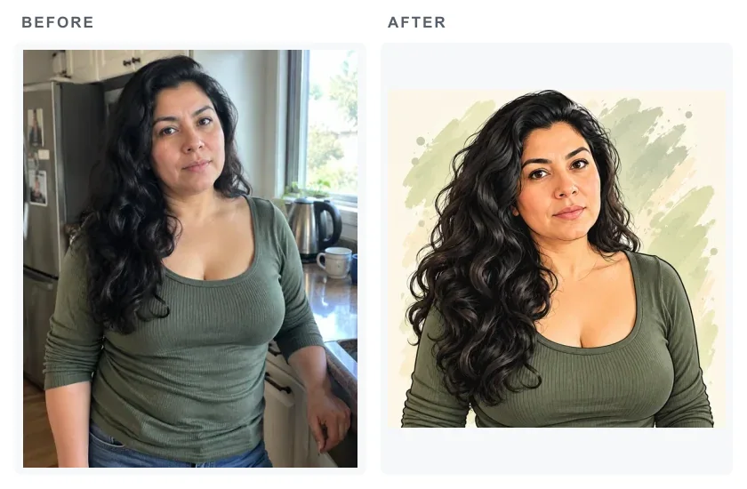
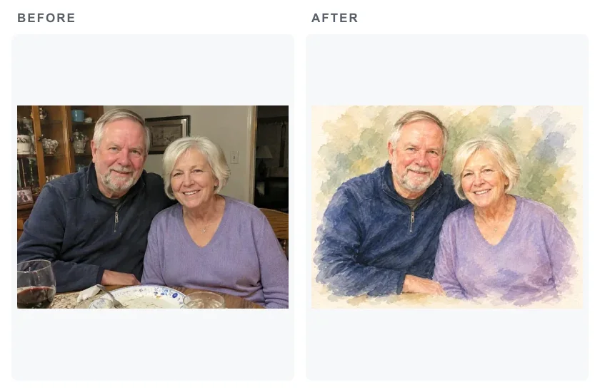
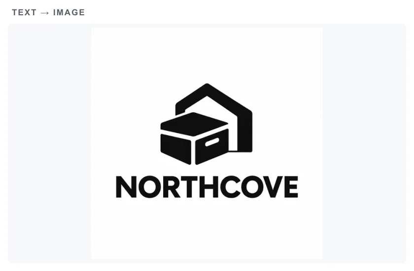

# Awesome Photo Skills

**Turn your photos into portraits, pet art, product images and redesigned spaces.**

Explore 246 image examples and 50 reusable prompt templates.

[中文](README.md) · **English** · [Português](README.pt.md) · [Español](README.es.md) · [Français](README.fr.md) · [Deutsch](README.de.md) · [عربي](README.ar.md) · [русский](README.ru.md) · [日本語](README.ja.md) · [हिंदी](README.hi.md)

<table>
<tr><td width="33%" valign="top"> <strong>Turn a pet into a royal or historical portrait</strong> <a href="docs/cases/i028-turn-a-pet-into-a-royal-or-historical-portrait.md#public-prompt">View prompt</a> · <a href="https://dearsketch.com/en/intent/i028-turn-a-pet-into-a-royal-or-historical-portrait.html?utm_source=github&amp;utm_medium=readme-en&amp;utm_campaign=dearsketch-public-cases&amp;utm_content=i028_cta">Use my photo</a></td><td width="33%" valign="top"> <strong>Turn a portrait photo into a cartoon avatar</strong> <a href="docs/cases/i047-turn-a-portrait-photo-into-a-cartoon-avatar.md#public-prompt">View prompt</a> · <a href="https://dearsketch.com/en/intent/i047-turn-a-portrait-photo-into-a-cartoon-avatar.html?utm_source=github&amp;utm_medium=readme-en&amp;utm_campaign=dearsketch-public-cases&amp;utm_content=i047_cta">Use my photo</a></td><td width="33%" valign="top"> <strong>Turn an ordinary product photo into a white-background listing image</strong> <a href="docs/cases/i065-turn-an-ordinary-product-photo-into-a-white-background-listing-image.md#public-prompt">View prompt</a> · <a href="https://dearsketch.com/en/intent/i065-turn-an-ordinary-product-photo-into-a-white-background-listing-image.html?utm_source=github&amp;utm_medium=readme-en&amp;utm_campaign=dearsketch-public-cases&amp;utm_content=i065_cta">Use my photo</a></td></tr>
<tr><td width="33%" valign="top"> <strong>Preview different interior styles in a room photo</strong> <a href="docs/cases/i169-preview-different-interior-styles-in-a-room-photo.md#public-prompt">View prompt</a> · <a href="https://dearsketch.com/en/intent/i169-preview-different-interior-styles-in-a-room-photo.html?utm_source=github&amp;utm_medium=readme-en&amp;utm_campaign=dearsketch-public-cases&amp;utm_content=i169_cta">Use my photo</a></td><td width="33%" valign="top"> <strong>Turn a house photo into a watercolor or line-art keepsake</strong> <a href="docs/cases/i030-turn-a-house-photo-into-a-watercolor-or-line-art-keepsake.md#public-prompt">View prompt</a> · <a href="https://dearsketch.com/en/intent/i030-turn-a-house-photo-into-a-watercolor-or-line-art-keepsake.html?utm_source=github&amp;utm_medium=readme-en&amp;utm_campaign=dearsketch-public-cases&amp;utm_content=i030_cta">Use my photo</a></td><td width="33%" valign="top"> <strong>Turn flat-lay clothing into an on-model image</strong> <a href="docs/cases/i089-turn-flat-lay-clothing-into-an-on-model-image.md#public-prompt">View prompt</a> · <a href="https://dearsketch.com/en/intent/i089-turn-flat-lay-clothing-into-an-on-model-image.html?utm_source=github&amp;utm_medium=readme-en&amp;utm_campaign=dearsketch-public-cases&amp;utm_content=i089_cta">Use my photo</a></td></tr>
<tr><td width="33%" valign="top"> <strong>Turn a couple&#39;s photo into anniversary artwork</strong> <a href="docs/cases/i022-turn-a-couple-s-photo-into-anniversary-artwork.md#public-prompt">View prompt</a> · <a href="https://dearsketch.com/en/intent/i022-turn-a-couple-s-photo-into-anniversary-artwork.html?utm_source=github&amp;utm_medium=readme-en&amp;utm_campaign=dearsketch-public-cases&amp;utm_content=i022_cta">Use my photo</a></td><td width="33%" valign="top"> <strong>Turn a person into a packaged action figure</strong> <a href="docs/cases/i050-turn-a-person-into-a-packaged-action-figure.md#public-prompt">View prompt</a> · <a href="https://dearsketch.com/en/intent/i050-turn-a-person-into-a-packaged-action-figure.html?utm_source=github&amp;utm_medium=readme-en&amp;utm_campaign=dearsketch-public-cases&amp;utm_content=i050_cta">Use my photo</a></td><td width="33%" valign="top"> <strong>Place a product in a realistic lifestyle scene</strong> <a href="docs/cases/i067-place-a-product-in-a-realistic-lifestyle-scene.md#public-prompt">View prompt</a> · <a href="https://dearsketch.com/en/intent/i067-place-a-product-in-a-realistic-lifestyle-scene.html?utm_source=github&amp;utm_medium=readme-en&amp;utm_campaign=dearsketch-public-cases&amp;utm_content=i067_cta">Use my photo</a></td></tr>
</table>

**[Browse all examples](https://dearsketch.com/en/?utm_source=github&utm_medium=readme-en&utm_campaign=dearsketch-public-cases&utm_content=home_gallery#library) · [Create with my own photos →](https://dearsketch.com/en/?utm_source=github&utm_medium=readme-en&utm_campaign=dearsketch-public-cases&utm_content=home_hero)**

Reference materials and result examples illustrate visual directions. Public templates are newly written and have not been generation-tested against these images.

## Browse by category

[Pets & family](#pets--family) · [Portraits & style](#portraits--style) · [Products & commerce](#products--commerce) · [Homes & spaces](#homes--spaces) · [Posters & design](#posters--design)

### Pets & family

<table>
<tr><td width="50%" valign="top"> <strong>Turn a pet into a royal or historical portrait</strong> <a href="docs/cases/i028-turn-a-pet-into-a-royal-or-historical-portrait.md#public-prompt">View prompt</a> · <a href="https://dearsketch.com/en/intent/i028-turn-a-pet-into-a-royal-or-historical-portrait.html?utm_source=github&amp;utm_medium=readme-en&amp;utm_campaign=dearsketch-public-cases&amp;utm_content=i028_cta">Use my photo</a></td><td width="50%" valign="top"> <strong>Turn a pet photo into a custom portrait</strong> <a href="docs/cases/i026-turn-a-pet-photo-into-a-custom-portrait.md#public-prompt">View prompt</a> · <a href="https://dearsketch.com/en/intent/i026-turn-a-pet-photo-into-a-custom-portrait.html?utm_source=github&amp;utm_medium=readme-en&amp;utm_campaign=dearsketch-public-cases&amp;utm_content=i026_cta">Use my photo</a></td></tr>
<tr><td width="50%" valign="top"> <strong>Turn a couple&#39;s photo into anniversary artwork</strong> <a href="docs/cases/i022-turn-a-couple-s-photo-into-anniversary-artwork.md#public-prompt">View prompt</a> · <a href="https://dearsketch.com/en/intent/i022-turn-a-couple-s-photo-into-anniversary-artwork.html?utm_source=github&amp;utm_medium=readme-en&amp;utm_campaign=dearsketch-public-cases&amp;utm_content=i022_cta">Use my photo</a></td><td width="50%" valign="top"> <strong>Combine separate family photos into one family portrait</strong> <a href="docs/cases/i017-combine-separate-family-photos-into-one-family-portrait.md#public-prompt">View prompt</a> · <a href="https://dearsketch.com/en/intent/i017-combine-separate-family-photos-into-one-family-portrait.html?utm_source=github&amp;utm_medium=readme-en&amp;utm_campaign=dearsketch-public-cases&amp;utm_content=i017_cta">Use my photo</a></td></tr>
</table>

[Browse this collection →](docs/en/guides/pets-family.md)

### Portraits & style

<table>
<tr><td width="50%" valign="top"> <strong>Create a professional LinkedIn headshot from a selfie</strong> <a href="docs/cases/i001-create-a-professional-linkedin-headshot-from-a-selfie.md#public-prompt">View prompt</a> · <a href="https://dearsketch.com/en/intent/i001-create-a-professional-linkedin-headshot-from-a-selfie.html?utm_source=github&amp;utm_medium=readme-en&amp;utm_campaign=dearsketch-public-cases&amp;utm_content=i001_cta">Use my photo</a></td><td width="50%" valign="top"> <strong>Turn a portrait photo into a cartoon avatar</strong> <a href="docs/cases/i047-turn-a-portrait-photo-into-a-cartoon-avatar.md#public-prompt">View prompt</a> · <a href="https://dearsketch.com/en/intent/i047-turn-a-portrait-photo-into-a-cartoon-avatar.html?utm_source=github&amp;utm_medium=readme-en&amp;utm_campaign=dearsketch-public-cases&amp;utm_content=i047_cta">Use my photo</a></td></tr>
<tr><td width="50%" valign="top"> <strong>Replace casual clothing with professional attire</strong> <a href="docs/cases/i015-replace-casual-clothing-with-professional-attire.md#public-prompt">View prompt</a> · <a href="https://dearsketch.com/en/intent/i015-replace-casual-clothing-with-professional-attire.html?utm_source=github&amp;utm_medium=readme-en&amp;utm_campaign=dearsketch-public-cases&amp;utm_content=i015_cta">Use my photo</a></td><td width="50%" valign="top"> <strong>Turn a person into a packaged action figure</strong> <a href="docs/cases/i050-turn-a-person-into-a-packaged-action-figure.md#public-prompt">View prompt</a> · <a href="https://dearsketch.com/en/intent/i050-turn-a-person-into-a-packaged-action-figure.html?utm_source=github&amp;utm_medium=readme-en&amp;utm_campaign=dearsketch-public-cases&amp;utm_content=i050_cta">Use my photo</a></td></tr>
</table>

[Browse this collection →](docs/en/guides/people.md)

### Products & commerce

<table>
<tr><td width="50%" valign="top"> <strong>Turn an ordinary product photo into a white-background listing image</strong> <a href="docs/cases/i065-turn-an-ordinary-product-photo-into-a-white-background-listing-image.md#public-prompt">View prompt</a> · <a href="https://dearsketch.com/en/intent/i065-turn-an-ordinary-product-photo-into-a-white-background-listing-image.html?utm_source=github&amp;utm_medium=readme-en&amp;utm_campaign=dearsketch-public-cases&amp;utm_content=i065_cta">Use my photo</a></td><td width="50%" valign="top"> <strong>Place a product in a realistic lifestyle scene</strong> <a href="docs/cases/i067-place-a-product-in-a-realistic-lifestyle-scene.md#public-prompt">View prompt</a> · <a href="https://dearsketch.com/en/intent/i067-place-a-product-in-a-realistic-lifestyle-scene.html?utm_source=github&amp;utm_medium=readme-en&amp;utm_campaign=dearsketch-public-cases&amp;utm_content=i067_cta">Use my photo</a></td></tr>
<tr><td width="50%" valign="top"> <strong>Turn flat-lay clothing into an on-model image</strong> <a href="docs/cases/i089-turn-flat-lay-clothing-into-an-on-model-image.md#public-prompt">View prompt</a> · <a href="https://dearsketch.com/en/intent/i089-turn-flat-lay-clothing-into-an-on-model-image.html?utm_source=github&amp;utm_medium=readme-en&amp;utm_campaign=dearsketch-public-cases&amp;utm_content=i089_cta">Use my photo</a></td><td width="50%" valign="top"> <strong>Turn an ordinary photo into a professional studio product shot</strong> <a href="docs/cases/i068-turn-an-ordinary-photo-into-a-professional-studio-product-shot.md#public-prompt">View prompt</a> · <a href="https://dearsketch.com/en/intent/i068-turn-an-ordinary-photo-into-a-professional-studio-product-shot.html?utm_source=github&amp;utm_medium=readme-en&amp;utm_campaign=dearsketch-public-cases&amp;utm_content=i068_cta">Use my photo</a></td></tr>
</table>

[Browse this collection →](docs/en/guides/products.md)

### Homes & spaces

<table>
<tr><td width="50%" valign="top"> <strong>Preview different interior styles in a room photo</strong> <a href="docs/cases/i169-preview-different-interior-styles-in-a-room-photo.md#public-prompt">View prompt</a> · <a href="https://dearsketch.com/en/intent/i169-preview-different-interior-styles-in-a-room-photo.html?utm_source=github&amp;utm_medium=readme-en&amp;utm_campaign=dearsketch-public-cases&amp;utm_content=i169_cta">Use my photo</a></td><td width="50%" valign="top"> <strong>Turn a house photo into a watercolor or line-art keepsake</strong> <a href="docs/cases/i030-turn-a-house-photo-into-a-watercolor-or-line-art-keepsake.md#public-prompt">View prompt</a> · <a href="https://dearsketch.com/en/intent/i030-turn-a-house-photo-into-a-watercolor-or-line-art-keepsake.html?utm_source=github&amp;utm_medium=readme-en&amp;utm_campaign=dearsketch-public-cases&amp;utm_content=i030_cta">Use my photo</a></td></tr>
<tr><td width="50%" valign="top"> <strong>Virtually stage an empty property with furniture and decor</strong> <a href="docs/cases/i175-virtually-stage-an-empty-property-with-furniture-and-decor.md#public-prompt">View prompt</a> · <a href="https://dearsketch.com/en/intent/i175-virtually-stage-an-empty-property-with-furniture-and-decor.html?utm_source=github&amp;utm_medium=readme-en&amp;utm_campaign=dearsketch-public-cases&amp;utm_content=i175_cta">Use my photo</a></td><td width="50%" valign="top"> <strong>Create a landscape makeover concept from a yard photo</strong> <a href="docs/cases/i178-create-a-landscape-makeover-concept-from-a-yard-photo.md#public-prompt">View prompt</a> · <a href="https://dearsketch.com/en/intent/i178-create-a-landscape-makeover-concept-from-a-yard-photo.html?utm_source=github&amp;utm_medium=readme-en&amp;utm_campaign=dearsketch-public-cases&amp;utm_content=i178_cta">Use my photo</a></td></tr>
</table>

[Browse this collection →](docs/en/guides/spaces.md)

### Posters & design

<table>
<tr><td width="50%" valign="top"> <strong>Create a YouTube video thumbnail</strong> <a href="docs/cases/i106-create-a-youtube-video-thumbnail.md#public-prompt">View prompt</a> · <a href="https://dearsketch.com/en/intent/i106-create-a-youtube-video-thumbnail.html?utm_source=github&amp;utm_medium=readme-en&amp;utm_campaign=dearsketch-public-cases&amp;utm_content=i106_cta">Use my photo</a></td><td width="50%" valign="top"> <strong>Create a promotional poster from a topic and copy</strong> <a href="docs/cases/i107-create-a-promotional-poster-from-a-topic-and-copy.md#public-prompt">View prompt</a> · <a href="https://dearsketch.com/en/intent/i107-create-a-promotional-poster-from-a-topic-and-copy.html?utm_source=github&amp;utm_medium=readme-en&amp;utm_campaign=dearsketch-public-cases&amp;utm_content=i107_cta">Use my photo</a></td></tr>
<tr><td width="50%" valign="top"> <strong>Create a newsletter header or article cover</strong> <a href="docs/cases/i119-create-a-newsletter-header-or-article-cover.md#public-prompt">View prompt</a> · <a href="https://dearsketch.com/en/intent/i119-create-a-newsletter-header-or-article-cover.html?utm_source=github&amp;utm_medium=readme-en&amp;utm_campaign=dearsketch-public-cases&amp;utm_content=i119_cta">Use my photo</a></td><td width="50%" valign="top"> <strong>Create logo concepts from a brand description</strong> <a href="docs/cases/i126-create-logo-concepts-from-a-brand-description.md#public-prompt">View prompt</a> · <a href="https://dearsketch.com/en/intent/i126-create-logo-concepts-from-a-brand-description.html?utm_source=github&amp;utm_medium=readme-en&amp;utm_campaign=dearsketch-public-cases&amp;utm_content=i126_cta">Use my photo</a></td></tr>
</table>

[Browse this collection →](docs/en/guides/design.md)

## Make your first image

1. **Pick an effect.** Open a case and check its required inputs.
2. **Choose your tool.** Copy its prompt into your image tool, or open the matching task on dearsketch.
3. **Use your own material.** Upload the required images, edit the instructions and generate one image.

[All public prompts](docs/en/prompts.md) · [Detailed quick start](docs/en/quickstart.md)

## Use with an AI agent

The optional photo-editing Skill helps an agent choose a task and prepare the inputs and instructions.

[Installation & usage](docs/en/quickstart.md#agent-skill) · [SKILL.md](skills/photo-editing/SKILL.md)

## Contribute & learn more

[Contribute an example](CONTRIBUTING.en.md) · [Updates](CHANGELOG.en.md) · [Input and image notes](docs/en/content-policy.md) · [Structured data](data/cases.json)

Some tasks need several reference images; some begin with text. The examples do not guarantee an identical result. Review the actual file for text accuracy, transparency and production requirements. Image reuse permissions are described in the content policy. Website features and prices follow the website.
