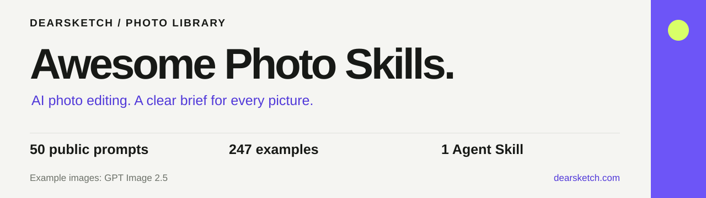

# Awesome Photo Skills · AI Photo Editing & GPT Image 2.5

[中文](README.md) · [English](README.en.md) · [Português](README.pt.md) · [Español](README.es.md) · [Français](README.fr.md) · [Deutsch](README.de.md) · [عربي](README.ar.md) · [русский](README.ru.md) · [日本語](README.ja.md) · [हिंदी](README.hi.md)

[50 prompts](./docs/en/prompts.md) · [Quick start](./docs/en/quickstart.md) · [Agent Skill](./skills/photo-editing/SKILL.md) · [197 more examples](./docs/en/gallery/index.md)

**Turn your photos into portraits, pet art, product images and redesigned spaces.** Explore 50 reusable prompts and 247 image examples, or let an Agent Skill help prepare your edit.

**[Try with your own photos on dearsketch →](https://dearsketch.com/en/?utm_source=github&utm_medium=readme-en&utm_campaign=dearsketch-public-cases&utm_content=home_hero)**

Example images were generated with GPT Image 2.5. The 50 public templates are newly written, have not been generation-tested, and were not used to produce the existing images.

## Choose how to use it

| You want to… | Start here |
| --- | --- |
| Copy a prompt into your image tool | [Browse 50 templates by task](./docs/en/prompts.md) |
| Let an agent prepare the edit | [Install and use the photo-editing Skill](./docs/en/quickstart.md#agent-skill) |
| Make an image through the website | [Open dearsketch](https://dearsketch.com/en/?utm_source=github&utm_medium=readme-en&utm_campaign=dearsketch-public-cases&utm_content=home_start) |

## Photo transformations

Reference material is shown beside a result example to explain the visual direction. These are not controlled reproduction tests. Click a result to open its matching task on dearsketch.

### Turn a pet into a royal or historical portrait

<table>
<thead><tr><th width="50%">Reference material</th><th width="50%">Result example</th></tr></thead>
<tbody><tr><td valign="top">
<strong>pet photos</strong> 
</td><td valign="top"></td></tr></tbody>
</table>

[Copy the prompt & check inputs](./docs/en/cases/i028-turn-a-pet-into-a-royal-or-historical-portrait.md#public-prompt) · [Use your photo on dearsketch](https://dearsketch.com/en/intent/i028-turn-a-pet-into-a-royal-or-historical-portrait.html?utm_source=github&utm_medium=readme-en&utm_campaign=dearsketch-public-cases&utm_content=i028_cta)

### Turn a portrait photo into a cartoon avatar

<table>
<thead><tr><th width="50%">Reference material</th><th width="50%">Result example</th></tr></thead>
<tbody><tr><td valign="top">
<strong>I have a clear picture of my head</strong> 
</td><td valign="top"></td></tr></tbody>
</table>

[Copy the prompt & check inputs](./docs/en/cases/i047-turn-a-portrait-photo-into-a-cartoon-avatar.md#public-prompt) · [Use your photo on dearsketch](https://dearsketch.com/en/intent/i047-turn-a-portrait-photo-into-a-cartoon-avatar.html?utm_source=github&utm_medium=readme-en&utm_campaign=dearsketch-public-cases&utm_content=i047_cta)

### Turn an ordinary product photo into a white-background listing image

<table>
<thead><tr><th width="50%">Reference material</th><th width="50%">Result example</th></tr></thead>
<tbody><tr><td valign="top">
<strong>Product photos taken with mobile phone</strong> 
</td><td valign="top"></td></tr></tbody>
</table>

[Copy the prompt & check inputs](./docs/en/cases/i065-turn-an-ordinary-product-photo-into-a-white-background-listing-image.md#public-prompt) · [Use your photo on dearsketch](https://dearsketch.com/en/intent/i065-turn-an-ordinary-product-photo-into-a-white-background-listing-image.html?utm_source=github&utm_medium=readme-en&utm_campaign=dearsketch-public-cases&utm_content=i065_cta)

### Preview different interior styles in a room photo

<table>
<thead><tr><th width="50%">Reference material</th><th width="50%">Result example</th></tr></thead>
<tbody><tr><td valign="top">
<strong>Photos of existing rooms</strong> 
</td><td valign="top"></td></tr></tbody>
</table>

[Copy the prompt & check inputs](./docs/en/cases/i169-preview-different-interior-styles-in-a-room-photo.md#public-prompt) · [Use your photo on dearsketch](https://dearsketch.com/en/intent/i169-preview-different-interior-styles-in-a-room-photo.html?utm_source=github&utm_medium=readme-en&utm_campaign=dearsketch-public-cases&utm_content=i169_cta)

See 6 more featured examples

### Turn a couple's photo into anniversary artwork

<table>
<thead><tr><th width="50%">Reference material</th><th width="50%">Result example</th></tr></thead>
<tbody><tr><td valign="top">
<strong>couple photos</strong> 
</td><td valign="top"></td></tr></tbody>
</table>

[Copy the prompt & check inputs](./docs/en/cases/i022-turn-a-couple-s-photo-into-anniversary-artwork.md#public-prompt) · [Use your photo on dearsketch](https://dearsketch.com/en/intent/i022-turn-a-couple-s-photo-into-anniversary-artwork.html?utm_source=github&utm_medium=readme-en&utm_campaign=dearsketch-public-cases&utm_content=i022_cta)

### Turn a person into a packaged action figure

<table>
<thead><tr><th width="50%">Reference material</th><th width="50%">Result example</th></tr></thead>
<tbody><tr><td valign="top">
<strong>Photos of people</strong> 
</td><td valign="top"></td></tr></tbody>
</table>

[Copy the prompt & check inputs](./docs/en/cases/i050-turn-a-person-into-a-packaged-action-figure.md#public-prompt) · [Use your photo on dearsketch](https://dearsketch.com/en/intent/i050-turn-a-person-into-a-packaged-action-figure.html?utm_source=github&utm_medium=readme-en&utm_campaign=dearsketch-public-cases&utm_content=i050_cta)

### Turn a house photo into a watercolor or line-art keepsake

<table>
<thead><tr><th width="50%">Reference material</th><th width="50%">Result example</th></tr></thead>
<tbody><tr><td valign="top">
<strong>house photos</strong> 
</td><td valign="top"></td></tr></tbody>
</table>

[Copy the prompt & check inputs](./docs/en/cases/i030-turn-a-house-photo-into-a-watercolor-or-line-art-keepsake.md#public-prompt) · [Use your photo on dearsketch](https://dearsketch.com/en/intent/i030-turn-a-house-photo-into-a-watercolor-or-line-art-keepsake.html?utm_source=github&utm_medium=readme-en&utm_campaign=dearsketch-public-cases&utm_content=i030_cta)

### Place a product in a realistic lifestyle scene

<table>
<thead><tr><th width="50%">Reference material</th><th width="50%">Result example</th></tr></thead>
<tbody><tr><td valign="top">
<strong>Product white background picture</strong> 
</td><td valign="top"></td></tr></tbody>
</table>

[Copy the prompt & check inputs](./docs/en/cases/i067-place-a-product-in-a-realistic-lifestyle-scene.md#public-prompt) · [Use your photo on dearsketch](https://dearsketch.com/en/intent/i067-place-a-product-in-a-realistic-lifestyle-scene.html?utm_source=github&utm_medium=readme-en&utm_campaign=dearsketch-public-cases&utm_content=i067_cta)

### Create a promotional poster from a topic and copy

<strong>Result example</strong>

No image reference is attached to this example. Check the input requirements below.

[Copy the prompt & check inputs](./docs/en/cases/i107-create-a-promotional-poster-from-a-topic-and-copy.md#public-prompt) · [Use your photo on dearsketch](https://dearsketch.com/en/intent/i107-create-a-promotional-poster-from-a-topic-and-copy.html?utm_source=github&utm_medium=readme-en&utm_campaign=dearsketch-public-cases&utm_content=i107_cta)

### Create logo concepts from a brand description

<strong>Result example</strong>

No image reference is attached to this example. Check the input requirements below.

[Copy the prompt & check inputs](./docs/en/cases/i126-create-logo-concepts-from-a-brand-description.md#public-prompt) · [Use your photo on dearsketch](https://dearsketch.com/en/intent/i126-create-logo-concepts-from-a-brand-description.html?utm_source=github&utm_medium=readme-en&utm_campaign=dearsketch-public-cases&utm_content=i126_cta)

## 50 prompts by use case

| Collection | Prompts | Popular starting points |
| --- | ---: | --- |
| [Pet Portrait & Family Photo Prompts](./docs/en/guides/pets-family.md) | 10 | [Turn a pet photo into a custom portrait](./docs/en/cases/i026-turn-a-pet-photo-into-a-custom-portrait.md#public-prompt) · [Turn a pet into a royal or historical portrait](./docs/en/cases/i028-turn-a-pet-into-a-royal-or-historical-portrait.md#public-prompt) · [Place a pet in a playful bathroom or kitchen scene](./docs/en/cases/i029-place-a-pet-in-a-playful-bathroom-or-kitchen-scene.md#public-prompt) |
| [Portrait & Personal Photo Editing Prompts](./docs/en/guides/people.md) | 10 | [Create a professional LinkedIn headshot from a selfie](./docs/en/cases/i001-create-a-professional-linkedin-headshot-from-a-selfie.md#public-prompt) · [Replace casual clothing with professional attire](./docs/en/cases/i015-replace-casual-clothing-with-professional-attire.md#public-prompt) · [Turn yourself into a royal, vintage, or historical portrait](./docs/en/cases/i052-turn-yourself-into-a-royal-vintage-or-historical-portrait.md#public-prompt) |
| [Interior, Home & Architecture Image Prompts](./docs/en/guides/spaces.md) | 10 | [Turn a house photo into a watercolor or line-art keepsake](./docs/en/cases/i030-turn-a-house-photo-into-a-watercolor-or-line-art-keepsake.md#public-prompt) · [Preview different interior styles in a room photo](./docs/en/cases/i169-preview-different-interior-styles-in-a-room-photo.md#public-prompt) · [Create a landscape makeover concept from a yard photo](./docs/en/cases/i178-create-a-landscape-makeover-concept-from-a-yard-photo.md#public-prompt) |
| [Product Photo Editing & Ecommerce Prompts](./docs/en/guides/products.md) | 10 | [Turn an ordinary product photo into a white-background listing image](./docs/en/cases/i065-turn-an-ordinary-product-photo-into-a-white-background-listing-image.md#public-prompt) · [Create a reusable product PNG with a transparent background](./docs/en/cases/i066-create-a-reusable-product-png-with-a-transparent-background.md#public-prompt) · [Place a product in a realistic lifestyle scene](./docs/en/cases/i067-place-a-product-in-a-realistic-lifestyle-scene.md#public-prompt) |
| [Poster, Thumbnail & Visual Design Prompts](./docs/en/guides/design.md) | 10 | [Create a YouTube video thumbnail](./docs/en/cases/i106-create-a-youtube-video-thumbnail.md#public-prompt) · [Create a promotional poster from a topic and copy](./docs/en/cases/i107-create-a-promotional-poster-from-a-topic-and-copy.md#public-prompt) · [Create a Mother's Day, Black Friday, or holiday sale poster](./docs/en/cases/i112-create-a-mother-s-day-black-friday-or-holiday-sale-poster.md#public-prompt) |

Each template includes the inputs to prepare, what should stay recognizable, the intended change and a result checklist. Read the input requirements before filling in the square-bracket placeholders.

**[Browse all 50 prompts →](./docs/en/prompts.md)**

## 197 more ideas

The extended gallery contains 197 more examples across 15 categories, without prompts. Across both collections, 175 examples include image references and 72 show a result only. Missing inputs are marked; no Before image is invented.

[Explore the extended image gallery →](./docs/en/gallery/index.md)

## What is included

| Resource | Location |
| --- | --- |
| 50 public prompt templates, inputs and checks | [docs/prompts.md](./docs/en/prompts.md) |
| Self-contained Agent Skill and task references | [skills/photo-editing](./skills/photo-editing/SKILL.md) |
| 5 introductory tutorials | [docs/tutorials.md](./docs/en/tutorials.md) |
| Structured case, gallery and public prompt data | [cases](./data/cases.json) · [gallery](./data/gallery.json) · [prompts](./data/public-prompts.json) |
| Product modules and user journey | [docs/architecture.md](./docs/en/architecture.md) |

## Questions before you start

**Will a template reproduce the example exactly?**

No. These are new public templates, not the original instructions behind the existing examples. Output depends on the source images, tool and settings. The public Skill prepares a task and prompt; it does not include a model, API access or free generation credits.

**Does every task start with one photo?**

No. Family composites, try-ons and information layouts may need several photos, an original design or exact copy. Some concepts start with text. Each case lists its inputs.

**Are these production-ready files or customer results?**

The images are project demos. Check text, transparency, dimensions and any vector or print requirements in the actual files. Image provenance and redistribution terms are described in the content policy.

[Image and content policy](./docs/en/content-policy.md) · [Contribute a case](./CONTRIBUTING.en.md) · [Updates](./CHANGELOG.en.md)

Image redistribution permissions are still being reviewed. Public visibility does not grant an unrestricted image license. Website features and pricing follow the current website.
