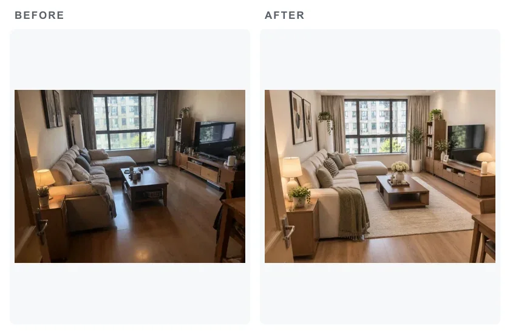
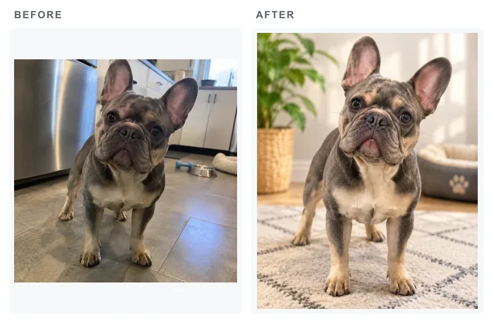
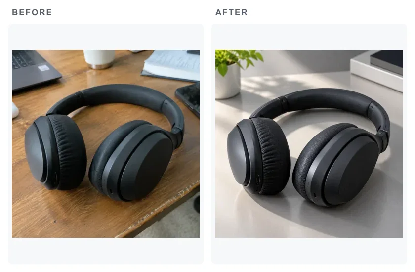
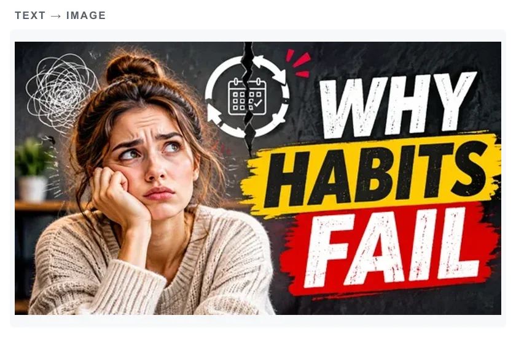
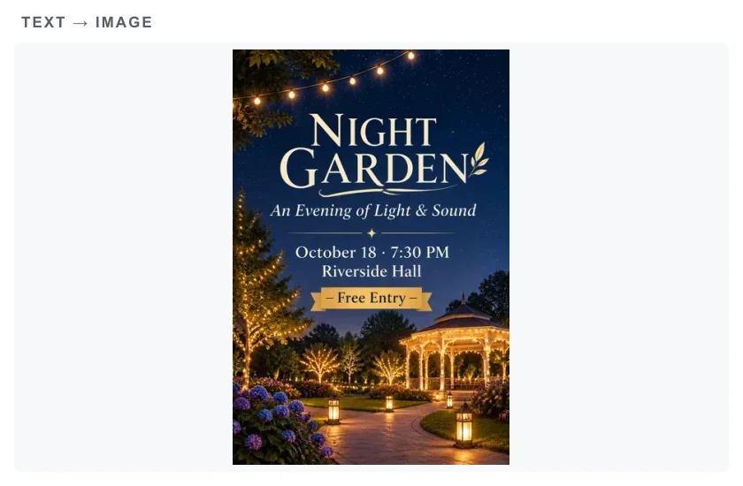

# Awesome Photo Skills

[中文](README.md) · [English](README.en.md) · [Português](README.pt.md) · [Español](README.es.md) · [Français](README.fr.md) · [Deutsch](README.de.md) · [عربي](README.ar.md) · [русский](README.ru.md) · [日本語](README.ja.md) · [हिंदी](README.hi.md)

**Créez des œuvres d'art originales à partir de texte ou transformez vos photos en portraits, en œuvres d'art pour animaux de compagnie, en images de produits et en espaces repensés.**

Explorez 246 exemples d'images et 100 modèles d'invites réutilisables : **50 fonctionnent avec du texte seul, aucune image de référence n'est nécessaire**.

[Parcourir 50 invites en texte uniquement →](./docs/fr/guides/text-only.md)

<table>
<tr><td width="33%" valign="top"> <strong>Transformez un animal de compagnie en portrait royal ou historique</strong> <a href="./docs/fr/cases/i028-turn-a-pet-into-a-royal-or-historical-portrait.md#public-prompt">Afficher l'invite</a> · <a href="https://dearsketch.com/fr/intent/i028-turn-a-pet-into-a-royal-or-historical-portrait.html?utm_source=github&amp;utm_medium=readme-en&amp;utm_campaign=dearsketch-public-cases&amp;utm_content=i028_cta">Créer en ligne</a></td><td width="33%" valign="top"> <strong>Transformez une photo de portrait en avatar de dessin animé</strong> <a href="./docs/fr/cases/i047-turn-a-portrait-photo-into-a-cartoon-avatar.md#public-prompt">Afficher l'invite</a> · <a href="https://dearsketch.com/fr/intent/i047-turn-a-portrait-photo-into-a-cartoon-avatar.html?utm_source=github&amp;utm_medium=readme-en&amp;utm_campaign=dearsketch-public-cases&amp;utm_content=i047_cta">Créer en ligne</a></td><td width="33%" valign="top"> <strong>Transformez une photo de produit ordinaire en une image de liste sur fond blanc</strong> <a href="./docs/fr/cases/i065-turn-an-ordinary-product-photo-into-a-white-background-listing-image.md#public-prompt">Afficher l'invite</a> · <a href="https://dearsketch.com/fr/intent/i065-turn-an-ordinary-product-photo-into-a-white-background-listing-image.html?utm_source=github&amp;utm_medium=readme-en&amp;utm_campaign=dearsketch-public-cases&amp;utm_content=i065_cta">Créer en ligne</a></td></tr>
<tr><td width="33%" valign="top"> <strong>Prévisualisez différents styles d’intérieur dans une photo de pièce</strong> <a href="./docs/fr/cases/i169-preview-different-interior-styles-in-a-room-photo.md#public-prompt">Afficher l'invite</a> · <a href="https://dearsketch.com/fr/intent/i169-preview-different-interior-styles-in-a-room-photo.html?utm_source=github&amp;utm_medium=readme-en&amp;utm_campaign=dearsketch-public-cases&amp;utm_content=i169_cta">Créer en ligne</a></td><td width="33%" valign="top"> <strong>Transformez une photo de maison en un souvenir d'aquarelle ou de dessin au trait</strong> <a href="./docs/fr/cases/i030-turn-a-house-photo-into-a-watercolor-or-line-art-keepsake.md#public-prompt">Afficher l'invite</a> · <a href="https://dearsketch.com/fr/intent/i030-turn-a-house-photo-into-a-watercolor-or-line-art-keepsake.html?utm_source=github&amp;utm_medium=readme-en&amp;utm_campaign=dearsketch-public-cases&amp;utm_content=i030_cta">Créer en ligne</a></td><td width="33%" valign="top"> <strong>Transformez des vêtements à plat en une image conforme au modèle</strong> <a href="./docs/fr/cases/i089-turn-flat-lay-clothing-into-an-on-model-image.md#public-prompt">Afficher l'invite</a> · <a href="https://dearsketch.com/fr/intent/i089-turn-flat-lay-clothing-into-an-on-model-image.html?utm_source=github&amp;utm_medium=readme-en&amp;utm_campaign=dearsketch-public-cases&amp;utm_content=i089_cta">Créer en ligne</a></td></tr>
<tr><td width="33%" valign="top"> <strong>Transformez la photo d'un couple en œuvre d'art d'anniversaire</strong> <a href="./docs/fr/cases/i022-turn-a-couple-s-photo-into-anniversary-artwork.md#public-prompt">Afficher l'invite</a> · <a href="https://dearsketch.com/fr/intent/i022-turn-a-couple-s-photo-into-anniversary-artwork.html?utm_source=github&amp;utm_medium=readme-en&amp;utm_campaign=dearsketch-public-cases&amp;utm_content=i022_cta">Créer en ligne</a></td><td width="33%" valign="top"> <strong>Transformez une personne en figurine articulée emballée</strong> <a href="./docs/fr/cases/i050-turn-a-person-into-a-packaged-action-figure.md#public-prompt">Afficher l'invite</a> · <a href="https://dearsketch.com/fr/intent/i050-turn-a-person-into-a-packaged-action-figure.html?utm_source=github&amp;utm_medium=readme-en&amp;utm_campaign=dearsketch-public-cases&amp;utm_content=i050_cta">Créer en ligne</a></td><td width="33%" valign="top"> <strong>Placez un produit dans une scène de style de vie réaliste</strong> <a href="./docs/fr/cases/i067-place-a-product-in-a-realistic-lifestyle-scene.md#public-prompt">Afficher l'invite</a> · <a href="https://dearsketch.com/fr/intent/i067-place-a-product-in-a-realistic-lifestyle-scene.html?utm_source=github&amp;utm_medium=readme-en&amp;utm_campaign=dearsketch-public-cases&amp;utm_content=i067_cta">Créer en ligne</a></td></tr>
</table>

**[Parcourir tous les exemples](https://dearsketch.com/fr/?utm_source=github&utm_medium=readme-en&utm_campaign=dearsketch-public-cases&utm_content=home_gallery#library) · [Créer avec mes propres photos →](https://dearsketch.com/fr/?utm_source=github&utm_medium=readme-en&utm_campaign=dearsketch-public-cases&utm_content=home_hero)**

Des documents de référence et des exemples de résultats illustrent les directions visuelles. Les modèles publics ont été récemment écrits et n'ont pas été testés par rapport à ces images.

## Parcourir par catégorie

[Animaux de compagnie et famille](#pets-family) · [Portraits et style](#people) · [Produits et commerce](#products) · [Maisons et espaces](#spaces) · [Affiches et conception](#design)

### Animaux et famille

<table>
<tr><td width="50%" valign="top"> <strong>Transformez un animal de compagnie en portrait royal ou historique</strong> <a href="./docs/fr/cases/i028-turn-a-pet-into-a-royal-or-historical-portrait.md#public-prompt">Afficher l'invite</a> · <a href="https://dearsketch.com/fr/intent/i028-turn-a-pet-into-a-royal-or-historical-portrait.html?utm_source=github&amp;utm_medium=readme-en&amp;utm_campaign=dearsketch-public-cases&amp;utm_content=i028_cta">Créer en ligne</a></td><td width="50%" valign="top"> <strong>Transformez une photo d'animal en portrait personnalisé</strong> <a href="./docs/fr/cases/i026-turn-a-pet-photo-into-a-custom-portrait.md#public-prompt">Afficher l'invite</a> · <a href="https://dearsketch.com/fr/intent/i026-turn-a-pet-photo-into-a-custom-portrait.html?utm_source=github&amp;utm_medium=readme-en&amp;utm_campaign=dearsketch-public-cases&amp;utm_content=i026_cta">Créer en ligne</a></td></tr>
<tr><td width="50%" valign="top"> <strong>Transformez la photo d'un couple en œuvre d'art d'anniversaire</strong> <a href="./docs/fr/cases/i022-turn-a-couple-s-photo-into-anniversary-artwork.md#public-prompt">Afficher l'invite</a> · <a href="https://dearsketch.com/fr/intent/i022-turn-a-couple-s-photo-into-anniversary-artwork.html?utm_source=github&amp;utm_medium=readme-en&amp;utm_campaign=dearsketch-public-cases&amp;utm_content=i022_cta">Créer en ligne</a></td><td width="50%" valign="top"> <strong>Combinez des photos de famille distinctes en un seul portrait de famille</strong> <a href="./docs/fr/cases/i017-combine-separate-family-photos-into-one-family-portrait.md#public-prompt">Afficher l'invite</a> · <a href="https://dearsketch.com/fr/intent/i017-combine-separate-family-photos-into-one-family-portrait.html?utm_source=github&amp;utm_medium=readme-en&amp;utm_campaign=dearsketch-public-cases&amp;utm_content=i017_cta">Créer en ligne</a></td></tr>
</table>

[Parcourir cette collection →](./docs/fr/guides/pets-family.md)

### Portraits et style

<table>
<tr><td width="50%" valign="top"> <strong>Créez un portrait LinkedIn professionnel à partir d'un selfie</strong> <a href="./docs/fr/cases/i001-create-a-professional-linkedin-headshot-from-a-selfie.md#public-prompt">Afficher l'invite</a> · <a href="https://dearsketch.com/fr/intent/i001-create-a-professional-linkedin-headshot-from-a-selfie.html?utm_source=github&amp;utm_medium=readme-en&amp;utm_campaign=dearsketch-public-cases&amp;utm_content=i001_cta">Créer en ligne</a></td><td width="50%" valign="top"> <strong>Transformez une photo de portrait en avatar de dessin animé</strong> <a href="./docs/fr/cases/i047-turn-a-portrait-photo-into-a-cartoon-avatar.md#public-prompt">Afficher l'invite</a> · <a href="https://dearsketch.com/fr/intent/i047-turn-a-portrait-photo-into-a-cartoon-avatar.html?utm_source=github&amp;utm_medium=readme-en&amp;utm_campaign=dearsketch-public-cases&amp;utm_content=i047_cta">Créer en ligne</a></td></tr>
<tr><td width="50%" valign="top"> <strong>Remplacez les vêtements décontractés par une tenue professionnelle</strong> <a href="./docs/fr/cases/i015-replace-casual-clothing-with-professional-attire.md#public-prompt">Afficher l'invite</a> · <a href="https://dearsketch.com/fr/intent/i015-replace-casual-clothing-with-professional-attire.html?utm_source=github&amp;utm_medium=readme-en&amp;utm_campaign=dearsketch-public-cases&amp;utm_content=i015_cta">Créer en ligne</a></td><td width="50%" valign="top"> <strong>Transformez une personne en figurine articulée emballée</strong> <a href="./docs/fr/cases/i050-turn-a-person-into-a-packaged-action-figure.md#public-prompt">Afficher l'invite</a> · <a href="https://dearsketch.com/fr/intent/i050-turn-a-person-into-a-packaged-action-figure.html?utm_source=github&amp;utm_medium=readme-en&amp;utm_campaign=dearsketch-public-cases&amp;utm_content=i050_cta">Créer en ligne</a></td></tr>
</table>

[Parcourir cette collection →](./docs/fr/guides/people.md)

### Produits et commerce

<table>
<tr><td width="50%" valign="top"> <strong>Transformez une photo de produit ordinaire en une image de liste sur fond blanc</strong> <a href="./docs/fr/cases/i065-turn-an-ordinary-product-photo-into-a-white-background-listing-image.md#public-prompt">Afficher l'invite</a> · <a href="https://dearsketch.com/fr/intent/i065-turn-an-ordinary-product-photo-into-a-white-background-listing-image.html?utm_source=github&amp;utm_medium=readme-en&amp;utm_campaign=dearsketch-public-cases&amp;utm_content=i065_cta">Créer en ligne</a></td><td width="50%" valign="top"> <strong>Placez un produit dans une scène de style de vie réaliste</strong> <a href="./docs/fr/cases/i067-place-a-product-in-a-realistic-lifestyle-scene.md#public-prompt">Afficher l'invite</a> · <a href="https://dearsketch.com/fr/intent/i067-place-a-product-in-a-realistic-lifestyle-scene.html?utm_source=github&amp;utm_medium=readme-en&amp;utm_campaign=dearsketch-public-cases&amp;utm_content=i067_cta">Créer en ligne</a></td></tr>
<tr><td width="50%" valign="top"> <strong>Transformez des vêtements à plat en une image conforme au modèle</strong> <a href="./docs/fr/cases/i089-turn-flat-lay-clothing-into-an-on-model-image.md#public-prompt">Afficher l'invite</a> · <a href="https://dearsketch.com/fr/intent/i089-turn-flat-lay-clothing-into-an-on-model-image.html?utm_source=github&amp;utm_medium=readme-en&amp;utm_campaign=dearsketch-public-cases&amp;utm_content=i089_cta">Créer en ligne</a></td><td width="50%" valign="top"> <strong>Transformez une photo ordinaire en une photo de produit professionnelle en studio</strong> <a href="./docs/fr/cases/i068-turn-an-ordinary-photo-into-a-professional-studio-product-shot.md#public-prompt">Afficher l'invite</a> · <a href="https://dearsketch.com/fr/intent/i068-turn-an-ordinary-photo-into-a-professional-studio-product-shot.html?utm_source=github&amp;utm_medium=readme-en&amp;utm_campaign=dearsketch-public-cases&amp;utm_content=i068_cta">Créer en ligne</a></td></tr>
</table>

[Parcourir cette collection →](./docs/fr/guides/products.md)

### Maisons et espaces

<table>
<tr><td width="50%" valign="top"> <strong>Prévisualisez différents styles d’intérieur dans une photo de pièce</strong> <a href="./docs/fr/cases/i169-preview-different-interior-styles-in-a-room-photo.md#public-prompt">Afficher l'invite</a> · <a href="https://dearsketch.com/fr/intent/i169-preview-different-interior-styles-in-a-room-photo.html?utm_source=github&amp;utm_medium=readme-en&amp;utm_campaign=dearsketch-public-cases&amp;utm_content=i169_cta">Créer en ligne</a></td><td width="50%" valign="top"> <strong>Transformez une photo de maison en un souvenir d'aquarelle ou de dessin au trait</strong> <a href="./docs/fr/cases/i030-turn-a-house-photo-into-a-watercolor-or-line-art-keepsake.md#public-prompt">Afficher l'invite</a> · <a href="https://dearsketch.com/fr/intent/i030-turn-a-house-photo-into-a-watercolor-or-line-art-keepsake.html?utm_source=github&amp;utm_medium=readme-en&amp;utm_campaign=dearsketch-public-cases&amp;utm_content=i030_cta">Créer en ligne</a></td></tr>
<tr><td width="50%" valign="top"> <strong>Mettez virtuellement en scène une propriété vide avec des meubles et une décoration</strong> <a href="./docs/fr/cases/i175-virtually-stage-an-empty-property-with-furniture-and-decor.md#public-prompt">Afficher l'invite</a> · <a href="https://dearsketch.com/fr/intent/i175-virtually-stage-an-empty-property-with-furniture-and-decor.html?utm_source=github&amp;utm_medium=readme-en&amp;utm_campaign=dearsketch-public-cases&amp;utm_content=i175_cta">Créer en ligne</a></td><td width="50%" valign="top"> <strong>Créez un concept de relooking de paysage à partir d'une photo de jardin</strong> <a href="./docs/fr/cases/i178-create-a-landscape-makeover-concept-from-a-yard-photo.md#public-prompt">Afficher l'invite</a> · <a href="https://dearsketch.com/fr/intent/i178-create-a-landscape-makeover-concept-from-a-yard-photo.html?utm_source=github&amp;utm_medium=readme-en&amp;utm_campaign=dearsketch-public-cases&amp;utm_content=i178_cta">Créer en ligne</a></td></tr>
</table>

[Parcourir cette collection →](./docs/fr/guides/spaces.md)

### Affiches et conception

<table>
<tr><td width="50%" valign="top"> <strong>Créer une miniature de vidéo YouTube</strong> <a href="./docs/fr/cases/i106-create-a-youtube-video-thumbnail.md#public-prompt">Afficher l'invite</a> · <a href="https://dearsketch.com/fr/intent/i106-create-a-youtube-video-thumbnail.html?utm_source=github&amp;utm_medium=readme-en&amp;utm_campaign=dearsketch-public-cases&amp;utm_content=i106_cta">Créer en ligne</a></td><td width="50%" valign="top"> <strong>Créer une affiche promotionnelle à partir d'un sujet et copier</strong> <a href="./docs/fr/cases/i107-create-a-promotional-poster-from-a-topic-and-copy.md#public-prompt">Afficher l'invite</a> · <a href="https://dearsketch.com/fr/intent/i107-create-a-promotional-poster-from-a-topic-and-copy.html?utm_source=github&amp;utm_medium=readme-en&amp;utm_campaign=dearsketch-public-cases&amp;utm_content=i107_cta">Créer en ligne</a></td></tr>
<tr><td width="50%" valign="top"> <strong>Créer un en-tête de newsletter ou une couverture d'article</strong> <a href="./docs/fr/cases/i119-create-a-newsletter-header-or-article-cover.md#public-prompt">Afficher l'invite</a> · <a href="https://dearsketch.com/fr/intent/i119-create-a-newsletter-header-or-article-cover.html?utm_source=github&amp;utm_medium=readme-en&amp;utm_campaign=dearsketch-public-cases&amp;utm_content=i119_cta">Créer en ligne</a></td><td width="50%" valign="top"> <strong>Créer des concepts de logo à partir d'une description de marque</strong> <a href="./docs/fr/cases/i126-create-logo-concepts-from-a-brand-description.md#public-prompt">Afficher l'invite</a> · <a href="https://dearsketch.com/fr/intent/i126-create-logo-concepts-from-a-brand-description.html?utm_source=github&amp;utm_medium=readme-en&amp;utm_campaign=dearsketch-public-cases&amp;utm_content=i126_cta">Créer en ligne</a></td></tr>
</table>

[Parcourir cette collection →](./docs/fr/guides/design.md)

## Créez votre première image

1. **Choisissez un effet.** Ouvrez un dossier et vérifiez les entrées requises.
2. **Choisissez votre outil.** Copiez son invite dans votre outil d'image ou ouvrez la tâche correspondante sur dearsketch.
3. **Utilisez votre propre matériel.** Pour les mémoires contenant uniquement du texte, remplissez les détails écrits ; pour les tâches photo, joignez les images requises. Modifiez l'invite et générez une image.

[ATous les public prompts](./docs/fr/prompts.md) · [Démarrage rapide détaillé](./docs/fr/quickstart.md)

## Utiliser avec un agent IA

La compétence facultative photo-editing aide un agent à choisir une tâche et à préparer les entrées et les instructions.

[Installation et utilisation](./docs/fr/quickstart.md#agent-skill) · [SKILL.md](./skills/photo-editing/SKILL.md)

## Contribuer et en savoir plus

[Contribuer un exemple](./CONTRIBUTING.en.md) · [Mises à jour](./CHANGELOG.en.md) · [Notes d'entrée et d'image](./docs/fr/content-policy.md) · [Données structurées ](./data/cases.json)

Certaines tâches nécessitent plusieurs images de référence ; certains commencent par du texte. Les exemples ne garantissent pas un résultat identique. Examinez le fichier réel pour vérifier l’exactitude du texte, la transparence et les exigences de production. Les autorisations de réutilisation des images sont décrites dans la politique de contenu. Les fonctionnalités et les prix du site Web suivent le site Web.
