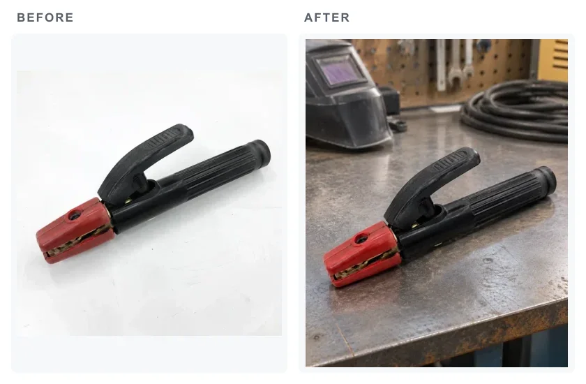
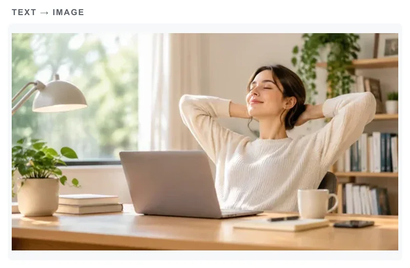

# Awesome Photo Skills

[中文](README.md) · [English](README.en.md) · [Português](README.pt.md) · [Español](README.es.md) · [Français](README.fr.md) · [Deutsch](README.de.md) · [عربي](README.ar.md) · [русский](README.ru.md) · [日本語](README.ja.md) · [हिंदी](README.hi.md)

**पाठ से मूल कला बनाएं, या अपनी तस्वीरों को पोर्ट्रेट, पालतू कला, उत्पाद छवियों और पुन: डिज़ाइन किए गए स्थानों में बदलें।**

246 छवि उदाहरण और 100 पुन: प्रयोज्य शीघ्र टेम्पलेट्स का अन्वेषण करें - **50 केवल पाठ के साथ काम करते हैं, किसी संदर्भ छवि की आवश्यकता नहीं है**।

[केवल-पाठ 50 संकेत ब्राउज़ करें →](./docs/hi/guides/text-only.md)

<table>
<tr><td width="33%" valign="top"> <strong>किसी पालतू जानवर को शाही या ऐतिहासिक चित्र में बदलें</strong> <a href="./docs/hi/cases/i028-turn-a-pet-into-a-royal-or-historical-portrait.md#public-prompt">शीघ्र देखें</a> · <a href="https://dearsketch.com/hi/intent/i028-turn-a-pet-into-a-royal-or-historical-portrait.html?utm_source=github&amp;utm_medium=readme-en&amp;utm_campaign=dearsketch-public-cases&amp;utm_content=i028_cta">ऑनलाइन बनाएं</a></td><td width="33%" valign="top"> <strong>एक पोर्ट्रेट फ़ोटो को कार्टून अवतार में बदलें</strong> <a href="./docs/hi/cases/i047-turn-a-portrait-photo-into-a-cartoon-avatar.md#public-prompt">शीघ्र देखें</a> · <a href="https://dearsketch.com/hi/intent/i047-turn-a-portrait-photo-into-a-cartoon-avatar.html?utm_source=github&amp;utm_medium=readme-en&amp;utm_campaign=dearsketch-public-cases&amp;utm_content=i047_cta">ऑनलाइन बनाएं</a></td><td width="33%" valign="top"> <strong>एक साधारण उत्पाद फ़ोटो को सफ़ेद-पृष्ठभूमि सूची छवि में बदलें</strong> <a href="./docs/hi/cases/i065-turn-an-ordinary-product-photo-into-a-white-background-listing-image.md#public-prompt">शीघ्र देखें</a> · <a href="https://dearsketch.com/hi/intent/i065-turn-an-ordinary-product-photo-into-a-white-background-listing-image.html?utm_source=github&amp;utm_medium=readme-en&amp;utm_campaign=dearsketch-public-cases&amp;utm_content=i065_cta">ऑनलाइन बनाएं</a></td></tr>
<tr><td width="33%" valign="top"> <strong>एक कमरे की तस्वीर में विभिन्न आंतरिक शैलियों का पूर्वावलोकन करें</strong> <a href="./docs/hi/cases/i169-preview-different-interior-styles-in-a-room-photo.md#public-prompt">शीघ्र देखें</a> · <a href="https://dearsketch.com/hi/intent/i169-preview-different-interior-styles-in-a-room-photo.html?utm_source=github&amp;utm_medium=readme-en&amp;utm_campaign=dearsketch-public-cases&amp;utm_content=i169_cta">ऑनलाइन बनाएं</a></td><td width="33%" valign="top"> <strong>घर की तस्वीर को वॉटरकलर या लाइन-आर्ट स्मृतिचिह्न में बदलें</strong> <a href="./docs/hi/cases/i030-turn-a-house-photo-into-a-watercolor-or-line-art-keepsake.md#public-prompt">शीघ्र देखें</a> · <a href="https://dearsketch.com/hi/intent/i030-turn-a-house-photo-into-a-watercolor-or-line-art-keepsake.html?utm_source=github&amp;utm_medium=readme-en&amp;utm_campaign=dearsketch-public-cases&amp;utm_content=i030_cta">ऑनलाइन बनाएं</a></td><td width="33%" valign="top"> <strong>फ़्लैट-ले कपड़ों को ऑन-मॉडल छवि में बदलें</strong> <a href="./docs/hi/cases/i089-turn-flat-lay-clothing-into-an-on-model-image.md#public-prompt">शीघ्र देखें</a> · <a href="https://dearsketch.com/hi/intent/i089-turn-flat-lay-clothing-into-an-on-model-image.html?utm_source=github&amp;utm_medium=readme-en&amp;utm_campaign=dearsketch-public-cases&amp;utm_content=i089_cta">ऑनलाइन बनाएं</a></td></tr>
<tr><td width="33%" valign="top"> <strong>किसी जोड़े की तस्वीर को सालगिरह की कलाकृति में बदलें</strong> <a href="./docs/hi/cases/i022-turn-a-couple-s-photo-into-anniversary-artwork.md#public-prompt">शीघ्र देखें</a> · <a href="https://dearsketch.com/hi/intent/i022-turn-a-couple-s-photo-into-anniversary-artwork.html?utm_source=github&amp;utm_medium=readme-en&amp;utm_campaign=dearsketch-public-cases&amp;utm_content=i022_cta">ऑनलाइन बनाएं</a></td><td width="33%" valign="top"> <strong>किसी व्यक्ति को पैकेज्ड एक्शन फिगर में बदलें</strong> <a href="./docs/hi/cases/i050-turn-a-person-into-a-packaged-action-figure.md#public-prompt">शीघ्र देखें</a> · <a href="https://dearsketch.com/hi/intent/i050-turn-a-person-into-a-packaged-action-figure.html?utm_source=github&amp;utm_medium=readme-en&amp;utm_campaign=dearsketch-public-cases&amp;utm_content=i050_cta">ऑनलाइन बनाएं</a></td><td width="33%" valign="top"> <strong>किसी उत्पाद को यथार्थवादी जीवनशैली दृश्य में रखें</strong> <a href="./docs/hi/cases/i067-place-a-product-in-a-realistic-lifestyle-scene.md#public-prompt">शीघ्र देखें</a> · <a href="https://dearsketch.com/hi/intent/i067-place-a-product-in-a-realistic-lifestyle-scene.html?utm_source=github&amp;utm_medium=readme-en&amp;utm_campaign=dearsketch-public-cases&amp;utm_content=i067_cta">ऑनलाइन बनाएं</a></td></tr>
</table>

**[सभी उदाहरण ब्राउज़ करें](https://dearsketch.com/hi/?utm_source=github&utm_medium=readme-en&utm_campaign=dearsketch-public-cases&utm_content=home_gallery#library) · [मेरी अपनी तस्वीरों के साथ बनाएं →](https://dearsketch.com/hi/?utm_source=github&utm_medium=readme-en&utm_campaign=dearsketch-public-cases&utm_content=home_hero)**

संदर्भ सामग्री और परिणाम उदाहरण दृश्य दिशाओं को दर्शाते हैं। सार्वजनिक टेम्प्लेट नए लिखे गए हैं और इन छवियों के विरुद्ध पीढ़ी-दर-पीढ़ी परीक्षण नहीं किया गया है।

## श्रेणी के अनुसार ब्राउज़ करें

[पालतू जानवर और परिवार](#pets-family) · [चित्र और शैली](#people) · [उत्पाद और वाणिज्य](#products) · [घर और स्थान](#spaces) · [पोस्टर और डिज़ाइन](#design)

### पालतू जानवर और परिवार

<table>
<tr><td width="50%" valign="top"> <strong>किसी पालतू जानवर को शाही या ऐतिहासिक चित्र में बदलें</strong> <a href="./docs/hi/cases/i028-turn-a-pet-into-a-royal-or-historical-portrait.md#public-prompt">शीघ्र देखें</a> · <a href="https://dearsketch.com/hi/intent/i028-turn-a-pet-into-a-royal-or-historical-portrait.html?utm_source=github&amp;utm_medium=readme-en&amp;utm_campaign=dearsketch-public-cases&amp;utm_content=i028_cta">ऑनलाइन बनाएं</a></td><td width="50%" valign="top"> <strong>किसी पालतू जानवर की तस्वीर को कस्टम पोर्ट्रेट में बदलें</strong> <a href="./docs/hi/cases/i026-turn-a-pet-photo-into-a-custom-portrait.md#public-prompt">शीघ्र देखें</a> · <a href="https://dearsketch.com/hi/intent/i026-turn-a-pet-photo-into-a-custom-portrait.html?utm_source=github&amp;utm_medium=readme-en&amp;utm_campaign=dearsketch-public-cases&amp;utm_content=i026_cta">ऑनलाइन बनाएं</a></td></tr>
<tr><td width="50%" valign="top"> <strong>किसी जोड़े की तस्वीर को सालगिरह की कलाकृति में बदलें</strong> <a href="./docs/hi/cases/i022-turn-a-couple-s-photo-into-anniversary-artwork.md#public-prompt">शीघ्र देखें</a> · <a href="https://dearsketch.com/hi/intent/i022-turn-a-couple-s-photo-into-anniversary-artwork.html?utm_source=github&amp;utm_medium=readme-en&amp;utm_campaign=dearsketch-public-cases&amp;utm_content=i022_cta">ऑनलाइन बनाएं</a></td><td width="50%" valign="top"> <strong>अलग-अलग पारिवारिक फ़ोटो को एक पारिवारिक चित्र में संयोजित करें</strong> <a href="./docs/hi/cases/i017-combine-separate-family-photos-into-one-family-portrait.md#public-prompt">शीघ्र देखें</a> · <a href="https://dearsketch.com/hi/intent/i017-combine-separate-family-photos-into-one-family-portrait.html?utm_source=github&amp;utm_medium=readme-en&amp;utm_campaign=dearsketch-public-cases&amp;utm_content=i017_cta">ऑनलाइन बनाएं</a></td></tr>
</table>

[इस संग्रह को ब्राउज़ करें →](./docs/hi/guides/pets-family.md)

### चित्र और शैली

<table>
<tr><td width="50%" valign="top"> <strong>एक सेल्फी से एक पेशेवर लिंक्डइन हेडशॉट बनाएं</strong> <a href="./docs/hi/cases/i001-create-a-professional-linkedin-headshot-from-a-selfie.md#public-prompt">शीघ्र देखें</a> · <a href="https://dearsketch.com/hi/intent/i001-create-a-professional-linkedin-headshot-from-a-selfie.html?utm_source=github&amp;utm_medium=readme-en&amp;utm_campaign=dearsketch-public-cases&amp;utm_content=i001_cta">ऑनलाइन बनाएं</a></td><td width="50%" valign="top"> <strong>एक पोर्ट्रेट फ़ोटो को कार्टून अवतार में बदलें</strong> <a href="./docs/hi/cases/i047-turn-a-portrait-photo-into-a-cartoon-avatar.md#public-prompt">शीघ्र देखें</a> · <a href="https://dearsketch.com/hi/intent/i047-turn-a-portrait-photo-into-a-cartoon-avatar.html?utm_source=github&amp;utm_medium=readme-en&amp;utm_campaign=dearsketch-public-cases&amp;utm_content=i047_cta">ऑनलाइन बनाएं</a></td></tr>
<tr><td width="50%" valign="top"> <strong>कैज़ुअल कपड़ों को पेशेवर पोशाक से बदलें</strong> <a href="./docs/hi/cases/i015-replace-casual-clothing-with-professional-attire.md#public-prompt">शीघ्र देखें</a> · <a href="https://dearsketch.com/hi/intent/i015-replace-casual-clothing-with-professional-attire.html?utm_source=github&amp;utm_medium=readme-en&amp;utm_campaign=dearsketch-public-cases&amp;utm_content=i015_cta">ऑनलाइन बनाएं</a></td><td width="50%" valign="top"> <strong>किसी व्यक्ति को पैकेज्ड एक्शन फिगर में बदलें</strong> <a href="./docs/hi/cases/i050-turn-a-person-into-a-packaged-action-figure.md#public-prompt">शीघ्र देखें</a> · <a href="https://dearsketch.com/hi/intent/i050-turn-a-person-into-a-packaged-action-figure.html?utm_source=github&amp;utm_medium=readme-en&amp;utm_campaign=dearsketch-public-cases&amp;utm_content=i050_cta">ऑनलाइन बनाएं</a></td></tr>
</table>

[इस संग्रह को ब्राउज़ करें →](./docs/hi/guides/people.md)

### उत्पाद एवं वाणिज्य

<table>
<tr><td width="50%" valign="top"> <strong>एक साधारण उत्पाद फ़ोटो को सफ़ेद-पृष्ठभूमि सूची छवि में बदलें</strong> <a href="./docs/hi/cases/i065-turn-an-ordinary-product-photo-into-a-white-background-listing-image.md#public-prompt">शीघ्र देखें</a> · <a href="https://dearsketch.com/hi/intent/i065-turn-an-ordinary-product-photo-into-a-white-background-listing-image.html?utm_source=github&amp;utm_medium=readme-en&amp;utm_campaign=dearsketch-public-cases&amp;utm_content=i065_cta">ऑनलाइन बनाएं</a></td><td width="50%" valign="top"> <strong>किसी उत्पाद को यथार्थवादी जीवनशैली दृश्य में रखें</strong> <a href="./docs/hi/cases/i067-place-a-product-in-a-realistic-lifestyle-scene.md#public-prompt">शीघ्र देखें</a> · <a href="https://dearsketch.com/hi/intent/i067-place-a-product-in-a-realistic-lifestyle-scene.html?utm_source=github&amp;utm_medium=readme-en&amp;utm_campaign=dearsketch-public-cases&amp;utm_content=i067_cta">ऑनलाइन बनाएं</a></td></tr>
<tr><td width="50%" valign="top"> <strong>फ़्लैट-ले कपड़ों को ऑन-मॉडल छवि में बदलें</strong> <a href="./docs/hi/cases/i089-turn-flat-lay-clothing-into-an-on-model-image.md#public-prompt">शीघ्र देखें</a> · <a href="https://dearsketch.com/hi/intent/i089-turn-flat-lay-clothing-into-an-on-model-image.html?utm_source=github&amp;utm_medium=readme-en&amp;utm_campaign=dearsketch-public-cases&amp;utm_content=i089_cta">ऑनलाइन बनाएं</a></td><td width="50%" valign="top"> <strong>एक साधारण फोटो को पेशेवर स्टूडियो उत्पाद शॉट में बदलें</strong> <a href="./docs/hi/cases/i068-turn-an-ordinary-photo-into-a-professional-studio-product-shot.md#public-prompt">शीघ्र देखें</a> · <a href="https://dearsketch.com/hi/intent/i068-turn-an-ordinary-photo-into-a-professional-studio-product-shot.html?utm_source=github&amp;utm_medium=readme-en&amp;utm_campaign=dearsketch-public-cases&amp;utm_content=i068_cta">ऑनलाइन बनाएं</a></td></tr>
</table>

[इस संग्रह को ब्राउज़ करें →](./docs/hi/guides/products.md)

### घर और स्थान

<table>
<tr><td width="50%" valign="top"> <strong>एक कमरे की तस्वीर में विभिन्न आंतरिक शैलियों का पूर्वावलोकन करें</strong> <a href="./docs/hi/cases/i169-preview-different-interior-styles-in-a-room-photo.md#public-prompt">शीघ्र देखें</a> · <a href="https://dearsketch.com/hi/intent/i169-preview-different-interior-styles-in-a-room-photo.html?utm_source=github&amp;utm_medium=readme-en&amp;utm_campaign=dearsketch-public-cases&amp;utm_content=i169_cta">ऑनलाइन बनाएं</a></td><td width="50%" valign="top"> <strong>घर की तस्वीर को वॉटरकलर या लाइन-आर्ट स्मृतिचिह्न में बदलें</strong> <a href="./docs/hi/cases/i030-turn-a-house-photo-into-a-watercolor-or-line-art-keepsake.md#public-prompt">शीघ्र देखें</a> · <a href="https://dearsketch.com/hi/intent/i030-turn-a-house-photo-into-a-watercolor-or-line-art-keepsake.html?utm_source=github&amp;utm_medium=readme-en&amp;utm_campaign=dearsketch-public-cases&amp;utm_content=i030_cta">ऑनलाइन बनाएं</a></td></tr>
<tr><td width="50%" valign="top"> <strong>वस्तुतः फर्नीचर और सजावट के साथ एक खाली संपत्ति का मंचन करें</strong> <a href="./docs/hi/cases/i175-virtually-stage-an-empty-property-with-furniture-and-decor.md#public-prompt">शीघ्र देखें</a> · <a href="https://dearsketch.com/hi/intent/i175-virtually-stage-an-empty-property-with-furniture-and-decor.html?utm_source=github&amp;utm_medium=readme-en&amp;utm_campaign=dearsketch-public-cases&amp;utm_content=i175_cta">ऑनलाइन बनाएं</a></td><td width="50%" valign="top"> <strong>एक यार्ड फोटो से लैंडस्केप मेकओवर अवधारणा बनाएं</strong> <a href="./docs/hi/cases/i178-create-a-landscape-makeover-concept-from-a-yard-photo.md#public-prompt">शीघ्र देखें</a> · <a href="https://dearsketch.com/hi/intent/i178-create-a-landscape-makeover-concept-from-a-yard-photo.html?utm_source=github&amp;utm_medium=readme-en&amp;utm_campaign=dearsketch-public-cases&amp;utm_content=i178_cta">ऑनलाइन बनाएं</a></td></tr>
</table>

[इस संग्रह को ब्राउज़ करें →](./docs/hi/guides/spaces.md)

### पोस्टर और डिज़ाइन

<table>
<tr><td width="50%" valign="top"> <strong>एक YouTube वीडियो थंबनेल बनाएं</strong> <a href="./docs/hi/cases/i106-create-a-youtube-video-thumbnail.md#public-prompt">शीघ्र देखें</a> · <a href="https://dearsketch.com/hi/intent/i106-create-a-youtube-video-thumbnail.html?utm_source=github&amp;utm_medium=readme-en&amp;utm_campaign=dearsketch-public-cases&amp;utm_content=i106_cta">ऑनलाइन बनाएं</a></td><td width="50%" valign="top"> <strong>किसी विषय से एक प्रचार पोस्टर बनाएं और कॉपी करें</strong> <a href="./docs/hi/cases/i107-create-a-promotional-poster-from-a-topic-and-copy.md#public-prompt">शीघ्र देखें</a> · <a href="https://dearsketch.com/hi/intent/i107-create-a-promotional-poster-from-a-topic-and-copy.html?utm_source=github&amp;utm_medium=readme-en&amp;utm_campaign=dearsketch-public-cases&amp;utm_content=i107_cta">ऑनलाइन बनाएं</a></td></tr>
<tr><td width="50%" valign="top"> <strong>एक न्यूज़लेटर हेडर या आर्टिकल कवर बनाएं</strong> <a href="./docs/hi/cases/i119-create-a-newsletter-header-or-article-cover.md#public-prompt">शीघ्र देखें</a> · <a href="https://dearsketch.com/hi/intent/i119-create-a-newsletter-header-or-article-cover.html?utm_source=github&amp;utm_medium=readme-en&amp;utm_campaign=dearsketch-public-cases&amp;utm_content=i119_cta">ऑनलाइन बनाएं</a></td><td width="50%" valign="top"> <strong>ब्रांड विवरण से लोगो अवधारणाएँ बनाएँ</strong> <a href="./docs/hi/cases/i126-create-logo-concepts-from-a-brand-description.md#public-prompt">शीघ्र देखें</a> · <a href="https://dearsketch.com/hi/intent/i126-create-logo-concepts-from-a-brand-description.html?utm_source=github&amp;utm_medium=readme-en&amp;utm_campaign=dearsketch-public-cases&amp;utm_content=i126_cta">ऑनलाइन बनाएं</a></td></tr>
</table>

[इस संग्रह को ब्राउज़ करें →](./docs/hi/guides/design.md)

## अपनी पहली छवि बनाएं

1. **एक प्रभाव चुनें।** एक केस खोलें और उसके आवश्यक इनपुट की जांच करें।
2. **अपना टूल चुनें।** इसके प्रॉम्प्ट को अपने इमेज टूल में कॉपी करें, या dearsketch पर मिलान कार्य खोलें।
3. **अपनी स्वयं की सामग्री का उपयोग करें।** केवल पाठ्य संक्षेप के लिए, लिखित विवरण भरें; फोटो कार्यों के लिए, आवश्यक चित्र संलग्न करें। प्रॉम्प्ट संपादित करें और एक छवि बनाएं।

[सभी public prompts](./docs/hi/prompts.md) · [विस्तृत त्वरित शुरुआत](./docs/hi/quickstart.md)

## एआई एजेंट के साथ प्रयोग करें

वैकल्पिक photo-editing कौशल एक एजेंट को कार्य चुनने और इनपुट और निर्देश तैयार करने में मदद करता है।

[स्थापना एवं उपयोग](./docs/hi/quickstart.md#agent-skill) · [SKILL.md](./skills/photo-editing/SKILL.md)

## योगदान करें और अधिक जानें

[एक उदाहरण योगदान करें](./CONTRIBUTING.en.md) · [अपडेट](./CHANGELOG.en.md) · [इनपुट और छवि नोट्स](./docs/hi/content-policy.md) · [संरचित डेटा ](./data/cases.json)

कुछ कार्यों के लिए कई संदर्भ छवियों की आवश्यकता होती है; कुछ पाठ से शुरू होते हैं। उदाहरण समान परिणाम की गारंटी नहीं देते. पाठ सटीकता, पारदर्शिता और उत्पादन आवश्यकताओं के लिए वास्तविक फ़ाइल की समीक्षा करें। छवि के पुन: उपयोग की अनुमतियाँ सामग्री नीति में वर्णित हैं। वेबसाइट की विशेषताएं और कीमतें वेबसाइट का अनुसरण करती हैं।
