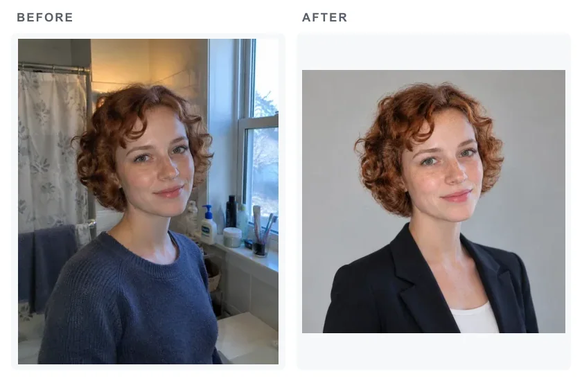

# Awesome Photo Skills

**把自己的照片，变成职业头像、宠物艺术、商品大片和空间改造方案。**

246 个图片示例 · 50 个公开提示词模板

**中文** · [English](README.en.md) · [Português](README.pt.md) · [Español](README.es.md) · [Français](README.fr.md) · [Deutsch](README.de.md) · [عربي](README.ar.md) · [русский](README.ru.md) · [日本語](README.ja.md) · [हिंदी](README.hi.md)

<table>
<tr><td width="33%" valign="top"> <strong>宠物皇家肖像</strong> <a href="docs/cases/i028-turn-a-pet-into-a-royal-or-historical-portrait.md#public-prompt">查看提示词</a> · <a href="https://dearsketch.com/intent/i028-turn-a-pet-into-a-royal-or-historical-portrait.html?utm_source=github&amp;utm_medium=readme&amp;utm_campaign=dearsketch-public-cases&amp;utm_content=i028_cta">用我的照片制作</a></td><td width="33%" valign="top"> <strong>照片转卡通头像</strong> <a href="docs/cases/i047-turn-a-portrait-photo-into-a-cartoon-avatar.md#public-prompt">查看提示词</a> · <a href="https://dearsketch.com/intent/i047-turn-a-portrait-photo-into-a-cartoon-avatar.html?utm_source=github&amp;utm_medium=readme&amp;utm_campaign=dearsketch-public-cases&amp;utm_content=i047_cta">用我的照片制作</a></td><td width="33%" valign="top"> <strong>商品白底主图</strong> <a href="docs/cases/i065-turn-an-ordinary-product-photo-into-a-white-background-listing-image.md#public-prompt">查看提示词</a> · <a href="https://dearsketch.com/intent/i065-turn-an-ordinary-product-photo-into-a-white-background-listing-image.html?utm_source=github&amp;utm_medium=readme&amp;utm_campaign=dearsketch-public-cases&amp;utm_content=i065_cta">用我的照片制作</a></td></tr>
<tr><td width="33%" valign="top"> <strong>房间装修风格预览</strong> <a href="docs/cases/i169-preview-different-interior-styles-in-a-room-photo.md#public-prompt">查看提示词</a> · <a href="https://dearsketch.com/intent/i169-preview-different-interior-styles-in-a-room-photo.html?utm_source=github&amp;utm_medium=readme&amp;utm_campaign=dearsketch-public-cases&amp;utm_content=i169_cta">用我的照片制作</a></td><td width="33%" valign="top"> <strong>住宅水彩纪念画</strong> <a href="docs/cases/i030-turn-a-house-photo-into-a-watercolor-or-line-art-keepsake.md#public-prompt">查看提示词</a> · <a href="https://dearsketch.com/intent/i030-turn-a-house-photo-into-a-watercolor-or-line-art-keepsake.html?utm_source=github&amp;utm_medium=readme&amp;utm_campaign=dearsketch-public-cases&amp;utm_content=i030_cta">用我的照片制作</a></td><td width="33%" valign="top"> <strong>服装平铺图转模特上身图</strong> <a href="docs/cases/i089-turn-flat-lay-clothing-into-an-on-model-image.md#public-prompt">查看提示词</a> · <a href="https://dearsketch.com/intent/i089-turn-flat-lay-clothing-into-an-on-model-image.html?utm_source=github&amp;utm_medium=readme&amp;utm_campaign=dearsketch-public-cases&amp;utm_content=i089_cta">用我的照片制作</a></td></tr>
<tr><td width="33%" valign="top"> <strong>情侣周年纪念艺术画</strong> <a href="docs/cases/i022-turn-a-couple-s-photo-into-anniversary-artwork.md#public-prompt">查看提示词</a> · <a href="https://dearsketch.com/intent/i022-turn-a-couple-s-photo-into-anniversary-artwork.html?utm_source=github&amp;utm_medium=readme&amp;utm_campaign=dearsketch-public-cases&amp;utm_content=i022_cta">用我的照片制作</a></td><td width="33%" valign="top"> <strong>包装行动人偶</strong> <a href="docs/cases/i050-turn-a-person-into-a-packaged-action-figure.md#public-prompt">查看提示词</a> · <a href="https://dearsketch.com/intent/i050-turn-a-person-into-a-packaged-action-figure.html?utm_source=github&amp;utm_medium=readme&amp;utm_campaign=dearsketch-public-cases&amp;utm_content=i050_cta">用我的照片制作</a></td><td width="33%" valign="top"> <strong>商品生活方式场景</strong> <a href="docs/cases/i067-place-a-product-in-a-realistic-lifestyle-scene.md#public-prompt">查看提示词</a> · <a href="https://dearsketch.com/intent/i067-place-a-product-in-a-realistic-lifestyle-scene.html?utm_source=github&amp;utm_medium=readme&amp;utm_campaign=dearsketch-public-cases&amp;utm_content=i067_cta">用我的照片制作</a></td></tr>
</table>

**[浏览全部效果](https://dearsketch.com/?utm_source=github&utm_medium=readme&utm_campaign=dearsketch-public-cases&utm_content=home_gallery#library) · [上传我的照片制作 →](https://dearsketch.com/?utm_source=github&utm_medium=readme&utm_campaign=dearsketch-public-cases&utm_content=home_hero)**

图片展示参考素材与结果方向；公开模板为新编教程，尚未逐条实测与配图的对应关系。

## 按用途找效果

[宠物与家庭](#宠物与家庭) · [人像与形象](#人像与形象) · [商品与电商](#商品与电商) · [住宅与空间](#住宅与空间) · [海报与设计](#海报与设计)

### 宠物与家庭

<table>
<tr><td width="50%" valign="top"> <strong>宠物皇家肖像</strong> <a href="docs/cases/i028-turn-a-pet-into-a-royal-or-historical-portrait.md#public-prompt">查看提示词</a> · <a href="https://dearsketch.com/intent/i028-turn-a-pet-into-a-royal-or-historical-portrait.html?utm_source=github&amp;utm_medium=readme&amp;utm_campaign=dearsketch-public-cases&amp;utm_content=i028_cta">用我的照片制作</a></td><td width="50%" valign="top"> <strong>宠物定制肖像</strong> <a href="docs/cases/i026-turn-a-pet-photo-into-a-custom-portrait.md#public-prompt">查看提示词</a> · <a href="https://dearsketch.com/intent/i026-turn-a-pet-photo-into-a-custom-portrait.html?utm_source=github&amp;utm_medium=readme&amp;utm_campaign=dearsketch-public-cases&amp;utm_content=i026_cta">用我的照片制作</a></td></tr>
<tr><td width="50%" valign="top"> <strong>情侣周年纪念艺术画</strong> <a href="docs/cases/i022-turn-a-couple-s-photo-into-anniversary-artwork.md#public-prompt">查看提示词</a> · <a href="https://dearsketch.com/intent/i022-turn-a-couple-s-photo-into-anniversary-artwork.html?utm_source=github&amp;utm_medium=readme&amp;utm_campaign=dearsketch-public-cases&amp;utm_content=i022_cta">用我的照片制作</a></td><td width="50%" valign="top"> <strong>分散照片合成全家福</strong> <a href="docs/cases/i017-combine-separate-family-photos-into-one-family-portrait.md#public-prompt">查看提示词</a> · <a href="https://dearsketch.com/intent/i017-combine-separate-family-photos-into-one-family-portrait.html?utm_source=github&amp;utm_medium=readme&amp;utm_campaign=dearsketch-public-cases&amp;utm_content=i017_cta">用我的照片制作</a></td></tr>
</table>

[查看本类全部模板 →](docs/guides/pets-family.md)

### 人像与形象

<table>
<tr><td width="50%" valign="top"> <strong>自拍转职业头像</strong> <a href="docs/cases/i001-create-a-professional-linkedin-headshot-from-a-selfie.md#public-prompt">查看提示词</a> · <a href="https://dearsketch.com/intent/i001-create-a-professional-linkedin-headshot-from-a-selfie.html?utm_source=github&amp;utm_medium=readme&amp;utm_campaign=dearsketch-public-cases&amp;utm_content=i001_cta">用我的照片制作</a></td><td width="50%" valign="top"> <strong>照片转卡通头像</strong> <a href="docs/cases/i047-turn-a-portrait-photo-into-a-cartoon-avatar.md#public-prompt">查看提示词</a> · <a href="https://dearsketch.com/intent/i047-turn-a-portrait-photo-into-a-cartoon-avatar.html?utm_source=github&amp;utm_medium=readme&amp;utm_campaign=dearsketch-public-cases&amp;utm_content=i047_cta">用我的照片制作</a></td></tr>
<tr><td width="50%" valign="top"> <strong>休闲装换正装</strong> <a href="docs/cases/i015-replace-casual-clothing-with-professional-attire.md#public-prompt">查看提示词</a> · <a href="https://dearsketch.com/intent/i015-replace-casual-clothing-with-professional-attire.html?utm_source=github&amp;utm_medium=readme&amp;utm_campaign=dearsketch-public-cases&amp;utm_content=i015_cta">用我的照片制作</a></td><td width="50%" valign="top"> <strong>包装行动人偶</strong> <a href="docs/cases/i050-turn-a-person-into-a-packaged-action-figure.md#public-prompt">查看提示词</a> · <a href="https://dearsketch.com/intent/i050-turn-a-person-into-a-packaged-action-figure.html?utm_source=github&amp;utm_medium=readme&amp;utm_campaign=dearsketch-public-cases&amp;utm_content=i050_cta">用我的照片制作</a></td></tr>
</table>

[查看本类全部模板 →](docs/guides/people.md)

### 商品与电商

<table>
<tr><td width="50%" valign="top"> <strong>商品白底主图</strong> <a href="docs/cases/i065-turn-an-ordinary-product-photo-into-a-white-background-listing-image.md#public-prompt">查看提示词</a> · <a href="https://dearsketch.com/intent/i065-turn-an-ordinary-product-photo-into-a-white-background-listing-image.html?utm_source=github&amp;utm_medium=readme&amp;utm_campaign=dearsketch-public-cases&amp;utm_content=i065_cta">用我的照片制作</a></td><td width="50%" valign="top"> <strong>商品生活方式场景</strong> <a href="docs/cases/i067-place-a-product-in-a-realistic-lifestyle-scene.md#public-prompt">查看提示词</a> · <a href="https://dearsketch.com/intent/i067-place-a-product-in-a-realistic-lifestyle-scene.html?utm_source=github&amp;utm_medium=readme&amp;utm_campaign=dearsketch-public-cases&amp;utm_content=i067_cta">用我的照片制作</a></td></tr>
<tr><td width="50%" valign="top"> <strong>服装平铺图转模特上身图</strong> <a href="docs/cases/i089-turn-flat-lay-clothing-into-an-on-model-image.md#public-prompt">查看提示词</a> · <a href="https://dearsketch.com/intent/i089-turn-flat-lay-clothing-into-an-on-model-image.html?utm_source=github&amp;utm_medium=readme&amp;utm_campaign=dearsketch-public-cases&amp;utm_content=i089_cta">用我的照片制作</a></td><td width="50%" valign="top"> <strong>商品影棚照</strong> <a href="docs/cases/i068-turn-an-ordinary-photo-into-a-professional-studio-product-shot.md#public-prompt">查看提示词</a> · <a href="https://dearsketch.com/intent/i068-turn-an-ordinary-photo-into-a-professional-studio-product-shot.html?utm_source=github&amp;utm_medium=readme&amp;utm_campaign=dearsketch-public-cases&amp;utm_content=i068_cta">用我的照片制作</a></td></tr>
</table>

[查看本类全部模板 →](docs/guides/products.md)

### 住宅与空间

<table>
<tr><td width="50%" valign="top"> <strong>房间装修风格预览</strong> <a href="docs/cases/i169-preview-different-interior-styles-in-a-room-photo.md#public-prompt">查看提示词</a> · <a href="https://dearsketch.com/intent/i169-preview-different-interior-styles-in-a-room-photo.html?utm_source=github&amp;utm_medium=readme&amp;utm_campaign=dearsketch-public-cases&amp;utm_content=i169_cta">用我的照片制作</a></td><td width="50%" valign="top"> <strong>住宅水彩纪念画</strong> <a href="docs/cases/i030-turn-a-house-photo-into-a-watercolor-or-line-art-keepsake.md#public-prompt">查看提示词</a> · <a href="https://dearsketch.com/intent/i030-turn-a-house-photo-into-a-watercolor-or-line-art-keepsake.html?utm_source=github&amp;utm_medium=readme&amp;utm_campaign=dearsketch-public-cases&amp;utm_content=i030_cta">用我的照片制作</a></td></tr>
<tr><td width="50%" valign="top"> <strong>空房虚拟布置</strong> <a href="docs/cases/i175-virtually-stage-an-empty-property-with-furniture-and-decor.md#public-prompt">查看提示词</a> · <a href="https://dearsketch.com/intent/i175-virtually-stage-an-empty-property-with-furniture-and-decor.html?utm_source=github&amp;utm_medium=readme&amp;utm_campaign=dearsketch-public-cases&amp;utm_content=i175_cta">用我的照片制作</a></td><td width="50%" valign="top"> <strong>庭院景观改造</strong> <a href="docs/cases/i178-create-a-landscape-makeover-concept-from-a-yard-photo.md#public-prompt">查看提示词</a> · <a href="https://dearsketch.com/intent/i178-create-a-landscape-makeover-concept-from-a-yard-photo.html?utm_source=github&amp;utm_medium=readme&amp;utm_campaign=dearsketch-public-cases&amp;utm_content=i178_cta">用我的照片制作</a></td></tr>
</table>

[查看本类全部模板 →](docs/guides/spaces.md)

### 海报与设计

<table>
<tr><td width="50%" valign="top"> <strong>YouTube 视频缩略图</strong> <a href="docs/cases/i106-create-a-youtube-video-thumbnail.md#public-prompt">查看提示词</a> · <a href="https://dearsketch.com/intent/i106-create-a-youtube-video-thumbnail.html?utm_source=github&amp;utm_medium=readme&amp;utm_campaign=dearsketch-public-cases&amp;utm_content=i106_cta">用我的照片制作</a></td><td width="50%" valign="top"> <strong>主题宣传海报</strong> <a href="docs/cases/i107-create-a-promotional-poster-from-a-topic-and-copy.md#public-prompt">查看提示词</a> · <a href="https://dearsketch.com/intent/i107-create-a-promotional-poster-from-a-topic-and-copy.html?utm_source=github&amp;utm_medium=readme&amp;utm_campaign=dearsketch-public-cases&amp;utm_content=i107_cta">用我的照片制作</a></td></tr>
<tr><td width="50%" valign="top"> <strong>文章与 Newsletter 封面</strong> <a href="docs/cases/i119-create-a-newsletter-header-or-article-cover.md#public-prompt">查看提示词</a> · <a href="https://dearsketch.com/intent/i119-create-a-newsletter-header-or-article-cover.html?utm_source=github&amp;utm_medium=readme&amp;utm_campaign=dearsketch-public-cases&amp;utm_content=i119_cta">用我的照片制作</a></td><td width="50%" valign="top"> <strong>Logo 概念探索</strong> <a href="docs/cases/i126-create-logo-concepts-from-a-brand-description.md#public-prompt">查看提示词</a> · <a href="https://dearsketch.com/intent/i126-create-logo-concepts-from-a-brand-description.html?utm_source=github&amp;utm_medium=readme&amp;utm_campaign=dearsketch-public-cases&amp;utm_content=i126_cta">用我的照片制作</a></td></tr>
</table>

[查看本类全部模板 →](docs/guides/design.md)

## 怎么做出第一张图

1. **先选效果。** 找到想做的图片，查看该案例需要哪些素材。
2. **选择制作方式。** 复制提示词到自己的图片工具，或打开 dearsketch 中对应的 Skill。
3. **换成自己的素材。** 上传所需图片，修改提示词，再生成一张图。

[全部公开提示词](docs/prompts.md) · [详细使用方法](docs/quickstart.md)

## 搭配 AI Agent 使用

photo-editing Skill 可以帮助 Agent 选择任务、整理输入素材和制作要求。

[安装与使用](docs/quickstart.md#agent-skill) · [SKILL.md](skills/photo-editing/SKILL.md)

## 贡献与说明

[贡献案例](CONTRIBUTING.md) · [更新记录](CHANGELOG.md) · [图片与内容说明](docs/content-policy.md) · [结构化数据](data/cases.json)

不同任务可能需要多张素材，或从文字开始。示例不保证相同结果；准确文字、透明通道与生产要求需检查实际文件。图片使用范围见内容说明，在线功能与费用以网站为准。
