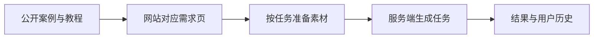

# Awesome Photo Skills — 照片处理技能与案例库

照片处理 Skills 与案例库｜50 个精选场景，涵盖人像编辑、宠物肖像、商品图优化与空间改造，附处理前后对照和在线体验。示例图片由 GPT Image 2.5 生成。

**想用自己的照片试一试？** [打开 dearsketch](https://dearsketch.com/?utm_source=github&utm_medium=readme&utm_campaign=dearsketch-public-cases&utm_content=home_hero)，也可以直接点击下面的效果图进入对应需求页面。

[浏览案例目录](#案例目录) · [5 个基础模板](docs/tutorials.md) · [产品架构](docs/architecture.md) · [图片与内容说明](docs/content-policy.md)

> 当前为待发布草稿。图片是已有项目演示，教程模板另行编写；图片再分发范围需在正式发布前逐项确认。

## 先看效果

<table>
<tr><td width="50%"> <strong>宠物皇家肖像</strong> <a href="docs/cases/i028-turn-a-pet-into-a-royal-or-historical-portrait.md">查看素材与检查要点</a> · <a href="https://dearsketch.com/intent/i028-turn-a-pet-into-a-royal-or-historical-portrait.html?utm_source=github&utm_medium=readme&utm_campaign=dearsketch-public-cases&utm_content=i028_cta">制作同款</a></td><td width="50%"> <strong>情侣周年纪念艺术画</strong> <a href="docs/cases/i022-turn-a-couple-s-photo-into-anniversary-artwork.md">查看素材与检查要点</a> · <a href="https://dearsketch.com/intent/i022-turn-a-couple-s-photo-into-anniversary-artwork.html?utm_source=github&utm_medium=readme&utm_campaign=dearsketch-public-cases&utm_content=i022_cta">制作同款</a></td></tr>
<tr><td width="50%"> <strong>照片转卡通头像</strong> <a href="docs/cases/i047-turn-a-portrait-photo-into-a-cartoon-avatar.md">查看素材与检查要点</a> · <a href="https://dearsketch.com/intent/i047-turn-a-portrait-photo-into-a-cartoon-avatar.html?utm_source=github&utm_medium=readme&utm_campaign=dearsketch-public-cases&utm_content=i047_cta">制作同款</a></td><td width="50%"> <strong>包装行动人偶</strong> <a href="docs/cases/i050-turn-a-person-into-a-packaged-action-figure.md">查看素材与检查要点</a> · <a href="https://dearsketch.com/intent/i050-turn-a-person-into-a-packaged-action-figure.html?utm_source=github&utm_medium=readme&utm_campaign=dearsketch-public-cases&utm_content=i050_cta">制作同款</a></td></tr>
<tr><td width="50%"> <strong>住宅水彩纪念画</strong> <a href="docs/cases/i030-turn-a-house-photo-into-a-watercolor-or-line-art-keepsake.md">查看素材与检查要点</a> · <a href="https://dearsketch.com/intent/i030-turn-a-house-photo-into-a-watercolor-or-line-art-keepsake.html?utm_source=github&utm_medium=readme&utm_campaign=dearsketch-public-cases&utm_content=i030_cta">制作同款</a></td><td width="50%"> <strong>房间装修风格预览</strong> <a href="docs/cases/i169-preview-different-interior-styles-in-a-room-photo.md">查看素材与检查要点</a> · <a href="https://dearsketch.com/intent/i169-preview-different-interior-styles-in-a-room-photo.html?utm_source=github&utm_medium=readme&utm_campaign=dearsketch-public-cases&utm_content=i169_cta">制作同款</a></td></tr>
<tr><td width="50%"> <strong>商品白底主图</strong> <a href="docs/cases/i065-turn-an-ordinary-product-photo-into-a-white-background-listing-image.md">查看素材与检查要点</a> · <a href="https://dearsketch.com/intent/i065-turn-an-ordinary-product-photo-into-a-white-background-listing-image.html?utm_source=github&utm_medium=readme&utm_campaign=dearsketch-public-cases&utm_content=i065_cta">制作同款</a></td><td width="50%"> <strong>商品生活方式场景</strong> <a href="docs/cases/i067-place-a-product-in-a-realistic-lifestyle-scene.md">查看素材与检查要点</a> · <a href="https://dearsketch.com/intent/i067-place-a-product-in-a-realistic-lifestyle-scene.html?utm_source=github&utm_medium=readme&utm_campaign=dearsketch-public-cases&utm_content=i067_cta">制作同款</a></td></tr>
<tr><td width="50%"> <strong>主题宣传海报</strong> <a href="docs/cases/i107-create-a-promotional-poster-from-a-topic-and-copy.md">查看素材与检查要点</a> · <a href="https://dearsketch.com/intent/i107-create-a-promotional-poster-from-a-topic-and-copy.html?utm_source=github&utm_medium=readme&utm_campaign=dearsketch-public-cases&utm_content=i107_cta">制作同款</a></td><td width="50%"> <strong>Logo 概念探索</strong> <a href="docs/cases/i126-create-logo-concepts-from-a-brand-description.md">查看素材与检查要点</a> · <a href="https://dearsketch.com/intent/i126-create-logo-concepts-from-a-brand-description.html?utm_source=github&utm_medium=readme&utm_campaign=dearsketch-public-cases&utm_content=i126_cta">制作同款</a></td></tr>
</table>

以上是结果预览；每个案例详情中可查看配套输入示例。图片点击后进入网站，文字链接进入 GitHub 案例说明。

## 怎么使用

1. 找一个想完成的效果，打开案例了解输入与限制。
2. 想自己研究制作方法，可以使用这里另写的 [5 个基础模板](docs/tutorials.md)。
3. 想在网站制作，点击案例的“制作同款”，按对应页面要求准备照片、文案或其他素材。
4. 检查主体、准确文字与用途要求，再决定是否使用结果。系列图和多个方案分别制作。

在线功能、可用入口和费用以网站实际说明为准。本仓库提供案例与教程，不包含运行整个在线服务所需的生产代码和资源。

## 案例目录

| 分类 | 数量 | 适合哪些需求 |
| --- | ---: | --- |
| [宠物与家庭纪念](#宠物与家庭纪念) | 10 | 把日常合照和宠物照片变成可以分享、收藏或制作礼物的图像。 |
| [人物与个人形象](#人物与个人形象) | 10 | 从职业头像到卡通角色，先确定想改变什么，再检查人物是否仍可识别。 |
| [住宅与空间](#住宅与空间) | 10 | 用照片或草图讨论空间方向，区分视觉概念与可以执行的设计文件。 |
| [商品与电商](#商品与电商) | 10 | 围绕同一件真实商品改变展示方式，商品结构与准确资料始终是核对重点。 |
| [创意与视觉设计](#创意与视觉设计) | 10 | 从主题、真实文案和设计原稿出发，制作可以进一步编辑的视觉方向。 |

### 宠物与家庭纪念

把日常合照和宠物照片变成可以分享、收藏或制作礼物的图像。

| 案例 | 所需素材 | 网站入口 |
| --- | --- | --- |
| [宠物定制肖像](docs/cases/i026-turn-a-pet-photo-into-a-custom-portrait.md) | 1张宠物照片 | [制作同款](https://dearsketch.com/intent/i026-turn-a-pet-photo-into-a-custom-portrait.html?utm_source=github&utm_medium=readme&utm_campaign=dearsketch-public-cases&utm_content=i026_catalog) |
| [宠物皇家肖像](docs/cases/i028-turn-a-pet-into-a-royal-or-historical-portrait.md) | 1张宠物照片 | [制作同款](https://dearsketch.com/intent/i028-turn-a-pet-into-a-royal-or-historical-portrait.html?utm_source=github&utm_medium=readme&utm_campaign=dearsketch-public-cases&utm_content=i028_catalog) |
| [宠物趣味场景画](docs/cases/i029-place-a-pet-in-a-playful-bathroom-or-kitchen-scene.md) | 1张宠物照片 | [制作同款](https://dearsketch.com/intent/i029-place-a-pet-in-a-playful-bathroom-or-kitchen-scene.html?utm_source=github&utm_medium=readme&utm_campaign=dearsketch-public-cases&utm_content=i029_catalog) |
| [宠物纪念画](docs/cases/i027-create-a-pet-memorial-portrait.md) | 1张宠物照片 | [制作同款](https://dearsketch.com/intent/i027-create-a-pet-memorial-portrait.html?utm_source=github&utm_medium=readme&utm_campaign=dearsketch-public-cases&utm_content=i027_catalog) |
| [人与宠物家庭肖像](docs/cases/i021-create-a-family-portrait-with-pets.md) | 每位成员至少1张家庭成员照片＋每只宠物至少1张宠物照片 | [制作同款](https://dearsketch.com/intent/i021-create-a-family-portrait-with-pets.html?utm_source=github&utm_medium=readme&utm_campaign=dearsketch-public-cases&utm_content=i021_catalog) |
| [情侣周年纪念艺术画](docs/cases/i022-turn-a-couple-s-photo-into-anniversary-artwork.md) | 1张情侣照片 | [制作同款](https://dearsketch.com/intent/i022-turn-a-couple-s-photo-into-anniversary-artwork.html?utm_source=github&utm_medium=readme&utm_campaign=dearsketch-public-cases&utm_content=i022_catalog) |
| [分散照片合成全家福](docs/cases/i017-combine-separate-family-photos-into-one-family-portrait.md) | 每位成员至少1张全部入画成员照片＋1组人数、人物关系与排列 | [制作同款](https://dearsketch.com/intent/i017-combine-separate-family-photos-into-one-family-portrait.html?utm_source=github&utm_medium=readme&utm_campaign=dearsketch-public-cases&utm_content=i017_catalog) |
| [节日主题全家福](docs/cases/i020-create-a-christmas-or-holiday-family-portrait.md) | 1张家庭照片＋1项节日名称或主题 | [制作同款](https://dearsketch.com/intent/i020-create-a-christmas-or-holiday-family-portrait.html?utm_source=github&utm_medium=readme&utm_campaign=dearsketch-public-cases&utm_content=i020_catalog) |
| [婚礼与婚纱风格肖像](docs/cases/i023-create-a-wedding-portrait-or-bridal-style-photo.md) | 1张情侣照片 | [制作同款](https://dearsketch.com/intent/i023-create-a-wedding-portrait-or-bridal-style-photo.html?utm_source=github&utm_medium=readme&utm_campaign=dearsketch-public-cases&utm_content=i023_catalog) |
| [宝宝成长里程碑照片](docs/cases/i025-create-baby-milestone-or-monthly-growth-photos.md) | 1张宝宝照片＋1项月龄或里程碑 | [制作同款](https://dearsketch.com/intent/i025-create-baby-milestone-or-monthly-growth-photos.html?utm_source=github&utm_medium=readme&utm_campaign=dearsketch-public-cases&utm_content=i025_catalog) |

### 人物与个人形象

从职业头像到卡通角色，先确定想改变什么，再检查人物是否仍可识别。

| 案例 | 所需素材 | 网站入口 |
| --- | --- | --- |
| [自拍转职业头像](docs/cases/i001-create-a-professional-linkedin-headshot-from-a-selfie.md) | 1张本人清楚原照 | [制作同款](https://dearsketch.com/intent/i001-create-a-professional-linkedin-headshot-from-a-selfie.html?utm_source=github&utm_medium=readme&utm_campaign=dearsketch-public-cases&utm_content=i001_catalog) |
| [休闲装换正装](docs/cases/i015-replace-casual-clothing-with-professional-attire.md) | 1张穿休闲装的人像 | [制作同款](https://dearsketch.com/intent/i015-replace-casual-clothing-with-professional-attire.html?utm_source=github&utm_medium=readme&utm_campaign=dearsketch-public-cases&utm_content=i015_catalog) |
| [皇家与复古人物肖像](docs/cases/i052-turn-yourself-into-a-royal-vintage-or-historical-portrait.md) | 1张本人清楚原照 | [制作同款](https://dearsketch.com/intent/i052-turn-yourself-into-a-royal-vintage-or-historical-portrait.html?utm_source=github&utm_medium=readme&utm_campaign=dearsketch-public-cases&utm_content=i052_catalog) |
| [眼镜试戴预览](docs/cases/i036-virtually-try-on-glasses.md) | 1张人物正面照片＋1张目标眼镜素材或款式描述 | [制作同款](https://dearsketch.com/intent/i036-virtually-try-on-glasses.html?utm_source=github&utm_medium=readme&utm_campaign=dearsketch-public-cases&utm_content=i036_catalog) |
| [纹身上身预览](docs/cases/i038-preview-a-tattoo-on-a-body-photo.md) | 1张人物皮肤原照＋1张目标纹身设计图＋1项纹身位置 | [制作同款](https://dearsketch.com/intent/i038-preview-a-tattoo-on-a-body-photo.html?utm_source=github&utm_medium=readme&utm_campaign=dearsketch-public-cases&utm_content=i038_catalog) |
| [照片转卡通头像](docs/cases/i047-turn-a-portrait-photo-into-a-cartoon-avatar.md) | 1张本人清楚头部照片 | [制作同款](https://dearsketch.com/intent/i047-turn-a-portrait-photo-into-a-cartoon-avatar.html?utm_source=github&utm_medium=readme&utm_campaign=dearsketch-public-cases&utm_content=i047_catalog) |
| [照片转动漫角色](docs/cases/i048-turn-a-portrait-photo-into-an-anime-character.md) | 1张本人清楚头部照片 | [制作同款](https://dearsketch.com/intent/i048-turn-a-portrait-photo-into-an-anime-character.html?utm_source=github&utm_medium=readme&utm_campaign=dearsketch-public-cases&utm_content=i048_catalog) |
| [包装行动人偶](docs/cases/i050-turn-a-person-into-a-packaged-action-figure.md) | 1张人物照片 | [制作同款](https://dearsketch.com/intent/i050-turn-a-person-into-a-packaged-action-figure.html?utm_source=github&utm_medium=readme&utm_campaign=dearsketch-public-cases&utm_content=i050_catalog) |
| [照片转聊天贴纸](docs/cases/i056-turn-a-photo-into-chat-stickers.md) | 1张人物、宠物或物体照片＋0或1项本张贴纸的动作或情绪 | [制作同款](https://dearsketch.com/intent/i056-turn-a-photo-into-chat-stickers.html?utm_source=github&utm_medium=readme&utm_campaign=dearsketch-public-cases&utm_content=i056_catalog) |
| [个人与情侣电影海报](docs/cases/i252-turn-a-personal-or-couple-photo-into-a-movie-poster.md) | 必需个人、情侣或群体原照(1张)＋必需原创海报题材与片名(1份)＋可选署名与日期(0或1组) | [制作同款](https://dearsketch.com/intent/i252-turn-a-personal-or-couple-photo-into-a-movie-poster.html?utm_source=github&utm_medium=readme&utm_campaign=dearsketch-public-cases&utm_content=i252_catalog) |

### 住宅与空间

用照片或草图讨论空间方向，区分视觉概念与可以执行的设计文件。

| 案例 | 所需素材 | 网站入口 |
| --- | --- | --- |
| [住宅水彩纪念画](docs/cases/i030-turn-a-house-photo-into-a-watercolor-or-line-art-keepsake.md) | 1张房屋照片 | [制作同款](https://dearsketch.com/intent/i030-turn-a-house-photo-into-a-watercolor-or-line-art-keepsake.html?utm_source=github&utm_medium=readme&utm_campaign=dearsketch-public-cases&utm_content=i030_catalog) |
| [房间装修风格预览](docs/cases/i169-preview-different-interior-styles-in-a-room-photo.md) | 现有房间照片 → 保持空间结构并替换风格、家具和材质 → 当前单张装修效果图 | [制作同款](https://dearsketch.com/intent/i169-preview-different-interior-styles-in-a-room-photo.html?utm_source=github&utm_medium=readme&utm_campaign=dearsketch-public-cases&utm_content=i169_catalog) |
| [庭院景观改造](docs/cases/i178-create-a-landscape-makeover-concept-from-a-yard-photo.md) | 庭院或外部空间照片＋使用需求、气候或所在地 → 添加植物、铺装和设施 → 当前单张景观效果图 | [制作同款](https://dearsketch.com/intent/i178-create-a-landscape-makeover-concept-from-a-yard-photo.html?utm_source=github&utm_medium=readme&utm_campaign=dearsketch-public-cases&utm_content=i178_catalog) |
| [墙漆与地板选材预览](docs/cases/i171-preview-wall-paint-flooring-and-wallpaper.md) | 室内照片＋目标材料样板＋替换表面与目标颜色/材质 → 替换表面颜色和材料 → 当前单张材料效果预览 | [制作同款](https://dearsketch.com/intent/i171-preview-wall-paint-flooring-and-wallpaper.html?utm_source=github&utm_medium=readme&utm_campaign=dearsketch-public-cases&utm_content=i171_catalog) |
| [办公室改造概念](docs/cases/i172-create-an-office-redesign-concept.md) | 办公室现场照片＋团队、功能区、品牌和分支说明 → 生成工位、会议区和品牌空间 → 当前单张办公室概念图 | [制作同款](https://dearsketch.com/intent/i172-create-an-office-redesign-concept.html?utm_source=github&utm_medium=readme&utm_campaign=dearsketch-public-cases&utm_content=i172_catalog) |
| [空房虚拟布置](docs/cases/i175-virtually-stage-an-empty-property-with-furniture-and-decor.md) | 空房照片 → 生成符合空间透视的家具 → 当前单张虚拟布置房源图 | [制作同款](https://dearsketch.com/intent/i175-virtually-stage-an-empty-property-with-furniture-and-decor.html?utm_source=github&utm_medium=readme&utm_campaign=dearsketch-public-cases&utm_content=i175_catalog) |
| [房源照片整理](docs/cases/i176-turn-a-casual-room-photo-into-a-polished-property-listing-image.md) | 随手拍的有杂物房间照片 → 移除杂物、清理房间并保持真实空间 → 当前单张整洁的房源销售展示图 | [制作同款](https://dearsketch.com/intent/i176-turn-a-casual-room-photo-into-a-polished-property-listing-image.html?utm_source=github&utm_medium=readme&utm_campaign=dearsketch-public-cases&utm_content=i176_catalog) |
| [建筑外立面概念](docs/cases/i177-create-an-architectural-facade-concept-from-text-or-a-sketch.md) | 建筑草图或体块图＋建筑用途、设计关键词 → 生成材料、环境和光线 → 当前单张建筑概念渲染 | [制作同款](https://dearsketch.com/intent/i177-create-an-architectural-facade-concept-from-text-or-a-sketch.html?utm_source=github&utm_medium=readme&utm_campaign=dearsketch-public-cases&utm_content=i177_catalog) |
| [建筑草图转写实效果](docs/cases/i179-turn-an-interior-or-architectural-sketch-into-a-realistic-render.md) | 室内或建筑草图/CAD线框＋空间用途与草图含义 → 保留结构并补充材质、灯光 → 当前单张写实空间渲染 | [制作同款](https://dearsketch.com/intent/i179-turn-an-interior-or-architectural-sketch-into-a-realistic-render.html?utm_source=github&utm_medium=readme&utm_campaign=dearsketch-public-cases&utm_content=i179_catalog) |
| [空间设计情绪板](docs/cases/i182-create-a-mood-board-for-an-architecture-or-interior-project.md) | 空间氛围与材料参考板＋项目类型与关键词 → 整理并生成一致视觉方向 → 当前单张Mood Board | [制作同款](https://dearsketch.com/intent/i182-create-a-mood-board-for-an-architecture-or-interior-project.html?utm_source=github&utm_medium=readme&utm_campaign=dearsketch-public-cases&utm_content=i182_catalog) |

### 商品与电商

围绕同一件真实商品改变展示方式，商品结构与准确资料始终是核对重点。

| 案例 | 所需素材 | 网站入口 |
| --- | --- | --- |
| [商品白底主图](docs/cases/i065-turn-an-ordinary-product-photo-into-a-white-background-listing-image.md) | 1张手机拍摄的商品照 | [制作同款](https://dearsketch.com/intent/i065-turn-an-ordinary-product-photo-into-a-white-background-listing-image.html?utm_source=github&utm_medium=readme&utm_campaign=dearsketch-public-cases&utm_content=i065_catalog) |
| [透明底商品素材](docs/cases/i066-create-a-reusable-product-png-with-a-transparent-background.md) | 1张商品照片 | [制作同款](https://dearsketch.com/intent/i066-create-a-reusable-product-png-with-a-transparent-background.html?utm_source=github&utm_medium=readme&utm_campaign=dearsketch-public-cases&utm_content=i066_catalog) |
| [商品生活方式场景](docs/cases/i067-place-a-product-in-a-realistic-lifestyle-scene.md) | 1张商品白底图 | [制作同款](https://dearsketch.com/intent/i067-place-a-product-in-a-realistic-lifestyle-scene.html?utm_source=github&utm_medium=readme&utm_campaign=dearsketch-public-cases&utm_content=i067_catalog) |
| [商品影棚照](docs/cases/i068-turn-an-ordinary-photo-into-a-professional-studio-product-shot.md) | 1张商品照片 | [制作同款](https://dearsketch.com/intent/i068-turn-an-ordinary-photo-into-a-professional-studio-product-shot.html?utm_source=github&utm_medium=readme&utm_campaign=dearsketch-public-cases&utm_content=i068_catalog) |
| [节日商品场景](docs/cases/i069-create-christmas-black-friday-or-seasonal-product-imagery.md) | 1张商品照片＋1项节日或促销主题 | [制作同款](https://dearsketch.com/intent/i069-create-christmas-black-friday-or-seasonal-product-imagery.html?utm_source=github&utm_medium=readme&utm_campaign=dearsketch-public-cases&utm_content=i069_catalog) |
| [食品与饮品商业摄影](docs/cases/i080-create-commercial-photography-for-food-cakes-pizza-or-drinks.md) | 1张食品照片或产品描述 | [制作同款](https://dearsketch.com/intent/i080-create-commercial-photography-for-food-cakes-pizza-or-drinks.html?utm_source=github&utm_medium=readme&utm_campaign=dearsketch-public-cases&utm_content=i080_catalog) |
| [服装平铺图转模特上身图](docs/cases/i089-turn-flat-lay-clothing-into-an-on-model-image.md) | 1张服装平铺图 | [制作同款](https://dearsketch.com/intent/i089-turn-flat-lay-clothing-into-an-on-model-image.html?utm_source=github&utm_medium=readme&utm_campaign=dearsketch-public-cases&utm_content=i089_catalog) |
| [商品手持互动图](docs/cases/i075-show-a-product-being-held-or-used.md) | 1张商品图片 | [制作同款](https://dearsketch.com/intent/i075-show-a-product-being-held-or-used.html?utm_source=github&utm_medium=readme&utm_campaign=dearsketch-public-cases&utm_content=i075_catalog) |
| [商品卖点信息图](docs/cases/i076-create-a-product-infographic-with-dimensions-features-and-specifications.md) | 1张商品照片＋1组准确尺寸、卖点和参数 | [制作同款](https://dearsketch.com/intent/i076-create-a-product-infographic-with-dimensions-features-and-specifications.html?utm_source=github&utm_medium=readme&utm_campaign=dearsketch-public-cases&utm_content=i076_catalog) |
| [电商详情页视觉草稿](docs/cases/i077-create-a-long-form-e-commerce-detail-image-from-product-information.md) | 多张同一商品图片组＋1组卖点与准确文案 | [制作同款](https://dearsketch.com/intent/i077-create-a-long-form-e-commerce-detail-image-from-product-information.html?utm_source=github&utm_medium=readme&utm_campaign=dearsketch-public-cases&utm_content=i077_catalog) |

### 创意与视觉设计

从主题、真实文案和设计原稿出发，制作可以进一步编辑的视觉方向。

| 案例 | 所需素材 | 网站入口 |
| --- | --- | --- |
| [YouTube 视频缩略图](docs/cases/i106-create-a-youtube-video-thumbnail.md) | 视频人物或主题物件原图＋视频主题或标题 → 生成高对比构图和标题区域 → 当前单张YouTube Thumbnail | [制作同款](https://dearsketch.com/intent/i106-create-a-youtube-video-thumbnail.html?utm_source=github&utm_medium=readme&utm_campaign=dearsketch-public-cases&utm_content=i106_catalog) |
| [主题宣传海报](docs/cases/i107-create-a-promotional-poster-from-a-topic-and-copy.md) | 活动主视觉素材原稿＋活动名称、核心信息、时间与地点或参与方式 → 生成带文字和图像的海报 → 当前单张活动海报 | [制作同款](https://dearsketch.com/intent/i107-create-a-promotional-poster-from-a-topic-and-copy.html?utm_source=github&utm_medium=readme&utm_campaign=dearsketch-public-cases&utm_content=i107_catalog) |
| [节日促销海报](docs/cases/i112-create-a-mother-s-day-black-friday-or-holiday-sale-poster.md) | 促销商品原图＋节庆或销售节点、商品或服务、促销信息 → 套用节庆主题并生成版式 → 当前单张节点促销图 | [制作同款](https://dearsketch.com/intent/i112-create-a-mother-s-day-black-friday-or-holiday-sale-poster.html?utm_source=github&utm_medium=readme&utm_campaign=dearsketch-public-cases&utm_content=i112_catalog) |
| [会议与展览海报](docs/cases/i115-create-a-conference-exhibition-or-speaking-event-poster.md) | 讲者、参展人或展品原图＋活动题目、讲者或参展信息、时间、地点或参与方式 → 生成规范活动海报 → 当前单张会议海报 | [制作同款](https://dearsketch.com/intent/i115-create-a-conference-exhibition-or-speaking-event-poster.html?utm_source=github&utm_medium=readme&utm_campaign=dearsketch-public-cases&utm_content=i115_catalog) |
| [概念信息图](docs/cases/i118-turn-a-complex-concept-into-an-infographic-visual.md) | 已有信息结构草图＋事实内容、信息结构或关系 → 生成图标、构图和视觉层次 → 当前单张Infographic | [制作同款](https://dearsketch.com/intent/i118-turn-a-complex-concept-into-an-infographic-visual.html?utm_source=github&utm_medium=readme&utm_campaign=dearsketch-public-cases&utm_content=i118_catalog) |
| [文章与 Newsletter 封面](docs/cases/i119-create-a-newsletter-header-or-article-cover.md) | 文章涉及的人物、商品或事件素材原图＋文章主题 → 生成横版封面和品牌化插图 → 当前单张文章头图 | [制作同款](https://dearsketch.com/intent/i119-create-a-newsletter-header-or-article-cover.html?utm_source=github&utm_medium=readme&utm_campaign=dearsketch-public-cases&utm_content=i119_catalog) |
| [App 设备展示图](docs/cases/i121-create-device-mockups-and-app-store-promotional-images.md) | 目标应用实际界面截图＋目标设备与真实功能卖点 → 置入手机设备并添加营销背景 → 当前单张App Mockup | [制作同款](https://dearsketch.com/intent/i121-create-device-mockups-and-app-store-promotional-images.html?utm_source=github&utm_medium=readme&utm_campaign=dearsketch-public-cases&utm_content=i121_catalog) |
| [菜单与菜品视觉](docs/cases/i124-create-restaurant-menu-visuals-and-dish-imagery.md) | 真实菜品照片原图＋菜品名称、准确价格、分类 → 生成排版、插图和真实菜图 → 当前单张菜单 | [制作同款](https://dearsketch.com/intent/i124-create-restaurant-menu-visuals-and-dish-imagery.html?utm_source=github&utm_medium=readme&utm_campaign=dearsketch-public-cases&utm_content=i124_catalog) |
| [Logo 概念探索](docs/cases/i126-create-logo-concepts-from-a-brand-description.md) | 既有品牌标志与识别资产原稿＋品牌名称、品牌定位、目标受众 → 生成多种标志方向 → 当前单张Logo草案 | [制作同款](https://dearsketch.com/intent/i126-create-logo-concepts-from-a-brand-description.html?utm_source=github&utm_medium=readme&utm_campaign=dearsketch-public-cases&utm_content=i126_catalog) |
| [艺术字与标题效果](docs/cases/i133-create-readable-display-lettering-and-title-effects.md) | 指定字形或材质字效样板＋准确文字、用途 → 生成带材质和风格的文字 → 当前单张艺术字 | [制作同款](https://dearsketch.com/intent/i133-create-readable-display-lettering-and-title-effects.html?utm_source=github&utm_medium=readme&utm_campaign=dearsketch-public-cases&utm_content=i133_catalog) |

## 这个库公开什么

这里公开 50 个案例的用途、输入要求、演示预览、检查要点、需求参考链接，以及 5 个独立编写的基础模板。结构化案例数据位于 [cases.json](data/cases.json)，方便按任务浏览和整理。

网站按具体任务组织制作入口：先选需求，再提供对应素材。你不需要在网站编写任意提示词。完整服务端 Skill、账户资源与部署配置由在线服务维护。

## 产品是怎样组织的

内容页面负责帮助用户找到需求，服务端负责执行与交付。更完整的模块职责和数据流见 [产品架构](docs/architecture.md)。

## 常见问题

**基础模板能生成和示例完全一样的图吗？**

不能保证。基础模板是公开版的新编教程，没有用来生成这些既有示例；输入素材、工具和参数也会影响结果。

**所有任务都只需要一张照片吗？**

不是。单主体肖像通常较简单，家庭合成、指定图案试戴和图文设计可能需要多个素材或准确文字。每条案例都列出对应输入，具体以页面要求为准。

**看到透明贴纸或印刷效果图，就可以直接生产吗？**

不能只凭预览确认。透明通道、尺寸、文字、矢量和生产要求需检查实际文件；概念图与生产文件是不同交付物。

**这些是客户案例吗？**

这里使用项目演示预览，不把它们描述为真实用户或客户成交记录。素材与许可说明见 [图片与内容说明](docs/content-policy.md)。
