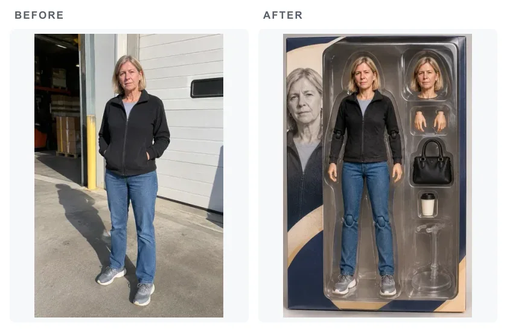
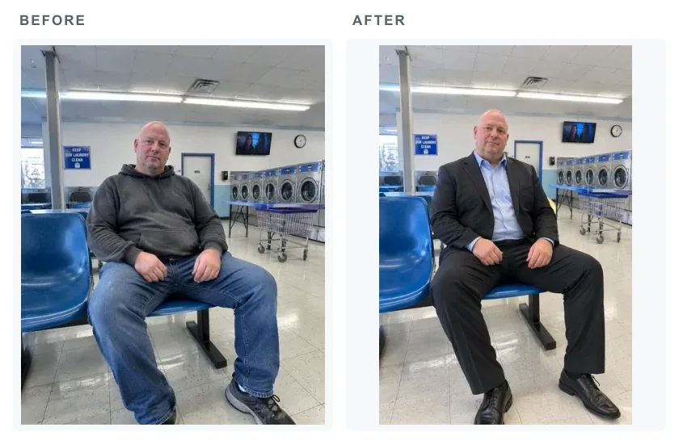
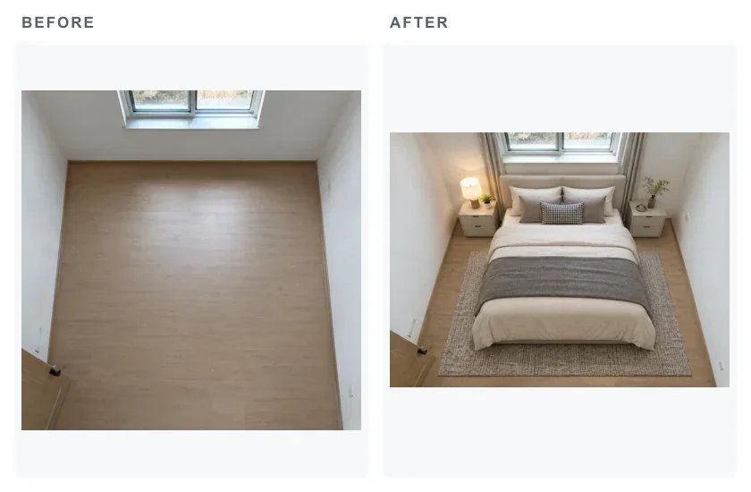

# Awesome Photo Skills

[中文](README.md) · [English](README.en.md) · [Português](README.pt.md) · [Español](README.es.md) · [Français](README.fr.md) · [Deutsch](README.de.md) · [عربي](README.ar.md) · [русский](README.ru.md) · [日本語](README.ja.md) · [हिंदी](README.hi.md)

**Создавайте оригинальные произведения искусства из текста или превращайте свои фотографии в портреты, рисунки домашних животных, изображения продуктов и обновленные пространства.**

Изучите 246 примеров изображений и 100 многократно используемых шаблонов подсказок — **50 работают только с текстом, эталонное изображение не требуется**.

[Просмотреть 50 текстовых подсказок →](./docs/ru/guides/text-only.md)

<table>
<tr><td width="33%" valign="top"> <strong>Превратите домашнее животное в королевский или исторический портрет</strong> <a href="./docs/ru/cases/i028-turn-a-pet-into-a-royal-or-historical-portrait.md#public-prompt">Посмотреть подсказку</a> · <a href="https://dearsketch.com/ru/intent/i028-turn-a-pet-into-a-royal-or-historical-portrait.html?utm_source=github&amp;utm_medium=readme-en&amp;utm_campaign=dearsketch-public-cases&amp;utm_content=i028_cta">Создавайте онлайн</a></td><td width="33%" valign="top"> <strong>Превратите портретную фотографию в мультяшный аватар</strong> <a href="./docs/ru/cases/i047-turn-a-portrait-photo-into-a-cartoon-avatar.md#public-prompt">Посмотреть подсказку</a> · <a href="https://dearsketch.com/ru/intent/i047-turn-a-portrait-photo-into-a-cartoon-avatar.html?utm_source=github&amp;utm_medium=readme-en&amp;utm_campaign=dearsketch-public-cases&amp;utm_content=i047_cta">Создавайте онлайн</a></td><td width="33%" valign="top"> <strong>Превратите обычную фотографию товара в изображение листинга на белом фоне.</strong> <a href="./docs/ru/cases/i065-turn-an-ordinary-product-photo-into-a-white-background-listing-image.md#public-prompt">Посмотреть подсказку</a> · <a href="https://dearsketch.com/ru/intent/i065-turn-an-ordinary-product-photo-into-a-white-background-listing-image.html?utm_source=github&amp;utm_medium=readme-en&amp;utm_campaign=dearsketch-public-cases&amp;utm_content=i065_cta">Создавайте онлайн</a></td></tr>
<tr><td width="33%" valign="top"> <strong>Предварительный просмотр различных стилей интерьера на фото комнаты</strong> <a href="./docs/ru/cases/i169-preview-different-interior-styles-in-a-room-photo.md#public-prompt">Посмотреть подсказку</a> · <a href="https://dearsketch.com/ru/intent/i169-preview-different-interior-styles-in-a-room-photo.html?utm_source=github&amp;utm_medium=readme-en&amp;utm_campaign=dearsketch-public-cases&amp;utm_content=i169_cta">Создавайте онлайн</a></td><td width="33%" valign="top"> <strong>Превратите фотографию дома в акварельный или штриховой рисунок на память</strong> <a href="./docs/ru/cases/i030-turn-a-house-photo-into-a-watercolor-or-line-art-keepsake.md#public-prompt">Посмотреть подсказку</a> · <a href="https://dearsketch.com/ru/intent/i030-turn-a-house-photo-into-a-watercolor-or-line-art-keepsake.html?utm_source=github&amp;utm_medium=readme-en&amp;utm_campaign=dearsketch-public-cases&amp;utm_content=i030_cta">Создавайте онлайн</a></td><td width="33%" valign="top"> <strong>Превратите плоскую одежду в модельный образ</strong> <a href="./docs/ru/cases/i089-turn-flat-lay-clothing-into-an-on-model-image.md#public-prompt">Посмотреть подсказку</a> · <a href="https://dearsketch.com/ru/intent/i089-turn-flat-lay-clothing-into-an-on-model-image.html?utm_source=github&amp;utm_medium=readme-en&amp;utm_campaign=dearsketch-public-cases&amp;utm_content=i089_cta">Создавайте онлайн</a></td></tr>
<tr><td width="33%" valign="top"> <strong>Превратите фотографию пары в юбилейное произведение искусства</strong> <a href="./docs/ru/cases/i022-turn-a-couple-s-photo-into-anniversary-artwork.md#public-prompt">Посмотреть подсказку</a> · <a href="https://dearsketch.com/ru/intent/i022-turn-a-couple-s-photo-into-anniversary-artwork.html?utm_source=github&amp;utm_medium=readme-en&amp;utm_campaign=dearsketch-public-cases&amp;utm_content=i022_cta">Создавайте онлайн</a></td><td width="33%" valign="top"> <strong>Превратите человека в упакованную фигурку</strong> <a href="./docs/ru/cases/i050-turn-a-person-into-a-packaged-action-figure.md#public-prompt">Посмотреть подсказку</a> · <a href="https://dearsketch.com/ru/intent/i050-turn-a-person-into-a-packaged-action-figure.html?utm_source=github&amp;utm_medium=readme-en&amp;utm_campaign=dearsketch-public-cases&amp;utm_content=i050_cta">Создавайте онлайн</a></td><td width="33%" valign="top"> <strong>Разместите продукт в реалистичной сцене образа жизни</strong> <a href="./docs/ru/cases/i067-place-a-product-in-a-realistic-lifestyle-scene.md#public-prompt">Посмотреть подсказку</a> · <a href="https://dearsketch.com/ru/intent/i067-place-a-product-in-a-realistic-lifestyle-scene.html?utm_source=github&amp;utm_medium=readme-en&amp;utm_campaign=dearsketch-public-cases&amp;utm_content=i067_cta">Создавайте онлайн</a></td></tr>
</table>

**[Просмотреть все примеры](https://dearsketch.com/ru/?utm_source=github&utm_medium=readme-en&utm_campaign=dearsketch-public-cases&utm_content=home_gallery#library) · [Создать из моих фотографий →](https://dearsketch.com/ru/?utm_source=github&utm_medium=readme-en&utm_campaign=dearsketch-public-cases&utm_content=home_hero)**

Справочные материалы и примеры результатов иллюстрируют визуальные указания. Публичные шаблоны написаны недавно и не тестировались на основе этих изображений.

## Просмотр по категориям

[Домашние животные и семья](#pets-family) · [Портреты и стиль](#people) · [Товары и торговля](#products) · [Дома и помещения](#spaces) · [Плакаты и дизайн](#design)

### Домашние животные и семья

<table>
<tr><td width="50%" valign="top"> <strong>Превратите домашнее животное в королевский или исторический портрет</strong> <a href="./docs/ru/cases/i028-turn-a-pet-into-a-royal-or-historical-portrait.md#public-prompt">Посмотреть подсказку</a> · <a href="https://dearsketch.com/ru/intent/i028-turn-a-pet-into-a-royal-or-historical-portrait.html?utm_source=github&amp;utm_medium=readme-en&amp;utm_campaign=dearsketch-public-cases&amp;utm_content=i028_cta">Создавайте онлайн</a></td><td width="50%" valign="top"> <strong>Превратите фотографию домашнего животного в индивидуальный портрет</strong> <a href="./docs/ru/cases/i026-turn-a-pet-photo-into-a-custom-portrait.md#public-prompt">Посмотреть подсказку</a> · <a href="https://dearsketch.com/ru/intent/i026-turn-a-pet-photo-into-a-custom-portrait.html?utm_source=github&amp;utm_medium=readme-en&amp;utm_campaign=dearsketch-public-cases&amp;utm_content=i026_cta">Создавайте онлайн</a></td></tr>
<tr><td width="50%" valign="top"> <strong>Превратите фотографию пары в юбилейное произведение искусства</strong> <a href="./docs/ru/cases/i022-turn-a-couple-s-photo-into-anniversary-artwork.md#public-prompt">Посмотреть подсказку</a> · <a href="https://dearsketch.com/ru/intent/i022-turn-a-couple-s-photo-into-anniversary-artwork.html?utm_source=github&amp;utm_medium=readme-en&amp;utm_campaign=dearsketch-public-cases&amp;utm_content=i022_cta">Создавайте онлайн</a></td><td width="50%" valign="top"> <strong>Объедините отдельные семейные фотографии в один семейный портрет.</strong> <a href="./docs/ru/cases/i017-combine-separate-family-photos-into-one-family-portrait.md#public-prompt">Посмотреть подсказку</a> · <a href="https://dearsketch.com/ru/intent/i017-combine-separate-family-photos-into-one-family-portrait.html?utm_source=github&amp;utm_medium=readme-en&amp;utm_campaign=dearsketch-public-cases&amp;utm_content=i017_cta">Создавайте онлайн</a></td></tr>
</table>

[Просмотреть эту коллекцию →](./docs/ru/guides/pets-family.md)

### Портреты и стиль

<table>
<tr><td width="50%" valign="top"> <strong>Создайте профессиональную фотографию LinkedIn на основе селфи</strong> <a href="./docs/ru/cases/i001-create-a-professional-linkedin-headshot-from-a-selfie.md#public-prompt">Посмотреть подсказку</a> · <a href="https://dearsketch.com/ru/intent/i001-create-a-professional-linkedin-headshot-from-a-selfie.html?utm_source=github&amp;utm_medium=readme-en&amp;utm_campaign=dearsketch-public-cases&amp;utm_content=i001_cta">Создавайте онлайн</a></td><td width="50%" valign="top"> <strong>Превратите портретную фотографию в мультяшный аватар</strong> <a href="./docs/ru/cases/i047-turn-a-portrait-photo-into-a-cartoon-avatar.md#public-prompt">Посмотреть подсказку</a> · <a href="https://dearsketch.com/ru/intent/i047-turn-a-portrait-photo-into-a-cartoon-avatar.html?utm_source=github&amp;utm_medium=readme-en&amp;utm_campaign=dearsketch-public-cases&amp;utm_content=i047_cta">Создавайте онлайн</a></td></tr>
<tr><td width="50%" valign="top"> <strong>Замените повседневную одежду профессиональной одеждой.</strong> <a href="./docs/ru/cases/i015-replace-casual-clothing-with-professional-attire.md#public-prompt">Посмотреть подсказку</a> · <a href="https://dearsketch.com/ru/intent/i015-replace-casual-clothing-with-professional-attire.html?utm_source=github&amp;utm_medium=readme-en&amp;utm_campaign=dearsketch-public-cases&amp;utm_content=i015_cta">Создавайте онлайн</a></td><td width="50%" valign="top"> <strong>Превратите человека в упакованную фигурку</strong> <a href="./docs/ru/cases/i050-turn-a-person-into-a-packaged-action-figure.md#public-prompt">Посмотреть подсказку</a> · <a href="https://dearsketch.com/ru/intent/i050-turn-a-person-into-a-packaged-action-figure.html?utm_source=github&amp;utm_medium=readme-en&amp;utm_campaign=dearsketch-public-cases&amp;utm_content=i050_cta">Создавайте онлайн</a></td></tr>
</table>

[Просмотреть эту коллекцию →](./docs/ru/guides/people.md)

### Продукты и коммерция

<table>
<tr><td width="50%" valign="top"> <strong>Превратите обычную фотографию товара в изображение листинга на белом фоне.</strong> <a href="./docs/ru/cases/i065-turn-an-ordinary-product-photo-into-a-white-background-listing-image.md#public-prompt">Посмотреть подсказку</a> · <a href="https://dearsketch.com/ru/intent/i065-turn-an-ordinary-product-photo-into-a-white-background-listing-image.html?utm_source=github&amp;utm_medium=readme-en&amp;utm_campaign=dearsketch-public-cases&amp;utm_content=i065_cta">Создавайте онлайн</a></td><td width="50%" valign="top"> <strong>Разместите продукт в реалистичной сцене образа жизни</strong> <a href="./docs/ru/cases/i067-place-a-product-in-a-realistic-lifestyle-scene.md#public-prompt">Посмотреть подсказку</a> · <a href="https://dearsketch.com/ru/intent/i067-place-a-product-in-a-realistic-lifestyle-scene.html?utm_source=github&amp;utm_medium=readme-en&amp;utm_campaign=dearsketch-public-cases&amp;utm_content=i067_cta">Создавайте онлайн</a></td></tr>
<tr><td width="50%" valign="top"> <strong>Превратите плоскую одежду в модельный образ</strong> <a href="./docs/ru/cases/i089-turn-flat-lay-clothing-into-an-on-model-image.md#public-prompt">Посмотреть подсказку</a> · <a href="https://dearsketch.com/ru/intent/i089-turn-flat-lay-clothing-into-an-on-model-image.html?utm_source=github&amp;utm_medium=readme-en&amp;utm_campaign=dearsketch-public-cases&amp;utm_content=i089_cta">Создавайте онлайн</a></td><td width="50%" valign="top"> <strong>Превратите обычную фотографию в профессиональный студийный снимок</strong> <a href="./docs/ru/cases/i068-turn-an-ordinary-photo-into-a-professional-studio-product-shot.md#public-prompt">Посмотреть подсказку</a> · <a href="https://dearsketch.com/ru/intent/i068-turn-an-ordinary-photo-into-a-professional-studio-product-shot.html?utm_source=github&amp;utm_medium=readme-en&amp;utm_campaign=dearsketch-public-cases&amp;utm_content=i068_cta">Создавайте онлайн</a></td></tr>
</table>

[Просмотреть эту коллекцию →](./docs/ru/guides/products.md)

### Дома и помещения

<table>
<tr><td width="50%" valign="top"> <strong>Предварительный просмотр различных стилей интерьера на фото комнаты</strong> <a href="./docs/ru/cases/i169-preview-different-interior-styles-in-a-room-photo.md#public-prompt">Посмотреть подсказку</a> · <a href="https://dearsketch.com/ru/intent/i169-preview-different-interior-styles-in-a-room-photo.html?utm_source=github&amp;utm_medium=readme-en&amp;utm_campaign=dearsketch-public-cases&amp;utm_content=i169_cta">Создавайте онлайн</a></td><td width="50%" valign="top"> <strong>Превратите фотографию дома в акварельный или штриховой рисунок на память</strong> <a href="./docs/ru/cases/i030-turn-a-house-photo-into-a-watercolor-or-line-art-keepsake.md#public-prompt">Посмотреть подсказку</a> · <a href="https://dearsketch.com/ru/intent/i030-turn-a-house-photo-into-a-watercolor-or-line-art-keepsake.html?utm_source=github&amp;utm_medium=readme-en&amp;utm_campaign=dearsketch-public-cases&amp;utm_content=i030_cta">Создавайте онлайн</a></td></tr>
<tr><td width="50%" valign="top"> <strong>Практически обставьте пустую недвижимость мебелью и декором.</strong> <a href="./docs/ru/cases/i175-virtually-stage-an-empty-property-with-furniture-and-decor.md#public-prompt">Посмотреть подсказку</a> · <a href="https://dearsketch.com/ru/intent/i175-virtually-stage-an-empty-property-with-furniture-and-decor.html?utm_source=github&amp;utm_medium=readme-en&amp;utm_campaign=dearsketch-public-cases&amp;utm_content=i175_cta">Создавайте онлайн</a></td><td width="50%" valign="top"> <strong>Создайте концепцию преображения ландшафта на основе фотографии двора.</strong> <a href="./docs/ru/cases/i178-create-a-landscape-makeover-concept-from-a-yard-photo.md#public-prompt">Посмотреть подсказку</a> · <a href="https://dearsketch.com/ru/intent/i178-create-a-landscape-makeover-concept-from-a-yard-photo.html?utm_source=github&amp;utm_medium=readme-en&amp;utm_campaign=dearsketch-public-cases&amp;utm_content=i178_cta">Создавайте онлайн</a></td></tr>
</table>

[Просмотреть эту коллекцию →](./docs/ru/guides/spaces.md)

### Плакаты и дизайн

<table>
<tr><td width="50%" valign="top"> <strong>Создайте миниатюру видео на YouTube</strong> <a href="./docs/ru/cases/i106-create-a-youtube-video-thumbnail.md#public-prompt">Посмотреть подсказку</a> · <a href="https://dearsketch.com/ru/intent/i106-create-a-youtube-video-thumbnail.html?utm_source=github&amp;utm_medium=readme-en&amp;utm_campaign=dearsketch-public-cases&amp;utm_content=i106_cta">Создавайте онлайн</a></td><td width="50%" valign="top"> <strong>Создайте рекламный плакат по теме и скопируйте его.</strong> <a href="./docs/ru/cases/i107-create-a-promotional-poster-from-a-topic-and-copy.md#public-prompt">Посмотреть подсказку</a> · <a href="https://dearsketch.com/ru/intent/i107-create-a-promotional-poster-from-a-topic-and-copy.html?utm_source=github&amp;utm_medium=readme-en&amp;utm_campaign=dearsketch-public-cases&amp;utm_content=i107_cta">Создавайте онлайн</a></td></tr>
<tr><td width="50%" valign="top"> <strong>Создайте заголовок информационного бюллетеня или обложку статьи</strong> <a href="./docs/ru/cases/i119-create-a-newsletter-header-or-article-cover.md#public-prompt">Посмотреть подсказку</a> · <a href="https://dearsketch.com/ru/intent/i119-create-a-newsletter-header-or-article-cover.html?utm_source=github&amp;utm_medium=readme-en&amp;utm_campaign=dearsketch-public-cases&amp;utm_content=i119_cta">Создавайте онлайн</a></td><td width="50%" valign="top"> <strong>Создавайте концепции логотипа на основе описания бренда.</strong> <a href="./docs/ru/cases/i126-create-logo-concepts-from-a-brand-description.md#public-prompt">Посмотреть подсказку</a> · <a href="https://dearsketch.com/ru/intent/i126-create-logo-concepts-from-a-brand-description.html?utm_source=github&amp;utm_medium=readme-en&amp;utm_campaign=dearsketch-public-cases&amp;utm_content=i126_cta">Создавайте онлайн</a></td></tr>
</table>

[Просмотреть эту коллекцию →](./docs/ru/guides/design.md)

## Сделайте свое первое изображение

1. **Выберите эффект.** Откройте кейс и проверьте необходимые входные данные.
2. **Выберите свой инструмент.** Скопируйте его подсказку в инструмент изображения или откройте соответствующую задачу на dearsketch.
3. **Используйте свои собственные материалы.** Если речь идет только о текстовых сводках, заполните письменные данные; для фотозаданий прикрепите необходимые изображения. Отредактируйте приглашение и создайте одно изображение.

[Все public prompts](./docs/ru/prompts.md) · [Подробное краткое руководство](./docs/ru/quickstart.md)

## Использование с ИИ-агентом

Дополнительный навык photo-editing помогает агенту выбрать задачу и подготовить входные данные и инструкции.

[Установка и использование](./docs/ru/quickstart.md#agent-skill) · [SKILL.md](./skills/photo-editing/SKILL.md)

## Внесите свой вклад и узнайте больше

[Добавить пример](./CONTRIBUTING.en.md) · [Обновления](./CHANGELOG.en.md) · [Ввод и примечания к изображениям](./docs/ru/content-policy.md) · [Структурированные данные ](./data/cases.json)

Для некоторых задач требуется несколько эталонных изображений; некоторые начинаются с текста. Примеры не гарантируют идентичный результат. Просмотрите фактический файл на предмет точности текста, прозрачности и производственных требований. Разрешения на повторное использование изображений описаны в политике в отношении контента. Характеристики веб-сайта и цены указаны на веб-сайте.
