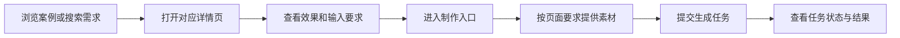
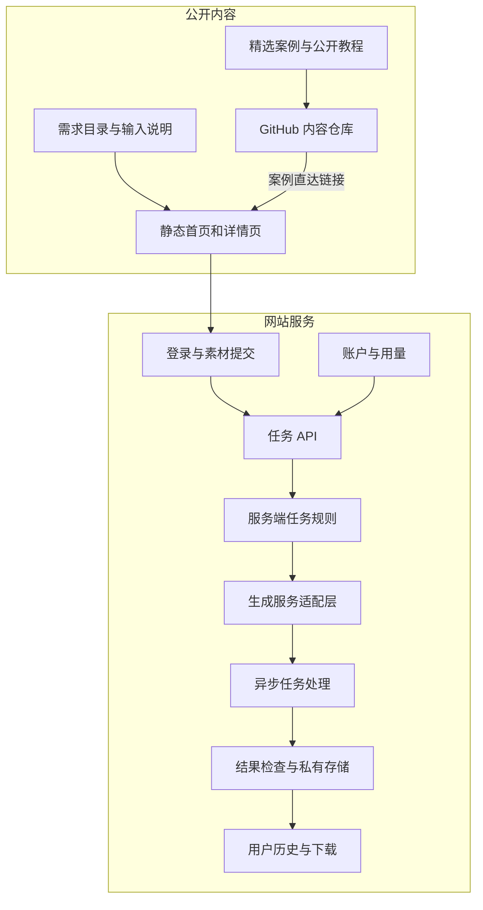

<div dir="rtl" align="right">

# dearsketch بنية المنتج

[中文](../../README.md) · [English](../../README.en.md) · [Português](../../README.pt.md) · [Español](../../README.es.md) · [Français](../../README.fr.md) · [Deutsch](../../README.de.md) · [عربي](../../README.ar.md) · [русский](../../README.ru.md) · [日本語](../../README.ja.md) · [हिंदी](../../README.hi.md)


يقوم dearsketch بتنظيم "ما هي الصور التي أريد إكمالها" في دليل المتطلبات القابل للتصفح. ولكل مطلب صفحة مستقلة تشرح الغرض والمواد المطلوبة ومتطلبات النتيجة؛ يدخل المستخدمون عملية الإنتاج من الصفحة المقابلة.

يصف هذا الوصف مسؤوليات الوحدة وتدفق البيانات. تتولى مكتبة المحتوى العام وخدمات الموقع الإلكتروني والنماذج المولدة مهام مختلفة؛ يوفر هذا المستودع حالات عامة و50 قالبًا تم تحريره حديثًا وAgent Skill، ويتم تنفيذ الإنتاج عبر الإنترنت على موقع الويب.

## مسار المستخدم



قد تتطلب المهام المختلفة صورًا أو مخطوطات تصميم مخصصة أو كتابة نصوص دقيقة أو أصول متعددة الشخصيات. يتم إنتاج الرسومات المتسلسلة والخطط المتعددة بشكل منفصل على أساس واحد؛ عندما تكون هناك حاجة إلى نص دقيق أو متجهات أو ملفات إنتاج، تكون الأدوات المقابلة مطلوبة بعد المعاينة المرئية.

## طبقات المحتوى والجيل



صفحات المحتوى الثابتة هي المسؤولة عن الاكتشاف والتفسير وإدراج البحث. المهمة API مسؤولة عن التحقق من صحة إدخال المستخدم وإنشاء المهام. تكون طبقة تكيف القاعدة والجيل من جانب الخادم مسؤولة عن تنفيذ المتطلبات المحددة. تكون طبقة السجل والتخزين مسؤولة عن إعادة النتائج إلى المستخدمين المعنيين.

تعكس الوحدات الموجودة في الشكل تقسيم المسؤوليات في كود المصدر الحالي، ولا تمثل التزامًا بجميع الوظائف عبر الإنترنت أو حالة الدفع أو مستويات الخدمة؛ عند استخدامها، يجب أن يكون المدخل الفعلي والتعليمات المقدمة من الموقع هي التي تسود.

## مسؤوليات الوحدة

| وحدة | تم حل المشكلة |
| --- | --- |
| كتالوج المتطلبات | تنظيم مهام الصورة مع الأغراض والمدخلات والمخرجات والسيناريوهات |
| بناء الصفحة | قم بإنشاء عناوين ثابتة ومحتوى الصفحة وبيانات تعريف البحث لتلبية احتياجاتك |
| أدخل العقد | اشرح ما هي المواد المطلوبة، وما هي الاختيارية، وما هي العلاقات بين المواد. |
| الحسابات والمهام API | التحقق من الهوية وسلامة الإدخال وطلب الازدواجية |
| قواعد مهمة الخادم | تنظيم محتوى التنفيذ بناءً على الاحتياجات والمدخلات الحالية |
| إنشاء طبقة التكيف | الاتصال بخدمات البناء الخارجية والتعامل مع المهام غير المتزامنة |
| النتائج والتاريخ | التحقق من النتائج، وحفظ الموارد، وتوفير الوصول إلى المستخدمين المناسبين |
| الحساب والاستخدام | التعامل مع مؤهلات الاستخدام والنقاط والحالة المتعلقة بالطلب |

## طريقة التنفيذ

| طبقة | الطريقة في كود المصدر الحالي |
| --- | --- |
| بناء المحتوى | يقوم البرنامج النصي Node.js بإنشاء HTML وصفحة التفاصيل وبيانات تعريف البحث من المتطلبات المنظمة |
| تفاعل المتصفح | تتعامل JavaScript مع التصفية وإدخال المواد وحالة المهمة؛ تستخدم بعض التفاعلات React ويتم تعبئتها بواسطة Vite |
| الخادم | تتعامل وحدات Node.js مع المصادقة والتحميلات وبناء المهام والتاريخ والاستخدام |
| بيانات | تسجل قاعدة البيانات العلائقية الحسابات وملكية الموارد وحالة المهمة |
| وثيقة | وحدة تخزين خاصة للكائنات منفصلة عن بيانات الأعمال، ويمكن الوصول إليها من خلال عناوين خاضعة للرقابة |
| يولد | يتكيف الخادم مع الخدمات المولدة خارجيًا ويعالج المهام والنتائج غير المتزامنة. |

يمكن أن تشرح هذه الاختيارات الفنية كيفية تقسيم النظام للعمل دون الكشف عن أرقام حسابات الإنتاج أو معرفات المشروع أو أسماء الحاويات أو قيم متغيرات البيئة.

## مثال البيانات العامة

```json
{
  "id": "I026",
  "title": "宠物定制肖像",
  "input": "1张宠物照片",
  "output": "宠物肖像图片",
  "roles": [
    { "kind": "image", "label": "宠物照片", "requirement": "required", "quantity": "1张" }
  ]
}
```

تشرح هذه الحقول مهام المستخدم ولا تحتوي على تعليمات الإنشاء الكاملة من جانب الخادم. راجع [cases.json](../../data/cases.json) للحصول على بيانات الحالة المحددة، راجع [gallery.json](../../data/gallery.json) للحصول على أمثلة النتائج الأخرى، وراجع [public-prompts.json](../../data/public-prompts.json) للقالب العام الجديد. المهارات العامة مسؤولة فقط عن إعداد قوائم الإدخال والكلمات السريعة، ولا يمكنها الوصول إلى قواعد الإنشاء الداخلية.

## حدود الوصول والمحتوى

تعد صور الحالة العامة والموارد التي تم تحميلها بواسطة المستخدم نوعين من المحتوى. تُستخدم الحالات لتوضيح الاتجاه البصري؛ لا تنتمي صور المستخدم الأصلية ونتائج المهام وسجلات الحساب إلى مكتبة الحالات العامة. تحتاج خدمة الإنشاء إلى التحقق من نوع المادة وحجمها وملكيتها، ولا يمكن لإدخال المستخدم تجاوز قيود التنفيذ الخاصة بالخادم.

يمكن عرض المخططات النموذجية والمسؤوليات وهياكل البيانات المجردة ومواصفات الإدخال ومبادئ الموثوقية العامة. يعد الكشف عن جزء من التنفيذ من جانب الخادم أو مجموعة من هياكل قواعد البيانات منطقة مفتوحة المصدر يمكن تحديدها بشكل مستقل؛ فهي ليست سرية تلقائيًا لمجرد وجودها على جانب الخادم.

نطاق هذا المستودع هو الحالات والبرامج التعليمية الأساسية وأوصاف بنية المنتج، ولا يتضمن كود مصدر خدمة الإنتاج أو المهارات الداخلية الكاملة أو موارد النشر. إن بيانات الاعتماد والجلسات وسجلات المستخدم الحقيقية وعناوين الموارد الخاصة ليست محتوى عامًا.

## كيفية ربط GitHub بالموقع

تؤدي كل صورة مميزة ورابط "اصنع نفس الشيء" إلى صفحة الطلب المقابلة. تستخدم الروابط معلمات المصدر لتمييز الملف التمهيدي (README) وتفاصيل الحالة وإدخالات البرنامج التعليمي؛ هذه المعلمات تعبر فقط عن المصدر ولا يمكنها وحدها إثبات أنه تم نشر نظام إحصائي.

لا يحتوي موقع الويب على أي مربعات إدخال كلمات سريعة للزوار. يتم نشر البرامج التعليمية الأساسية للمستخدمين لتجربة الأدوات التي يختارونها؛ يوفر الموقع مداخل المواد المقابلة بناءً على الاحتياجات المحددة.


</div>
