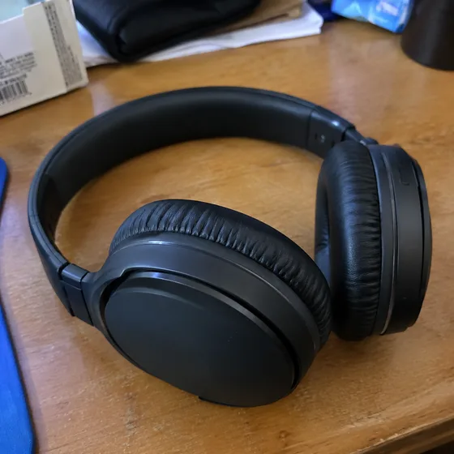
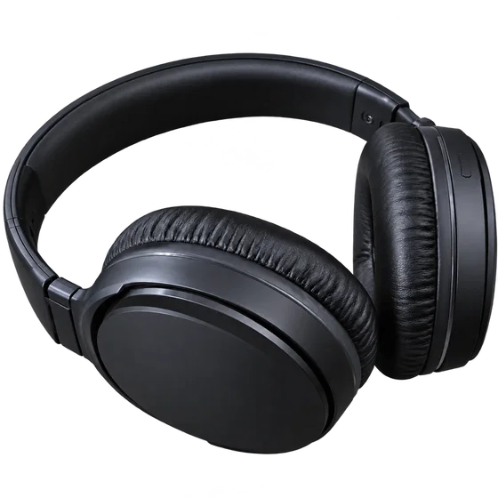

<div dir="rtl" align="right">

# أصول المنتج ذات الخلفية الشفافة · مادة المنتج ذات الخلفية الشفافة

[中文](../../../README.md) · [English](../../../README.en.md) · [Português](../../../README.pt.md) · [Español](../../../README.es.md) · [Français](../../../README.fr.md) · [Deutsch](../../../README.de.md) · [عربي](../../../README.ar.md) · [русский](../../../README.ru.md) · [日本語](../../../README.ja.md) · [हिंदी](../../../README.hi.md)


قم باستخراج منتج كقطعة قابلة لإعادة الاستخدام باستخدام قناة ألفا حقيقية.

قم بإنشاء منتج ذو قاع شفاف وقابل لإعادة الاستخدام PNG. للملصقات والكتالوجات والإعلانات.

[مطالبة النسخ](#public-prompt) · تم إنتاج [ بواسطة dearsketch / جرب عبر الإنترنت](https://dearsketch.com/ar/intent/i066-create-a-reusable-product-png-with-a-transparent-background.html?utm_source=github&utm_medium=case&utm_campaign=dearsketch-public-cases&utm_content=i066_cta) · [العودة إلى الموضوع / المجموعة](../guides/products.md)

## المواد المرجعية واتجاه النتيجة

<table>
<thead><tr><th width="50%">المواد المرجعية</th><th width="50%">مثال على النتائج</th></tr></thead>
<tbody><tr><td valign="top"><p><strong>صور المنتج</strong><br></p></td><td valign="top"><a href="https://dearsketch.com/ar/intent/i066-create-a-reusable-product-png-with-a-transparent-background.html?utm_source=github&amp;utm_medium=case&amp;utm_campaign=dearsketch-public-cases&amp;utm_content=i066_image"></a></td></tr></tbody>
</table>

يتم استخدام المواد المرجعية والنتائج لتوضيح الاتجاه البصري. القالب العام ليس تعليمات الإنشاء الأصلية للصور المصاحبة، ولا يمكن ضمان إعادة إنتاج نفس النتائج.

## ما يجب إعداده/المدخلات

| مادة | النوع / النوع | الكمية / الكمية | الحالة/المتطلبات |
| --- | --- | --- | --- |
| صور المنتج | صورة/صورة | 1 قطعة | مطلوب / مطلوب |

يتم إنشاء صورة واحدة فقط في كل مرة.

## الاحتفاظ والتغيير/التحرير الموجز

- **الحفاظ / 保留:** احتفظ بكل حافة المنتج، والفتحة، والملصق، واللون، والتفاصيل الشفافة أو العاكسة.
- **التغيير / التعديل:** قم بتغيير إزالة الخلفية فقط، وتنظيف الحواف، والتعامل مع الظل المحايد الاختياري.

## Public prompt

**قالب عام تم تحريره حديثًا · مؤلف حديثًا · لم يتم اختباره بواسطة الأجيال. ** استبدل معلمات القوس المربع وأرفق المواد المطلوبة في الأداة التي تدعم تحرير الصور؛ يتم إعداد المدخلات الاختيارية والشرطية حسب الجدول أعلاه. لم يتم استخدام هذا القالب لإنشاء الأمثلة في هذه الصفحة.

```text
Create one reusable product cutout from [PRODUCT PHOTO].
Preserve the exact product shape, proportions, colors, labels, openings, fine edges, transparent parts, and reflective details.
Remove the entire background without removing real product pixels.
Refine hair-like, fabric, glass, glossy, perforated, and semi-transparent edges carefully.
Do not redesign the product, fill openings, straighten labels, or invent hidden geometry.
Keep or remove the contact shadow according to [SHADOW REQUIREMENT].
Avoid white halos, dark fringes, jagged edges, color spill, and artificial outlines.
Export as [PNG / OTHER ALPHA-CAPABLE FORMAT] at [REQUIRED SIZE].
Open the delivered file over dark and light backgrounds to verify a genuine alpha channel.
Deliver one cutout asset only; do not substitute a white-background image.
```

[ اجعله متصلاً بالإنترنت باستخدام المواد الخاصة بك / اجعله متصلاً بالإنترنت](https://dearsketch.com/ar/intent/i066-create-a-reusable-product-png-with-a-transparent-background.html?utm_source=github&utm_medium=case&utm_campaign=dearsketch-public-cases&utm_content=i066_after-prompt) · [دع الوكيل يساعدك في تنظيمه / استخدم Skill](../quickstart.md#agent-skill)

## تحقق من النقاط الرئيسية/المراجعة

تحقق من قنوات الشفافية الحقيقية والحواف الصغيرة، ولا تعامل المعاينات البيضاء كدليل على الشفافية.

التحقق من قناة ألفا للملف الذي تم تصديره؛ معاينة رقعة الشطرنج ليست دليلا.

اتجاه النتيجة: مادة المنتج السفلية الشفافة. عندما يكون النص الدقيق أو الملفات الشفافة أو المتجهات أو تسليم الطباعة مطلوبًا، تحقق من الملف الفعلي؛ الميزات والرسوم المتاحة تخضع لوصف الموقع.

## الحالات ذات الصلة / المهام ذات الصلة

- [تحويل صورة منتج عادية إلى صورة قائمة بخلفية بيضاء · الصورة الرئيسية للمنتج بخلفية بيضاء ](./i065-turn-an-ordinary-product-photo-into-a-white-background-listing-image.md#public-prompt)
- [وضع منتج في مشهد واقعي لأسلوب الحياة · مشهد لأسلوب حياة المنتج](./i067-place-a-product-in-a-realistic-lifestyle-scene.md#public-prompt)
- [تحويل صورة عادية إلى لقطة منتج استوديو احترافية · صورة استوديو المنتج](./i068-turn-an-ordinary-photo-into-a-professional-studio-product-shot.md#public-prompt)

## متطلبات الخلفية المرجعية

- [Cutout.pro](https://www.cutout.pro/)
- [insMind تصوير المنتجات](https://www.insmind.com/image-tools/ai-product-photography)

تهدف هذه الروابط فقط إلى المساعدة في فهم الغرض وليست دليلاً على مصدر الصور الموجودة على هذه الصفحة أو ترخيصها.

للتعرف على نطاق استخدام الصور والمواد، راجع وصف محتوى [ ](../content-policy.md). [عرض جميع النماذج الخمسين ](../prompts.md).


</div>
