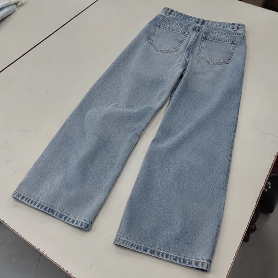
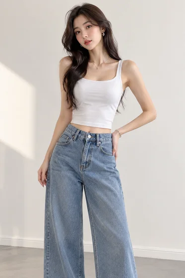

<div dir="rtl" align="right">

# الملابس المسطحة إلى صورة على النموذج · الملابس المسطحة إلى الصورة على النموذج

[中文](../../../README.md) · [English](../../../README.en.md) · [Português](../../../README.pt.md) · [Español](../../../README.es.md) · [Français](../../../README.fr.md) · [Deutsch](../../../README.de.md) · [عربي](../../../README.ar.md) · [русский](../../../README.ru.md) · [日本語](../../../README.ja.md) · [हिंदी](../../../README.hi.md)


تصور الملابس الموردة على النموذج دون تغيير تصميم الملابس.

قم بإنشاء مربعات الملابس في صور الجزء العلوي من الجسم لعارضات حقيقية. تستخدم لتفاصيل التجارة الإلكترونية والإعلانات.

[مطالبة النسخ](#public-prompt) · تم إنتاج [ بواسطة dearsketch / جرب عبر الإنترنت](https://dearsketch.com/ar/intent/i089-turn-flat-lay-clothing-into-an-on-model-image.html?utm_source=github&utm_medium=case&utm_campaign=dearsketch-public-cases&utm_content=i089_cta) · [العودة إلى الموضوع / المجموعة](../guides/products.md)

## المواد المرجعية واتجاه النتيجة

<table>
<thead><tr><th width="50%">المواد المرجعية</th><th width="50%">مثال على النتائج</th></tr></thead>
<tbody><tr><td valign="top"><p><strong>بلاط الملابس</strong><br></p></td><td valign="top"><a href="https://dearsketch.com/ar/intent/i089-turn-flat-lay-clothing-into-an-on-model-image.html?utm_source=github&amp;utm_medium=case&amp;utm_campaign=dearsketch-public-cases&amp;utm_content=i089_image"></a></td></tr></tbody>
</table>

يتم استخدام المواد المرجعية والنتائج لتوضيح الاتجاه البصري. القالب العام ليس تعليمات الإنشاء الأصلية للصور المصاحبة، ولا يمكن ضمان إعادة إنتاج نفس النتائج.

## ما يجب إعداده/المدخلات

| مادة | النوع / النوع | الكمية / الكمية | الحالة/المتطلبات |
| --- | --- | --- | --- |
| بلاط الملابس | صورة/صورة | 1 قطعة | مطلوب / مطلوب |

يتم إنشاء صورة واحدة فقط في كل مرة.

## الاحتفاظ والتغيير/التحرير الموجز

- **الحفاظ / 保留:** احتفظ بالصورة الظلية والبنية واللون والطباعة وإشارات القماش والزخارف والعلامات التجارية.
- **التغيير / العرض:** تغيير العرض التقديمي من الوضع المسطح إلى النموذج والوضعية والإعدادات والإضاءة.

## Public prompt

**قالب عام تم تحريره حديثًا · مؤلف حديثًا · لم يتم اختباره بواسطة الأجيال. ** استبدل معلمات القوس المربع وأرفق المواد المطلوبة في الأداة التي تدعم تحرير الصور؛ يتم إعداد المدخلات الاختيارية والشرطية حسب الجدول أعلاه. لم يتم استخدام هذا القالب لإنشاء الأمثلة في هذه الصفحة.

```text
Create one on-model image from [FLAT-LAY GARMENT PHOTO].
Preserve the garment’s exact silhouette, construction, color, print placement, fabric cues, seams, trims, closures, and branding.
Show it on [MODEL DESCRIPTION] in [POSE] and [SETTING].
Keep the garment’s front/back orientation and layering consistent with [WEAR INSTRUCTION].
Render drape, folds, tension, shadows, and body contact appropriate to the visible fabric.
Do not redesign the garment, alter the print, add pockets, remove labels, or invent unseen details.
Keep hands, limbs, neckline, hem, and garment boundaries anatomically coherent.
Do not claim exact fit, size accuracy, comfort, or real-world appearance on a buyer.
Treat the image as merchandising visualization, not a fitting-room guarantee.
Deliver one on-model image only.
```

[ اجعله متصلاً بالإنترنت باستخدام المواد الخاصة بك / اجعله متصلاً بالإنترنت](https://dearsketch.com/ar/intent/i089-turn-flat-lay-clothing-into-an-on-model-image.html?utm_source=github&utm_medium=case&utm_campaign=dearsketch-public-cases&utm_content=i089_after-prompt) · [دع الوكيل يساعدك في تنظيمه / استخدم Skill](../quickstart.md#agent-skill)

## تحقق من النقاط الرئيسية/المراجعة

التحقق من الأنماط والمطبوعات والأقمشة والتفاصيل والصور التي تم إنشاؤها ليست دليلاً على الحجم الحقيقي أو الملاءمة الفعلية.

تحقق من جميع تفاصيل الملابس وتأكد من عدم إثبات الملاءمة والمقاس.

اتجاه النتيجة: صور نماذج الملابس. عندما يكون النص الدقيق أو الملفات الشفافة أو المتجهات أو تسليم الطباعة مطلوبًا، تحقق من الملف الفعلي؛ الميزات والرسوم المتاحة تخضع لوصف الموقع.

## الحالات ذات الصلة / المهام ذات الصلة

- [تحويل صورة منتج عادية إلى صورة قائمة بخلفية بيضاء · الصورة الرئيسية للمنتج بخلفية بيضاء ](./i065-turn-an-ordinary-product-photo-into-a-white-background-listing-image.md#public-prompt)
- [إنشاء منتج قابل لإعادة الاستخدام PNG بخلفية شفافة · مادة المنتج ذات الجزء السفلي الشفاف ](./i066-create-a-reusable-product-png-with-a-transparent-background.md#public-prompt)
- [وضع منتج في مشهد واقعي لأسلوب الحياة · مشهد لأسلوب حياة المنتج](./i067-place-a-product-in-a-realistic-lifestyle-scene.md#public-prompt)

## متطلبات الخلفية المرجعية

- [ أداة الذكاء الاصطناعي لغرفة الصور](https://help.photoroom.com/en/articles/11495331-introduction-to-ai-tools-in-photoroom)
- [ Meitu Design Studio](https://www.designkit.cn/help/143)

تهدف هذه الروابط فقط إلى المساعدة في فهم الغرض وليست دليلاً على مصدر الصور الموجودة على هذه الصفحة أو ترخيصها.

للتعرف على نطاق استخدام الصور والمواد، راجع وصف محتوى [ ](../content-policy.md). [عرض جميع النماذج الخمسين ](../prompts.md).


</div>
