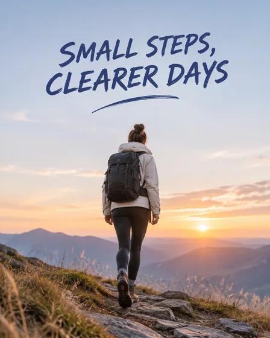

<div dir="rtl" align="right">

# منشور اجتماعي مرئي · منشور اجتماعي مرئي رئيسي

[中文](../../../README.md) · [English](../../../README.en.md) · [Português](../../../README.pt.md) · [Español](../../../README.es.md) · [Français](../../../README.fr.md) · [Deutsch](../../../README.de.md) · [عربي](../../../README.ar.md) · [русский](../../../README.ru.md) · [日本語](../../../README.ja.md) · [हिंदी](../../../README.hi.md)


أنشئ منشورًا اجتماعيًا واحدًا يحتوي على نص حول ملخصك المحدد لموجزك المحدد من النص وحده.

قم بإنشاء صور مرئية للنشر اليومي مناسبة لمنصات التواصل الاجتماعي. لإينستاجرام، الفيسبوك، Xiaohongshu.

[مطالبة النسخ](#public-prompt) · تم إنتاج [ بواسطة dearsketch / جرب عبر الإنترنت](https://dearsketch.com/ar/intent/i104-create-everyday-social-media-post-visuals.html?utm_source=github&utm_medium=case&utm_campaign=dearsketch-public-cases&utm_content=i104_cta) · [العودة إلى الموضوع / المجموعة](../guides/text-only.md)

## المواد المرجعية واتجاه النتيجة

<p><strong>مثال على النتائج</strong></p>
<p><a href="https://dearsketch.com/ar/intent/i104-create-everyday-social-media-post-visuals.html?utm_source=github&amp;utm_medium=case&amp;utm_campaign=dearsketch-public-cases&amp;utm_content=i104_image"></a></p>
<p>هذا المثال عبارة عن إدخال نص، ولم يتم إرفاق أي مرجع للصورة.</p>

يتم استخدام المواد المرجعية والنتائج لتوضيح الاتجاه البصري. القالب العام ليس تعليمات الإنشاء الأصلية للصور المصاحبة، ولا يمكن ضمان إعادة إنتاج نفس النتائج.

## ما يجب إعداده/المدخلات

| مادة | النوع / النوع | الكمية / الكمية | الحالة/المتطلبات |
| --- | --- | --- | --- |
| موجز إنشاء النص: املأ الموضوع والغرض والمعلمات الواقعية بالكلمات السريعة | الحرف / النص | 1 حصة | مطلوب / مطلوب |

**إنشاء نص خالص / نص فقط: لا يلزم وجود صورة أو شعار أو رسم تخطيطي أو أي مرفق آخر. ** استخدم فقط ملخص النص أدناه لإنشاء مفاهيم جديدة.

يتم إنشاء صورة واحدة فقط في كل مرة، ولا حاجة لتحميل الصور.

## الاحتفاظ والتغيير/التحرير الموجز

- **الحفاظ / 保留:** احترام الحقائق المكتوبة المقدمة والصياغة الدقيقة والقيود.
- **التغيير / 改变:** استخدم [ORIGINAL VISUAL METAPHOR] كنقطة محورية، [PALETTE] و[ASPECT RATIO]. قم بتعيين العنوان الدقيق "[HEADLINE]" بتسلسل هرمي واضح وهوامش كبيرة.

## Public prompt

**قالب عام تم تجميعه حديثًا · مؤلف حديثًا · لم يتم اختباره بواسطة الأجيال.** ما عليك سوى استبدال معلمات القوس المربع، دون الحاجة إلى تحميل صور مرجعية. لم يتم استخدام هذا القالب لإنشاء الأمثلة في هذه الصفحة.

```text
Create one text-led social post about [TOPIC] for [PLATFORM] from the following written brief only. No reference image or other attachment is needed.
Use [ORIGINAL VISUAL METAPHOR] as the focal point, [PALETTE] and [ASPECT RATIO]. Set the exact headline “[HEADLINE]” with clear hierarchy and generous margins.
Do not invent a real product, testimonial or news event; proofread the headline.
Use an original design. Do not imply fidelity to any existing person, product, property or artwork that has not been supplied.
Return one finished image only. Replace every bracketed field with your own details before generating.
```

[ اجعله متصلاً بالإنترنت باستخدام المواد الخاصة بك / اجعله متصلاً بالإنترنت](https://dearsketch.com/ar/intent/i104-create-everyday-social-media-post-visuals.html?utm_source=github&utm_medium=case&utm_campaign=dearsketch-public-cases&utm_content=i104_after-prompt) · [دع الوكيل يساعدك في تنظيمه / استخدم Skill](../quickstart.md#agent-skill)

## تحقق من النقاط الرئيسية/المراجعة

لا تخترع منتجًا حقيقيًا أو شهادة أو حدثًا إخباريًا؛ تدقيق العنوان.

لا تخترع منتجًا حقيقيًا أو شهادة أو حدثًا إخباريًا؛ تدقيق العنوان.

اتجاه النتائج: منشورات وسائل التواصل الاجتماعي. عندما يكون النص الدقيق أو الملفات الشفافة أو المتجهات أو تسليم الطباعة مطلوبًا، تحقق من الملف الفعلي؛ الميزات والرسوم المتاحة تخضع لوصف الموقع.

## الحالات ذات الصلة / المهام ذات الصلة

- [ إنشاء صورة ملف شخصي لموقع YouTube أو البث المباشر · الصورة الرمزية للقناة التي يتم إنشاؤها بواسطة النص ](./i054-create-a-profile-picture-for-youtube-or-streaming.md#public-prompt)
- [ إنشاء رمز تعبيري مخصص من النص · رمز تعبيري مخصص](./i057-create-a-custom-emoji-from-text.md#public-prompt)
- [إنشاء مطبوعات وأنماط قماشية سلسة للملابس · ](./i100-create-seamless-prints-and-fabric-patterns-for-clothing.md#public-prompt)

## متطلبات الخلفية المرجعية

- [ أداة Picsart AI](https://picsart.com/ai/)

تهدف هذه الروابط فقط إلى المساعدة في فهم الغرض وليست دليلاً على مصدر الصور الموجودة على هذه الصفحة أو ترخيصها.

للتعرف على نطاق استخدام الصور والمواد، راجع وصف محتوى [ ](../content-policy.md). [عرض جميع النماذج المائة ](../prompts.md).


</div>
