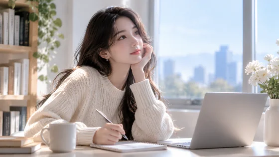

<div dir="rtl" align="right">

# مفهوم بطل الموقع · رؤية مفهوم بطل الموقع

[中文](../../../README.md) · [English](../../../README.en.md) · [Português](../../../README.pt.md) · [Español](../../../README.es.md) · [Français](../../../README.fr.md) · [Deutsch](../../../README.de.md) · [عربي](../../../README.ar.md) · [русский](../../../README.ru.md) · [日本語](../../../README.ja.md) · [हिंदी](../../../README.hi.md)


قم بإنشاء رسم توضيحي أصلي لبطل موقع الويب لملخصك المحدد من النص وحده.

إنشاء رؤية البطل للصفحة الرئيسية للموقع. تستخدم للصفحة الرئيسية للموقع الرسمي.

[مطالبة النسخ](#public-prompt) · تم إنتاج [ بواسطة dearsketch / جرب عبر الإنترنت](https://dearsketch.com/ar/intent/i120-create-a-website-homepage-hero-visual.html?utm_source=github&utm_medium=case&utm_campaign=dearsketch-public-cases&utm_content=i120_cta) · [العودة إلى الموضوع / المجموعة](../guides/text-only.md)

## المواد المرجعية واتجاه النتيجة

<p><strong>مثال على النتائج</strong></p>
<p><a href="https://dearsketch.com/ar/intent/i120-create-a-website-homepage-hero-visual.html?utm_source=github&amp;utm_medium=case&amp;utm_campaign=dearsketch-public-cases&amp;utm_content=i120_image"></a></p>
<p>هذا المثال عبارة عن إدخال نص، ولم يتم إرفاق أي مرجع للصورة.</p>

يتم استخدام المواد المرجعية والنتائج لتوضيح الاتجاه البصري. القالب العام ليس تعليمات الإنشاء الأصلية للصور المصاحبة، ولا يمكن ضمان إعادة إنتاج نفس النتائج.

## ما يجب إعداده/المدخلات

| مادة | النوع / النوع | الكمية / الكمية | الحالة/المتطلبات |
| --- | --- | --- | --- |
| موجز إنشاء النص: املأ الموضوع والغرض والمعلمات الواقعية بالكلمات السريعة | الحرف / النص | 1 حصة | مطلوب / مطلوب |

**إنشاء نص خالص / نص فقط: لا يلزم وجود صورة أو شعار أو رسم تخطيطي أو أي مرفق آخر. ** استخدم فقط ملخص النص أدناه لإنشاء مفاهيم جديدة.

يتم إنشاء صورة واحدة فقط في كل مرة، ولا حاجة لتحميل الصور.

## الاحتفاظ والتغيير/التحرير الموجز

- **الحفاظ / 保留:** احترام الحقائق المكتوبة المقدمة والصياغة الدقيقة والقيود.
- **التغيير / التعليق:** تصور [CORE VALUE] من خلال [SCENE OR METAPHOR]. استخدم [PALETTE] و[ASPECT RATIO] ومنطقة [LEFT OR RIGHT] الهادئة لنسخ الصفحة لاحقًا.

## Public prompt

**قالب عام تم تجميعه حديثًا · مؤلف حديثًا · لم يتم اختباره بواسطة الأجيال.** ما عليك سوى استبدال معلمات القوس المربع، دون الحاجة إلى تحميل صور مرجعية. لم يتم استخدام هذا القالب لإنشاء الأمثلة في هذه الصفحة.

```text
Create one original website hero illustration for [SERVICE POSITIONING] from the following written brief only. No reference image or other attachment is needed.
Visualize [CORE VALUE] through [SCENE OR METAPHOR]. Use [PALETTE], [ASPECT RATIO] and a quiet [LEFT OR RIGHT] area for later page copy.
Do not fabricate a real interface, user testimonial or product feature; keep it a brand concept.
Use an original design. Do not imply fidelity to any existing person, product, property or artwork that has not been supplied.
Return one finished image only. Replace every bracketed field with your own details before generating.
```

[ اجعله متصلاً بالإنترنت باستخدام المواد الخاصة بك / اجعله متصلاً بالإنترنت](https://dearsketch.com/ar/intent/i120-create-a-website-homepage-hero-visual.html?utm_source=github&utm_medium=case&utm_campaign=dearsketch-public-cases&utm_content=i120_after-prompt) · [دع الوكيل يساعدك في تنظيمه / استخدم Skill](../quickstart.md#agent-skill)

## تحقق من النقاط الرئيسية/المراجعة

لا تقم بتصنيع واجهة حقيقية أو شهادة مستخدم أو ميزة منتج؛ اجعله مفهومًا للعلامة التجارية.

لا تقم بتصنيع واجهة حقيقية أو شهادة مستخدم أو ميزة منتج؛ اجعله مفهومًا للعلامة التجارية.

اتجاه النتيجة: صورة بطل الموقع. عندما يكون النص الدقيق أو الملفات الشفافة أو المتجهات أو تسليم الطباعة مطلوبًا، تحقق من الملف الفعلي؛ الميزات والرسوم المتاحة تخضع لوصف الموقع.

## الحالات ذات الصلة / المهام ذات الصلة

- [ إنشاء صورة ملف شخصي لموقع YouTube أو البث المباشر · الصورة الرمزية للقناة التي يتم إنشاؤها بواسطة النص ](./i054-create-a-profile-picture-for-youtube-or-streaming.md#public-prompt)
- [ إنشاء رمز تعبيري مخصص من النص · رمز تعبيري مخصص](./i057-create-a-custom-emoji-from-text.md#public-prompt)
- [إنشاء مطبوعات وأنماط قماشية سلسة للملابس · ](./i100-create-seamless-prints-and-fabric-patterns-for-clothing.md#public-prompt)

## متطلبات الخلفية المرجعية

- [Freepik AI](https://www.freepik.com/ai)

تهدف هذه الروابط فقط إلى المساعدة في فهم الغرض وليست دليلاً على مصدر الصور الموجودة على هذه الصفحة أو ترخيصها.

للتعرف على نطاق استخدام الصور والمواد، راجع وصف محتوى [ ](../content-policy.md). [عرض جميع النماذج المائة ](../prompts.md).


</div>
