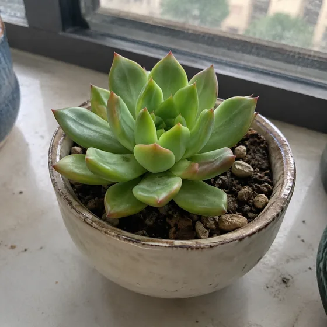
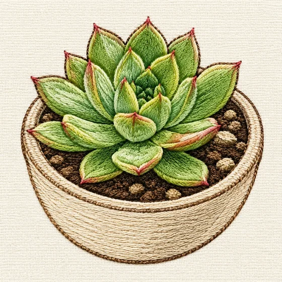

<div dir="rtl" align="right">

# مفهوم عزر التطريز · مفهوم نمط نمط التطريز

[中文](../../../README.md) · [English](../../../README.en.md) · [Português](../../../README.pt.md) · [Español](../../../README.es.md) · [Français](../../../README.fr.md) · [Deutsch](../../../README.de.md) · [عربي](../../../README.ar.md) · [русский](../../../README.ru.md) · [日本語](../../../README.ja.md) · [हिंदी](../../../README.hi.md)


قم بإنشاء مفهوم واحد لتصميم التطريز لموجزك المحدد من النص وحده.

تحويل النص أو الصور إلى اتجاهات نمط التطريز. تستخدم للملابس والشارات والحرف اليدوية.

[مطالبة النسخ](#public-prompt) · تم إنتاج [ بواسطة dearsketch / جرب عبر الإنترنت](https://dearsketch.com/ar/intent/i160-turn-text-or-an-image-into-an-embroidery-design-direction.html?utm_source=github&utm_medium=case&utm_campaign=dearsketch-public-cases&utm_content=i160_cta) · [العودة إلى الموضوع / المجموعة](../guides/text-only.md)

## المواد المرجعية واتجاه النتيجة

<table>
<thead><tr><th width="50%">المواد المرجعية</th><th width="50%">مثال على النتائج</th></tr></thead>
<tbody><tr><td valign="top"><p><strong>الصورة أو الشعار الأصلي</strong><br></p></td><td valign="top"><a href="https://dearsketch.com/ar/intent/i160-turn-text-or-an-image-into-an-embroidery-design-direction.html?utm_source=github&amp;utm_medium=case&amp;utm_campaign=dearsketch-public-cases&amp;utm_content=i160_image"></a></td></tr></tbody>
</table>

يتم استخدام المواد المرجعية والنتائج لتوضيح الاتجاه البصري. القالب العام ليس تعليمات الإنشاء الأصلية للصور المصاحبة، ولا يمكن ضمان إعادة إنتاج نفس النتائج.

## ما يجب إعداده/المدخلات

| مادة | النوع / النوع | الكمية / الكمية | الحالة/المتطلبات |
| --- | --- | --- | --- |
| موجز إنشاء النص: املأ الموضوع والغرض والمعلمات الواقعية بالكلمات السريعة | الحرف / النص | 1 حصة | مطلوب / مطلوب |

**إنشاء نص خالص / نص فقط: لا يلزم وجود صورة أو شعار أو رسم تخطيطي أو أي مرفق آخر. ** استخدم فقط ملخص النص أدناه لإنشاء مفاهيم جديدة.

يتم إنشاء صورة واحدة فقط في كل مرة، ولا حاجة لتحميل الصور. اختر فرع السمة النصية فقط لموقع الويب.

## الاحتفاظ والتغيير/التحرير الموجز

- **الحفاظ / 保留:** احترام الحقائق المكتوبة المقدمة والصياغة الدقيقة والقيود.
- **التغيير / 改变:** استخدم [THREAD COLORS] والأشكال المغلقة العريضة و[LINE WEIGHT] المناسبة لـ [FINISHED SIZE AND PLACEMENT]. تجنب التدرجات والجزر الصغيرة والتفاصيل المتداخلة المفرطة.

## Public prompt

**قالب عام تم تجميعه حديثًا · مؤلف حديثًا · لم يتم اختباره بواسطة الأجيال.** ما عليك سوى استبدال معلمات القوس المربع، دون الحاجة إلى تحميل صور مرجعية. لم يتم استخدام هذا القالب لإنشاء الأمثلة في هذه الصفحة.

```text
Create one embroidery-design concept of [TEXT-DESCRIBED MOTIF] from the following written brief only. No reference image or other attachment is needed.
Use [THREAD COLORS], broad closed shapes and [LINE WEIGHT] suited to [FINISHED SIZE AND PLACEMENT]. Avoid gradients, tiny islands and excessive overlapping detail.
This is a visual motif, not digitized stitch instructions; stitch count, density and machine files need separate work.
Use an original design. Do not imply fidelity to any existing person, product, property or artwork that has not been supplied.
Return one finished image only. Replace every bracketed field with your own details before generating.
```

[ اجعله متصلاً بالإنترنت باستخدام المواد الخاصة بك / اجعله متصلاً بالإنترنت](https://dearsketch.com/ar/intent/i160-turn-text-or-an-image-into-an-embroidery-design-direction.html?utm_source=github&utm_medium=case&utm_campaign=dearsketch-public-cases&utm_content=i160_after-prompt) · [دع الوكيل يساعدك في تنظيمه / استخدم Skill](../quickstart.md#agent-skill)

## تحقق من النقاط الرئيسية/المراجعة

هذه فكرة مرئية، وليست تعليمات رقمية للغرزة؛ يحتاج عدد الغرز والكثافة وملفات الآلة إلى عمل منفصل.

هذه فكرة مرئية، وليست تعليمات رقمية للغرزة؛ يحتاج عدد الغرز والكثافة وملفات الآلة إلى عمل منفصل.

النتائج في اتجاه: تصاميم التطريز. عندما يكون النص الدقيق أو الملفات الشفافة أو المتجهات أو تسليم الطباعة مطلوبًا، تحقق من الملف الفعلي؛ الميزات والرسوم المتاحة تخضع لوصف الموقع.

## الحالات ذات الصلة / المهام ذات الصلة

- [ إنشاء صورة ملف شخصي لموقع YouTube أو البث المباشر · الصورة الرمزية للقناة التي يتم إنشاؤها بواسطة النص ](./i054-create-a-profile-picture-for-youtube-or-streaming.md#public-prompt)
- [ إنشاء رمز تعبيري مخصص من النص · رمز تعبيري مخصص](./i057-create-a-custom-emoji-from-text.md#public-prompt)
- [إنشاء مطبوعات وأنماط قماشية سلسة للملابس · ](./i100-create-seamless-prints-and-fabric-patterns-for-clothing.md#public-prompt)

## متطلبات الخلفية المرجعية

- [Cutout.pro](https://www.cutout.pro/)
- [LightXجميع الأدوات](https://www.lightxeditor.com/all-tools/all-tools/)

تهدف هذه الروابط فقط إلى المساعدة في فهم الغرض وليست دليلاً على مصدر الصور الموجودة على هذه الصفحة أو ترخيصها.

للتعرف على نطاق استخدام الصور والمواد، راجع وصف محتوى [ ](../content-policy.md). [عرض جميع النماذج المائة ](../prompts.md).


</div>
