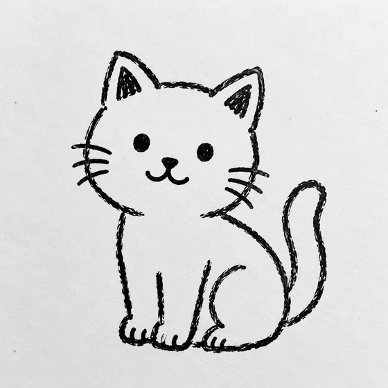
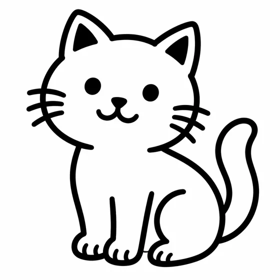

<div dir="rtl" align="right">

# مفهوم خط القطع · مفهوم خط القطع

[中文](../../../README.md) · [English](../../../README.en.md) · [Português](../../../README.pt.md) · [Español](../../../README.es.md) · [Français](../../../README.fr.md) · [Deutsch](../../../README.de.md) · [عربي](../../../README.ar.md) · [русский](../../../README.ru.md) · [日本語](../../../README.ja.md) · [हिंदी](../../../README.hi.md)


قم بإنشاء مفهوم تصميم القطع الأصلي لموجزك المحدد من النص وحده.

قم بإنشاء فن خط متجه مناسب لقطع Cricut أو الليزر. بالنسبة للكريكت، القطع بالليزر.

[مطالبة النسخ](#public-prompt) · تم إنتاج [ بواسطة dearsketch / جرب عبر الإنترنت](https://dearsketch.com/ar/intent/i166-create-vector-line-art-for-cricut-or-laser-cutting.html?utm_source=github&utm_medium=case&utm_campaign=dearsketch-public-cases&utm_content=i166_cta) · [العودة إلى الموضوع / المجموعة](../guides/text-only.md)

## المواد المرجعية واتجاه النتيجة

<table>
<thead><tr><th width="50%">المواد المرجعية</th><th width="50%">مثال على النتائج</th></tr></thead>
<tbody><tr><td valign="top"><p><strong>الصورة الأصلية المراد تحويلها</strong><br></p></td><td valign="top"><a href="https://dearsketch.com/ar/intent/i166-create-vector-line-art-for-cricut-or-laser-cutting.html?utm_source=github&amp;utm_medium=case&amp;utm_campaign=dearsketch-public-cases&amp;utm_content=i166_image"></a></td></tr></tbody>
</table>

يتم استخدام المواد المرجعية والنتائج لتوضيح الاتجاه البصري. القالب العام ليس تعليمات الإنشاء الأصلية للصور المصاحبة، ولا يمكن ضمان إعادة إنتاج نفس النتائج.

## ما يجب إعداده/المدخلات

| مادة | النوع / النوع | الكمية / الكمية | الحالة/المتطلبات |
| --- | --- | --- | --- |
| موجز إنشاء النص: املأ الموضوع والغرض والمعلمات الواقعية بالكلمات السريعة | الحرف / النص | 1 حصة | مطلوب / مطلوب |

**إنشاء نص خالص / نص فقط: لا يلزم وجود صورة أو شعار أو رسم تخطيطي أو أي مرفق آخر. ** استخدم فقط ملخص النص أدناه لإنشاء مفاهيم جديدة.

يتم إنشاء صورة واحدة فقط في كل مرة، ولا حاجة لتحميل الصور.

## الاحتفاظ والتغيير/التحرير الموجز

- **الحفاظ / 保留:** احترام الحقائق المكتوبة المقدمة والصياغة الدقيقة والقيود.
- **التغيير / 改变:** استخدم الصور الظلية البسيطة المغلقة، [MINIMUM FEATURE WIDTH] والجسور المقصودة التي تحافظ على القطع الداخلية متصلة. افصل [LAYERS] بصريًا وتجنب العلامات الضالة.

## Public prompt

**قالب عام تم تجميعه حديثًا · مؤلف حديثًا · لم يتم اختباره بواسطة الأجيال.** ما عليك سوى استبدال معلمات القوس المربع، دون الحاجة إلى تحميل صور مرجعية. لم يتم استخدام هذا القالب لإنشاء الأمثلة في هذه الصفحة.

```text
Create one original cutting-design concept of [MOTIF] for [MATERIAL AND PROCESS] from the following written brief only. No reference image or other attachment is needed.
Use simple closed silhouettes, [MINIMUM FEATURE WIDTH] and intentional bridges that keep interior pieces attached. Separate [LAYERS] visually and avoid stray marks.
The image is a drafting reference, not an executable cut file; rebuild and test vector paths in the cutting software.
Use an original design. Do not imply fidelity to any existing person, product, property or artwork that has not been supplied.
Return one finished image only. Replace every bracketed field with your own details before generating.
```

[ اجعله متصلاً بالإنترنت باستخدام المواد الخاصة بك / اجعله متصلاً بالإنترنت](https://dearsketch.com/ar/intent/i166-create-vector-line-art-for-cricut-or-laser-cutting.html?utm_source=github&utm_medium=case&utm_campaign=dearsketch-public-cases&utm_content=i166_after-prompt) · [دع الوكيل يساعدك في تنظيمه / استخدم Skill](../quickstart.md#agent-skill)

## تحقق من النقاط الرئيسية/المراجعة

الصورة هي مرجع صياغة، وليست ملف قطع قابل للتنفيذ؛ إعادة بناء واختبار مسارات المتجهات في برنامج القطع.

الصورة هي مرجع صياغة، وليست ملف قطع قابل للتنفيذ؛ إعادة بناء واختبار مسارات المتجهات في برنامج القطع.

اتجاه النتيجة: ملف قطع SVG. عندما يكون النص الدقيق أو الملفات الشفافة أو المتجهات أو تسليم الطباعة مطلوبًا، تحقق من الملف الفعلي؛ الميزات والرسوم المتاحة تخضع لوصف الموقع.

## الحالات ذات الصلة / المهام ذات الصلة

- [ إنشاء صورة ملف شخصي لموقع YouTube أو البث المباشر · الصورة الرمزية للقناة التي يتم إنشاؤها بواسطة النص ](./i054-create-a-profile-picture-for-youtube-or-streaming.md#public-prompt)
- [ إنشاء رمز تعبيري مخصص من النص · رمز تعبيري مخصص](./i057-create-a-custom-emoji-from-text.md#public-prompt)
- [إنشاء مطبوعات وأنماط قماشية سلسة للملابس · ](./i100-create-seamless-prints-and-fabric-patterns-for-clothing.md#public-prompt)

## متطلبات الخلفية المرجعية

- [E أعمال فنية جدارية تعمل بالذكاء الاصطناعي](https://www.etsy.com/market/ai_wall_art)
- [Recraft](https://www.recraft.ai/Generate)

تهدف هذه الروابط فقط إلى المساعدة في فهم الغرض وليست دليلاً على مصدر الصور الموجودة على هذه الصفحة أو ترخيصها.

للتعرف على نطاق استخدام الصور والمواد، راجع وصف محتوى [ ](../content-policy.md). [عرض جميع النماذج المائة ](../prompts.md).


</div>
