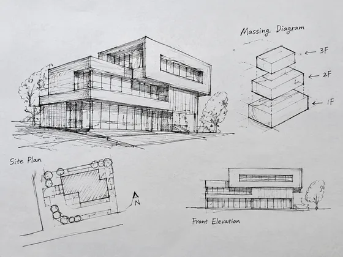
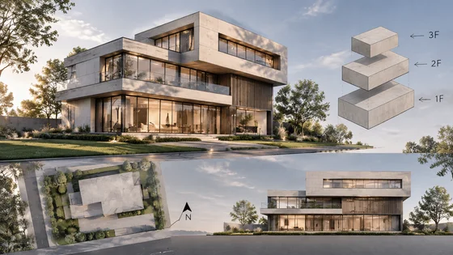

<div dir="rtl" align="right">

# مفهوم الواجهة المعمارية · مفهوم واجهة المبنى

[中文](../../../README.md) · [English](../../../README.en.md) · [Português](../../../README.pt.md) · [Español](../../../README.es.md) · [Français](../../../README.fr.md) · [Deutsch](../../../README.de.md) · [عربي](../../../README.ar.md) · [русский](../../../README.ru.md) · [日本語](../../../README.ja.md) · [हिंदी](../../../README.hi.md)


قم بتطوير واجهة من رسم تخطيطي اختياري أو من ملخص استخدام المبنى واتجاه التصميم.

إنشاء مفاهيم واجهة المبنى من النص أو الرسومات. تستخدم للمسابقات والمقترحات والتقارير.

[مطالبة النسخ](#public-prompt) · تم إنتاج [ بواسطة dearsketch / جرب عبر الإنترنت](https://dearsketch.com/ar/intent/i177-create-an-architectural-facade-concept-from-text-or-a-sketch.html?utm_source=github&utm_medium=case&utm_campaign=dearsketch-public-cases&utm_content=i177_cta) · [العودة إلى الموضوع / المجموعة](../guides/spaces.md)

## المواد المرجعية واتجاه النتيجة

<table>
<thead><tr><th width="50%">المواد المرجعية</th><th width="50%">مثال على النتائج</th></tr></thead>
<tbody><tr><td valign="top"><p><strong>المخططات المعمارية أو الرسومات الجماعية</strong><br></p></td><td valign="top"><a href="https://dearsketch.com/ar/intent/i177-create-an-architectural-facade-concept-from-text-or-a-sketch.html?utm_source=github&amp;utm_medium=case&amp;utm_campaign=dearsketch-public-cases&amp;utm_content=i177_image"></a></td></tr></tbody>
</table>

يتم استخدام المواد المرجعية والنتائج لتوضيح الاتجاه البصري. القالب العام ليس تعليمات الإنشاء الأصلية للصور المصاحبة، ولا يمكن ضمان إعادة إنتاج نفس النتائج.

## ما يجب إعداده/المدخلات

| مادة | النوع / النوع | الكمية / الكمية | الحالة/المتطلبات |
| --- | --- | --- | --- |
| المخططات المعمارية أو الرسومات الجماعية | صورة/صورة | 0-1؛ يمكن دمج مواد متعددة في لوحة مرجعية واحدة تحمل علامة | اختياري/اختياري: عندما يكون لدى المستخدم بالفعل نموذج بناء أو افتتاح أو رسم تخطيطي للموقع |
| استخدام البناء، وتصميم الكلمات الرئيسية | الحرف / النص | 1 حصة | مطلوب / مطلوب |

يتم إنشاء صورة واحدة فقط في كل مرة.

## الاحتفاظ والتغيير/التحرير الموجز

- **الحفظ / 保留:** احتفظ بالتجميع والفتحات المتوفرة فقط عند وجود رسم تخطيطي أو مرجع تجميعي.
- **التغيير / 改变:** تغيير مواد الواجهة والتعبير والبيئة والمناظر الطبيعية والضوء.

## Public prompt

**قالب عام تم تحريره حديثًا · مؤلف حديثًا · لم يتم اختباره بواسطة الأجيال. ** استبدل معلمات القوس المربع وأرفق المواد المطلوبة في الأداة التي تدعم تحرير الصور؛ يتم إعداد المدخلات الاختيارية والشرطية حسب الجدول أعلاه. لم يتم استخدام هذا القالب لإنشاء الأمثلة في هذه الصفحة.

```text
Create one architectural facade concept for [BUILDING USE] with [DESIGN KEYWORDS].
Choose one branch: follow [OPTIONAL SKETCH OR MASSING IMAGE] when supplied, or create a text-led concept from the brief when no image exists.
For the reference branch, preserve the supplied massing, floor count, principal openings, roof form, proportions, and camera view.
For the text-only branch, do not claim that any generated geometry reproduces an existing design.
Develop [FACADE MATERIALS], [OPENING TREATMENT], [SHADING ELEMENTS], and [ENTRY EXPRESSION].
Add a restrained [SITE CONTEXT], [LANDSCAPE], and [LIGHTING CONDITION] for scale.
Keep perspective, material joints, shadows, and human scale coherent.
Do not invent planning approval, structural feasibility, energy performance, or code compliance.
Do not treat generated details as measured dimensions or construction assemblies.
Deliver one facade concept rendering only for design discussion.
```

[ اجعله متصلاً بالإنترنت باستخدام المواد الخاصة بك / اجعله متصلاً بالإنترنت](https://dearsketch.com/ar/intent/i177-create-an-architectural-facade-concept-from-text-or-a-sketch.html?utm_source=github&utm_medium=case&utm_campaign=dearsketch-public-cases&utm_content=i177_after-prompt) · [دع الوكيل يساعدك في تنظيمه / استخدم Skill](../quickstart.md#agent-skill)

## تحقق من النقاط الرئيسية/المراجعة

يتم توضيح غرض المبنى واتجاه التصميم، ويتم استخدام النتائج للتواصل المفاهيمي، وليس للرسومات الإنشائية.

تعامل مع المخرجات على أنها تواصل مفاهيمي، وليس رسمًا للبناء.

اتجاه النتيجة: تقديم المفهوم المعماري. عندما يكون النص الدقيق أو الملفات الشفافة أو المتجهات أو تسليم الطباعة مطلوبًا، تحقق من الملف الفعلي؛ الميزات والرسوم المتاحة تخضع لوصف الموقع.

## الحالات ذات الصلة / المهام ذات الصلة

- [ تحويل صورة منزل إلى لوحة مائية أو فن خطي · لوحة تذكارية سكنية بالألوان المائية ](./i030-turn-a-house-photo-into-a-watercolor-or-line-art-keepsake.md#public-prompt)
- [ معاينة الأنماط الداخلية المختلفة في صورة الغرفة · معاينة نمط ديكور الغرفة](./i169-preview-different-interior-styles-in-a-room-photo.md#public-prompt)
- [ إنشاء مفهوم تجديد المناظر الطبيعية من صورة الفناء · تجديد المناظر الطبيعية في الفناء ](./i178-create-a-landscape-makeover-concept-from-a-yard-photo.md#public-prompt)

## متطلبات الخلفية المرجعية

- [جيل بناء Adobe ](https://www.adobe.com/products/firefly/features/ai-architecture-generator.html)

تهدف هذه الروابط فقط إلى المساعدة في فهم الغرض وليست دليلاً على مصدر الصور الموجودة على هذه الصفحة أو ترخيصها.

للتعرف على نطاق استخدام الصور والمواد، راجع وصف محتوى [ ](../content-policy.md). [عرض جميع النماذج الخمسين ](../prompts.md).


</div>
