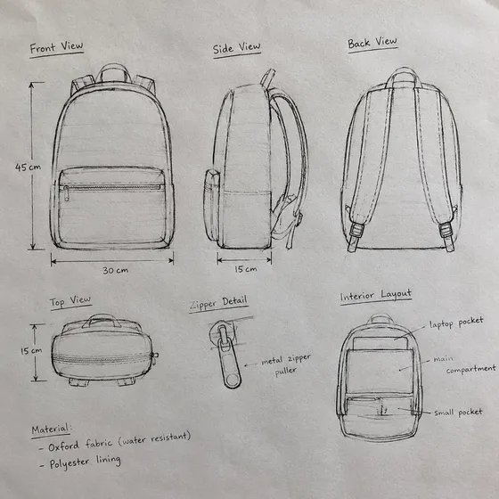
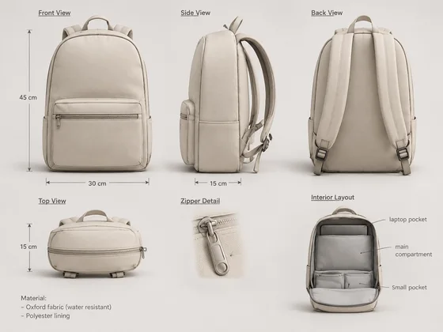

<div dir="rtl" align="right">

# النموذج الأولي للمنتج الافتراضي · النموذج الأولي للمنتج الافتراضي

[中文](../../../README.md) · [English](../../../README.en.md) · [Português](../../../README.pt.md) · [Español](../../../README.es.md) · [Français](../../../README.fr.md) · [Deutsch](../../../README.de.md) · [عربي](../../../README.ar.md) · [русский](../../../README.ru.md) · [日本語](../../../README.ja.md) · [हिंदी](../../../README.hi.md)


أنشئ نموذجًا أوليًا مرئيًا لملخصك الجديد المحدد من النص وحده.

قم بإنشاء نماذج أولية للمنتج قابلة للعرض قبل صنع المنتج الفعلي. يستخدم للتمويل، ومقابلات المستخدمين، والتمويل الجماعي.

[مطالبة النسخ](#public-prompt) · تم إنتاج [ بواسطة dearsketch / جرب عبر الإنترنت](https://dearsketch.com/ar/intent/i191-create-a-presentation-ready-product-prototype-image-before-production.html?utm_source=github&utm_medium=case&utm_campaign=dearsketch-public-cases&utm_content=i191_cta) · [العودة إلى الموضوع / المجموعة](../guides/text-only.md)

## المواد المرجعية واتجاه النتيجة

<table>
<thead><tr><th width="50%">المواد المرجعية</th><th width="50%">مثال على النتائج</th></tr></thead>
<tbody><tr><td valign="top"><p><strong>رسم المنتج أو المخطوطة الهيكلية</strong><br></p></td><td valign="top"><a href="https://dearsketch.com/ar/intent/i191-create-a-presentation-ready-product-prototype-image-before-production.html?utm_source=github&amp;utm_medium=case&amp;utm_campaign=dearsketch-public-cases&amp;utm_content=i191_image"></a></td></tr></tbody>
</table>

يتم استخدام المواد المرجعية والنتائج لتوضيح الاتجاه البصري. القالب العام ليس تعليمات الإنشاء الأصلية للصور المصاحبة، ولا يمكن ضمان إعادة إنتاج نفس النتائج.

## ما يجب إعداده/المدخلات

| مادة | النوع / النوع | الكمية / الكمية | الحالة/المتطلبات |
| --- | --- | --- | --- |
| موجز إنشاء النص: املأ الموضوع والغرض والمعلمات الواقعية بالكلمات السريعة | الحرف / النص | 1 حصة | مطلوب / مطلوب |

**إنشاء نص خالص / نص فقط: لا يلزم وجود صورة أو شعار أو رسم تخطيطي أو أي مرفق آخر. ** استخدم فقط ملخص النص أدناه لإنشاء مفاهيم جديدة.

يتم إنشاء صورة واحدة فقط في كل مرة، ولا حاجة لتحميل الصور.

## الاحتفاظ والتغيير/التحرير الموجز

- **الحفاظ / 保留:** احترام الحقائق المكتوبة المقدمة والصياغة الدقيقة والقيود.
- **التغيير / 改变:** استخدم البنية المكتوبة [COMPONENTS AND RELATIONSHIPS] لـ [USE SCENARIO]. طبّق [MATERIALS AND FINISHES] وأظهر [VIEW] بمفاصل وملامسات ومقياس معقول.

## Public prompt

**قالب عام تم تجميعه حديثًا · مؤلف حديثًا · لم يتم اختباره بواسطة الأجيال.** ما عليك سوى استبدال معلمات القوس المربع، دون الحاجة إلى تحميل صور مرجعية. لم يتم استخدام هذا القالب لإنشاء الأمثلة في هذه الصفحة.

```text
Create one visual prototype of a new [PRODUCT] from the following written brief only. No reference image or other attachment is needed.
Use the written structure [COMPONENTS AND RELATIONSHIPS] for [USE SCENARIO]. Apply [MATERIALS AND FINISHES] and show [VIEW] with plausible joints, contact and scale.
This visualizes the written brief only; it does not establish internal engineering, safety or real-world performance.
Use an original design. Do not imply fidelity to any existing person, product, property or artwork that has not been supplied.
Return one finished image only. Replace every bracketed field with your own details before generating.
```

[ اجعله متصلاً بالإنترنت باستخدام المواد الخاصة بك / اجعله متصلاً بالإنترنت](https://dearsketch.com/ar/intent/i191-create-a-presentation-ready-product-prototype-image-before-production.html?utm_source=github&utm_medium=case&utm_campaign=dearsketch-public-cases&utm_content=i191_after-prompt) · [دع الوكيل يساعدك في تنظيمه / استخدم Skill](../quickstart.md#agent-skill)

## تحقق من النقاط الرئيسية/المراجعة

هذا يتصور الموجز المكتوب فقط؛ فهو لا يحدد الهندسة الداخلية أو السلامة أو الأداء في العالم الحقيقي.

هذا يتصور الموجز المكتوب فقط؛ فهو لا يحدد الهندسة الداخلية أو السلامة أو الأداء في العالم الحقيقي.

اتجاه النتيجة: النموذج الأولي للمنتج الافتراضي. عندما يكون النص الدقيق أو الملفات الشفافة أو المتجهات أو تسليم الطباعة مطلوبًا، تحقق من الملف الفعلي؛ الميزات والرسوم المتاحة تخضع لوصف الموقع.

## الحالات ذات الصلة / المهام ذات الصلة

- [ إنشاء صورة ملف شخصي لموقع YouTube أو البث المباشر · الصورة الرمزية للقناة التي يتم إنشاؤها بواسطة النص ](./i054-create-a-profile-picture-for-youtube-or-streaming.md#public-prompt)
- [ إنشاء رمز تعبيري مخصص من النص · رمز تعبيري مخصص](./i057-create-a-custom-emoji-from-text.md#public-prompt)
- [إنشاء مطبوعات وأنماط قماشية سلسة للملابس · ](./i100-create-seamless-prints-and-fabric-patterns-for-clothing.md#public-prompt)

## متطلبات الخلفية المرجعية

- [رسم OpenArt للصورة ](https://openart.ai/generator/sketch/)
- [insMind تصوير المنتجات](https://www.insmind.com/image-tools/ai-product-photography)

تهدف هذه الروابط فقط إلى المساعدة في فهم الغرض وليست دليلاً على مصدر الصور الموجودة على هذه الصفحة أو ترخيصها.

للتعرف على نطاق استخدام الصور والمواد، راجع وصف محتوى [ ](../content-policy.md). [عرض جميع النماذج المائة ](../prompts.md).


</div>
