

# معاينة المظهر والمكياج والجسم

[中文](../../../README.md) · [English](../../../README.en.md) · [Português](../../../README.pt.md) · [Español](../../../README.es.md) · [Français](../../../README.fr.md) · [Deutsch](../../../README.de.md) · [عربي](../../../README.ar.md) · [русский](../../../README.ru.md) · [日本語](../../../README.ja.md) · [हिंदी](../../../README.hi.md)

9 حالات خارج الكتالوج المميز. لم يتم الكشف عن الكلمات السريعة هنا، بل يتم عرض فقط المواد المرجعية الموجودة وتوجيهات النتائج والحد الأدنى من متطلبات المواد.

[الرجوع إلى المزيد من كتالوجات الحالات](./index.md) · [الرجوع إلى الصفحة الرئيسية للمستودع](../../../README.ar.md)

> المواد المرجعية وصور النتائج مخصصة للتوجيه البصري فقط؛ ليس هناك ما يضمن إمكانية إعادة إنتاج نفس التأثير باستخدام نفس المواد.

## I031 · معاينة تسريحات الشعر المختلفة

<table>
<thead><tr><th width="50%">المواد المرجعية</th><th width="50%">مثال على النتائج</th></tr></thead>
<tbody><tr><td valign="top">
<strong>صورة أمامية</strong> 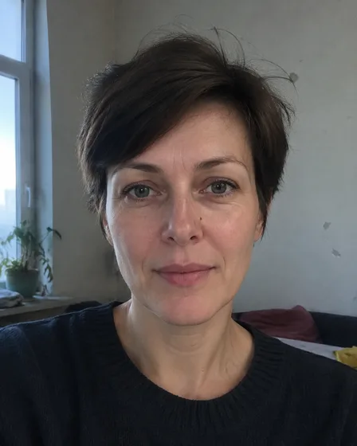
</td><td valign="top"><a href="https://dearsketch.com/ar/intent/i031-preview-different-hairstyles.html?utm_source=github&amp;utm_medium=gallery&amp;utm_campaign=dearsketch-public-cases&amp;utm_content=i031_image">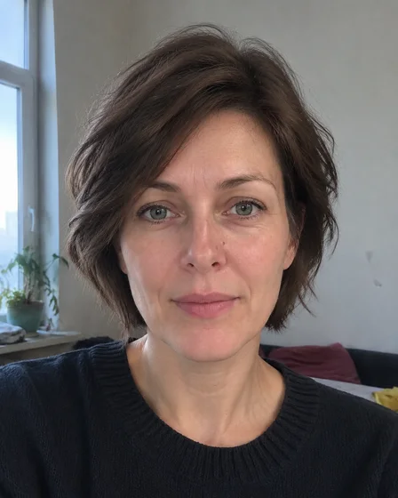</a></td></tr></tbody>
</table>

- **نوع الإدخال:** يتضمن معاينة المواد المرجعية ومثال النتيجة
- **المتطلبات المادية:** 1 صورة أمامية + 1 وصف أو مرجع لتصفيفة الشعر
- **الوصف:** يتم إنشاء صورة واحدة فقط في كل مرة.

[ تحقق من المتطلبات المحددة في dearsketch وقم بإجراء ](https://dearsketch.com/ar/intent/i031-preview-different-hairstyles.html?utm_source=github&utm_medium=gallery&utm_campaign=dearsketch-public-cases&utm_content=i031_cta)

---

## I032 · معاينة ألوان الشعر المختلفة

<table>
<thead><tr><th width="50%">المواد المرجعية</th><th width="50%">مثال على النتائج</th></tr></thead>
<tbody><tr><td valign="top">
<strong>صور شخصية</strong> 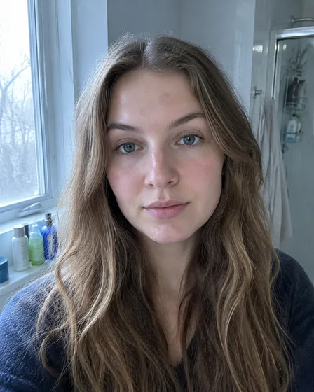
</td><td valign="top"><a href="https://dearsketch.com/ar/intent/i032-preview-different-hair-colors.html?utm_source=github&amp;utm_medium=gallery&amp;utm_campaign=dearsketch-public-cases&amp;utm_content=i032_image">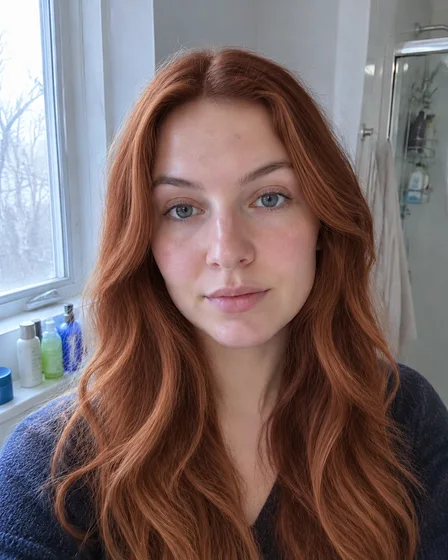</a></td></tr></tbody>
</table>

- **نوع الإدخال:** يتضمن معاينة المواد المرجعية ومثال النتيجة
- **متطلبات المواد:** 1 صورة شخصية + 1 لون شعر مستهدف
- **الوصف:** يتم إنشاء صورة واحدة فقط في كل مرة.

[ تحقق من المتطلبات المحددة في dearsketch وقم بإجراء ](https://dearsketch.com/ar/intent/i032-preview-different-hair-colors.html?utm_source=github&utm_medium=gallery&utm_campaign=dearsketch-public-cases&utm_content=i032_cta)

---

## I037 · جرب افتراضيًا الأقراط أو القلائد أو الخواتم أو الأساور

<table>
<thead><tr><th width="50%">المواد المرجعية</th><th width="50%">مثال على النتائج</th></tr></thead>
<tbody><tr><td valign="top">
<strong>صور الأشخاص أو الأيدي</strong> 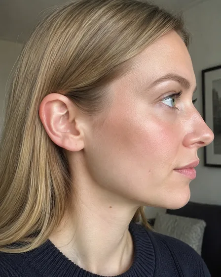

<strong>صور المجوهرات</strong> 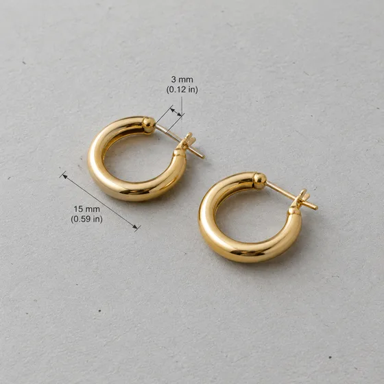
</td><td valign="top"><a href="https://dearsketch.com/ar/intent/i037-virtually-try-on-earrings-necklaces-rings-or-bracelets.html?utm_source=github&amp;utm_medium=gallery&amp;utm_campaign=dearsketch-public-cases&amp;utm_content=i037_image">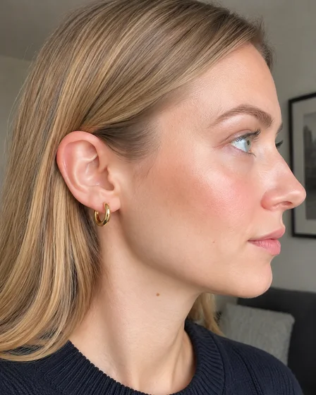</a></td></tr></tbody>
</table>

- **نوع الإدخال:** يتضمن معاينة المواد المرجعية ومثال النتيجة
- **متطلبات المواد:** 1 صورة شخص أو يد + 1 صورة إكسسوارات + 1 قطعة تجريبية
- **الوصف:** يتم إنشاء صورة واحدة فقط في كل مرة.

[ تحقق من المتطلبات المحددة في dearsketch وقم بإجراء ](https://dearsketch.com/ar/intent/i037-virtually-try-on-earrings-necklaces-rings-or-bracelets.html?utm_source=github&utm_medium=gallery&utm_campaign=dearsketch-public-cases&utm_content=i037_cta)

---

## I039 · معاينة ثقب الأذن أو الأنف أو الوجه

<table>
<thead><tr><th width="50%">المواد المرجعية</th><th width="50%">مثال على النتائج</th></tr></thead>
<tbody><tr><td valign="top">
<strong>mugshot</strong> 
</td><td valign="top"></td></tr></tbody>
</table>

- **نوع الإدخال:** يتضمن معاينة المواد المرجعية ومثال النتيجة
- **المتطلبات المادية:** 1 صورة للوجه + 1 مكان للثقب
- **الوصف:** يتم إنشاء صورة واحدة فقط في كل مرة.

[ تحقق من المتطلبات المحددة في dearsketch وقم بإجراء ](https://dearsketch.com/ar/intent/i039-preview-ear-nose-or-facial-piercings.html?utm_source=github&utm_medium=gallery&utm_campaign=dearsketch-public-cases&utm_content=i039_cta)

---

## I040 · استبدل الملابس الموجودة في الصورة بأنماط أخرى

<table>
<thead><tr><th width="50%">المواد المرجعية</th><th width="50%">مثال على النتائج</th></tr></thead>
<tbody><tr><td valign="top">
<strong>صور لنصف أو كامل الجسم للأشخاص</strong> 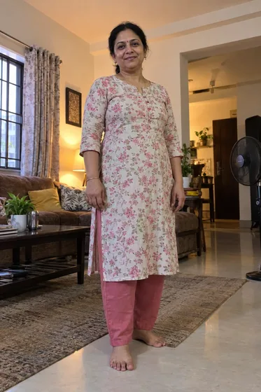

<strong>صور الملابس المستهدفة</strong> 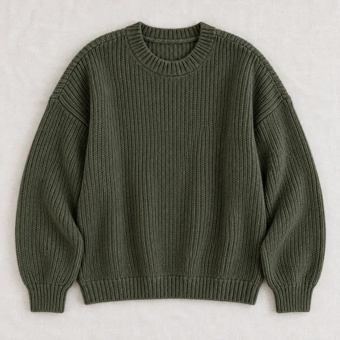
</td><td valign="top"><a href="https://dearsketch.com/ar/intent/i040-replace-clothing-in-a-photo-with-another-style.html?utm_source=github&amp;utm_medium=gallery&amp;utm_campaign=dearsketch-public-cases&amp;utm_content=i040_image">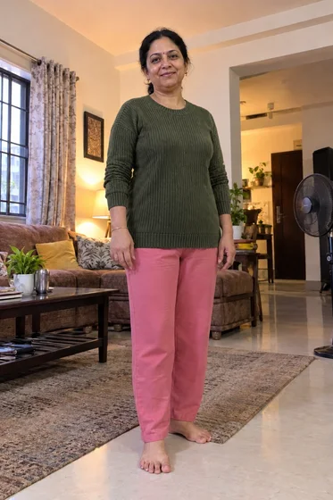</a></td></tr></tbody>
</table>

- **نوع الإدخال:** يتضمن معاينة المواد المرجعية ومثال النتيجة
- **المتطلبات المادية:** صورة واحدة لنصف الجسم أو كامل الجسم للشخصية + صورة واحدة للملابس المستهدفة
- **الوصف:** يتم إنشاء صورة واحدة فقط في كل مرة.

[ تحقق من المتطلبات المحددة في dearsketch وقم بإجراء ](https://dearsketch.com/ar/intent/i040-replace-clothing-in-a-photo-with-another-style.html?utm_source=github&utm_medium=gallery&utm_campaign=dearsketch-public-cases&utm_content=i040_cta)

---

## I041 · معاينة فستان الزفاف أو الفستان

<table>
<thead><tr><th width="50%">المواد المرجعية</th><th width="50%">مثال على النتائج</th></tr></thead>
<tbody><tr><td valign="top">
<strong>صور الناس</strong> 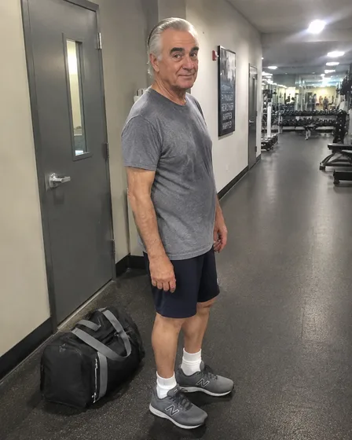

<strong>الهدف فستان الزفاف أو صور اللباس</strong> 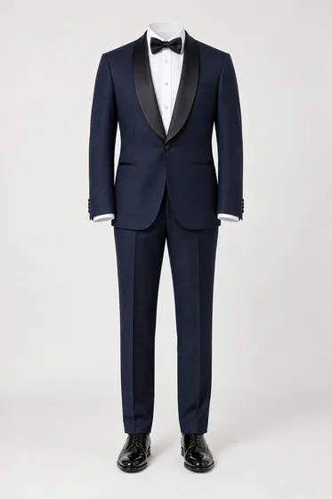
</td><td valign="top"><a href="https://dearsketch.com/ar/intent/i041-preview-a-wedding-dress-or-formal-gown.html?utm_source=github&amp;utm_medium=gallery&amp;utm_campaign=dearsketch-public-cases&amp;utm_content=i041_image">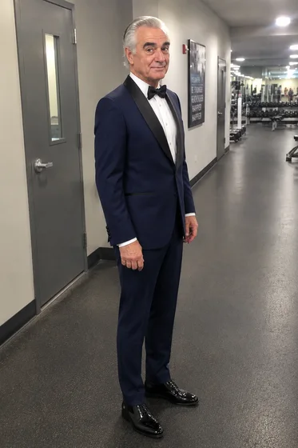</a></td></tr></tbody>
</table>

- **نوع الإدخال:** يتضمن معاينة المواد المرجعية ومثال النتيجة
- **المتطلبات المادية:** صورة شخصية واحدة + فستان زفاف مستهدف واحد أو صورة فستان
- **الوصف:** يتم إنشاء صورة واحدة فقط في كل مرة.

[ تحقق من المتطلبات المحددة في dearsketch وقم بإجراء ](https://dearsketch.com/ar/intent/i041-preview-a-wedding-dress-or-formal-gown.html?utm_source=github&utm_medium=gallery&utm_campaign=dearsketch-public-cases&utm_content=i041_cta)

---

## I042 · محاكاة نسب الجسم أو زيادة العضلات أو تأثيرات التخسيس

<table>
<thead><tr><th width="50%">المواد المرجعية</th><th width="50%">مثال على النتائج</th></tr></thead>
<tbody><tr><td valign="top">
<strong>صورة لكامل الجسم</strong> 
</td><td valign="top"><a href="https://dearsketch.com/ar/intent/i042-visualize-body-proportions-muscle-gain-or-slimming.html?utm_source=github&amp;utm_medium=gallery&amp;utm_campaign=dearsketch-public-cases&amp;utm_content=i042_image">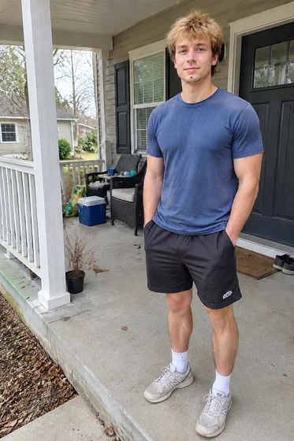</a></td></tr></tbody>
</table>

- **نوع الإدخال:** يتضمن معاينة المواد المرجعية ومثال النتيجة
- **متطلبات المواد:** صورة واحدة لكامل الجسم + صورة واحدة لتغيير الاتجاه ترغب في معاينتها
- **الوصف:** يتم إنشاء صورة واحدة فقط في كل مرة.

[ تحقق من المتطلبات المحددة في dearsketch وقم بإجراء ](https://dearsketch.com/ar/intent/i042-visualize-body-proportions-muscle-gain-or-slimming.html?utm_source=github&utm_medium=gallery&utm_campaign=dearsketch-public-cases&utm_content=i042_cta)

---

## I044 · تغيير التعبير أو إصلاح العيون المغلقة

<table>
<thead><tr><th width="50%">المواد المرجعية</th><th width="50%">مثال على النتائج</th></tr></thead>
<tbody><tr><td valign="top">
<strong>صور شخصية أو صور جماعية</strong> 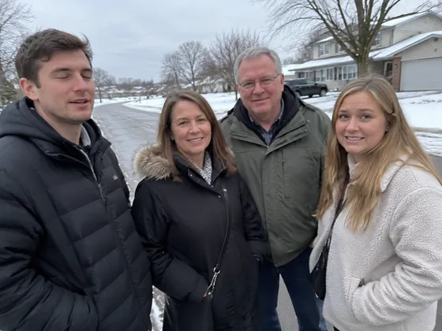
</td><td valign="top"><a href="https://dearsketch.com/ar/intent/i044-change-an-expression-or-open-closed-eyes.html?utm_source=github&amp;utm_medium=gallery&amp;utm_campaign=dearsketch-public-cases&amp;utm_content=i044_image">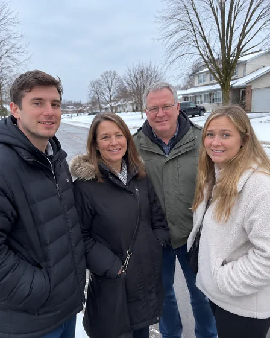</a></td></tr></tbody>
</table>

- **نوع الإدخال:** يتضمن معاينة المواد المرجعية ومثال النتيجة
- **المتطلبات المادية:** صورة شخصية واحدة أو صورة جماعية
- **الوصف:** يتم إنشاء صورة واحدة فقط في كل مرة.

[ تحقق من المتطلبات المحددة في dearsketch وقم بإجراء ](https://dearsketch.com/ar/intent/i044-change-an-expression-or-open-closed-eyes.html?utm_source=github&utm_medium=gallery&utm_campaign=dearsketch-public-cases&utm_content=i044_cta)

---

## I046 · إصلاح البشرة والهالات السوداء والتجاعيد بشكل طبيعي

<table>
<thead><tr><th width="50%">المواد المرجعية</th><th width="50%">مثال على النتائج</th></tr></thead>
<tbody><tr><td valign="top">
<strong>صور شخصية</strong> 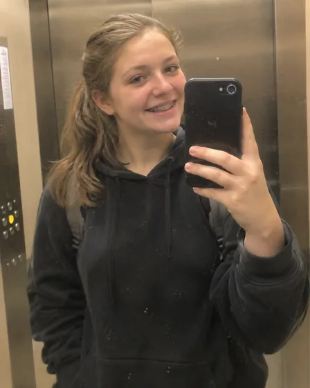
</td><td valign="top"><a href="https://dearsketch.com/ar/intent/i046-naturally-retouch-skin-dark-circles-and-wrinkles.html?utm_source=github&amp;utm_medium=gallery&amp;utm_campaign=dearsketch-public-cases&amp;utm_content=i046_image">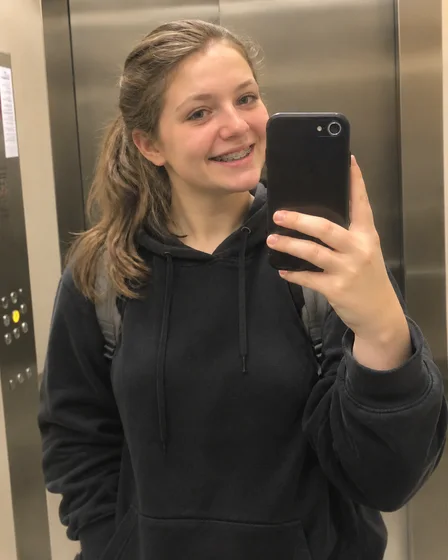</a></td></tr></tbody>
</table>

- **نوع الإدخال:** يتضمن معاينة المواد المرجعية ومثال النتيجة
- **المتطلبات المادية:** صورة شخصية واحدة
- **الوصف:** يتم إنشاء صورة واحدة فقط في كل مرة.

[ تحقق من المتطلبات المحددة في dearsketch وقم بإجراء ](https://dearsketch.com/ar/intent/i046-naturally-retouch-skin-dark-circles-and-wrinkles.html?utm_source=github&utm_medium=gallery&utm_campaign=dearsketch-public-cases&utm_content=i046_cta)

