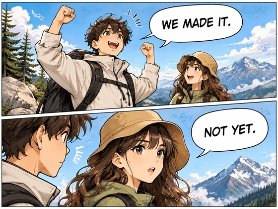

# الرسوم التوضيحية والنشر والقصص

[中文](../../../README.md) · [English](../../../README.en.md) · [Português](../../../README.pt.md) · [Español](../../../README.es.md) · [Français](../../../README.fr.md) · [Deutsch](../../../README.de.md) · [عربي](../../../README.ar.md) · [русский](../../../README.ru.md) · [日本語](../../../README.ja.md) · [हिंदी](../../../README.hi.md)

6 حالات خارج الكتالوج المميز. لم يتم الكشف عن الكلمات السريعة هنا، بل يتم عرض فقط المواد المرجعية الموجودة وتوجيهات النتائج والحد الأدنى من متطلبات المواد.

[الرجوع إلى المزيد من كتالوجات الحالات](./index.md) · [الرجوع إلى الصفحة الرئيسية للمستودع](../../../README.ar.md)

> المواد المرجعية وصور النتائج مخصصة للتوجيه البصري فقط؛ ليس هناك ما يضمن إمكانية إعادة إنتاج نفس التأثير باستخدام نفس المواد.

## I141 · كتاب مصور للأطفال يقوم بإنشاء شخصيات متناسقة من نص القصة

<strong>مثال على النتائج</strong>

لا يتضمن هذا المثال مرجعًا للصورة، ويجب إكمال معاينة الإدخال؛ انظر متطلبات المواد أدناه.

- **نوع الإدخال:** يعرض هذا المثال أمثلة النتائج فقط؛ تتم إضافة معاينة إدخال الصورة
- **متطلبات المواد:** القصة الكاملة وقواعد الترحيل + لوحة مخطوطة إعداد أحرف الكتاب المصور + قالب نمط توضيح الكتاب المصور + رقم الصفحة الحالية أو الحيز ← تقسيم الصفحات وإنشاء رسوم توضيحية متسقة للشخصيات ← كتاب مصور فردي كامل للأطفال
- **الوصف:** يتم إنشاء الخيار المحدد حاليًا فقط في كل مرة؛ يتم تنفيذ الصور الأخرى في السلسلة بشكل منفصل.

[ تحقق من المتطلبات المحددة في dearsketch وقم بإجراء ](https://dearsketch.com/ar/intent/i141-create-a-children-s-picture-book-with-consistent-characters-from-a-story.html?utm_source=github&utm_medium=gallery&utm_campaign=dearsketch-public-cases&utm_content=i141_cta)

---

## I144 · قم بإنشاء القصص المصورة أو اللوحات المصورة التي تحافظ على تناسق الشخصيات

<strong>مثال على النتائج</strong>

لا يتضمن هذا المثال مرجعًا للصورة، ويجب إكمال معاينة الإدخال؛ انظر متطلبات المواد أدناه.

- **نوع الإدخال:** يعرض هذا المثال أمثلة النتائج فقط؛ تتم إضافة معاينة إدخال الصورة
- **متطلبات المواد:** نص القصة المصورة والحوار + لوحة إعداد الشخصيات والمشهد + الصفحة الهزلية الحالية → إنشاء مشاهد وتكوين مستمر → اللوحة الهزلية الفردية الحالية
- **الوصف:** هذه المرة يتم إنشاء معاينة مرئية واحدة. لا تزال هناك حاجة إلى التحقق من حساب البيانات أو التنضيد الدقيق أو ملفات المتجهات أو الإنتاج باستخدام الأدوات المقابلة.

[ تحقق من المتطلبات المحددة في dearsketch وقم بإجراء ](https://dearsketch.com/ar/intent/i144-create-comic-panels-with-consistent-characters.html?utm_source=github&utm_medium=gallery&utm_campaign=dearsketch-public-cases&utm_content=i144_cta)

---

## I145 · قم بإنشاء نصوص أو أفكار في القصص المصورة للأفلام والتلفزيون

<strong>مثال على النتائج</strong>

لا يتضمن هذا المثال مرجعًا للصورة، ويجب إكمال معاينة الإدخال؛ انظر متطلبات المواد أدناه.

- **نوع الإدخال:** يعرض هذا المثال أمثلة النتائج فقط؛ تتم إضافة معاينة إدخال الصورة
- ** متطلبات المواد: ** قائمة السيناريو أو اللقطات + لوحة مخطوطة إعداد الشخصية والمشهد + صفحة القصة المصورة الحالية → إنشاء رسم تسلسلي → لوحة القصة الفردية الحالية
- **الوصف:** هذه المرة يتم إنشاء معاينة مرئية واحدة. لا تزال هناك حاجة إلى التحقق من حساب البيانات أو التنضيد الدقيق أو ملفات المتجهات أو الإنتاج باستخدام الأدوات المقابلة.

[ تحقق من المتطلبات المحددة في dearsketch وقم بإجراء ](https://dearsketch.com/ar/intent/i145-turn-a-script-or-idea-into-a-film-storyboard.html?utm_source=github&utm_medium=gallery&utm_campaign=dearsketch-public-cases&utm_content=i145_cta)

---

## I148 · تحويل الرسومات التقريبية إلى رسوم توضيحية كاملة التشطيب

<table>
<thead><tr><th width="50%">المواد المرجعية</th><th width="50%">مثال على النتائج</th></tr></thead>
<tbody><tr><td valign="top">
<strong>رسم يدوي أو رسم رقمي</strong> 
</td><td valign="top"></td></tr></tbody>
</table>

- **نوع الإدخال:** يتضمن معاينة المواد المرجعية ومثال النتيجة
- **متطلبات المواد:** رسم مرسوم يدويًا أو رقمي + نطاق التعديل المسموح به → احتفظ بالتكوين وأضف الألوان والتفاصيل → أكمل الرسم التوضيحي في الصورة الفردية الحالية
- **الوصف:** يتم إنشاء صورة واحدة فقط في كل مرة.

[ تحقق من المتطلبات المحددة في dearsketch وقم بإجراء ](https://dearsketch.com/ar/intent/i148-turn-a-rough-sketch-into-a-polished-illustration.html?utm_source=github&utm_medium=gallery&utm_campaign=dearsketch-public-cases&utm_content=i148_cta)

---

## I149 · قم بإنشاء صفحات تلوين للأطفال من الصور أو النصوص

<table>
<thead><tr><th width="50%">المواد المرجعية</th><th width="50%">مثال على النتائج</th></tr></thead>
<tbody><tr><td valign="top">
<strong>الصورة الأصلية المراد تحويلها</strong> 
</td><td valign="top"></td></tr></tbody>
</table>

- **نوع الإدخال:** يتضمن معاينة المواد المرجعية ومثال النتيجة
- **متطلبات المواد:** الصورة الأصلية المراد تحويلها → مبسطة إلى رسم خطي أبيض وأسود واضح → صفحة التلوين الحالية للأطفال الفرديين
- **الوصف:** يتم إنشاء صورة واحدة فقط في كل مرة.

[ تحقق من المتطلبات المحددة في dearsketch وقم بإجراء ](https://dearsketch.com/ar/intent/i149-create-a-children-s-coloring-page-from-a-photo-or-text.html?utm_source=github&utm_medium=gallery&utm_campaign=dearsketch-public-cases&utm_content=i149_cta)

---

## I153 · إنشاء التارو، لعبة اللوحة أو الرسوم التوضيحية بطاقة تحصيلها

<strong>مثال على النتائج</strong>

لا يتضمن هذا المثال مرجعًا للصورة، ويجب إكمال معاينة الإدخال؛ انظر متطلبات المواد أدناه.

- **نوع الإدخال:** يعرض هذا المثال أمثلة النتائج فقط؛ تتم إضافة معاينة إدخال الصورة
- **متطلبات المواد:** جدول بيانات البطاقة + قالب رؤية العالم للبطاقة ومواصفات الحدود + البطاقة الحالية → إنشاء سلسلة حدود وتوضيحات موحدة → رسم توضيحي للبطاقة الفردية الحالية
- **الوصف:** يتم إنشاء الخيار المحدد حاليًا فقط في كل مرة؛ يتم تنفيذ الصور الأخرى في السلسلة بشكل منفصل.

[ تحقق من المتطلبات المحددة في dearsketch وقم بإجراء ](https://dearsketch.com/ar/intent/i153-create-artwork-for-tarot-board-game-or-collectible-cards.html?utm_source=github&utm_medium=gallery&utm_campaign=dearsketch-public-cases&utm_content=i153_cta)

