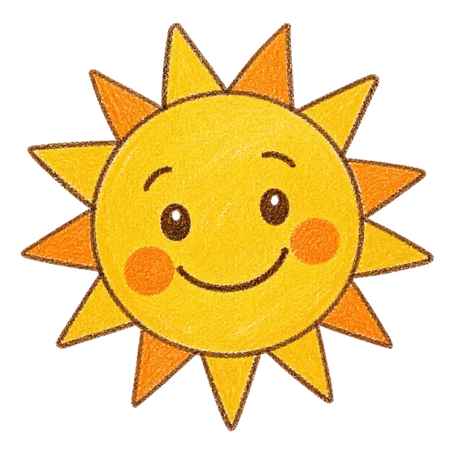
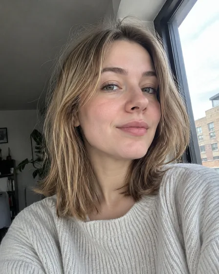
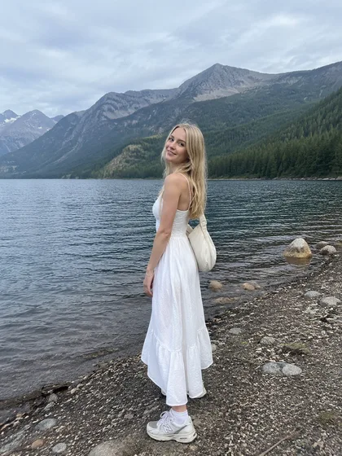

# POD والمنتجات الشخصية

[中文](../../../README.md) · [English](../../../README.en.md) · [Português](../../../README.pt.md) · [Español](../../../README.es.md) · [Français](../../../README.fr.md) · [Deutsch](../../../README.de.md) · [عربي](../../../README.ar.md) · [русский](../../../README.ru.md) · [日本語](../../../README.ja.md) · [हिंदी](../../../README.hi.md)

6 حالات خارج الكتالوج المميز. لم يتم الكشف عن الكلمات السريعة هنا، بل يتم عرض فقط المواد المرجعية الموجودة وتوجيهات النتائج والحد الأدنى من متطلبات المواد.

[الرجوع إلى المزيد من كتالوجات الحالات](./index.md) · [الرجوع إلى الصفحة الرئيسية للمستودع](../../../README.ar.md)

> المواد المرجعية وصور النتائج مخصصة للتوجيه البصري فقط؛ ليس هناك ما يضمن إمكانية إعادة إنتاج نفس التأثير باستخدام نفس المواد.

## I264 · تحويل الشعار أو الرسم التوضيحي إلى ملف غرزة آلة التطريز

<table>
<thead><tr><th width="50%">المواد المرجعية</th><th width="50%">مثال على النتائج</th></tr></thead>
<tbody><tr><td valign="top">
<strong>شعار أو رسم توضيحي شفاف ليتم رقمنته للتطريز</strong> 
</td><td valign="top"></td></tr></tbody>
</table>

- **نوع الإدخال:** يتضمن معاينة المواد المرجعية ومثال النتيجة
- **متطلبات المواد:** يلزم ترقيم الشعار أو الرسم التوضيحي الشفاف للتطريز (1) + مواصفات إنتاج التطريز المطلوبة (نسخة واحدة)
- **الوصف:** هذه المرة يتم إنشاء معاينة مرئية واحدة. لا تزال هناك حاجة إلى التحقق من حساب البيانات أو التنضيد الدقيق أو ملفات المتجهات أو الإنتاج باستخدام الأدوات المقابلة.

[ تحقق من المتطلبات المحددة في dearsketch وقم بإجراء ](https://dearsketch.com/ar/intent/i264-convert-a-logo-or-illustration-into-an-embroidery-stitch-file.html?utm_source=github&utm_medium=gallery&utm_campaign=dearsketch-public-cases&utm_content=i264_cta)

---

## I268 · تنظيم الصور أو النص في النقش بالليزر وقطع الملفات المتجهة

<table>
<thead><tr><th width="50%">المواد المرجعية</th><th width="50%">مثال على النتائج</th></tr></thead>
<tbody><tr><td valign="top">
<strong>الصورة أو الشعار المراد نقشه/قصه</strong> 
</td><td valign="top"></td></tr></tbody>
</table>

- **نوع الإدخال:** يتضمن معاينة المواد المرجعية ومثال النتيجة
- **متطلبات المواد:** الصور أو الشعارات الاختيارية المراد نقشها/قصها (0 أو 1) + طرق المعالجة والمواد وقيود الماكينة المطلوبة (نسخة واحدة) + الشروط التي تتطلب معالجة النصوص والصور الرمزية (نسخة واحدة)
- **الوصف:** هذه المرة يتم إنشاء معاينة مرئية واحدة. لا تزال هناك حاجة إلى التحقق من حساب البيانات أو التنضيد الدقيق أو ملفات المتجهات أو الإنتاج باستخدام الأدوات المقابلة.

[ تحقق من المتطلبات المحددة في dearsketch وقم بإجراء ](https://dearsketch.com/ar/intent/i268-prepare-an-image-or-text-as-a-vector-file-for-laser-engraving-or-cutting.html?utm_source=github&utm_medium=gallery&utm_campaign=dearsketch-public-cases&utm_content=i268_cta)

---

## I271 · تحويل الصور إلى رسومات زيتية رقمية

<table>
<thead><tr><th width="50%">المواد المرجعية</th><th width="50%">مثال على النتائج</th></tr></thead>
<tbody><tr><td valign="top">
<strong>صورة الجسم الرئيسية لللوحة الزيتية الرقمية المراد تحويلها</strong> 
</td><td valign="top"></td></tr></tbody>
</table>

- **نوع الإدخال:** يتضمن معاينة المواد المرجعية ومثال النتيجة
- **متطلبات المواد:** صورة الجسم الرئيسي المطلوبة للوحة الزيتية الرقمية المراد نقلها (صورة واحدة) + النطاق المطلوب للمنتج النهائي وعدد ألوان الطلاء (مجموعة واحدة)
- **الوصف:** هذه المرة يتم إنشاء معاينة مرئية واحدة. لا تزال هناك حاجة إلى التحقق من حساب البيانات أو التنضيد الدقيق أو ملفات المتجهات أو الإنتاج باستخدام الأدوات المقابلة.

[ تحقق من المتطلبات المحددة في dearsketch وقم بإجراء ](https://dearsketch.com/ar/intent/i271-turn-a-photo-into-a-paint-by-numbers-pattern.html?utm_source=github&utm_medium=gallery&utm_campaign=dearsketch-public-cases&utm_content=i271_cta)

---

## I273 · تحويل الصور إلى قوالب يمكن قصها أو رشها بالطلاء

<table>
<thead><tr><th width="50%">المواد المرجعية</th><th width="50%">مثال على النتائج</th></tr></thead>
<tbody><tr><td valign="top">
<strong>صورة عالية التباين أو شعار القالب المراد تحويله</strong> 
</td><td valign="top"></td></tr></tbody>
</table>

- **نوع الإدخال:** يتضمن معاينة المواد المرجعية ومثال النتيجة
- **متطلبات المواد:** مطلوب صورة عالية التباين أو شعار القالب المراد نقله (صورة واحدة) + غرض القالب والمواد المطلوبة والحد الأدنى من الاتصال (نسخة واحدة)
- **الوصف:** هذه المرة يتم إنشاء معاينة مرئية واحدة. لا تزال هناك حاجة إلى التحقق من حساب البيانات أو التنضيد الدقيق أو ملفات المتجهات أو الإنتاج باستخدام الأدوات المقابلة.

[ تحقق من المتطلبات المحددة في dearsketch وقم بإجراء ](https://dearsketch.com/ar/intent/i273-turn-a-photo-into-a-cuttable-or-paintable-stencil.html?utm_source=github&utm_medium=gallery&utm_campaign=dearsketch-public-cases&utm_content=i273_cta)

---

## I284 · أنشئ معجبًا للدعم أو لوحة أسماء تتضمن صورًا للأشخاص ونصًا غامقًا

<table>
<thead><tr><th width="50%">المواد المرجعية</th><th width="50%">مثال على النتائج</th></tr></thead>
<tbody><tr><td valign="top">
<strong>صور الأشخاص الذين لديهم إذن الاستخدام</strong> 
</td><td valign="top"></td></tr></tbody>
</table>

- **نوع الإدخال:** يتضمن معاينة المواد المرجعية ومثال النتيجة
- **متطلبات المواد:** يجب أن يكون لديك الحق في استخدام صور الأشخاص (صورة واحدة) + الأسماء المطلوبة أو عبارات التشجيع (مجموعة واحدة) + أنواع المنتجات النهائية المطلوبة والألوان التمثيلية (مجموعة واحدة)
- **الوصف:** يتم إنشاء صورة واحدة فقط في كل مرة.

[ تحقق من المتطلبات المحددة في dearsketch وقم بإجراء ](https://dearsketch.com/ar/intent/i284-create-a-fan-support-uchiwa-or-name-board-from-a-portrait.html?utm_source=github&utm_medium=gallery&utm_campaign=dearsketch-public-cases&utm_content=i284_cta)

---

## I287 · قم بإنشاء صور سيلفي متعددة في شرائط صور بأربعة إطارات وحدود للموضوع

<table>
<thead><tr><th width="50%">المواد المرجعية</th><th width="50%">مثال على النتائج</th></tr></thead>
<tbody><tr><td valign="top">
<strong>المرجع التاريخي/مدخلات ما قبل التحول</strong> 

<strong>المرجع التاريخي/مدخلات ما قبل التحول</strong> 

<strong>المرجع التاريخي/مدخلات ما قبل التحول</strong> 

<strong>المرجع التاريخي/مدخلات ما قبل التحول</strong> 
</td><td valign="top"></td></tr></tbody>
</table>

- **نوع الإدخال:** يتضمن معاينة المواد المرجعية ومثال النتيجة
- **متطلبات المواد:** التصوير المستمر/صور السيلفي المطلوبة (من 2 إلى 4 صور) + ترتيب الإطار العلوي والسفلي المطلوب لشرائط الصور (نسخة واحدة) + التاريخ الاختياري والجملة القصيرة والشعار ولون الموضوع (0 أو مجموعة واحدة)
- **الوصف:** يتم إنشاء صورة واحدة فقط في كل مرة.

[ تحقق من المتطلبات المحددة في dearsketch وقم بإجراء ](https://dearsketch.com/ar/intent/i287-turn-selfies-into-a-four-cut-photo-strip-with-a-themed-frame.html?utm_source=github&utm_medium=gallery&utm_campaign=dearsketch-public-cases&utm_content=i287_cta)

