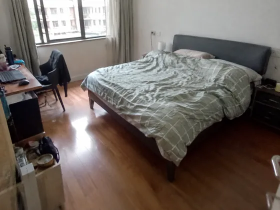

# الفضاء والهندسة المعمارية والعقارات

[中文](../../../README.md) · [English](../../../README.en.md) · [Português](../../../README.pt.md) · [Español](../../../README.es.md) · [Français](../../../README.fr.md) · [Deutsch](../../../README.de.md) · [عربي](../../../README.ar.md) · [русский](../../../README.ru.md) · [日本語](../../../README.ja.md) · [हिंदी](../../../README.hi.md)

حالتان خارج الكتالوج المميز. لم يتم الكشف عن الكلمات السريعة هنا، بل يتم عرض فقط المواد المرجعية الموجودة وتوجيهات النتائج والحد الأدنى من متطلبات المواد.

[الرجوع إلى المزيد من كتالوجات الحالات](./index.md) · [الرجوع إلى الصفحة الرئيسية للمستودع](../../../README.ar.md)

> المواد المرجعية وصور النتائج مخصصة للتوجيه البصري فقط؛ ليس هناك ما يضمن إمكانية إعادة إنتاج نفس التأثير باستخدام نفس المواد.

## I170 · جرب مواضع ومجموعات مختلفة من الأثاث

<table>
<thead><tr><th width="50%">المواد المرجعية</th><th width="50%">مثال على النتائج</th></tr></thead>
<tbody><tr><td valign="top">
<strong>صور الغرف المتوفرة أو الموجودة</strong> 
</td><td valign="top"></td></tr></tbody>
</table>

- **نوع الإدخال:** يتضمن معاينة المواد المرجعية ومثال النتيجة
- **متطلبات المواد:** صور الغرف الشاغرة أو الموجودة → فقط اضبط موضع عناصر المنزل الموجودة في الصورة الأصلية → معاينة تخطيط الأثاث الفردي الحالي
- **الوصف:** يتم إنشاء صورة واحدة فقط في كل مرة.

[ تحقق من المتطلبات المحددة في dearsketch وقم بإجراء ](https://dearsketch.com/ar/intent/i170-try-different-furniture-arrangements-and-combinations.html?utm_source=github&utm_medium=gallery&utm_campaign=dearsketch-public-cases&utm_content=i170_cta)

---

## I180 · توليد مواد متعددة واتجاهات الضوء في نفس المساحة

<table>
<thead><tr><th width="50%">المواد المرجعية</th><th width="50%">مثال على النتائج</th></tr></thead>
<tbody><tr><td valign="top">
<strong>خريطة الفضاء مسند</strong> 
</td><td valign="top"></td></tr></tbody>
</table>

- **نوع الإدخال:** يتضمن معاينة المواد المرجعية ومثال النتيجة
- **متطلبات المواد:** 1 رسم للمساحة المرجعية + اتجاه التصميم المستهدف، والمواد السطحية، ومتطلبات الإضاءة
- **الوصف:** يتم إنشاء صورة واحدة فقط في كل مرة.

[ تحقق من المتطلبات المحددة في dearsketch وقم بإجراء ](https://dearsketch.com/ar/intent/i180-create-material-and-lighting-variations-for-the-same-space.html?utm_source=github&utm_medium=gallery&utm_campaign=dearsketch-public-cases&utm_content=i180_cta)

