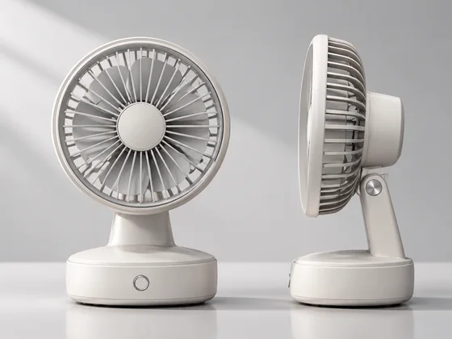
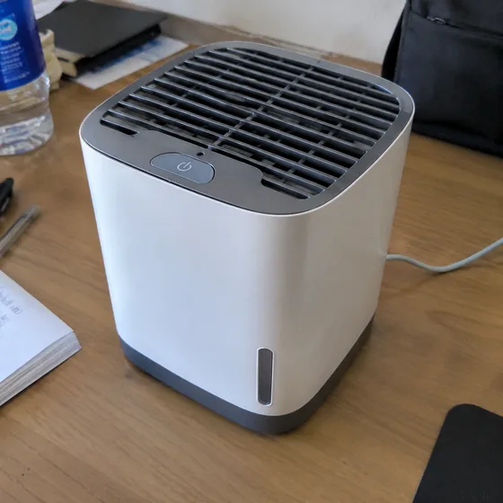
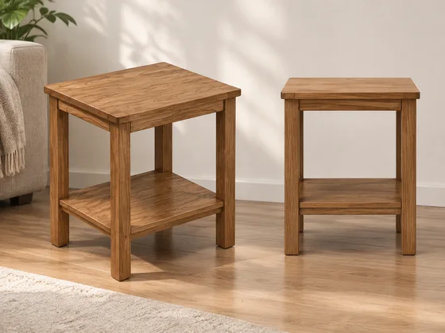

# مفهوم المنتج والتصميم الصناعي

[中文](../../../README.md) · [English](../../../README.en.md) · [Português](../../../README.pt.md) · [Español](../../../README.es.md) · [Français](../../../README.fr.md) · [Deutsch](../../../README.de.md) · [عربي](../../../README.ar.md) · [русский](../../../README.ru.md) · [日本語](../../../README.ja.md) · [हिंदी](../../../README.hi.md)

4 حالات خارج الكتالوج المميز. لم يتم الكشف عن الكلمات السريعة هنا، بل يتم عرض فقط المواد المرجعية الموجودة وتوجيهات النتائج والحد الأدنى من متطلبات المواد.

[الرجوع إلى المزيد من كتالوجات الحالات](./index.md) · [الرجوع إلى الصفحة الرئيسية للمستودع](../../../README.ar.md)

> المواد المرجعية وصور النتائج مخصصة للتوجيه البصري فقط؛ ليس هناك ما يضمن إمكانية إعادة إنتاج نفس التأثير باستخدام نفس المواد.

## I184 · تحويل رسومات المنتج إلى عروض واقعية للمنتج

<table>
<thead><tr><th width="50%">المواد المرجعية</th><th width="50%">مثال على النتائج</th></tr></thead>
<tbody><tr><td valign="top">
<strong>رسومات المنتج المرسومة باليد</strong> 
</td><td valign="top"></td></tr></tbody>
</table>

- **نوع الإدخال:** يتضمن معاينة المواد المرجعية ومثال النتيجة
- **متطلبات المواد:** رسم تخطيطي للمنتج مرسوم يدويًا + استخدام المنتج، وميزات غير قابلة للتغيير في الرسم ← الاحتفاظ بالشكل وإنشاء المواد والضوء والظل والخلفية ← عرض المنتج الفردي الحالي
- **الوصف:** يتم إنشاء صورة واحدة فقط في كل مرة.

[ تحقق من المتطلبات المحددة في dearsketch وقم بإجراء ](https://dearsketch.com/ar/intent/i184-turn-a-product-sketch-into-a-realistic-product-render.html?utm_source=github&utm_medium=gallery&utm_campaign=dearsketch-public-cases&utm_content=i184_cta)

---

## I186 · معاينة المنتج بألوان ومواد ومعالجات سطحية مختلفة

<table>
<thead><tr><th width="50%">المواد المرجعية</th><th width="50%">مثال على النتائج</th></tr></thead>
<tbody><tr><td valign="top">
<strong>صور المنتج أو العروض ثلاثية الأبعاد</strong> 
</td><td valign="top"></td></tr></tbody>
</table>

- **نوع الإدخال:** يتضمن معاينة المواد المرجعية ومثال النتيجة
- **متطلبات المواد:** رسم المنتج أو العرض ثلاثي الأبعاد + اللون أو المادة المستهدفة ← استبدال اللون والمادة والملمس ← رسم خطة CMF الفردي الحالي
- **الوصف:** يتم إنشاء صورة واحدة فقط في كل مرة.

[ تحقق من المتطلبات المحددة في dearsketch وقم بإجراء ](https://dearsketch.com/ar/intent/i186-preview-product-colors-materials-and-finishes.html?utm_source=github&utm_medium=gallery&utm_campaign=dearsketch-public-cases&utm_content=i186_cta)

---

## I188 · إنشاء عروض منتجات الأثاث من الرسومات

<table>
<thead><tr><th width="50%">المواد المرجعية</th><th width="50%">مثال على النتائج</th></tr></thead>
<tbody><tr><td valign="top">
<strong>اسكتشات الأثاث</strong> 
</td><td valign="top"></td></tr></tbody>
</table>

- **نوع الإدخال:** يتضمن معاينة المواد المرجعية ومثال النتيجة
- **متطلبات المواد:** رسم تخطيطي للأثاث + استخدام الأثاث، والهيكل الذي يجب الاحتفاظ به ← إنشاء مشاهد للخشب والنسيج والاستخدام ← عرض منتج الأثاث الفردي الحالي
- **الوصف:** يتم إنشاء صورة واحدة فقط في كل مرة.

[ تحقق من المتطلبات المحددة في dearsketch وقم بإجراء ](https://dearsketch.com/ar/intent/i188-turn-a-furniture-sketch-into-a-product-render.html?utm_source=github&utm_medium=gallery&utm_campaign=dearsketch-public-cases&utm_content=i188_cta)

---

## I192 · تحويل رسومات الواجهة إلى نماذج أكثر اكتمالاً لواجهة المستخدم

<table>
<thead><tr><th width="50%">المواد المرجعية</th><th width="50%">مثال على النتائج</th></tr></thead>
<tbody><tr><td valign="top">
<strong>إطارات سلكية أو لقطات شاشة للواجهات الموجودة</strong> 
</td><td valign="top"></td></tr></tbody>
</table>

- **نوع الإدخال:** يتضمن معاينة المواد المرجعية ومثال النتيجة
- **متطلبات المواد:** الإطارات السلكية أو لقطات الشاشة للواجهات الحالية + نوع المنتج وبنية المعلومات غير القابلة للتغيير → النمط المرئي التكميلي والمكونات وسيناريوهات الجهاز → خريطة مفاهيم واجهة المستخدم الفردية الحالية
- **الوصف:** يتم إنشاء صورة واحدة فقط في كل مرة.

[ تحقق من المتطلبات المحددة في dearsketch وقم بإجراء ](https://dearsketch.com/ar/intent/i192-turn-a-ui-sketch-into-a-polished-interface-mockup.html?utm_source=github&utm_medium=gallery&utm_campaign=dearsketch-public-cases&utm_content=i192_cta)

