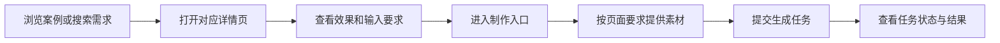
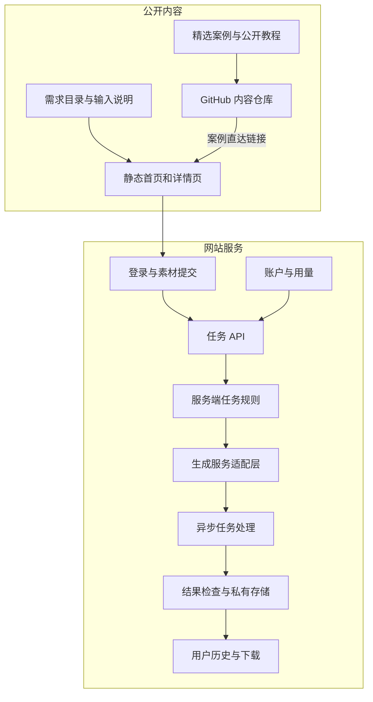

# dearsketch 产品架构

[中文](../README.md) · [English](../README.en.md) · [Português](../README.pt.md) · [Español](../README.es.md) · [Français](../README.fr.md) · [Deutsch](../README.de.md) · [عربي](../README.ar.md) · [русский](../README.ru.md) · [日本語](../README.ja.md) · [हिंदी](../README.hi.md)


dearsketch 把“我想完成什么图片”组织成可浏览的需求目录。每个需求有独立页面，解释用途、所需素材和结果要求；用户从对应页面进入制作流程。

这份说明介绍模块职责与数据流。公开内容库、网站服务和生成模型分别承担不同工作；本仓库提供公开案例、50 个新编模板与 Agent Skill，在线制作在网站进行。

## 用户路径



不同任务可能需要照片、指定设计原稿、准确文案或多角色素材。系列图和多个方案按单张分别制作；需要精确文字、矢量或生产文件时，视觉预览之后还需要相应工具检查。

## 内容与生成分层



静态内容页负责发现、解释和搜索收录。任务 API 负责验证用户输入和创建任务。服务端规则与生成适配层负责执行选定需求。历史与存储层负责把结果交还给对应用户。

图中的模块反映当前源码中的职责划分，不是全部线上功能、支付状态或服务等级的承诺；使用时以网站实际提供的入口和说明为准。

## 模块职责

| 模块 | 解决的问题 |
| --- | --- |
| 需求目录 | 用用途、输入、输出和场景组织图片任务 |
| 页面构建 | 为需求生成稳定地址、页面内容与搜索元数据 |
| 输入契约 | 说明哪些素材必需、哪些可选、素材之间是什么关系 |
| 账户与任务 API | 验证身份、输入完整性与请求是否重复 |
| 服务端任务规则 | 根据需求和本次输入组织执行内容 |
| 生成适配层 | 连接外部生成服务并处理异步任务 |
| 结果与历史 | 检查结果、保存资源并向对应用户提供访问 |
| 账户与用量 | 处理使用资格、积分与订单相关状态 |

## 实现方式

| 层 | 当前源码中的方式 |
| --- | --- |
| 内容构建 | Node.js 脚本从结构化需求生成 HTML、详情页与搜索元数据 |
| 浏览器交互 | JavaScript 处理筛选、素材输入、任务状态；部分交互使用 React，由 Vite 打包 |
| 服务端 | Node.js 模块处理认证、上传、生成任务、历史与用量 |
| 数据 | 关系型数据库记录账户、资源归属和任务状态 |
| 文件 | 与业务数据分离的私有对象存储，通过受控地址访问 |
| 生成 | 服务端适配外部生成服务，处理异步任务与结果 |

这些技术选择可以解释系统如何分工，无需公开生产账号、项目 ID、存储桶名称或环境变量值。

## 公开数据示例

```json
{
  "id": "I026",
  "title": "宠物定制肖像",
  "input": "1张宠物照片",
  "output": "宠物肖像图片",
  "roles": [
    { "kind": "image", "label": "宠物照片", "requirement": "required", "quantity": "1张" }
  ]
}
```

这些字段解释用户任务，不包含服务端完整生成指令。精选案例数据见 [cases.json](../data/cases.json)，其余结果示例见 [gallery.json](../data/gallery.json)，新编公开模板见 [public-prompts.json](../data/public-prompts.json)。公开 Skill 只负责准备输入清单和提示词，不访问内部生成规则。

## 访问与内容边界

公开案例图片与用户上传资源是两类内容。案例用于说明视觉方向；用户原图、任务结果和账户记录不属于公开案例库。生成服务需要校验素材类型、大小与归属，用户输入也不能覆盖服务端的执行约束。

可以公开模块图、职责、抽象数据结构、输入规范与通用可靠性原则。公开某段服务端实现或某组数据库结构，是可以单独决定的开源范围；它们并非因为位于服务端就自动属于秘密。

本仓库的范围是案例、基础教程和产品架构说明，不包含生产服务源码、内部完整 Skill 或部署资源。凭证、会话、真实用户记录与私有资源地址不属于可公开内容。

## GitHub 与网站如何连接

每张精选图片和“制作同款”链接都指向对应需求页。链接使用来源参数区分 README、案例详情和教程入口；这些参数只表达来源，不能单独证明已经部署了统计系统。

网站没有面向访客的任意提示词输入框。公开基础教程供用户在自己选择的工具中尝试；网站根据选定需求提供对应的素材入口。
