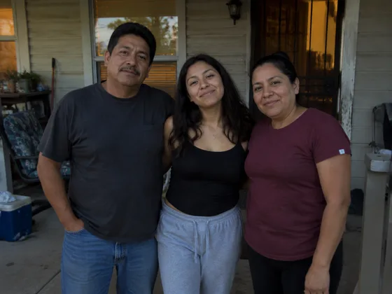
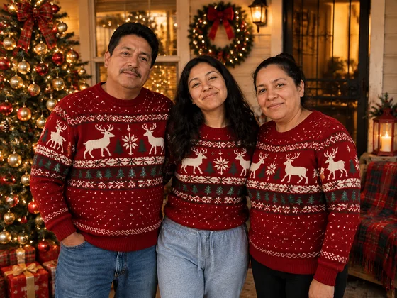

# Holiday Family Portrait · 节日主题全家福

Restyle a family photo for a specified holiday.

生成圣诞或节日主题全家福。用于贺卡、社交分享。

[复制公开提示词 / Copy prompt](#public-prompt) · [在 dearsketch 制作 / Try online](https://dearsketch.com/intent/i020-create-a-christmas-or-holiday-family-portrait.html?utm_source=github&utm_medium=case&utm_campaign=dearsketch-public-cases&utm_content=i020_cta) · [返回专题 / Collection](../guides/pets-family.md)

## 参考素材与结果方向

<table>
<thead><tr><th width="50%">参考素材</th><th width="50%">结果示例</th></tr></thead>
<tbody><tr><td valign="top"><p><strong>家庭照片</strong><br></p></td><td valign="top"><a href="https://dearsketch.com/intent/i020-create-a-christmas-or-holiday-family-portrait.html?utm_source=github&amp;utm_medium=case&amp;utm_campaign=dearsketch-public-cases&amp;utm_content=i020_image"></a></td></tr></tbody>
</table>

参考素材与结果用于说明视觉方向，公开模板不是配图的原始生成指令，不保证复现相同结果。

## 需要准备什么 / Inputs

| 素材 / Material | 类型 / Type | 数量 / Quantity | 条件 / Requirement |
| --- | --- | --- | --- |
| 家庭照片 | 图片 / Image | 1张 | 必需 / Required |
| 节日名称或主题 | 文字 / Text | 1项 | 必需 / Required |

每次只生成一张图片。

## 保留与改变 / Editing brief

- **Preserve / 保留：** Keep all people, identities, count, and unobscured facial features.
- **Change / 改变：** Change decor, wardrobe accents, background, and holiday atmosphere.

## Public prompt

**新编公开模板 · Newly authored · Not generation-tested.** 替换方括号参数，在支持图片编辑的工具中附上所需素材；可选和条件输入按上表准备。此模板没有用于生成本页示例。

```text
Create one [HOLIDAY OR FESTIVAL] family portrait from [FAMILY PHOTO].
Preserve every person’s identity, count, facial features, skin tone, hair, and relative position.
Keep children and adults age-appropriate and anatomically natural.
Introduce [HOLIDAY SETTING], [DECOR], and [WARDROBE DIRECTION] without obscuring faces.
Use [COLOR PALETTE] and [LIGHTING] appropriate to the requested celebration.
Do not add cultural or religious symbols beyond [CONFIRMED THEME].
Keep hands, group overlaps, and floor contact believable.
If a greeting is requested, reproduce “[EXACT GREETING]” exactly and keep it readable.
Do not invent names, dates, or family members.
Deliver one finished holiday portrait image only.
```

[用自己的素材在线制作 / Make it online](https://dearsketch.com/intent/i020-create-a-christmas-or-holiday-family-portrait.html?utm_source=github&utm_medium=case&utm_campaign=dearsketch-public-cases&utm_content=i020_after-prompt) · [让 Agent 帮你整理 / Use the Skill](../quickstart.md#agent-skill)

## 检查重点 / Review

检查人数和身份，节日服装与装饰不能遮挡关键特征。

Check that decorations never hide faces or alter the family roster.

结果方向：节日全家福。需要准确文字、透明文件、矢量或印刷交付时，检查实际文件；可用功能和费用以网站说明为准。

## 相关案例 / Related tasks

- [Turn a pet photo into a custom portrait · 宠物定制肖像](i026-turn-a-pet-photo-into-a-custom-portrait.md#public-prompt)
- [Turn a pet into a royal or historical portrait · 宠物皇家肖像](i028-turn-a-pet-into-a-royal-or-historical-portrait.md#public-prompt)
- [Place a pet in a playful bathroom or kitchen scene · 宠物趣味场景画](i029-place-a-pet-in-a-playful-bathroom-or-kitchen-scene.md#public-prompt)

## 需求背景参考

- [Fotor家庭照](https://www.fotor.com/features/ai-portrait-generator/family/)
- [Etsy家庭肖像](https://www.etsy.com/market/ai_family_portrait)

这些链接仅帮助理解用途，不是本页图片的来源或授权证明。

图片与素材使用范围见[内容说明](../content-policy.md)。[查看全部 50 个模板](../prompts.md)。
