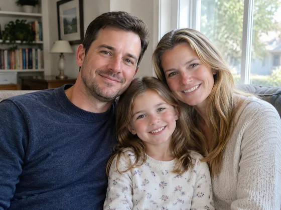
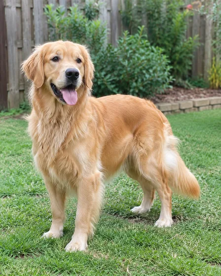
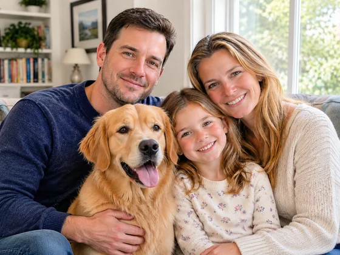

# Family Portrait with Pets · 人与宠物家庭肖像

Combine supplied family-member and pet references into one coherent portrait.

生成包含宠物的家庭肖像。用于家居装饰、礼物。

[复制公开提示词 / Copy prompt](#public-prompt) · [在 dearsketch 制作 / Try online](https://dearsketch.com/intent/i021-create-a-family-portrait-with-pets.html?utm_source=github&utm_medium=case&utm_campaign=dearsketch-public-cases&utm_content=i021_cta) · [返回专题 / Collection](../guides/pets-family.md)

## 参考素材与结果方向

<table>
<thead><tr><th width="50%">参考素材</th><th width="50%">结果示例</th></tr></thead>
<tbody><tr><td valign="top"><p><strong>家庭成员照片</strong><br></p>
<p><strong>宠物照片</strong><br></p></td><td valign="top"><a href="https://dearsketch.com/intent/i021-create-a-family-portrait-with-pets.html?utm_source=github&amp;utm_medium=case&amp;utm_campaign=dearsketch-public-cases&amp;utm_content=i021_image"></a></td></tr></tbody>
</table>

参考素材与结果用于说明视觉方向，公开模板不是配图的原始生成指令，不保证复现相同结果。

## 需要准备什么 / Inputs

| 素材 / Material | 类型 / Type | 数量 / Quantity | 条件 / Requirement |
| --- | --- | --- | --- |
| 家庭成员照片 | 图片 / Image | 每位成员至少1张 | 必需 / Required |
| 宠物照片 | 图片 / Image | 每只宠物至少1张 | 必需 / Required |

每次只生成一张图片。

## 保留与改变 / Editing brief

- **Preserve / 保留：** Keep every person and pet individually recognizable, with correct count and markings.
- **Change / 改变：** Change shared setting, wardrobe coordination, light, and arrangement.

## Public prompt

**新编公开模板 · Newly authored · Not generation-tested.** 替换方括号参数，在支持图片编辑的工具中附上所需素材；可选和条件输入按上表准备。此模板没有用于生成本页示例。

```text
Create one family portrait from [LABELED FAMILY MEMBER PHOTOS] and [LABELED PET PHOTOS].
Include exactly [NUMBER OF PEOPLE] people and [NUMBER OF PETS] pets in [REQUESTED ARRANGEMENT].
Preserve each person’s identity, age cues, skin tone, hair, and visible defining features.
Preserve each pet’s species, face, coat colors, markings, size, and body type.
Do not merge faces, duplicate subjects, swap markings, or invent an absent family member.
Coordinate [WARDROBE DIRECTION] without making everyone identical.
Place the group in [SETTING] with consistent perspective, scale, shadows, and eye lines.
Keep hands, paws, leashes, and body overlaps natural and readable.
Use no text unless [EXACT TEXT] is supplied.
Deliver one complete group portrait image only.
```

[用自己的素材在线制作 / Make it online](https://dearsketch.com/intent/i021-create-a-family-portrait-with-pets.html?utm_source=github&utm_medium=case&utm_campaign=dearsketch-public-cases&utm_content=i021_after-prompt) · [让 Agent 帮你整理 / Use the Skill](../quickstart.md#agent-skill)

## 检查重点 / Review

逐一核对每位成员和宠物，避免漏人、重复或花纹错配。

Count every subject and check for omissions, duplicates, or identity swaps.

结果方向：家庭宠物合影。需要准确文字、透明文件、矢量或印刷交付时，检查实际文件；可用功能和费用以网站说明为准。

## 相关案例 / Related tasks

- [Turn a pet photo into a custom portrait · 宠物定制肖像](i026-turn-a-pet-photo-into-a-custom-portrait.md#public-prompt)
- [Turn a pet into a royal or historical portrait · 宠物皇家肖像](i028-turn-a-pet-into-a-royal-or-historical-portrait.md#public-prompt)
- [Place a pet in a playful bathroom or kitchen scene · 宠物趣味场景画](i029-place-a-pet-in-a-playful-bathroom-or-kitchen-scene.md#public-prompt)

## 需求背景参考

- [Fotor家庭照](https://www.fotor.com/features/ai-portrait-generator/family/)
- [Etsy家庭肖像](https://www.etsy.com/market/ai_family_portrait)

这些链接仅帮助理解用途，不是本页图片的来源或授权证明。

图片与素材使用范围见[内容说明](../content-policy.md)。[查看全部 50 个模板](../prompts.md)。
