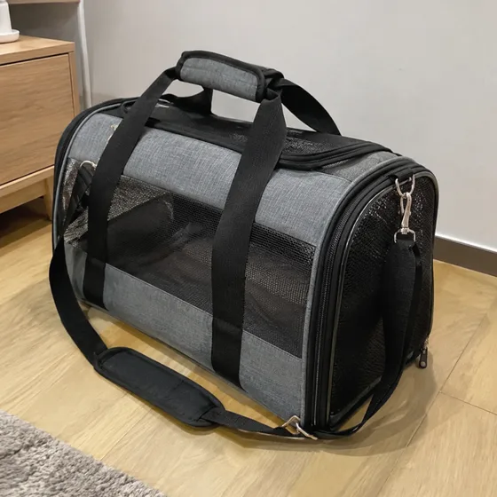
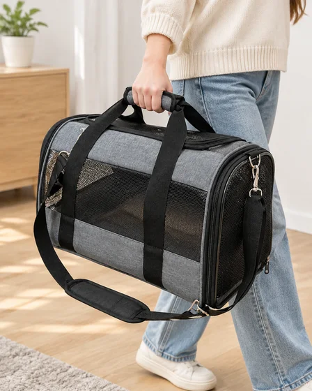

# Product-in-Hand Interaction Image · 商品手持互动图

Show a real product being held or used with plausible scale and contact.

生成手持或使用商品的互动图。用于社媒广告、详情页。

[复制公开提示词 / Copy prompt](#public-prompt) · [在 dearsketch 制作 / Try online](https://dearsketch.com/intent/i075-show-a-product-being-held-or-used.html?utm_source=github&utm_medium=case&utm_campaign=dearsketch-public-cases&utm_content=i075_cta) · [返回专题 / Collection](../guides/products.md)

## 参考素材与结果方向

<table>
<thead><tr><th width="50%">参考素材</th><th width="50%">结果示例</th></tr></thead>
<tbody><tr><td valign="top"><p><strong>商品图片</strong><br></p></td><td valign="top"><a href="https://dearsketch.com/intent/i075-show-a-product-being-held-or-used.html?utm_source=github&amp;utm_medium=case&amp;utm_campaign=dearsketch-public-cases&amp;utm_content=i075_image"></a></td></tr></tbody>
</table>

参考素材与结果用于说明视觉方向，公开模板不是配图的原始生成指令，不保证复现相同结果。

## 需要准备什么 / Inputs

| 素材 / Material | 类型 / Type | 数量 / Quantity | 条件 / Requirement |
| --- | --- | --- | --- |
| 商品图片 | 图片 / Image | 1张 | 必需 / Required |

每次只生成一张图片。

## 保留与改变 / Editing brief

- **Preserve / 保留：** Keep product design, size cues, label, color, and functional truth.
- **Change / 改变：** Change hands, user context, environment, camera angle, and light.

## Public prompt

**新编公开模板 · Newly authored · Not generation-tested.** 替换方括号参数，在支持图片编辑的工具中附上所需素材；可选和条件输入按上表准备。此模板没有用于生成本页示例。

```text
Create one interaction image from [PRODUCT IMAGE].
Preserve the product’s exact shape, dimensions relative to known cues, color, labels, materials, controls, and attachments.
Show [PERSON OR HAND DESCRIPTION] [HOLDING / USING] it in [CONTEXT].
Use [CAMERA ANGLE], [LIGHTING], and [BACKGROUND] appropriate to [MARKETING USE].
Make fingers, grip, pressure, contact points, occlusion, perspective, and shadows anatomically plausible.
Keep the product at a believable scale and orientation.
Do not redesign the item, hide important parts, add accessories, or imply an unsupported function.
Avoid extra fingers, fused hands, floating objects, and impossible use positions.
If the context suggests performance, show only behavior confirmed in [PRODUCT FACTS].
Deliver one finished interaction image only.
```

[用自己的素材在线制作 / Make it online](https://dearsketch.com/intent/i075-show-a-product-being-held-or-used.html?utm_source=github&utm_medium=case&utm_campaign=dearsketch-public-cases&utm_content=i075_after-prompt) · [让 Agent 帮你整理 / Use the Skill](../quickstart.md#agent-skill)

## 检查重点 / Review

核对手部结构、握持关系与商品尺寸感，避免伪造产品功能。

Inspect hand anatomy, grip, scale, and avoid inventing product capability.

结果方向：商品互动图。需要准确文字、透明文件、矢量或印刷交付时，检查实际文件；可用功能和费用以网站说明为准。

## 相关案例 / Related tasks

- [Turn an ordinary product photo into a white-background listing image · 商品白底主图](i065-turn-an-ordinary-product-photo-into-a-white-background-listing-image.md#public-prompt)
- [Create a reusable product PNG with a transparent background · 透明底商品素材](i066-create-a-reusable-product-png-with-a-transparent-background.md#public-prompt)
- [Place a product in a realistic lifestyle scene · 商品生活方式场景](i067-place-a-product-in-a-realistic-lifestyle-scene.md#public-prompt)

## 需求背景参考

- [OpenArt图片生成](https://openart.ai/ai-image-generator/)
- [Pixelcut Product Studio](https://www.pixelcut.ai/ai-product-photography)

这些链接仅帮助理解用途，不是本页图片的来源或授权证明。

图片与素材使用范围见[内容说明](../content-policy.md)。[查看全部 50 个模板](../prompts.md)。
