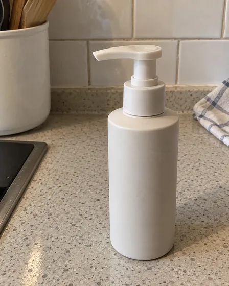
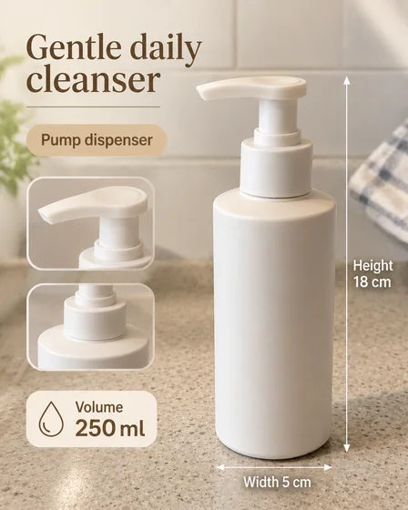

# Product Feature Infographic · 商品卖点信息图

[中文](../../README.md) · [English](../../README.en.md) · [Português](../../README.pt.md) · [Español](../../README.es.md) · [Français](../../README.fr.md) · [Deutsch](../../README.de.md) · [عربي](../../README.ar.md) · [русский](../../README.ru.md) · [日本語](../../README.ja.md) · [हिंदी](../../README.hi.md)


Create a single product infographic from a photo and verified specifications.

制作带尺寸、卖点和参数的商品信息图。用于Amazon详情、独立站。

[复制公开提示词 / Copy prompt](#public-prompt) · [在 dearsketch 制作 / Try online](https://dearsketch.com/intent/i076-create-a-product-infographic-with-dimensions-features-and-specifications.html?utm_source=github&utm_medium=case&utm_campaign=dearsketch-public-cases&utm_content=i076_cta) · [返回专题 / Collection](../guides/products.md)

## 参考素材与结果方向

<table>
<thead><tr><th width="50%">参考素材</th><th width="50%">结果示例</th></tr></thead>
<tbody><tr><td valign="top"><p><strong>商品照片</strong><br></p></td><td valign="top"><a href="https://dearsketch.com/intent/i076-create-a-product-infographic-with-dimensions-features-and-specifications.html?utm_source=github&amp;utm_medium=case&amp;utm_campaign=dearsketch-public-cases&amp;utm_content=i076_image"></a></td></tr></tbody>
</table>

参考素材与结果用于说明视觉方向，公开模板不是配图的原始生成指令，不保证复现相同结果。

## 需要准备什么 / Inputs

| 素材 / Material | 类型 / Type | 数量 / Quantity | 条件 / Requirement |
| --- | --- | --- | --- |
| 商品照片 | 图片 / Image | 1张 | 必需 / Required |
| 准确尺寸、卖点和参数 | 文字 / Text | 1组 | 必需 / Required |

本次生成单张视觉预览。数据计算、精确排版、矢量或生产文件仍需对应工具校验。

## 保留与改变 / Editing brief

- **Preserve / 保留：** Keep product appearance and every supplied number, unit, and claim exact.
- **Change / 改变：** Change layout, callouts, icons, hierarchy, and supporting background.

## Public prompt

**新编公开模板 · Newly authored · Not generation-tested.** 替换方括号参数，在支持图片编辑的工具中附上所需素材；可选和条件输入按上表准备。此模板没有用于生成本页示例。

```text
Create one product-feature infographic from [PRODUCT PHOTO] and [VERIFIED DIMENSIONS, FEATURES, AND SPECIFICATIONS].
Preserve the product’s exact geometry, color, labels, materials, and visible components.
Use a clear [LAYOUT FORMAT] with product image, callout lines, icons, and concise information hierarchy.
Reproduce every supplied number, unit, feature, and qualifier exactly; do not calculate or infer missing values.
Include only these approved claims: [APPROVED CLAIMS].
Use [BRAND PALETTE], [TYPE DIRECTION], and [BACKGROUND] without obscuring the product.
Keep callout lines attached to the correct feature and maintain readable spacing.
Do not invent certifications, compatibility, performance, warranty, or comparative claims.
Treat generated text as a visual draft: manually proofread and typeset the final file.
Deliver one infographic preview image only, not a verified vector or print-production file.
```

[用自己的素材在线制作 / Make it online](https://dearsketch.com/intent/i076-create-a-product-infographic-with-dimensions-features-and-specifications.html?utm_source=github&utm_medium=case&utm_campaign=dearsketch-public-cases&utm_content=i076_after-prompt) · [让 Agent 帮你整理 / Use the Skill](../quickstart.md#agent-skill)

## 检查重点 / Review

尺寸、参数与卖点来自用户资料；生成文字必须逐项复核。

Proofread all text and verify the final production file separately.

结果方向：商品信息图。需要准确文字、透明文件、矢量或印刷交付时，检查实际文件；可用功能和费用以网站说明为准。

## 相关案例 / Related tasks

- [Turn an ordinary product photo into a white-background listing image · 商品白底主图](./i065-turn-an-ordinary-product-photo-into-a-white-background-listing-image.md#public-prompt)
- [Create a reusable product PNG with a transparent background · 透明底商品素材](./i066-create-a-reusable-product-png-with-a-transparent-background.md#public-prompt)
- [Place a product in a realistic lifestyle scene · 商品生活方式场景](./i067-place-a-product-in-a-realistic-lifestyle-scene.md#public-prompt)

## 需求背景参考

- [Pixelcut Product Studio](https://www.pixelcut.ai/ai-product-photography)

这些链接仅帮助理解用途，不是本页图片的来源或授权证明。

图片与素材使用范围见[内容说明](../content-policy.md)。[查看全部 50 个模板](../prompts.md)。
