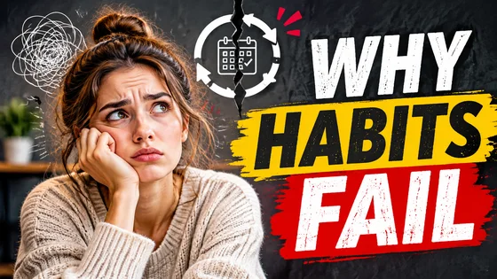

# YouTube Thumbnail · YouTube 视频缩略图

[中文](../../README.md) · [English](../../README.en.md) · [Português](../../README.pt.md) · [Español](../../README.es.md) · [Français](../../README.fr.md) · [Deutsch](../../README.de.md) · [عربي](../../README.ar.md) · [русский](../../README.ru.md) · [日本語](../../README.ja.md) · [हिंदी](../../README.hi.md)


Create one high-contrast thumbnail around a verified video topic and optional subject image.

生成YouTube视频缩略图。用于视频发布。

[复制公开提示词 / Copy prompt](#public-prompt) · [在 dearsketch 制作 / Try online](https://dearsketch.com/intent/i106-create-a-youtube-video-thumbnail.html?utm_source=github&utm_medium=case&utm_campaign=dearsketch-public-cases&utm_content=i106_cta) · [返回专题 / Collection](../guides/design.md)

## 参考素材与结果方向

<p><strong>结果示例</strong></p>
<p><a href="https://dearsketch.com/intent/i106-create-a-youtube-video-thumbnail.html?utm_source=github&amp;utm_medium=case&amp;utm_campaign=dearsketch-public-cases&amp;utm_content=i106_image"></a></p>
<p>本例未附图片参考，输入预览待补；素材要求见下方。</p>

参考素材与结果用于说明视觉方向，公开模板不是配图的原始生成指令，不保证复现相同结果。

## 需要准备什么 / Inputs

| 素材 / Material | 类型 / Type | 数量 / Quantity | 条件 / Requirement |
| --- | --- | --- | --- |
| 视频人物或主题物件原图 | 图片 / Image | 0–1张；多素材可合并为一张已标注参考板 | 可选 / Optional：缩略图要出现特定人物、产品或实物时 |
| 视频主题或标题 | 文字 / Text | 1份 | 必需 / Required |

每次只生成一张图片。

## 保留与改变 / Editing brief

- **Preserve / 保留：** Keep supplied person or object identity and the exact approved title.
- **Change / 改变：** Change composition, background, expression emphasis, color, and title treatment.

## Public prompt

**新编公开模板 · Newly authored · Not generation-tested.** 替换方括号参数，在支持图片编辑的工具中附上所需素材；可选和条件输入按上表准备。此模板没有用于生成本页示例。

```text
Create one YouTube thumbnail for the verified topic [VIDEO TOPIC].
Use [PERSON OR SUBJECT IMAGE] when supplied and preserve its identity, design, and defining features.
Use the exact short title “[APPROVED THUMBNAIL TITLE]”; do not add unsupported claims.
Build a high-contrast [16:9 OR SPECIFIED] composition with one dominant focal point.
Use [BACKGROUND CONCEPT], [PALETTE], and [EMOTIONAL TONE] appropriate to the actual video.
Keep the subject clearly separated from the background without distorted anatomy or cutout halos.
Make title placement readable at small size and keep important content inside safe margins.
Do not invent reactions, results, numbers, logos, or clickbait facts absent from the video.
Treat rendered lettering as a draft and manually proofread the final thumbnail.
Deliver one thumbnail image only.
```

[用自己的素材在线制作 / Make it online](https://dearsketch.com/intent/i106-create-a-youtube-video-thumbnail.html?utm_source=github&utm_medium=case&utm_campaign=dearsketch-public-cases&utm_content=i106_after-prompt) · [让 Agent 帮你整理 / Use the Skill](../quickstart.md#agent-skill)

## 检查重点 / Review

使用真实视频主题，检查缩小后的主体与标题识别度。

Test readability at small size and verify the wording matches the video.

结果方向：YouTube Thumbnail。需要准确文字、透明文件、矢量或印刷交付时，检查实际文件；可用功能和费用以网站说明为准。

## 相关案例 / Related tasks

- [Create a promotional poster from a topic and copy · 主题宣传海报](./i107-create-a-promotional-poster-from-a-topic-and-copy.md#public-prompt)
- [Create a Mother's Day, Black Friday, or holiday sale poster · 节日促销海报](./i112-create-a-mother-s-day-black-friday-or-holiday-sale-poster.md#public-prompt)
- [Create a conference, exhibition, or speaking-event poster · 会议与展览海报](./i115-create-a-conference-exhibition-or-speaking-event-poster.md#public-prompt)

## 需求背景参考

- [LightX全部工具](https://www.lightxeditor.com/all-tools/all-tools/)
- [Recraft](https://www.recraft.ai/Generate)

这些链接仅帮助理解用途，不是本页图片的来源或授权证明。

图片与素材使用范围见[内容说明](../content-policy.md)。[查看全部 50 个模板](../prompts.md)。
