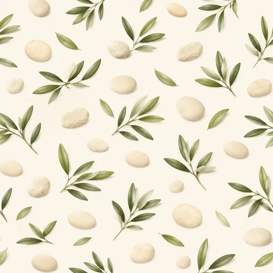

# Brand Background Pattern · 品牌背景图案

[中文](../../README.md) · [English](../../README.en.md) · [Português](../../README.pt.md) · [Español](../../README.es.md) · [Français](../../README.fr.md) · [Deutsch](../../README.de.md) · [عربي](../../README.ar.md) · [русский](../../README.ru.md) · [日本語](../../README.ja.md) · [हिंदी](../../README.hi.md)


Create one original repeating background for a new your specified brief direction from text alone.

生成可重复背景、纹理和品牌图案。用于包装、网页、印刷。

[复制公开提示词 / Copy prompt](#public-prompt) · [在 dearsketch 制作 / Try online](https://dearsketch.com/intent/i135-create-repeatable-backgrounds-textures-and-brand-patterns.html?utm_source=github&utm_medium=case&utm_campaign=dearsketch-public-cases&utm_content=i135_cta) · [返回专题 / Collection](../guides/text-only.md)

## 参考素材与结果方向

<p><strong>结果示例</strong></p>
<p><a href="https://dearsketch.com/intent/i135-create-repeatable-backgrounds-textures-and-brand-patterns.html?utm_source=github&amp;utm_medium=case&amp;utm_campaign=dearsketch-public-cases&amp;utm_content=i135_image"></a></p>
<p>本例为文字输入，未附图片参考。</p>

参考素材与结果用于说明视觉方向，公开模板不是配图的原始生成指令，不保证复现相同结果。

## 需要准备什么 / Inputs

| 素材 / Material | 类型 / Type | 数量 / Quantity | 条件 / Requirement |
| --- | --- | --- | --- |
| 文字创作brief：填写提示词中的主题、用途和事实参数 | 文字 / Text | 1份 | 必需 / Required |

**纯文字生成 / Text only: no image, logo, sketch or other attachment required.** 仅使用下方文字brief建立新概念。

每次只生成一张图片，无需上传图片。

## 保留与改变 / Editing brief

- **Preserve / 保留：** Honor the supplied written facts, exact wording and constraints.
- **Change / 改变：** Create [MOTIFS] using [SHAPE LANGUAGE], [PALETTE] and [SPACING]. Keep contrast low enough for [APPLICATION] and align the tile’s opposite edges.

## Public prompt

**新编公开模板 · Newly authored · Not generation-tested.** 替换方括号参数即可，不需要上传参考图。此模板没有用于生成本页示例。

```text
Create one original repeating background for a new [BRAND PERSONALITY] direction from the following written brief only. No reference image or other attachment is needed.
Create [MOTIFS] using [SHAPE LANGUAGE], [PALETTE] and [SPACING]. Keep contrast low enough for [APPLICATION] and align the tile’s opposite edges.
This defines a new pattern rather than preserving unseen brand artwork; test the repeat.
Use an original design. Do not imply fidelity to any existing person, product, property or artwork that has not been supplied.
Return one finished image only. Replace every bracketed field with your own details before generating.
```

[用自己的素材在线制作 / Make it online](https://dearsketch.com/intent/i135-create-repeatable-backgrounds-textures-and-brand-patterns.html?utm_source=github&utm_medium=case&utm_campaign=dearsketch-public-cases&utm_content=i135_after-prompt) · [让 Agent 帮你整理 / Use the Skill](../quickstart.md#agent-skill)

## 检查重点 / Review

This defines a new pattern rather than preserving unseen brand artwork; test the repeat.

This defines a new pattern rather than preserving unseen brand artwork; test the repeat.

结果方向：Pattern与Texture。需要准确文字、透明文件、矢量或印刷交付时，检查实际文件；可用功能和费用以网站说明为准。

## 相关案例 / Related tasks

- [Create a profile picture for YouTube or streaming · 文字生成频道头像](./i054-create-a-profile-picture-for-youtube-or-streaming.md#public-prompt)
- [Create a custom emoji from text · 自定义 Emoji](./i057-create-a-custom-emoji-from-text.md#public-prompt)
- [Create seamless prints and fabric patterns for clothing · 服装无缝印花](./i100-create-seamless-prints-and-fabric-patterns-for-clothing.md#public-prompt)

## 需求背景参考

- [Freepik AI](https://www.freepik.com/ai)
- [Recraft](https://www.recraft.ai/Generate)

这些链接仅帮助理解用途，不是本页图片的来源或授权证明。

图片与素材使用范围见[内容说明](../content-policy.md)。[查看全部 100 个模板](../prompts.md)。
