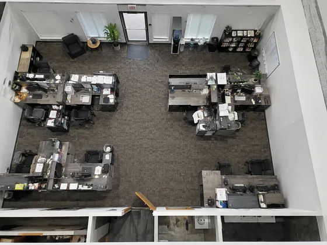
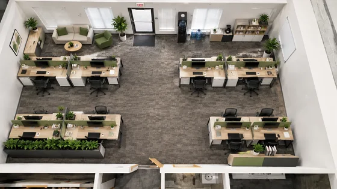

# Office Redesign Concept · 办公室改造概念

[中文](../../README.md) · [English](../../README.en.md) · [Português](../../README.pt.md) · [Español](../../README.es.md) · [Français](../../README.fr.md) · [Deutsch](../../README.de.md) · [عربي](../../README.ar.md) · [русский](../../README.ru.md) · [日本語](../../README.ja.md) · [हिंदी](../../README.hi.md)


Visualize either an existing-office redesign from a site photo or a text-led workplace concept.

生成办公室重新设计方案。用于办公室改造。

[复制公开提示词 / Copy prompt](#public-prompt) · [在 dearsketch 制作 / Try online](https://dearsketch.com/intent/i172-create-an-office-redesign-concept.html?utm_source=github&utm_medium=case&utm_campaign=dearsketch-public-cases&utm_content=i172_cta) · [返回专题 / Collection](../guides/spaces.md)

## 参考素材与结果方向

<table>
<thead><tr><th width="50%">参考素材</th><th width="50%">结果示例</th></tr></thead>
<tbody><tr><td valign="top"><p><strong>办公室现场照片</strong><br></p></td><td valign="top"><a href="https://dearsketch.com/intent/i172-create-an-office-redesign-concept.html?utm_source=github&amp;utm_medium=case&amp;utm_campaign=dearsketch-public-cases&amp;utm_content=i172_image"></a></td></tr></tbody>
</table>

参考素材与结果用于说明视觉方向，公开模板不是配图的原始生成指令，不保证复现相同结果。

## 需要准备什么 / Inputs

| 素材 / Material | 类型 / Type | 数量 / Quantity | 条件 / Requirement |
| --- | --- | --- | --- |
| 办公室现场照片 | 图片 / Image | 1张 | 按条件 / Conditional：改造既有办公室时 |
| 团队、功能区、品牌和分支说明 | 文字 / Text | 1份 | 必需 / Required |

每次只生成一张图片。

## 保留与改变 / Editing brief

- **Preserve / 保留：** Keep visible structure and constraints only when a site photo is supplied.
- **Change / 改变：** Change workstations, zones, furniture, branding, finishes, and lighting.

## Public prompt

**新编公开模板 · Newly authored · Not generation-tested.** 替换方括号参数，在支持图片编辑的工具中附上所需素材；可选和条件输入按上表准备。此模板没有用于生成本页示例。

```text
Create one office concept for [TEAM SIZE], [WORK MODES], and [FUNCTIONAL ZONES].
Choose one branch: use [OFFICE SITE PHOTO] when redesigning an existing office, or use [TEXT-ONLY SPACE BRIEF] for a new generic concept.
For the site-photo branch, preserve visible walls, columns, windows, doors, exits, ceiling, fixed services, and camera view.
For the text-only branch, do not claim to preserve or represent an unknown existing structure.
Use [BRAND DIRECTION], [PALETTE], [MATERIALS], and [FURNITURE STYLE].
Arrange workstations, meeting areas, storage, and circulation with plausible scale and access.
Do not invent confirmed floor area, site constraints, or compliance facts absent from the brief.
Show only brand names or logos supplied in [APPROVED BRAND ASSET].
Treat the result as a concept, not a measured plan, budget, accessibility review, or fire-code approval.
Deliver one office concept image only and flag technical questions for professional verification.
```

[用自己的素材在线制作 / Make it online](https://dearsketch.com/intent/i172-create-an-office-redesign-concept.html?utm_source=github&utm_medium=case&utm_campaign=dearsketch-public-cases&utm_content=i172_after-prompt) · [让 Agent 帮你整理 / Use the Skill](../quickstart.md#agent-skill)

## 检查重点 / Review

团队人数、功能分区和品牌内容需要明确，画面不能证明满足建筑与消防要求。

Check capacity and workflow, then separately verify code, accessibility, and fire safety.

结果方向：办公室概念图。需要准确文字、透明文件、矢量或印刷交付时，检查实际文件；可用功能和费用以网站说明为准。

## 相关案例 / Related tasks

- [Turn a house photo into a watercolor or line-art keepsake · 住宅水彩纪念画](./i030-turn-a-house-photo-into-a-watercolor-or-line-art-keepsake.md#public-prompt)
- [Preview different interior styles in a room photo · 房间装修风格预览](./i169-preview-different-interior-styles-in-a-room-photo.md#public-prompt)
- [Create a landscape makeover concept from a yard photo · 庭院景观改造](./i178-create-a-landscape-makeover-concept-from-a-yard-photo.md#public-prompt)

## 需求背景参考

- [LightX全部工具](https://www.lightxeditor.com/all-tools/all-tools/)
- [Adobe房间设计](https://www.adobe.com/products/firefly/features/ai-room-design.html)

这些链接仅帮助理解用途，不是本页图片的来源或授权证明。

图片与素材使用范围见[内容说明](../content-policy.md)。[查看全部 50 个模板](../prompts.md)。
