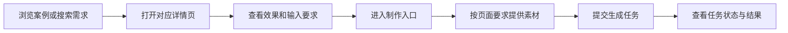
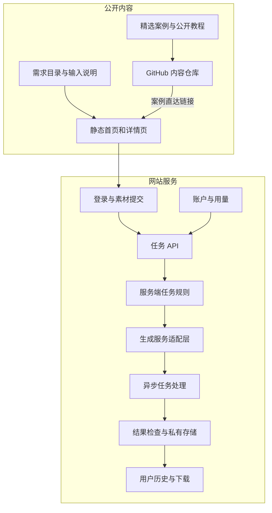

# dearsketch Produktarchitektur

[中文](../../README.md) · [English](../../README.en.md) · [Português](../../README.pt.md) · [Español](../../README.es.md) · [Français](../../README.fr.md) · [Deutsch](../../README.de.md) · [عربي](../../README.ar.md) · [русский](../../README.ru.md) · [日本語](../../README.ja.md) · [हिंदी](../../README.hi.md)


dearsketch organisiert „Welche Bilder möchte ich vervollständigen?“ in einem durchsuchbaren Anforderungsverzeichnis. Für jede Anforderung gibt es eine unabhängige Seite, auf der der Zweck, die erforderlichen Materialien und die Ergebnisanforderungen erläutert werden. Benutzer gelangen über die entsprechende Seite in den Produktionsprozess.

In dieser Beschreibung werden die Verantwortlichkeiten und der Datenfluss des Moduls beschrieben. Die öffentliche Inhaltsbibliothek, die Website-Dienste und die generierten Modelle übernehmen jeweils unterschiedliche Aufgaben; Dieses Lager bietet öffentliche Fälle, 50 neu bearbeitete Vorlagen und Agent Skill, und die Online-Produktion erfolgt auf der Website.

## Benutzerpfad



Für unterschiedliche Aufgaben sind möglicherweise Fotos, bestimmte Designmanuskripte, genaues Verfassen von Texten oder Assets mit mehreren Charakteren erforderlich. Serienzeichnungen und Mehrfachpläne werden separat auf einer Basis erstellt; Wenn präzise Texte, Vektoren oder Produktionsdateien benötigt werden, sind nach der visuellen Vorschau entsprechende Werkzeuge erforderlich.

## Inhalts- und Generationsschichtung



Statische Inhaltsseiten sind für die Entdeckung, Interpretation und Sucheinbindung verantwortlich. Die Aufgabe API ist für die Validierung von Benutzereingaben und die Erstellung von Aufgaben verantwortlich. Die serverseitige Regel- und Generierungsanpassungsschicht ist für die Ausführung ausgewählter Anforderungen verantwortlich. Die Verlaufs- und Speicherschicht ist für die Rückgabe der Ergebnisse an die entsprechenden Benutzer verantwortlich.

Die Module in der Abbildung spiegeln die Aufteilung der Verantwortlichkeiten im aktuellen Quellcode wider und stellen keine Verpflichtung zu allen Online-Funktionen, Zahlungsstatus oder Service-Levels dar; Bei der Nutzung sind die tatsächlichen Zugangs- und Anweisungen auf der Website maßgebend.

## Modulverantwortung

| Modul | Problem gelöst |
| --- | --- |
| Anforderungskatalog | Organisieren Sie Bildaufgaben mit Zwecken, Eingaben, Ausgaben und Szenarien |
| Seitenaufbau | Generieren Sie stabile Adressen, Seiteninhalte und Suchmetadaten für Ihre Anforderungen |
| Geben Sie den Vertrag ein | Erklären Sie, welche Materialien erforderlich und welche optional sind und welche Beziehungen zwischen den Materialien bestehen. |
| Konten und Aufgaben API | Überprüfen Sie die Identität, die Eingabeintegrität und fordern Sie Duplikate an |
| Regeln für Serveraufgaben | Organisieren Sie Ausführungsinhalte je nach Bedarf und aktuellem Input |
| Anpassungsschicht generieren | Stellen Sie eine Verbindung zu externen Build-Diensten her und erledigen Sie asynchrone Aufgaben |
| Ergebnisse und Geschichte | Überprüfen Sie Ergebnisse, sparen Sie Ressourcen und gewähren Sie den entsprechenden Benutzern Zugriff |
| Konto und Nutzung | Verwalten Sie Nutzungsqualifikationen, Punkte und den auftragsbezogenen Status |

## Implementierungsmethode

| Schicht | Die Methode im aktuellen Quellcode |
| --- | --- |
| Inhaltskonstruktion | Das Node.js-Skript generiert HTML, Detailseiten- und Suchmetadaten aus strukturierten Anforderungen |
| Browser-Interaktion | JavaScript übernimmt die Filterung, Materialeingabe und den Aufgabenstatus; Einige Interaktionen verwenden React und werden von Vite gepackt |
| Server | Node.js-Module kümmern sich um Authentifizierung, Uploads, Build-Aufgaben, Verlauf und Nutzung |
| Daten | Die relationale Datenbank zeichnet Konten, Ressourcenbesitz und Aufgabenstatus auf |
| dokumentieren | Von Geschäftsdaten getrennter privater Objektspeicher, auf den über kontrollierte Adressen zugegriffen wird |
| erzeugen | Der Server passt sich extern generierten Diensten an und verarbeitet asynchrone Aufgaben und Ergebnisse. |

Diese technischen Entscheidungen können erklären, wie das System die Arbeit aufteilt, ohne Produktionskontonummern, Projekt-IDs, Bucket-Namen oder Umgebungsvariablenwerte preiszugeben.

## Beispiel für öffentliche Daten

```json
{
  "id": "I026",
  "title": "宠物定制肖像",
  "input": "1张宠物照片",
  "output": "宠物肖像图片",
  "roles": [
    { "kind": "image", "label": "宠物照片", "requirement": "required", "quantity": "1张" }
  ]
}
```

Diese Felder erläutern Benutzeraufgaben und enthalten keine vollständigen Anweisungen zur serverseitigen Generierung. Ausgewählte Falldaten finden Sie unter [cases.json](../../data/cases.json), weitere Ergebnisbeispiele finden Sie unter [gallery.json](../../data/gallery.json) und die neue öffentliche Vorlage finden Sie unter [public-prompts.json](../../data/public-prompts.json). Öffentliche Fähigkeiten sind nur für die Vorbereitung von Eingabelisten und Aufforderungswörtern verantwortlich und haben keinen Zugriff auf interne Generierungsregeln.

## Zugriffs- und Inhaltsgrenzen

Öffentliche Fallbilder und von Benutzern hochgeladene Ressourcen sind zwei Arten von Inhalten. Hüllen werden verwendet, um die visuelle Richtung zu veranschaulichen; Originale Benutzerbilder, Aufgabenergebnisse und Kontodatensätze gehören nicht zur öffentlichen Fallbibliothek. Der Generierungsdienst muss den Materialtyp, die Größe und den Besitz überprüfen, und Benutzereingaben können die Ausführungsbeschränkungen des Servers nicht außer Kraft setzen.

Moduldiagramme, Verantwortlichkeiten, abstrakte Datenstrukturen, Eingabespezifikationen und allgemeine Zuverlässigkeitsprinzipien können offengelegt werden. Das Offenlegen eines Teils der serverseitigen Implementierung oder einer Reihe von Datenbankstrukturen ist ein Bereich von Open Source, über den unabhängig entschieden werden kann. Sie sind nicht automatisch geheim, nur weil sie auf der Serverseite liegen.

Der Umfang dieses Lagers umfasst Fälle, grundlegende Tutorials und Beschreibungen der Produktarchitektur und umfasst nicht den Quellcode für Produktionsdienste, interne vollständige Fähigkeiten oder Bereitstellungsressourcen. Anmeldeinformationen, Sitzungen, echte Benutzerdatensätze und private Ressourcenadressen sind keine öffentlichen Inhalte.

## So verbinden Sie GitHub mit der Website

Jedes vorgestellte Bild und jeder „Make the same“-Link führt zur entsprechenden Nachfrageseite. Links verwenden Quellparameter, um README-Dateien, Falldetails und Tutorial-Einträge zu unterscheiden. Diese Parameter geben lediglich die Quelle wieder und können allein nicht beweisen, dass ein statistisches System eingesetzt wurde.

Die Website verfügt über keine Eingabefelder für Eingabeaufforderungen für Besucher. Grundlegende Tutorials werden veröffentlicht, damit Benutzer die Tools ihrer Wahl ausprobieren können. Die Website bietet entsprechende Materialeingänge basierend auf ausgewählten Anforderungen.
