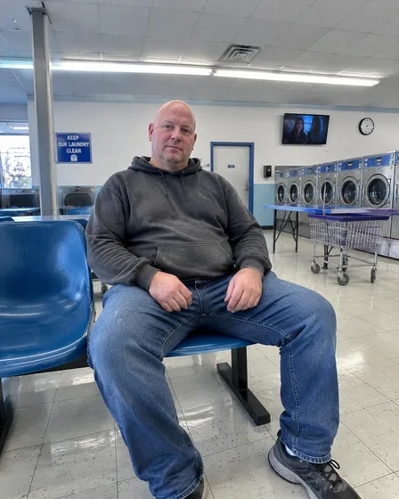

# Ersetzen Sie Freizeitkleidung durch Berufskleidung · Freizeitkleidung durch Berufskleidung

[中文](../../../README.md) · [English](../../../README.en.md) · [Português](../../../README.pt.md) · [Español](../../../README.es.md) · [Français](../../../README.fr.md) · [Deutsch](../../../README.de.md) · [عربي](../../../README.ar.md) · [русский](../../../README.ru.md) · [日本語](../../../README.ja.md) · [हिंदी](../../../README.hi.md)


Bearbeiten Sie nur die Kleidung in einem Porträt, um sie an ein bestimmtes professionelles Outfit anzupassen.

Ersetzen Sie Freizeitkleidung durch formelle Kleidung. Wird für Lebensläufe und Arbeitsmaterialien verwendet.

[Kopieraufforderung](#public-prompt) · [ wird erstellt von dearsketch / Online testen](https://dearsketch.com/de/intent/i015-replace-casual-clothing-with-professional-attire.html?utm_source=github&utm_medium=case&utm_campaign=dearsketch-public-cases&utm_content=i015_cta) · [Zurück zum Thema / Sammlung](../guides/people.md)

## Referenzmaterial und Ergebnisrichtung

<table>
<thead><tr><th width="50%">Referenzmaterial</th><th width="50%">Beispiel für Ergebnisse</th></tr></thead>
<tbody><tr><td valign="top"><p><strong>Porträt in Freizeitkleidung</strong><br></p></td><td valign="top"><a href="https://dearsketch.com/de/intent/i015-replace-casual-clothing-with-professional-attire.html?utm_source=github&amp;utm_medium=case&amp;utm_campaign=dearsketch-public-cases&amp;utm_content=i015_image"></a></td></tr></tbody>
</table>

Die Referenzmaterialien und Ergebnisse dienen zur Veranschaulichung der visuellen Ausrichtung. Die öffentliche Vorlage stellt nicht die ursprüngliche Generierungsanweisung für die begleitenden Bilder dar und es kann nicht garantiert werden, dass dieselben Ergebnisse reproduziert werden.

## Was vorzubereiten/Eingaben

| Material | Typ / Typ | Menge / Menge | Bedingung / Anforderung |
| --- | --- | --- | --- |
| Porträt in Freizeitkleidung | Bild/Bild | 1 Stück | Erforderlich / Erforderlich |

Es wird jeweils nur ein Bild generiert.

## Behalten und ändern / Kurzfassung bearbeiten

- **Bewahren / 保留：** Behalten Sie Identität, Gesicht, Haare, Pose, Körperform, Hände und Hintergrund bei, sofern nicht anders gewünscht.
- **Ändern / 改变：** Ändern Sie den Kleidungsstücktyp, die Farbe, die Passform und die sichtbaren Accessoires.

## Public prompt

**Neu bearbeitete öffentliche Vorlage · Neu verfasst · Nicht generativ getestet.** Ersetzen Sie die Parameter in eckigen Klammern und fügen Sie die erforderlichen Materialien in das Tool ein, das die Bildbearbeitung unterstützt; Optionale und bedingte Eingaben werden gemäß der obigen Tabelle vorbereitet. Diese Vorlage wurde nicht zum Generieren der Beispiele auf dieser Seite verwendet.

```text
Edit [PORTRAIT PHOTO] to replace only the casual clothing with [PROFESSIONAL OUTFIT].
Preserve the person’s identity, face, skin tone, hair, expression, pose, body shape, and camera angle.
Keep the original background and lighting unless [BACKGROUND CHANGE] is explicitly requested.
Fit the new garment naturally around the neck, shoulders, torso, arms, and waist.
Use [FABRIC], [COLOR], and [FORMALITY LEVEL] appropriate to [PROFESSIONAL CONTEXT].
Retain or remove visible accessories only according to [ACCESSORY INSTRUCTION].
Do not add uniforms, employer logos, medals, or credentials that were not supplied.
Keep hands, collar, lapels, cuffs, seams, and body edges anatomically clean.
Avoid changing weight, age, makeup, or facial features.
Deliver one edited portrait image only.
```

[Machen Sie es online mit Ihren eigenen Materialien / Machen Sie es online](https://dearsketch.com/de/intent/i015-replace-casual-clothing-with-professional-attire.html?utm_source=github&utm_medium=case&utm_campaign=dearsketch-public-cases&utm_content=i015_after-prompt) · [Lassen Sie sich vom Agenten bei der Organisation helfen / Nutzen Sie den Skill](../quickstart.md#agent-skill)

## Überprüfen Sie die wichtigsten Punkte/Bewertung

Passen Sie nur die Kleidung des Ziels an und überprüfen Sie dabei den Ausschnitt, die Hände und die Körperkanten, um das Aussehen der Person nicht zu verändern.

Überprüfen Sie Kragen, Manschetten, Hände und Körperkanten auf saubere Integration.

Ergebnisrichtung: Fotos von formeller Kleidung. Wenn exakter Text, transparente Dateien, Vektoren oder eine Drucklieferung erforderlich sind, überprüfen Sie die tatsächliche Datei. Die verfügbaren Funktionen und Gebühren unterliegen der Beschreibung auf der Website.

## Verwandte Fälle / Verwandte Aufgaben

- [Erstellen Sie ein professionelles LinkedIn-Headshot von einem Selfie · Selfie zum professionellen Headshot ](./i001-create-a-professional-linkedin-headshot-from-a-selfie.md#public-prompt)
- [Verwandeln Sie sich in ein königliches, Vintage- oder historisches Porträt · Königliches und Vintage-Porträt ](./i052-turn-yourself-into-a-royal-vintage-or-historical-portrait.md#public-prompt)
- [Brillen virtuell anprobieren · Vorschau zur Brillenanprobe](./i036-virtually-try-on-glasses.md#public-prompt)

## Hintergrundreferenz zu den Anforderungen

- [Fotor professionelles Foto](https://www.fotor.com/features/ai-headshot-generator/)
- [LightXAlle Werkzeuge](https://www.lightxeditor.com/all-tools/all-tools/)

Diese Links dienen lediglich dem Verständnis des Zwecks und sind kein Beweis für die Quelle oder Autorisierung der Bilder auf dieser Seite.

Den Umfang der Nutzung von Bildern und Materialien finden Sie in der Inhaltsbeschreibung [ ](../content-policy.md). [Alle 50 Vorlagen anzeigen ](../prompts.md).
