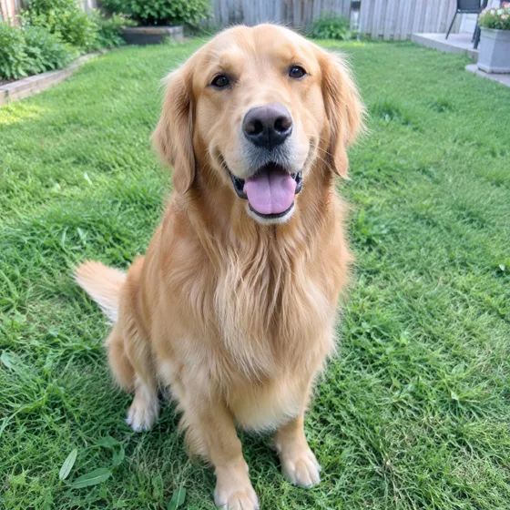
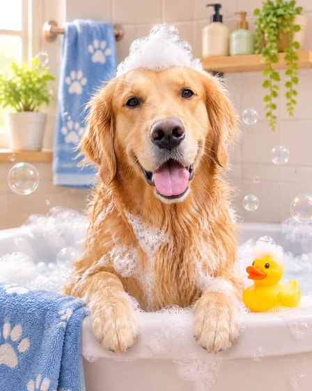

# Verspielte Haustierszene · Lustige Szenenmalerei mit Haustieren

[中文](../../../README.md) · [English](../../../README.en.md) · [Português](../../../README.pt.md) · [Español](../../../README.es.md) · [Français](../../../README.fr.md) · [Deutsch](../../../README.de.md) · [عربي](../../../README.ar.md) · [русский](../../../README.ru.md) · [日本語](../../../README.ja.md) · [हिंदी](../../../README.hi.md)


Platzieren Sie ein erkennbares Haustier in einer humorvollen Badezimmer-, Küchen- oder häuslichen Szene.

Malen Sie interessante Szenen wie Haustiertoiletten und Küchen. Für Heimdekoration, Geschenke.

[Kopieraufforderung](#public-prompt) · [ wird erstellt von dearsketch / Online testen](https://dearsketch.com/de/intent/i029-place-a-pet-in-a-playful-bathroom-or-kitchen-scene.html?utm_source=github&utm_medium=case&utm_campaign=dearsketch-public-cases&utm_content=i029_cta) · [Zurück zum Thema / Sammlung](../guides/pets-family.md)

## Referenzmaterial und Ergebnisrichtung

<table>
<thead><tr><th width="50%">Referenzmaterial</th><th width="50%">Beispiel für Ergebnisse</th></tr></thead>
<tbody><tr><td valign="top"><p><strong>Haustierfotos</strong><br></p></td><td valign="top"><a href="https://dearsketch.com/de/intent/i029-place-a-pet-in-a-playful-bathroom-or-kitchen-scene.html?utm_source=github&amp;utm_medium=case&amp;utm_campaign=dearsketch-public-cases&amp;utm_content=i029_image"></a></td></tr></tbody>
</table>

Die Referenzmaterialien und Ergebnisse dienen zur Veranschaulichung der visuellen Ausrichtung. Die öffentliche Vorlage stellt nicht die ursprüngliche Generierungsanweisung für die begleitenden Bilder dar und es kann nicht garantiert werden, dass dieselben Ergebnisse reproduziert werden.

## Was vorzubereiten/Eingaben

| Material | Typ / Typ | Menge / Menge | Bedingung / Anforderung |
| --- | --- | --- | --- |
| Haustierfotos | Bild/Bild | 1 Stück | Erforderlich / Erforderlich |

Es wird jeweils nur ein Bild generiert.

## Behalten und ändern / Kurzfassung bearbeiten

- **Bewahren / 保留：** Halten Sie Identität, Fellzeichnung, Anatomie und Maßstab konsistent.
- **Ändern / 改变：** Ändern Sie die Umgebung, den Posenkontext und die spielerischen Requisiten.

## Public prompt

**Neu bearbeitete öffentliche Vorlage · Neu verfasst · Nicht generativ getestet.** Ersetzen Sie die Parameter in eckigen Klammern und fügen Sie die erforderlichen Materialien in das Tool ein, das die Bildbearbeitung unterstützt; Optionale und bedingte Eingaben werden gemäß der obigen Tabelle vorbereitet. Diese Vorlage wurde nicht zum Generieren der Beispiele auf dieser Seite verwendet.

```text
Create one humorous wall-art scene from [PET PHOTO].
Place the same pet in [BATHROOM / KITCHEN / OTHER DOMESTIC SCENE] doing [PLAYFUL ACTION].
Preserve the pet’s face, coat pattern, eye color, ear shape, body type, and scale.
Keep paws, tail, joints, and posture anatomically coherent.
Make contact with [PROP] believable; avoid floating, fused, or duplicated objects.
Build an original, tidy background using [PALETTE] and [DECOR STYLE].
Keep the pet as the clear focal point and avoid excessive clutter.
Treat the scene as fictional artwork, not documentary photography.
Include no text unless [EXACT TEXT] is provided.
Deliver one finished image suitable for [PRINT OR DIGITAL USE].
```

[Machen Sie es online mit Ihren eigenen Materialien / Machen Sie es online](https://dearsketch.com/de/intent/i029-place-a-pet-in-a-playful-bathroom-or-kitchen-scene.html?utm_source=github&utm_medium=case&utm_campaign=dearsketch-public-cases&utm_content=i029_after-prompt) · [Lassen Sie sich vom Agenten bei der Organisation helfen / Nutzen Sie den Skill](../quickstart.md#agent-skill)

## Überprüfen Sie die wichtigsten Punkte/Bewertung

Überprüfen Sie die Klauen, den Stützenkontakt und die Karosseriestruktur. Lustige Szenen sind Kreationen, keine echten Aufnahmen.

Untersuchen Sie Pfoten, Körperstruktur, Objektkontakt und körperliche Plausibilität.

Ergebnisse in Richtung: Lustige Wandkunst für Haustiere. Wenn exakter Text, transparente Dateien, Vektoren oder eine Drucklieferung erforderlich sind, überprüfen Sie die tatsächliche Datei. Die verfügbaren Funktionen und Gebühren unterliegen der Beschreibung auf der Website.

## Verwandte Fälle / Verwandte Aufgaben

- [Verwandeln Sie ein Haustierfoto in ein individuelles Porträt · Benutzerdefiniertes Haustierporträt ](./i026-turn-a-pet-photo-into-a-custom-portrait.md#public-prompt)
- [Verwandeln Sie ein Haustier in ein königliches oder historisches Porträt · Haustierkönigliches Porträt](./i028-turn-a-pet-into-a-royal-or-historical-portrait.md#public-prompt)
- [Erstellen Sie ein Haustier-Gedenkporträt · Haustier-Gedenkgemälde ](./i027-create-a-pet-memorial-portrait.md#public-prompt)

## Hintergrundreferenz zu den Anforderungen

- [Etsy KI-Tierporträt](https://www.etsy.com/market/ai_pet_portrait)

Diese Links dienen lediglich dem Verständnis des Zwecks und sind kein Beweis für die Quelle oder Autorisierung der Bilder auf dieser Seite.

Den Umfang der Nutzung von Bildern und Materialien finden Sie in der Inhaltsbeschreibung [ ](../content-policy.md). [Alle 50 Vorlagen anzeigen ](../prompts.md).
