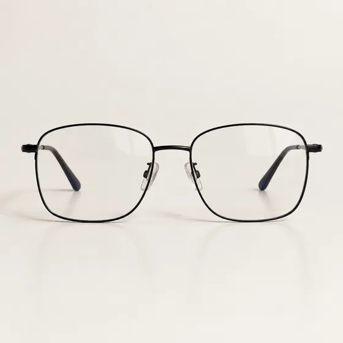

# Virtuelle Brillenvorschau · Vorschau zur Brillenanprobe

[中文](../../../README.md) · [English](../../../README.en.md) · [Português](../../../README.pt.md) · [Español](../../../README.es.md) · [Français](../../../README.fr.md) · [Deutsch](../../../README.de.md) · [عربي](../../../README.ar.md) · [русский](../../../README.ru.md) · [日本語](../../../README.ja.md) · [हिंदी](../../../README.hi.md)


Platzieren Sie ein genaues Produkt oder ein beschriebenes Brillenkonzept auf einem frontal gerichteten Porträt.

Brillen virtuell anprobieren. bei Kaufentscheidungen verwendet werden.

[Kopieraufforderung](#public-prompt) · [ wird erstellt von dearsketch / Online testen](https://dearsketch.com/de/intent/i036-virtually-try-on-glasses.html?utm_source=github&utm_medium=case&utm_campaign=dearsketch-public-cases&utm_content=i036_cta) · [Zurück zum Thema / Sammlung](../guides/people.md)

## Referenzmaterial und Ergebnisrichtung

<table>
<thead><tr><th width="50%">Referenzmaterial</th><th width="50%">Beispiel für Ergebnisse</th></tr></thead>
<tbody><tr><td valign="top"><p><strong>Frontalfoto einer Person</strong><br></p>
<p><strong>Produktbild der Target-Brille</strong><br></p></td><td valign="top"><a href="https://dearsketch.com/de/intent/i036-virtually-try-on-glasses.html?utm_source=github&amp;utm_medium=case&amp;utm_campaign=dearsketch-public-cases&amp;utm_content=i036_image"></a></td></tr></tbody>
</table>

Die Referenzmaterialien und Ergebnisse dienen zur Veranschaulichung der visuellen Ausrichtung. Die öffentliche Vorlage stellt nicht die ursprüngliche Generierungsanweisung für die begleitenden Bilder dar und es kann nicht garantiert werden, dass dieselben Ergebnisse reproduziert werden.

## Was vorzubereiten/Eingaben

| Material | Typ / Typ | Menge / Menge | Bedingung / Anforderung |
| --- | --- | --- | --- |
| Frontalfoto einer Person | Bild/Bild | 1 Stück | Erforderlich / Erforderlich |
| Zielbeschreibung des Brillenmaterials oder -stils | Bild/Bild | 1 Stück | Bedingt/Bedingt: Erforderlich für eine genaue Produktanprobe; Nur Konzeptstile können mit Text beschrieben werden |

Es wird jeweils nur ein Bild generiert.

## Behalten und ändern / Kurzfassung bearbeiten

- **Bewahren / 保留：** Behalten Sie Identität, Gesichtsform, Haut, Augen und die bereitgestellten Rahmendetails für den ausgewählten Zweig bei.
- **Änderung / Verbesserung:** Ändern Sie nur die Rahmenplatzierung, das Erscheinungsbild der Linse und die minimale Beleuchtungsintegration.

## Public prompt

**Neu bearbeitete öffentliche Vorlage · Neu verfasst · Nicht generativ getestet.** Ersetzen Sie die Parameter in eckigen Klammern und fügen Sie die erforderlichen Materialien in das Tool ein, das die Bildbearbeitung unterstützt; Optionale und bedingte Eingaben werden gemäß der obigen Tabelle vorbereitet. Diese Vorlage wurde nicht zum Generieren der Beispiele auf dieser Seite verwendet.

```text
Create one eyewear preview using [FRONT-FACING PERSON PHOTO].
Choose one eyewear branch: use [EYEWEAR PRODUCT IMAGE] for an exact product, or [FRAME STYLE DESCRIPTION] for a concept; do not require both.
Preserve the person’s identity, face shape, eyes, eyebrows, skin tone, hair, and expression.
For the product-image branch, preserve the frame silhouette, color, material, bridge, and temple design exactly.
For the description branch, create only the described frame characteristics without implying a real product match.
Align the frame to the eyes, nose bridge, ears, head angle, and camera perspective.
Render [CLEAR / TINTED / PRESCRIPTION-LIKE] lenses with plausible reflections.
Do not reshape the face or claim exact sizing, optical correction, comfort, or real-world fit.
Keep the original portrait background unless [BACKGROUND CHANGE] is requested.
Deliver one preview image only.
```

[Machen Sie es online mit Ihren eigenen Materialien / Machen Sie es online](https://dearsketch.com/de/intent/i036-virtually-try-on-glasses.html?utm_source=github&utm_medium=case&utm_campaign=dearsketch-public-cases&utm_content=i036_after-prompt) · [Lassen Sie sich vom Agenten bei der Organisation helfen / Nutzen Sie den Skill](../quickstart.md#agent-skill)

## Überprüfen Sie die wichtigsten Punkte/Bewertung

Wenn Sie ein bestimmtes Produkt anprobieren möchten, stellen Sie das entsprechende Stilbild bereit; Das generierte Bild kann die tatsächliche Größe und den Tragekomfort nicht belegen.

Überprüfen Sie Steg, Schläfen und Perspektive und beachten Sie, dass Passform und Komfort nicht überprüft wurden.

Ergebnisrichtung: Brillenanprobetabelle. Wenn exakter Text, transparente Dateien, Vektoren oder eine Drucklieferung erforderlich sind, überprüfen Sie die tatsächliche Datei. Die verfügbaren Funktionen und Gebühren unterliegen der Beschreibung auf der Website.

## Verwandte Fälle / Verwandte Aufgaben

- [Erstellen Sie ein professionelles LinkedIn-Headshot von einem Selfie · Selfie zum professionellen Headshot ](./i001-create-a-professional-linkedin-headshot-from-a-selfie.md#public-prompt)
- [Ersetzen Sie Freizeitkleidung durch Berufskleidung · ](./i015-replace-casual-clothing-with-professional-attire.md#public-prompt)
- [Verwandeln Sie sich in ein königliches, Vintage- oder historisches Porträt · Königliches und Vintage-Porträt ](./i052-turn-yourself-into-a-royal-vintage-or-historical-portrait.md#public-prompt)

## Hintergrundreferenz zu den Anforderungen

- [Picsart KI-Tool](https://picsart.com/ai/)

Diese Links dienen lediglich dem Verständnis des Zwecks und sind kein Beweis für die Quelle oder Autorisierung der Bilder auf dieser Seite.

Den Umfang der Nutzung von Bildern und Materialien finden Sie in der Inhaltsbeschreibung [ ](../content-policy.md). [Alle 50 Vorlagen anzeigen ](../prompts.md).
