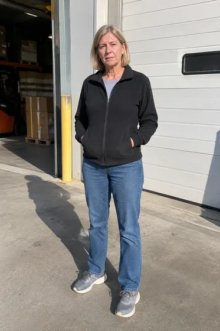
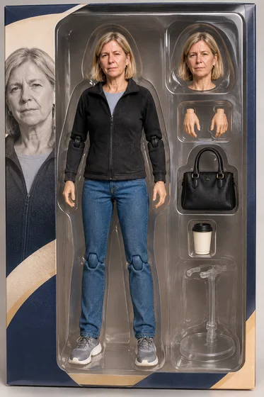

# Konzept für verpackte Actionfiguren · Verpackte Actionfiguren

[中文](../../../README.md) · [English](../../../README.en.md) · [Português](../../../README.pt.md) · [Español](../../../README.es.md) · [Français](../../../README.fr.md) · [Deutsch](../../../README.de.md) · [عربي](../../../README.ar.md) · [русский](../../../README.ru.md) · [日本語](../../../README.ja.md) · [हिंदी](../../../README.hi.md)


Verwandeln Sie eine Person in ein fiktional verpacktes Actionfigur-Konzeptbild.

Verwandeln Sie die Charaktere in verpackte Actionfiguren. Wird für soziale Hotspots und Geschenke verwendet.

[Kopieraufforderung](#public-prompt) · [ wird erstellt von dearsketch / Online testen](https://dearsketch.com/de/intent/i050-turn-a-person-into-a-packaged-action-figure.html?utm_source=github&utm_medium=case&utm_campaign=dearsketch-public-cases&utm_content=i050_cta) · [Zurück zum Thema / Sammlung](../guides/people.md)

## Referenzmaterial und Ergebnisrichtung

<table>
<thead><tr><th width="50%">Referenzmaterial</th><th width="50%">Beispiel für Ergebnisse</th></tr></thead>
<tbody><tr><td valign="top"><p><strong>Fotos von Menschen</strong><br></p></td><td valign="top"><a href="https://dearsketch.com/de/intent/i050-turn-a-person-into-a-packaged-action-figure.html?utm_source=github&amp;utm_medium=case&amp;utm_campaign=dearsketch-public-cases&amp;utm_content=i050_image"></a></td></tr></tbody>
</table>

Die Referenzmaterialien und Ergebnisse dienen zur Veranschaulichung der visuellen Ausrichtung. Die öffentliche Vorlage stellt nicht die ursprüngliche Generierungsanweisung für die begleitenden Bilder dar und es kann nicht garantiert werden, dass dieselben Ergebnisse reproduziert werden.

## Was vorzubereiten/Eingaben

| Material | Typ / Typ | Menge / Menge | Bedingung / Anforderung |
| --- | --- | --- | --- |
| Fotos von Menschen | Bild/Bild | 1 Stück | Erforderlich / Erforderlich |

Es wird jeweils nur ein Bild generiert.

## Behalten und ändern / Kurzfassung bearbeiten

- **Preserve / 保留：** Bewahren Sie die Identität der Person und die Liste der angeforderten Zubehörteile auf.
- **Ändern / 改变：** Verändern Sie den Körper in eine spielzeugähnliche Figur, die Verpackung, das Farbsystem und das Display-Layout.

## Public prompt

**Neu bearbeitete öffentliche Vorlage · Neu verfasst · Nicht generativ getestet.** Ersetzen Sie die Parameter in eckigen Klammern und fügen Sie die erforderlichen Materialien in das Tool ein, das die Bildbearbeitung unterstützt; Optionale und bedingte Eingaben werden gemäß der obigen Tabelle vorbereitet. Diese Vorlage wurde nicht zum Generieren der Beispiele auf dieser Seite verwendet.

```text
Create one fictional packaged action-figure concept from [PERSON PHOTO].
Preserve the person’s recognizable face, hair, skin tone, and defining clothing cues.
Render a toy-like full figure in [POSE] inside [PACKAGING STYLE].
Include exactly these accessories: [ACCESSORY LIST]; do not duplicate or invent extras.
Use [PACKAGE COLOR SYSTEM] and [BACKGROUND GRAPHICS] with a clear retail-display hierarchy.
If supplied, reproduce the exact package title “[EXACT TITLE]” and subtitle “[EXACT SUBTITLE]”.
Keep limbs, hands, joints, accessory compartments, plastic reflections, and shadows coherent.
Do not use third-party logos, franchise marks, or claims that a physical product exists.
Treat all package lettering as artwork that must be manually proofread.
Deliver one concept image only, not manufacturing artwork or a product specification.
```

[Machen Sie es online mit Ihren eigenen Materialien / Machen Sie es online](https://dearsketch.com/de/intent/i050-turn-a-person-into-a-packaged-action-figure.html?utm_source=github&utm_medium=case&utm_campaign=dearsketch-public-cases&utm_content=i050_after-prompt) · [Lassen Sie sich vom Agenten bei der Organisation helfen / Nutzen Sie den Skill](../quickstart.md#agent-skill)

## Überprüfen Sie die wichtigsten Punkte/Bewertung

Überprüfen Sie die Größe, die Anzahl der Zubehörteile und den Verpackungstext. Dies ist ein Konzeptbild, nicht das tatsächliche Produkt.

Zählen Sie Gliedmaßen und Zubehör, lesen Sie den Pakettext Korrektur und kennzeichnen Sie ihn als Konzept.

Ergebnisse in Richtung: Actionfiguren-Verpackungsbilder. Wenn exakter Text, transparente Dateien, Vektoren oder eine Drucklieferung erforderlich sind, überprüfen Sie die tatsächliche Datei. Die verfügbaren Funktionen und Gebühren unterliegen der Beschreibung auf der Website.

## Verwandte Fälle / Verwandte Aufgaben

- [Erstellen Sie ein professionelles LinkedIn-Headshot von einem Selfie · Selfie zum professionellen Headshot ](./i001-create-a-professional-linkedin-headshot-from-a-selfie.md#public-prompt)
- [Ersetzen Sie Freizeitkleidung durch Berufskleidung · ](./i015-replace-casual-clothing-with-professional-attire.md#public-prompt)
- [Verwandeln Sie sich in ein königliches, Vintage- oder historisches Porträt · Königliches und Vintage-Porträt ](./i052-turn-yourself-into-a-royal-vintage-or-historical-portrait.md#public-prompt)

## Hintergrundreferenz zu den Anforderungen

- [LightXAlle Werkzeuge](https://www.lightxeditor.com/all-tools/all-tools/)

Diese Links dienen lediglich dem Verständnis des Zwecks und sind kein Beweis für die Quelle oder Autorisierung der Bilder auf dieser Seite.

Den Umfang der Nutzung von Bildern und Materialien finden Sie in der Inhaltsbeschreibung [ ](../content-policy.md). [Alle 50 Vorlagen anzeigen ](../prompts.md).
