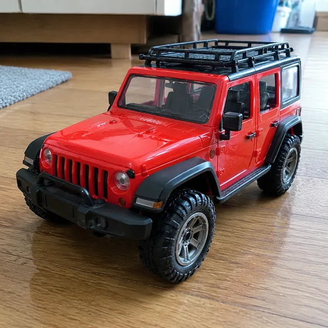

# Saisonales Produktkampagnenbild · Weihnachtsartikelszene

[中文](../../../README.md) · [English](../../../README.en.md) · [Português](../../../README.pt.md) · [Español](../../../README.es.md) · [Français](../../../README.fr.md) · [Deutsch](../../../README.de.md) · [عربي](../../../README.ar.md) · [русский](../../../README.ru.md) · [日本語](../../../README.ja.md) · [हिंदी](../../../README.hi.md)


Erstellen Sie eine Weihnachts- oder Verkaufssaisonszene rund um ein echtes Produkt.

Generieren Sie Produktbilder mit Weihnachts-, Black Friday- oder saisonalen Themen. Wird für Festivalaktivitäten und Werbung verwendet.

[Kopieraufforderung](#public-prompt) · [ wird erstellt von dearsketch / Online testen](https://dearsketch.com/de/intent/i069-create-christmas-black-friday-or-seasonal-product-imagery.html?utm_source=github&utm_medium=case&utm_campaign=dearsketch-public-cases&utm_content=i069_cta) · [Zurück zum Thema / Sammlung](../guides/products.md)

## Referenzmaterial und Ergebnisrichtung

<table>
<thead><tr><th width="50%">Referenzmaterial</th><th width="50%">Beispiel für Ergebnisse</th></tr></thead>
<tbody><tr><td valign="top"><p><strong>Produktfotos</strong><br></p></td><td valign="top"><a href="https://dearsketch.com/de/intent/i069-create-christmas-black-friday-or-seasonal-product-imagery.html?utm_source=github&amp;utm_medium=case&amp;utm_campaign=dearsketch-public-cases&amp;utm_content=i069_image"></a></td></tr></tbody>
</table>

Die Referenzmaterialien und Ergebnisse dienen zur Veranschaulichung der visuellen Ausrichtung. Die öffentliche Vorlage stellt nicht die ursprüngliche Generierungsanweisung für die begleitenden Bilder dar und es kann nicht garantiert werden, dass dieselben Ergebnisse reproduziert werden.

## Was vorzubereiten/Eingaben

| Material | Typ / Typ | Menge / Menge | Bedingung / Anforderung |
| --- | --- | --- | --- |
| Produktfotos | Bild/Bild | 1 Stück | Erforderlich / Erforderlich |
| Feiertags- oder Werbethemen | Zeichen / Text | 1 Artikel | Erforderlich / Erforderlich |

Es wird jeweils nur ein Bild generiert.

## Behalten und ändern / Kurzfassung bearbeiten

- **Bewahren / 保留：** Behalten Sie Produktidentität, Design, Etikett, Farbe und bereitgestellte Werbeinformationen bei.
- **Ändern / 改变：** Ändern Sie Dekor, Hintergrund, Licht, Farbpalette und Kampagnenkomposition.

## Public prompt

**Neu bearbeitete öffentliche Vorlage · Neu verfasst · Nicht generativ getestet.** Ersetzen Sie die Parameter in eckigen Klammern und fügen Sie die erforderlichen Materialien in das Tool ein, das die Bildbearbeitung unterstützt; Optionale und bedingte Eingaben werden gemäß der obigen Tabelle vorbereitet. Diese Vorlage wurde nicht zum Generieren der Beispiele auf dieser Seite verwendet.

```text
Create one seasonal campaign image from [PRODUCT PHOTO].
The confirmed campaign theme is [HOLIDAY OR SALES MOMENT].
Preserve the product’s exact design, proportions, colors, labels, materials, and included components.
Place it in [SEASONAL SETTING] using [PALETTE], [DECOR], and [LIGHTING].
Keep the product dominant and ensure decorations do not cover labels or important features.
Use only the confirmed offer “[EXACT PROMOTION]” and date “[EXACT VALID DATES]” if text is requested.
Do not invent prices, discounts, urgency, availability, endorsements, or product benefits.
Keep scale, contact, reflections, and shadows believable.
Treat generated campaign lettering as a draft requiring manual proofreading.
Deliver one finished promotional product image only.
```

[Machen Sie es online mit Ihren eigenen Materialien / Machen Sie es online](https://dearsketch.com/de/intent/i069-create-christmas-black-friday-or-seasonal-product-imagery.html?utm_source=github&utm_medium=case&utm_campaign=dearsketch-public-cases&utm_content=i069_after-prompt) · [Lassen Sie sich vom Agenten bei der Organisation helfen / Nutzen Sie den Skill](../quickstart.md#agent-skill)

## Überprüfen Sie die wichtigsten Punkte/Bewertung

Verwenden Sie nur bestätigte Veranstaltungsthemen und Werbeinformationen. Dekorationen dürfen die Produkte nicht verdecken.

Überprüfen Sie Termine, Rabatte und Formulierungen; Dekorationen dürfen das Produkt nicht verdecken.

Ergebnisrichtung: Merchandise-Chart für Weihnachtsaktionen. Wenn exakter Text, transparente Dateien, Vektoren oder eine Drucklieferung erforderlich sind, überprüfen Sie die tatsächliche Datei. Die verfügbaren Funktionen und Gebühren unterliegen der Beschreibung auf der Website.

## Verwandte Fälle / Verwandte Aufgaben

- [Verwandeln Sie ein gewöhnliches Produktfoto in ein Auflistungsbild mit weißem Hintergrund. · Produkthauptbild mit weißem Hintergrund ](./i065-turn-an-ordinary-product-photo-into-a-white-background-listing-image.md#public-prompt)
- [Erstellen Sie ein wiederverwendbares Produkt PNG mit transparentem Hintergrund · Transparentes Bodenproduktmaterial ](./i066-create-a-reusable-product-png-with-a-transparent-background.md#public-prompt)
- [Platzieren Sie ein Produkt in einer realistischen Lifestyle-Szene · Produkt-Lifestyle-Szene](./i067-place-a-product-in-a-realistic-lifestyle-scene.md#public-prompt)

## Hintergrundreferenz zu den Anforderungen

- [insMind Produktfotografie](https://www.insmind.com/image-tools/ai-product-photography)
- [ Meitu Design Studio](https://www.designkit.cn/help/143)

Diese Links dienen lediglich dem Verständnis des Zwecks und sind kein Beweis für die Quelle oder Autorisierung der Bilder auf dieser Seite.

Den Umfang der Nutzung von Bildern und Materialien finden Sie in der Inhaltsbeschreibung [ ](../content-policy.md). [Alle 50 Vorlagen anzeigen ](../prompts.md).
