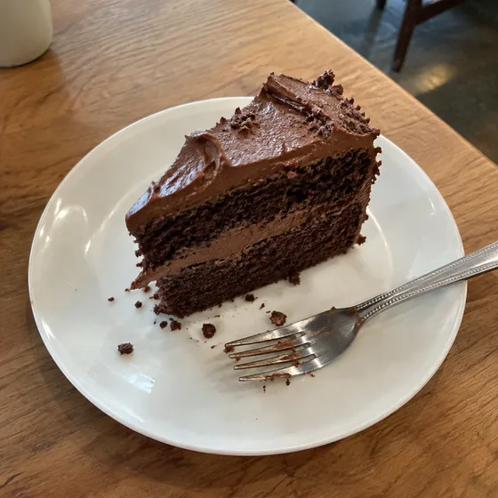
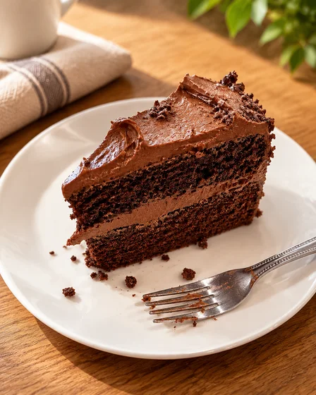

# Kommerzielles Bild von Lebensmitteln oder Getränken · Kommerzielle Fotografie von Lebensmitteln und Getränken

[中文](../../../README.md) · [English](../../../README.en.md) · [Português](../../../README.pt.md) · [Español](../../../README.es.md) · [Français](../../../README.fr.md) · [Deutsch](../../../README.de.md) · [عربي](../../../README.ar.md) · [русский](../../../README.ru.md) · [日本語](../../../README.ja.md) · [हिंदी](../../../README.hi.md)


Erstellen Sie ein appetitliches Werbebild aus einem Lebensmittelfoto oder einer expliziten Produktbeschreibung.

Erstellen Sie kommerzielle Fotografie für Lebensmittel, Kuchen, Pizza oder Getränke. Wird für Speisekarten, Imbissbuden und Werbung verwendet.

[Kopieraufforderung](#public-prompt) · [ wird erstellt von dearsketch / Online testen](https://dearsketch.com/de/intent/i080-create-commercial-photography-for-food-cakes-pizza-or-drinks.html?utm_source=github&utm_medium=case&utm_campaign=dearsketch-public-cases&utm_content=i080_cta) · [Zurück zum Thema / Sammlung](../guides/products.md)

## Referenzmaterial und Ergebnisrichtung

<table>
<thead><tr><th width="50%">Referenzmaterial</th><th width="50%">Beispiel für Ergebnisse</th></tr></thead>
<tbody><tr><td valign="top"><p><strong>Lebensmittelfotos oder Produktbeschreibungen</strong><br></p></td><td valign="top"><a href="https://dearsketch.com/de/intent/i080-create-commercial-photography-for-food-cakes-pizza-or-drinks.html?utm_source=github&amp;utm_medium=case&amp;utm_campaign=dearsketch-public-cases&amp;utm_content=i080_image"></a></td></tr></tbody>
</table>

Die Referenzmaterialien und Ergebnisse dienen zur Veranschaulichung der visuellen Ausrichtung. Die öffentliche Vorlage stellt nicht die ursprüngliche Generierungsanweisung für die begleitenden Bilder dar und es kann nicht garantiert werden, dass dieselben Ergebnisse reproduziert werden.

## Was vorzubereiten/Eingaben

| Material | Typ / Typ | Menge / Menge | Bedingung / Anforderung |
| --- | --- | --- | --- |
| Lebensmittelfotos oder Produktbeschreibungen | Bild/Bild | 1 Stück | Optional/Optional: Der Klartextzweig kann weggelassen werden |

Es wird jeweils nur ein Bild generiert.

## Behalten und ändern / Kurzfassung bearbeiten

- **Bewahren / 保留：** Behalten Sie die tatsächliche Portion, die Zutaten, die Verpackung und das Aussehen im Fotozweig bei.
- **Änderung / 改变：** Verkleidung, Bühnenbild, Beleuchtung, Hintergrund und Kamerabehandlung ändern.

## Public prompt

**Neu bearbeitete öffentliche Vorlage · Neu verfasst · Nicht generativ getestet.** Ersetzen Sie die Parameter in eckigen Klammern und fügen Sie die erforderlichen Materialien in das Tool ein, das die Bildbearbeitung unterstützt; Optionale und bedingte Eingaben werden gemäß der obigen Tabelle vorbereitet. Diese Vorlage wurde nicht zum Generieren der Beispiele auf dieser Seite verwendet.

```text
Create one commercial food or drink image using exactly one starting branch.
For a real-item branch, use [FOOD PHOTO]; for a concept branch, use [EXACT PRODUCT DESCRIPTION] without requiring a photo.
In the photo branch, preserve the actual portion, ingredients, shape, packaging, garnish, and defining appearance.
In the text-only branch, clearly treat the image as a concept visualization rather than the actual item.
Style the scene for [MENU / DELIVERY / ADVERTISING USE] with [SURFACE], [PROPS], and [BACKGROUND].
Use [CAMERA ANGLE], [LIGHTING], and [COLOR MOOD] to make the item clear and appealing.
Keep steam, condensation, splashes, crumbs, and reflections plausible and restrained.
Do not add ingredients, increase portions, change packaging, or imply nutrition claims unless confirmed.
Add no price or wording unless [EXACT TEXT] is supplied and later proofread.
Deliver one finished food or beverage image only.
```

[Machen Sie es online mit Ihren eigenen Materialien / Machen Sie es online](https://dearsketch.com/de/intent/i080-create-commercial-photography-for-food-cakes-pizza-or-drinks.html?utm_source=github&utm_medium=case&utm_campaign=dearsketch-public-cases&utm_content=i080_after-prompt) · [Lassen Sie sich vom Agenten bei der Organisation helfen / Nutzen Sie den Skill](../quickstart.md#agent-skill)

## Überprüfen Sie die wichtigsten Punkte/Bewertung

Überprüfen Sie bei der Präsentation tatsächlicher Produkte das Gewicht, die Inhaltsstoffe und das Aussehen und geben Sie die kreativen Effekte nicht als tatsächliche Produkte aus.

Präsentieren Sie kein textbasiertes Konzept als tatsächliches Produkt.

Ergebnisrichtung: Werbegrafiken für Lebensmittel. Wenn exakter Text, transparente Dateien, Vektoren oder eine Drucklieferung erforderlich sind, überprüfen Sie die tatsächliche Datei. Die verfügbaren Funktionen und Gebühren unterliegen der Beschreibung auf der Website.

## Verwandte Fälle / Verwandte Aufgaben

- [Verwandeln Sie ein gewöhnliches Produktfoto in ein Auflistungsbild mit weißem Hintergrund. · Produkthauptbild mit weißem Hintergrund ](./i065-turn-an-ordinary-product-photo-into-a-white-background-listing-image.md#public-prompt)
- [Erstellen Sie ein wiederverwendbares Produkt PNG mit transparentem Hintergrund · Transparentes Bodenproduktmaterial ](./i066-create-a-reusable-product-png-with-a-transparent-background.md#public-prompt)
- [Platzieren Sie ein Produkt in einer realistischen Lifestyle-Szene · Produkt-Lifestyle-Szene](./i067-place-a-product-in-a-realistic-lifestyle-scene.md#public-prompt)

## Hintergrundreferenz zu den Anforderungen

- [LightXAlle Werkzeuge](https://www.lightxeditor.com/all-tools/all-tools/)

Diese Links dienen lediglich dem Verständnis des Zwecks und sind kein Beweis für die Quelle oder Autorisierung der Bilder auf dieser Seite.

Den Umfang der Nutzung von Bildern und Materialien finden Sie in der Inhaltsbeschreibung [ ](../content-policy.md). [Alle 50 Vorlagen anzeigen ](../prompts.md).
