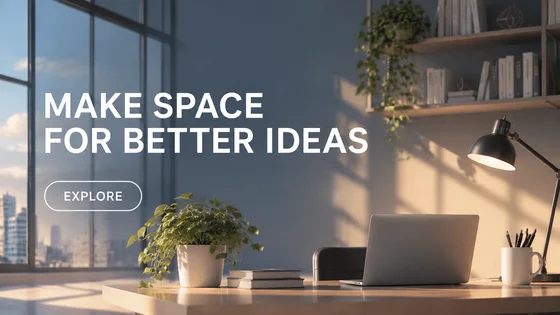

# Kampagnenbanner · Kampagnenbanner

[中文](../../../README.md) · [English](../../../README.en.md) · [Português](../../../README.pt.md) · [Español](../../../README.es.md) · [Français](../../../README.fr.md) · [Deutsch](../../../README.de.md) · [عربي](../../../README.ar.md) · [русский](../../../README.ru.md) · [日本語](../../../README.ja.md) · [हिंदी](../../../README.hi.md)


Erstellen Sie ein horizontales Banner für Ihr vorgegebenes Briefing nur aus Text.

Erstellen Sie Website-, Werbe- und Event-Banner. Wird für Websites, Ausstellungen und Werbung verwendet.

[Kopieraufforderung](#public-prompt) · [ wird erstellt von dearsketch / Online testen](https://dearsketch.com/de/intent/i109-create-a-website-advertising-or-event-banner.html?utm_source=github&utm_medium=case&utm_campaign=dearsketch-public-cases&utm_content=i109_cta) · [Zurück zum Thema / Sammlung](../guides/text-only.md)

## Referenzmaterial und Ergebnisrichtung

<p><strong>Beispiel für Ergebnisse</strong></p>
<p><a href="https://dearsketch.com/de/intent/i109-create-a-website-advertising-or-event-banner.html?utm_source=github&amp;utm_medium=case&amp;utm_campaign=dearsketch-public-cases&amp;utm_content=i109_image"></a></p>
<p>Bei diesem Beispiel handelt es sich um eine Texteingabe, es ist kein Bildverweis beigefügt.</p>

Die Referenzmaterialien und Ergebnisse dienen zur Veranschaulichung der visuellen Ausrichtung. Die öffentliche Vorlage stellt nicht die ursprüngliche Generierungsanweisung für die begleitenden Bilder dar und es kann nicht garantiert werden, dass dieselben Ergebnisse reproduziert werden.

## Was vorzubereiten/Eingaben

| Material | Typ / Typ | Menge / Menge | Bedingung / Anforderung |
| --- | --- | --- | --- |
| Kurzbeschreibung zur Texterstellung: Füllen Sie das Thema, den Zweck und die sachlichen Parameter in den Aufforderungswörtern aus | Zeichen / Text | 1 Portion | Erforderlich / Erforderlich |

**Reine Textgenerierung / Nur Text: kein Bild, Logo, Skizze oder andere Anhänge erforderlich.** Verwenden Sie zum Erstellen neuer Konzepte nur das unten stehende Textformular.

Es wird jeweils nur ein Bild generiert, es ist nicht erforderlich, Bilder hochzuladen.

## Behalten und ändern / Kurzfassung bearbeiten

- **Bewahren Sie / 保留：** Beachten Sie die bereitgestellten schriftlichen Fakten, den genauen Wortlaut und die Einschränkungen.
- **Änderung / Verbesserung:** Erstellen Sie eine Originalillustration von [SCENE] über [ASPECT RATIO]. Reservieren Sie [LEFT OR RIGHT] für die exakte Kopie „[HEADLINE]“ und „[CALL TO ACTION]“. Halten Sie beides von den Erntekanten fern.

## Public prompt

**Neu kompilierte öffentliche Vorlage · Neu verfasst · Nicht auf Generierung getestet.** Ersetzen Sie einfach die Parameter in eckigen Klammern, es ist nicht erforderlich, Referenzbilder hochzuladen. Diese Vorlage wurde nicht zum Generieren der Beispiele auf dieser Seite verwendet.

```text
Create one horizontal banner for [PURPOSE] from the following written brief only. No reference image or other attachment is needed.
Build an original illustration of [SCENE] across [ASPECT RATIO]. Reserve [LEFT OR RIGHT] for the exact copy “[HEADLINE]” and “[CALL TO ACTION]”; keep both away from crop edges.
Use only supplied campaign facts; do not invent discounts, dates or endorsements.
Use an original design. Do not imply fidelity to any existing person, product, property or artwork that has not been supplied.
Return one finished image only. Replace every bracketed field with your own details before generating.
```

[Machen Sie es online mit Ihren eigenen Materialien / Machen Sie es online](https://dearsketch.com/de/intent/i109-create-a-website-advertising-or-event-banner.html?utm_source=github&utm_medium=case&utm_campaign=dearsketch-public-cases&utm_content=i109_after-prompt) · [Lassen Sie sich vom Agenten bei der Organisation helfen / Nutzen Sie den Skill](../quickstart.md#agent-skill)

## Überprüfen Sie die wichtigsten Punkte/Bewertung

Verwenden Sie nur bereitgestellte Kampagnenfakten. Erfinden Sie keine Rabatte, Termine oder Empfehlungen.

Verwenden Sie nur bereitgestellte Kampagnenfakten. Erfinden Sie keine Rabatte, Termine oder Empfehlungen.

Ergebnisrichtung: Banner. Wenn exakter Text, transparente Dateien, Vektoren oder eine Drucklieferung erforderlich sind, überprüfen Sie die tatsächliche Datei. Die verfügbaren Funktionen und Gebühren unterliegen der Beschreibung auf der Website.

## Verwandte Fälle / Verwandte Aufgaben

- [Erstellen Sie ein Profilbild für YouTube oder Streaming · Textgenerierter Kanal-Avatar ](./i054-create-a-profile-picture-for-youtube-or-streaming.md#public-prompt)
- [Erstellen Sie ein benutzerdefiniertes Emoji aus Text · Benutzerdefiniertes Emoji](./i057-create-a-custom-emoji-from-text.md#public-prompt)
- [Erstellen Sie nahtlose Drucke und Stoffmuster für Kleidung · ](./i100-create-seamless-prints-and-fabric-patterns-for-clothing.md#public-prompt)

## Hintergrundreferenz zu den Anforderungen

- [LightXAlle Werkzeuge](https://www.lightxeditor.com/all-tools/all-tools/)

Diese Links dienen lediglich dem Verständnis des Zwecks und sind kein Beweis für die Quelle oder Autorisierung der Bilder auf dieser Seite.

Den Umfang der Nutzung von Bildern und Materialien finden Sie in der Inhaltsbeschreibung [ ](../content-policy.md). [Alle 100 Vorlagen anzeigen ](../prompts.md).
