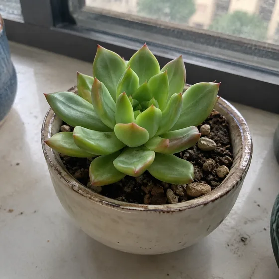
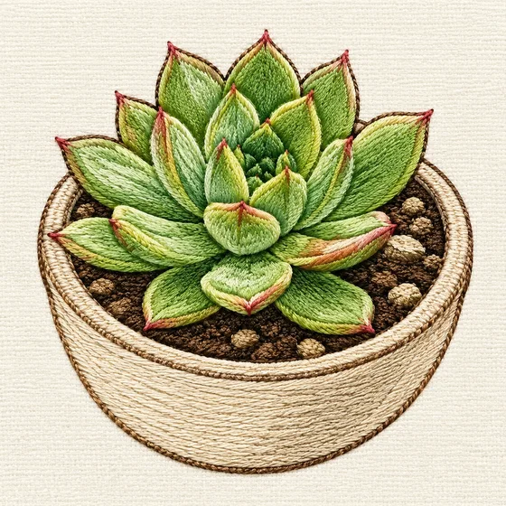

# Stickmotiv-Konzept · Stickmuster-Konzept

[中文](../../../README.md) · [English](../../../README.en.md) · [Português](../../../README.pt.md) · [Español](../../../README.es.md) · [Français](../../../README.fr.md) · [Deutsch](../../../README.de.md) · [عربي](../../../README.ar.md) · [русский](../../../README.ru.md) · [日本語](../../../README.ja.md) · [हिंदी](../../../README.hi.md)


Erstellen Sie ein Stickdesign-Konzept für Ihr vorgegebenes Briefing allein aus dem Text.

Wandeln Sie Text oder Bilder in Stickmusterrichtungen um. Wird für Kleidung, Abzeichen und Kunsthandwerk verwendet.

[Kopieraufforderung](#public-prompt) · [ wird erstellt von dearsketch / Online testen](https://dearsketch.com/de/intent/i160-turn-text-or-an-image-into-an-embroidery-design-direction.html?utm_source=github&utm_medium=case&utm_campaign=dearsketch-public-cases&utm_content=i160_cta) · [Zurück zum Thema / Sammlung](../guides/text-only.md)

## Referenzmaterial und Ergebnisrichtung

<table>
<thead><tr><th width="50%">Referenzmaterial</th><th width="50%">Beispiel für Ergebnisse</th></tr></thead>
<tbody><tr><td valign="top"><p><strong>Foto oder Originallogo</strong><br></p></td><td valign="top"><a href="https://dearsketch.com/de/intent/i160-turn-text-or-an-image-into-an-embroidery-design-direction.html?utm_source=github&amp;utm_medium=case&amp;utm_campaign=dearsketch-public-cases&amp;utm_content=i160_image"></a></td></tr></tbody>
</table>

Die Referenzmaterialien und Ergebnisse dienen zur Veranschaulichung der visuellen Ausrichtung. Die öffentliche Vorlage stellt nicht die ursprüngliche Generierungsanweisung für die begleitenden Bilder dar und es kann nicht garantiert werden, dass dieselben Ergebnisse reproduziert werden.

## Was vorzubereiten/Eingaben

| Material | Typ / Typ | Menge / Menge | Bedingung / Anforderung |
| --- | --- | --- | --- |
| Kurzbeschreibung zur Texterstellung: Füllen Sie das Thema, den Zweck und die sachlichen Parameter in den Aufforderungswörtern aus | Zeichen / Text | 1 Portion | Erforderlich / Erforderlich |

**Reine Textgenerierung / Nur Text: kein Bild, Logo, Skizze oder andere Anhänge erforderlich.** Verwenden Sie zum Erstellen neuer Konzepte nur das unten stehende Textformular.

Es wird jeweils nur ein Bild generiert, es ist nicht erforderlich, Bilder hochzuladen. Wählen Sie den Nur-Text-Themenzweig für die Website.

## Behalten und ändern / Kurzfassung bearbeiten

- **Bewahren Sie / 保留：** Beachten Sie die bereitgestellten schriftlichen Fakten, den genauen Wortlaut und die Einschränkungen.
- **Änderung / Änderung:** Verwenden Sie [THREAD COLORS], breite geschlossene Formen und [LINE WEIGHT] passend zu [FINISHED SIZE AND PLACEMENT]. Vermeiden Sie Farbverläufe, kleine Inseln und übermäßig überlappende Details.

## Public prompt

**Neu kompilierte öffentliche Vorlage · Neu verfasst · Nicht auf Generierung getestet.** Ersetzen Sie einfach die Parameter in eckigen Klammern, es ist nicht erforderlich, Referenzbilder hochzuladen. Diese Vorlage wurde nicht zum Generieren der Beispiele auf dieser Seite verwendet.

```text
Create one embroidery-design concept of [TEXT-DESCRIBED MOTIF] from the following written brief only. No reference image or other attachment is needed.
Use [THREAD COLORS], broad closed shapes and [LINE WEIGHT] suited to [FINISHED SIZE AND PLACEMENT]. Avoid gradients, tiny islands and excessive overlapping detail.
This is a visual motif, not digitized stitch instructions; stitch count, density and machine files need separate work.
Use an original design. Do not imply fidelity to any existing person, product, property or artwork that has not been supplied.
Return one finished image only. Replace every bracketed field with your own details before generating.
```

[Machen Sie es online mit Ihren eigenen Materialien / Machen Sie es online](https://dearsketch.com/de/intent/i160-turn-text-or-an-image-into-an-embroidery-design-direction.html?utm_source=github&utm_medium=case&utm_campaign=dearsketch-public-cases&utm_content=i160_after-prompt) · [Lassen Sie sich vom Agenten bei der Organisation helfen / Nutzen Sie den Skill](../quickstart.md#agent-skill)

## Überprüfen Sie die wichtigsten Punkte/Bewertung

Dies ist ein visuelles Motiv, keine digitalisierte Stichanleitung; Stichanzahl, Stichdichte und Maschinendateien erfordern separate Arbeiten.

Dies ist ein visuelles Motiv, keine digitalisierte Stichanleitung; Stichanzahl, Stichdichte und Maschinendateien erfordern separate Arbeiten.

Ergebnisse in Richtung: Stickmotive. Wenn exakter Text, transparente Dateien, Vektoren oder eine Drucklieferung erforderlich sind, überprüfen Sie die tatsächliche Datei. Die verfügbaren Funktionen und Gebühren unterliegen der Beschreibung auf der Website.

## Verwandte Fälle / Verwandte Aufgaben

- [Erstellen Sie ein Profilbild für YouTube oder Streaming · Textgenerierter Kanal-Avatar ](./i054-create-a-profile-picture-for-youtube-or-streaming.md#public-prompt)
- [Erstellen Sie ein benutzerdefiniertes Emoji aus Text · Benutzerdefiniertes Emoji](./i057-create-a-custom-emoji-from-text.md#public-prompt)
- [Erstellen Sie nahtlose Drucke und Stoffmuster für Kleidung · ](./i100-create-seamless-prints-and-fabric-patterns-for-clothing.md#public-prompt)

## Hintergrundreferenz zu den Anforderungen

- [Cutout.pro](https://www.cutout.pro/)
- [LightXAlle Werkzeuge](https://www.lightxeditor.com/all-tools/all-tools/)

Diese Links dienen lediglich dem Verständnis des Zwecks und sind kein Beweis für die Quelle oder Autorisierung der Bilder auf dieser Seite.

Den Umfang der Nutzung von Bildern und Materialien finden Sie in der Inhaltsbeschreibung [ ](../content-policy.md). [Alle 100 Vorlagen anzeigen ](../prompts.md).
