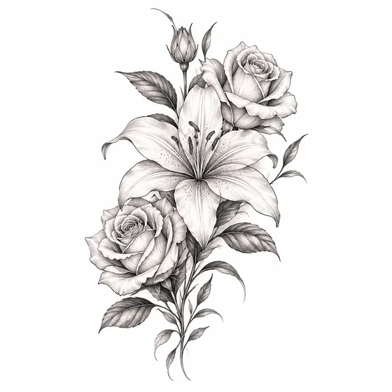

# Originale Tattoo-Skizze · Originale Tattoo-Skizze

[中文](../../../README.md) · [English](../../../README.en.md) · [Português](../../../README.pt.md) · [Español](../../../README.es.md) · [Français](../../../README.fr.md) · [Deutsch](../../../README.de.md) · [عربي](../../../README.ar.md) · [русский](../../../README.ru.md) · [日本語](../../../README.ja.md) · [हिंदी](../../../README.hi.md)


Erstellen Sie eine Original-Tattoo-Skizze basierend auf Ihrem vorgegebenen Auftrag, nur aus Text.

Erstellen Sie individuelle Tattoo-Skizzen basierend auf dem Thema. Zur Tattoo-Beratung.

[Kopieraufforderung](#public-prompt) · [ wird erstellt von dearsketch / Online testen](https://dearsketch.com/de/intent/i161-create-a-custom-tattoo-sketch-from-a-theme.html?utm_source=github&utm_medium=case&utm_campaign=dearsketch-public-cases&utm_content=i161_cta) · [Zurück zum Thema / Sammlung](../guides/text-only.md)

## Referenzmaterial und Ergebnisrichtung

<p><strong>Beispiel für Ergebnisse</strong></p>
<p><a href="https://dearsketch.com/de/intent/i161-create-a-custom-tattoo-sketch-from-a-theme.html?utm_source=github&amp;utm_medium=case&amp;utm_campaign=dearsketch-public-cases&amp;utm_content=i161_image"></a></p>
<p>Bei diesem Beispiel handelt es sich um eine Texteingabe, es ist kein Bildverweis beigefügt.</p>

Die Referenzmaterialien und Ergebnisse dienen zur Veranschaulichung der visuellen Ausrichtung. Die öffentliche Vorlage stellt nicht die ursprüngliche Generierungsanweisung für die begleitenden Bilder dar und es kann nicht garantiert werden, dass dieselben Ergebnisse reproduziert werden.

## Was vorzubereiten/Eingaben

| Material | Typ / Typ | Menge / Menge | Bedingung / Anforderung |
| --- | --- | --- | --- |
| Kurzbeschreibung zur Texterstellung: Füllen Sie das Thema, den Zweck und die sachlichen Parameter in den Aufforderungswörtern aus | Zeichen / Text | 1 Portion | Erforderlich / Erforderlich |

**Reine Textgenerierung / Nur Text: kein Bild, Logo, Skizze oder andere Anhänge erforderlich.** Verwenden Sie zum Erstellen neuer Konzepte nur das unten stehende Textformular.

Es wird jeweils nur ein Bild generiert, es ist nicht erforderlich, Bilder hochzuladen.

## Behalten und ändern / Kurzfassung bearbeiten

- **Bewahren Sie / 保留：** Beachten Sie die bereitgestellten schriftlichen Fakten, den genauen Wortlaut und die Einschränkungen.
- **Änderung / Änderung:** Design für [BODY LOCATION AND APPROXIMATE SIZE] mit [LINE STYLE], [SHADING APPROACH] und [COMPOSITION]. Zeigen Sie die Zeichnung auf einem einfachen Hintergrund, ohne Körpermodell.

## Public prompt

**Neu kompilierte öffentliche Vorlage · Neu verfasst · Nicht auf Generierung getestet.** Ersetzen Sie einfach die Parameter in eckigen Klammern, es ist nicht erforderlich, Referenzbilder hochzuladen. Diese Vorlage wurde nicht zum Generieren der Beispiele auf dieser Seite verwendet.

```text
Create one original tattoo sketch based on [THEME AND SYMBOLS] from the following written brief only. No reference image or other attachment is needed.
Design for [BODY LOCATION AND APPROXIMATE SIZE] using [LINE STYLE], [SHADING APPROACH] and [COMPOSITION]. Show the drawing on a plain background, without a body mockup.
Check spelling and symbol meaning; have a tattoo artist assess line spacing and practical placement.
Use an original design. Do not imply fidelity to any existing person, product, property or artwork that has not been supplied.
Return one finished image only. Replace every bracketed field with your own details before generating.
```

[Machen Sie es online mit Ihren eigenen Materialien / Machen Sie es online](https://dearsketch.com/de/intent/i161-create-a-custom-tattoo-sketch-from-a-theme.html?utm_source=github&utm_medium=case&utm_campaign=dearsketch-public-cases&utm_content=i161_after-prompt) · [Lassen Sie sich vom Agenten bei der Organisation helfen / Nutzen Sie den Skill](../quickstart.md#agent-skill)

## Überprüfen Sie die wichtigsten Punkte/Bewertung

Überprüfen Sie die Rechtschreibung und die Bedeutung der Symbole. Lassen Sie den Linienabstand und die praktische Platzierung von einem Tätowierer beurteilen.

Überprüfen Sie die Rechtschreibung und die Bedeutung der Symbole. Lassen Sie den Linienabstand und die praktische Platzierung von einem Tätowierer beurteilen.

Ergebnisrichtung: Tattoo-Design-Entwurf. Wenn exakter Text, transparente Dateien, Vektoren oder eine Drucklieferung erforderlich sind, überprüfen Sie die tatsächliche Datei. Die verfügbaren Funktionen und Gebühren unterliegen der Beschreibung auf der Website.

## Verwandte Fälle / Verwandte Aufgaben

- [Erstellen Sie ein Profilbild für YouTube oder Streaming · Textgenerierter Kanal-Avatar ](./i054-create-a-profile-picture-for-youtube-or-streaming.md#public-prompt)
- [Erstellen Sie ein benutzerdefiniertes Emoji aus Text · Benutzerdefiniertes Emoji](./i057-create-a-custom-emoji-from-text.md#public-prompt)
- [Erstellen Sie nahtlose Drucke und Stoffmuster für Kleidung · ](./i100-create-seamless-prints-and-fabric-patterns-for-clothing.md#public-prompt)

## Hintergrundreferenz zu den Anforderungen

- [Cutout.pro](https://www.cutout.pro/)
- [Picsart KI-Tool](https://picsart.com/ai/)

Diese Links dienen lediglich dem Verständnis des Zwecks und sind kein Beweis für die Quelle oder Autorisierung der Bilder auf dieser Seite.

Den Umfang der Nutzung von Bildern und Materialien finden Sie in der Inhaltsbeschreibung [ ](../content-policy.md). [Alle 100 Vorlagen anzeigen ](../prompts.md).
