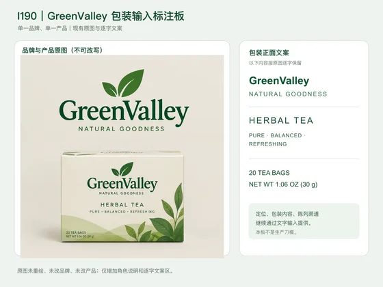
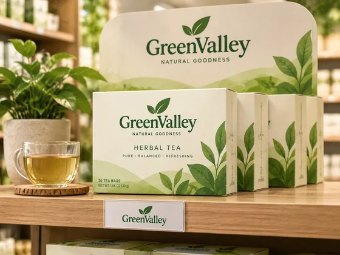

# Verpackungsstrukturkonzept · Verpackungsstruktur- und Displaykonzept

[中文](../../../README.md) · [English](../../../README.en.md) · [Português](../../../README.pt.md) · [Español](../../../README.es.md) · [Français](../../../README.fr.md) · [Deutsch](../../../README.de.md) · [عربي](../../../README.ar.md) · [русский](../../../README.ru.md) · [日本語](../../../README.ja.md) · [हिंदी](../../../README.hi.md)


Erstellen Sie ein Verpackungs- und Regalkonzept für ein fiktives, von Ihnen vorgegebenes Briefing allein aus dem Text.

Entdecken Sie schnell verschiedene Verpackungsstrukturen und Regaleffekte. Wird für die Entscheidungsfindung und das Testen neuer Produkte verwendet.

[Kopieraufforderung](#public-prompt) · [ wird erstellt von dearsketch / Online testen](https://dearsketch.com/de/intent/i190-explore-packaging-structures-and-shelf-presence.html?utm_source=github&utm_medium=case&utm_campaign=dearsketch-public-cases&utm_content=i190_cta) · [Zurück zum Thema / Sammlung](../guides/text-only.md)

## Referenzmaterial und Ergebnisrichtung

<table>
<thead><tr><th width="50%">Referenzmaterial</th><th width="50%">Beispiel für Ergebnisse</th></tr></thead>
<tbody><tr><td valign="top"><p><strong>Texterstellung für Produkte, Logos und echte Verpackungen</strong><br></p></td><td valign="top"><a href="https://dearsketch.com/de/intent/i190-explore-packaging-structures-and-shelf-presence.html?utm_source=github&amp;utm_medium=case&amp;utm_campaign=dearsketch-public-cases&amp;utm_content=i190_image"></a></td></tr></tbody>
</table>

Die Referenzmaterialien und Ergebnisse dienen zur Veranschaulichung der visuellen Ausrichtung. Die öffentliche Vorlage stellt nicht die ursprüngliche Generierungsanweisung für die begleitenden Bilder dar und es kann nicht garantiert werden, dass dieselben Ergebnisse reproduziert werden.

## Was vorzubereiten/Eingaben

| Material | Typ / Typ | Menge / Menge | Bedingung / Anforderung |
| --- | --- | --- | --- |
| Kurzbeschreibung zur Texterstellung: Füllen Sie das Thema, den Zweck und die sachlichen Parameter in den Aufforderungswörtern aus | Zeichen / Text | 1 Portion | Erforderlich / Erforderlich |

**Reine Textgenerierung / Nur Text: kein Bild, Logo, Skizze oder andere Anhänge erforderlich.** Verwenden Sie zum Erstellen neuer Konzepte nur das unten stehende Textformular.

Es wird jeweils nur ein Bild generiert, es ist nicht erforderlich, Bilder hochzuladen. Standortbedingungen Referenzbildauswahl nicht anwendbar.

## Behalten und ändern / Kurzfassung bearbeiten

- **Bewahren Sie / 保留：** Beachten Sie die bereitgestellten schriftlichen Fakten, den genauen Wortlaut und die Einschränkungen.
- **Änderung / Änderung:** Design [BOX OR CONTAINER STRUCTURE] für [CHANNEL AND POSITIONING]. Zeigen Sie ein Hauptpaket und einen eingeschränkten Regalkontext an. Verwenden Sie nur „[BRAND NAME]“ und „[EXACT COPY]“.

## Public prompt

**Neu kompilierte öffentliche Vorlage · Neu verfasst · Nicht auf Generierung getestet.** Ersetzen Sie einfach die Parameter in eckigen Klammern, es ist nicht erforderlich, Referenzbilder hochzuladen. Diese Vorlage wurde nicht zum Generieren der Beispiele auf dieser Seite verwendet.

```text
Create one packaging-and-shelf concept for a fictional [PRODUCT CATEGORY] from the following written brief only. No reference image or other attachment is needed.
Design [BOX OR CONTAINER STRUCTURE] for [CHANNEL AND POSITIONING]. Show one main pack and a restrained shelf context; use only “[BRAND NAME]” and “[EXACT COPY]”.
Keep repeated packs consistent; do not imply a tested dieline, shelf load rating or actual stocked product.
Use an original design. Do not imply fidelity to any existing person, product, property or artwork that has not been supplied.
Return one finished image only. Replace every bracketed field with your own details before generating.
```

[Machen Sie es online mit Ihren eigenen Materialien / Machen Sie es online](https://dearsketch.com/de/intent/i190-explore-packaging-structures-and-shelf-presence.html?utm_source=github&utm_medium=case&utm_campaign=dearsketch-public-cases&utm_content=i190_after-prompt) · [Lassen Sie sich vom Agenten bei der Organisation helfen / Nutzen Sie den Skill](../quickstart.md#agent-skill)

## Überprüfen Sie die wichtigsten Punkte/Bewertung

Halten Sie wiederholte Packungen konsistent; deuten nicht auf eine getestete Stanzform, Regalbelastbarkeit oder ein tatsächlich vorrätiges Produkt hin.

Halten Sie wiederholte Packungen konsistent; deuten nicht auf eine getestete Stanzform, Regalbelastbarkeit oder ein tatsächlich vorrätiges Produkt hin.

Ergebnisrichtung: Verpackungskonzeptzeichnung. Wenn exakter Text, transparente Dateien, Vektoren oder eine Drucklieferung erforderlich sind, überprüfen Sie die tatsächliche Datei. Die verfügbaren Funktionen und Gebühren unterliegen der Beschreibung auf der Website.

## Verwandte Fälle / Verwandte Aufgaben

- [Erstellen Sie ein Profilbild für YouTube oder Streaming · Textgenerierter Kanal-Avatar ](./i054-create-a-profile-picture-for-youtube-or-streaming.md#public-prompt)
- [Erstellen Sie ein benutzerdefiniertes Emoji aus Text · Benutzerdefiniertes Emoji](./i057-create-a-custom-emoji-from-text.md#public-prompt)
- [Erstellen Sie nahtlose Drucke und Stoffmuster für Kleidung · ](./i100-create-seamless-prints-and-fabric-patterns-for-clothing.md#public-prompt)

## Hintergrundreferenz zu den Anforderungen

- [Freepik AI](https://www.freepik.com/ai)
- [Recraft](https://www.recraft.ai/Generate)

Diese Links dienen lediglich dem Verständnis des Zwecks und sind kein Beweis für die Quelle oder Autorisierung der Bilder auf dieser Seite.

Den Umfang der Nutzung von Bildern und Materialien finden Sie in der Inhaltsbeschreibung [ ](../content-policy.md). [Alle 100 Vorlagen anzeigen ](../prompts.md).
