# Marketing-, Werbe- und Social-Media-Inhalte

[中文](../../../README.md) · [English](../../../README.en.md) · [Português](../../../README.pt.md) · [Español](../../../README.es.md) · [Français](../../../README.fr.md) · [Deutsch](../../../README.de.md) · [عربي](../../../README.ar.md) · [русский](../../../README.ru.md) · [日本語](../../../README.ja.md) · [हिंदी](../../../README.hi.md)

14 Fälle außerhalb des vorgestellten Katalogs. Die Aufforderungsworte werden hier nicht offengelegt, es werden lediglich die vorhandenen Referenzmaterialien, Ergebnisanweisungen und Mindestmaterialanforderungen angezeigt.

[Zurück zu weiteren Kofferkatalogen](./index.md) · [Zurück zur Lager-Homepage](../../../README.de.md)

> Referenzmaterialien und Ergebnisbilder dienen nur zur visuellen Orientierung; Es gibt keine Garantie dafür, dass der gleiche Effekt mit den gleichen Materialien reproduziert werden kann.

## I104 · Generieren Sie tägliche Post-Visuals, die für soziale Plattformen geeignet sind

<strong>Beispiel für Ergebnisse</strong>

<a href="https://dearsketch.com/de/intent/i104-create-everyday-social-media-post-visuals.html?utm_source=github&amp;utm_medium=gallery&amp;utm_campaign=dearsketch-public-cases&amp;utm_content=i104_image">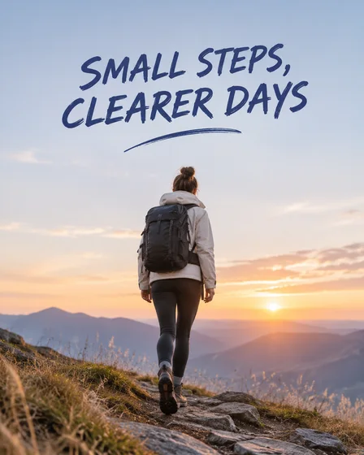</a>

Dieses Beispiel enthält keine Bildreferenz und die Eingabevorschau muss abgeschlossen werden. siehe unten die Materialanforderungen.

- **Eingabetyp:** Dieses Beispiel zeigt nur Ergebnisbeispiele; Es soll eine Bildeingabevorschau hinzugefügt werden
- **Materialanforderungen:** Das Hauptfoto des Beitrags oder das Originalbild des Produkts + das Thema oder die Kerninformationen des Beitrags und die Zielplattform → Generieren Sie das Hauptvisual, das den Proportionen der Plattform entspricht → Der aktuelle einzelne Social-Media-Beitrag
- **Beschreibung:** Es wird jeweils nur ein Bild generiert.

[ Überprüfen Sie die spezifischen Anforderungen in dearsketch und erstellen Sie ](https://dearsketch.com/de/intent/i104-create-everyday-social-media-post-visuals.html?utm_source=github&utm_medium=gallery&utm_campaign=dearsketch-public-cases&utm_content=i104_cta)

---

## I109 · Erstellen Sie Website-, Werbe- und Event-Banner

<strong>Beispiel für Ergebnisse</strong>

<a href="https://dearsketch.com/de/intent/i109-create-a-website-advertising-or-event-banner.html?utm_source=github&amp;utm_medium=gallery&amp;utm_campaign=dearsketch-public-cases&amp;utm_content=i109_image">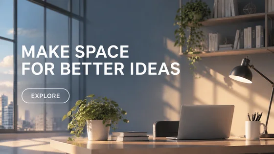</a>

Dieses Beispiel enthält keine Bildreferenz und die Eingabevorschau muss abgeschlossen werden. siehe unten die Materialanforderungen.

- **Eingabetyp:** Dieses Beispiel zeigt nur Ergebnisbeispiele; Es soll eine Bildeingabevorschau hinzugefügt werden
- **Materialanforderungen:** Originalbild der Hauptfigur oder des Produkts im Banner + Bannerzweck und Kerninformationen → Horizontales visuelles und Textlayout erstellen → Aktuelles einzelnes Banner
- **Beschreibung:** Es wird jeweils nur ein Bild generiert.

[ Überprüfen Sie die spezifischen Anforderungen in dearsketch und erstellen Sie ](https://dearsketch.com/de/intent/i109-create-a-website-advertising-or-event-banner.html?utm_source=github&utm_medium=gallery&utm_campaign=dearsketch-public-cases&utm_content=i109_cta)

---

## I110 · Generieren Sie Performance-Creatives aus Produktbildern

<table>
<thead><tr><th width="50%">Referenzmaterial</th><th width="50%">Beispiel für Ergebnisse</th></tr></thead>
<tbody><tr><td valign="top">
<strong>Produktbilder, Verkaufsargumente und Zielgruppe</strong> 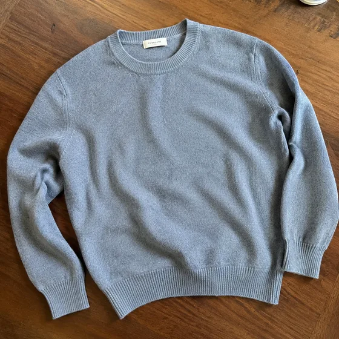
</td><td valign="top"><a href="https://dearsketch.com/de/intent/i110-create-performance-ad-creative-from-a-product-image.html?utm_source=github&amp;utm_medium=gallery&amp;utm_campaign=dearsketch-public-cases&amp;utm_content=i110_image">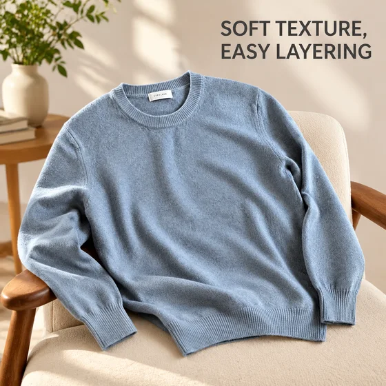</a></td></tr></tbody>
</table>

- **Eingabetyp:** Enthält eine Vorschau des Referenzmaterials und ein Ergebnisbeispiel
- **Materialanforderungen:** Produktbilder, Verkaufsargumente und Zielgruppe + Produktverkaufsargumente, Zielgruppe → Kombination von Szenen, Texten und Markenelementen → aktuelles einzelnes Werbebild
- **Beschreibung:** Es wird jeweils nur ein Bild generiert.

[ Überprüfen Sie die spezifischen Anforderungen in dearsketch und erstellen Sie ](https://dearsketch.com/de/intent/i110-create-performance-ad-creative-from-a-product-image.html?utm_source=github&utm_medium=gallery&utm_campaign=dearsketch-public-cases&utm_content=i110_cta)

---

## I113 · Generieren Sie Hochzeits-, Geburtstags- oder Partyeinladungen

<strong>Beispiel für Ergebnisse</strong>

<a href="https://dearsketch.com/de/intent/i113-create-a-wedding-birthday-or-party-invitation.html?utm_source=github&amp;utm_medium=gallery&amp;utm_campaign=dearsketch-public-cases&amp;utm_content=i113_image">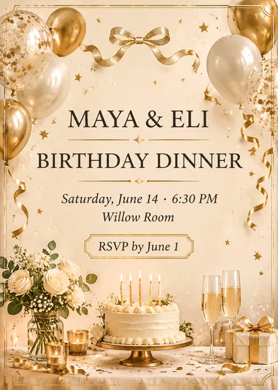</a>

Dieses Beispiel enthält keine Bildreferenz und die Eingabevorschau muss abgeschlossen werden. siehe unten die Materialanforderungen.

- **Eingabetyp:** Dieses Beispiel zeigt nur Ergebnisbeispiele; Es soll eine Bildeingabevorschau hinzugefügt werden
- **Materialanforderungen:** Personalisiertes Foto der Person im Einladungsschreiben + Art der Veranstaltung, Name oder Titel des Protagonisten, Datum, Ort oder Teilnahmemethode → Muster, Layout und unterstützendes Bildmaterial erstellen → Aktuelles einzelnes Einladungsschreiben
- **Beschreibung:** Diesmal wird eine einzelne visuelle Vorschau generiert. Datenberechnung, präziser Satz, Vektor- oder Produktionsdateien müssen noch durch entsprechende Tools überprüft werden.

[ Überprüfen Sie die spezifischen Anforderungen in dearsketch und erstellen Sie ](https://dearsketch.com/de/intent/i113-create-a-wedding-birthday-or-party-invitation.html?utm_source=github&utm_medium=gallery&utm_campaign=dearsketch-public-cases&utm_content=i113_cta)

---

## I114 · Erstellen Sie Feiertags- oder personalisierte Grußkarten

<table>
<thead><tr><th width="50%">Referenzmaterial</th><th width="50%">Beispiel für Ergebnisse</th></tr></thead>
<tbody><tr><td valign="top">
<strong>Grußkarten, personalisierte Personen- oder Haustierfotos</strong> 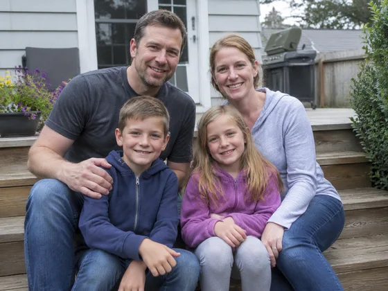
</td><td valign="top"><a href="https://dearsketch.com/de/intent/i114-create-a-holiday-or-personalized-greeting-card.html?utm_source=github&amp;utm_medium=gallery&amp;utm_campaign=dearsketch-public-cases&amp;utm_content=i114_image">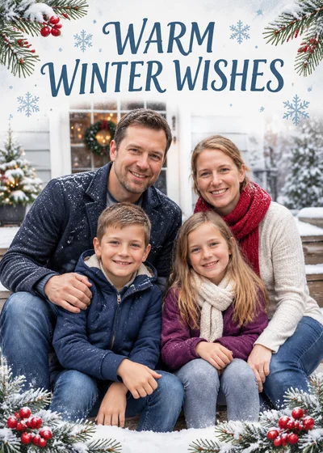</a></td></tr></tbody>
</table>

- **Eingabetyp:** Enthält eine Vorschau des Referenzmaterials und ein Ergebnisbeispiel
- **Materialanforderungen:** Personalisierte Grußkartenfotos von Menschen oder Haustieren + Fest- oder Segensszenen → Kartenillustrationen und -layout erstellen → Aktuelle einzelne Grußkarte
- **Beschreibung:** Es wird jeweils nur ein Bild generiert.

[ Überprüfen Sie die spezifischen Anforderungen in dearsketch und erstellen Sie ](https://dearsketch.com/de/intent/i114-create-a-holiday-or-personalized-greeting-card.html?utm_source=github&utm_medium=gallery&utm_campaign=dearsketch-public-cases&utm_content=i114_cta)

---

## I116 · Erstellen Sie Plakate für Schulveranstaltungen oder Kurse

<strong>Beispiel für Ergebnisse</strong>

<a href="https://dearsketch.com/de/intent/i116-create-a-school-event-or-course-poster.html?utm_source=github&amp;utm_medium=gallery&amp;utm_campaign=dearsketch-public-cases&amp;utm_content=i116_image">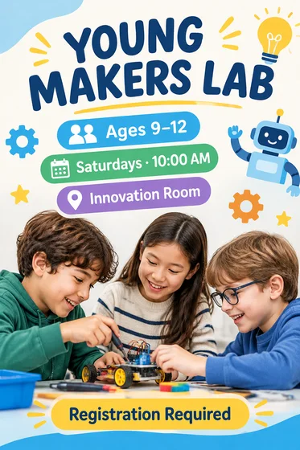</a>

Dieses Beispiel enthält keine Bildreferenz und die Eingabevorschau muss abgeschlossen werden. siehe unten die Materialanforderungen.

- **Eingabetyp:** Dieses Beispiel zeigt nur Ergebnisbeispiele; Es soll eine Bildeingabevorschau hinzugefügt werden
- **Materialanforderungen:** Schulemblem, Campus-Charaktere oder Originalwerke der Schüler + Name der Aktivität oder des Kurses, zutreffendes Alter, Datum und Informationen zur Teilnahme → Erstellen Sie altersgerechte Bilder und Layouts → Aktuelles einzelnes Campus-Poster
- **Beschreibung:** Diesmal wird eine einzelne visuelle Vorschau generiert. Datenberechnung, präziser Satz, Vektor- oder Produktionsdateien müssen noch durch entsprechende Tools überprüft werden.

[ Überprüfen Sie die spezifischen Anforderungen in dearsketch und erstellen Sie ](https://dearsketch.com/de/intent/i116-create-a-school-event-or-course-poster.html?utm_source=github&utm_medium=gallery&utm_campaign=dearsketch-public-cases&utm_content=i116_cta)

---

## I117 · Generieren Sie zum Thema passende Bilder für PPT

<strong>Beispiel für Ergebnisse</strong>

<a href="https://dearsketch.com/de/intent/i117-create-theme-matched-visuals-for-a-presentation.html?utm_source=github&amp;utm_medium=gallery&amp;utm_campaign=dearsketch-public-cases&amp;utm_content=i117_image">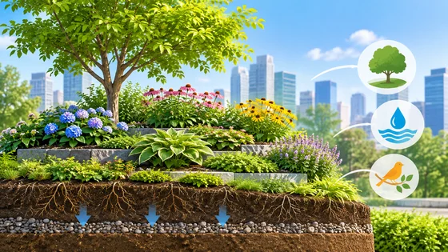</a>

Dieses Beispiel enthält keine Bildreferenz und die Eingabevorschau muss abgeschlossen werden. siehe unten die Materialanforderungen.

- **Eingabetyp:** Dieses Beispiel zeigt nur Ergebnisbeispiele; Es soll eine Bildeingabevorschau hinzugefügt werden
- **Materialanforderungen:** Visuelle Vorlage für die Demonstrationsmarke + Demonstrationsthema, der auf der aktuellen Seite zum Ausdruck gebrachte Standpunkt → Generieren Sie benutzerdefinierte Bilder ohne Urheberrechtsdruck → Aktuelles einzelnes PPT-Bild
- **Beschreibung:** Es wird jeweils nur ein Bild generiert.

[ Überprüfen Sie die spezifischen Anforderungen in dearsketch und erstellen Sie ](https://dearsketch.com/de/intent/i117-create-theme-matched-visuals-for-a-presentation.html?utm_source=github&utm_medium=gallery&utm_campaign=dearsketch-public-cases&utm_content=i117_cta)

---

## I120 · Generieren Sie eine Heldenvision für die Homepage der Website

<strong>Beispiel für Ergebnisse</strong>

Dieses Beispiel enthält keine Bildreferenz und die Eingabevorschau muss abgeschlossen werden. siehe unten die Materialanforderungen.

- **Eingabetyp:** Dieses Beispiel zeigt nur Ergebnisbeispiele; Es soll eine Bildeingabevorschau hinzugefügt werden
- **Materialanforderungen:** Produkt, Screenshot der Benutzeroberfläche oder Originalcharakterbild + Positionierung des Produkts oder der Dienstleistung, Kernwert, den Sie vermitteln möchten → Generieren Sie eine groß angelegte Markenvision und Leerraum → Aktuelles einzelnes Website-Hero-Bild
- **Beschreibung:** Es wird jeweils nur ein Bild generiert.

[ Überprüfen Sie die spezifischen Anforderungen in dearsketch und erstellen Sie ](https://dearsketch.com/de/intent/i120-create-a-website-homepage-hero-visual.html?utm_source=github&utm_medium=gallery&utm_campaign=dearsketch-public-cases&utm_content=i120_cta)

---

## I122 · Angebotskarten und Wissenskarten mit Text erstellen

<strong>Beispiel für Ergebnisse</strong>

<a href="https://dearsketch.com/de/intent/i122-create-quote-cards-and-educational-cards-with-text.html?utm_source=github&amp;utm_medium=gallery&amp;utm_campaign=dearsketch-public-cases&amp;utm_content=i122_image">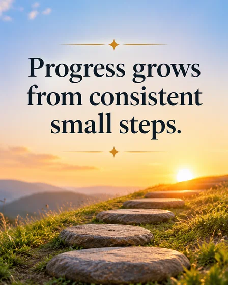</a>

Dieses Beispiel enthält keine Bildreferenz und die Eingabevorschau muss abgeschlossen werden. siehe unten die Materialanforderungen.

- **Eingabetyp:** Dieses Beispiel zeigt nur Ergebnisbeispiele; Es soll eine Bildeingabevorschau hinzugefügt werden
- **Materialanforderungen:** Visuelle Vorlage für die Marke der Angebotskarte + genaue kurze Kopie → Hintergrund, Schriftart und Layout erstellen → Aktuelle einzelne Angebotskarte
- **Beschreibung:** Es wird jeweils nur ein Bild generiert.

[ Überprüfen Sie die spezifischen Anforderungen in dearsketch und erstellen Sie ](https://dearsketch.com/de/intent/i122-create-quote-cards-and-educational-cards-with-text.html?utm_source=github&utm_medium=gallery&utm_campaign=dearsketch-public-cases&utm_content=i122_cta)

---

## I125 · Ändern Sie dasselbe Werbevisual in verschiedene Sprach- und Kulturversionen

<table>
<thead><tr><th width="50%">Referenzmaterial</th><th width="50%">Beispiel für Ergebnisse</th></tr></thead>
<tbody><tr><td valign="top">
<strong>Vollständige Originalanzeige</strong> 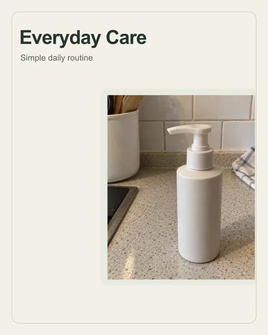
</td><td valign="top"><a href="https://dearsketch.com/de/intent/i125-adapt-one-ad-visual-for-different-languages-and-cultures.html?utm_source=github&amp;utm_medium=gallery&amp;utm_campaign=dearsketch-public-cases&amp;utm_content=i125_image">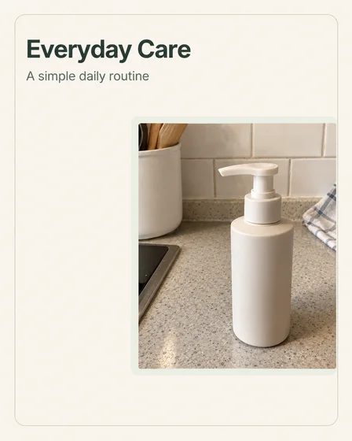</a></td></tr></tbody>
</table>

- **Eingabetyp:** Enthält eine Vorschau des Referenzmaterials und ein Ergebnisbeispiel
- **Materialanforderungen:** Vollständige Originalwerbung + Zielsprache, Markt und genehmigte Übersetzung → Text übersetzen, Zeichen und kulturelle Elemente ersetzen → Aktuelles einzelnes lokalisiertes Werbematerial
- **Beschreibung:** Diesmal wird eine einzelne visuelle Vorschau generiert. Datenberechnung, präziser Satz, Vektor- oder Produktionsdateien müssen noch durch entsprechende Tools überprüft werden.

[ Überprüfen Sie die spezifischen Anforderungen in dearsketch und erstellen Sie ](https://dearsketch.com/de/intent/i125-adapt-one-ad-visual-for-different-languages-and-cultures.html?utm_source=github&utm_medium=gallery&utm_campaign=dearsketch-public-cases&utm_content=i125_cta)

---

## I260 · Verwandeln Sie Ihre Bekleidungskollektion in ein Lookbook oder einen Modekatalog

<table>
<thead><tr><th width="50%">Referenzmaterial</th><th width="50%">Beispiel für Ergebnisse</th></tr></thead>
<tbody><tr><td valign="top">
<strong>L02-Modell trägt Bild</strong> 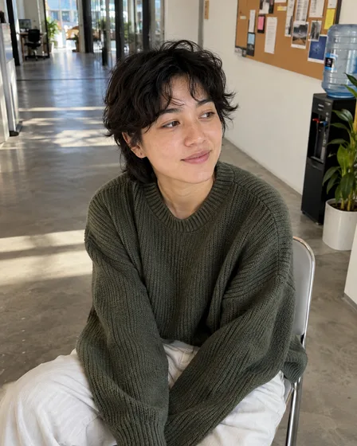

<strong>L02 vollständiges Produktbild vorne</strong> 
</td><td valign="top"><a href="https://dearsketch.com/de/intent/i260-turn-a-clothing-collection-into-a-lookbook-or-fashion-catalog.html?utm_source=github&amp;utm_medium=gallery&amp;utm_campaign=dearsketch-public-cases&amp;utm_content=i260_image">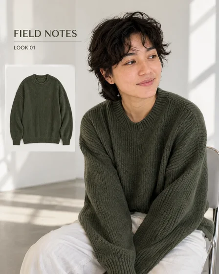</a></td></tr></tbody>
</table>

- **Eingabetyp:** Enthält eine Vorschau des Referenzmaterials und ein Ergebnisbeispiel
- **Materialbedarf:** Erforderliche Modellbilder und Produktbilder (mehrere Bilder der kompletten Serie) + erforderliches Serienthema, Stilnummer, Reihenfolge und Seitenzahl (1 Exemplar)
- **Beschreibung:** Diesmal wird eine einzelne visuelle Vorschau generiert. Datenberechnung, präziser Satz, Vektor- oder Produktionsdateien müssen noch durch entsprechende Tools überprüft werden.

[ Überprüfen Sie die spezifischen Anforderungen in dearsketch und erstellen Sie ](https://dearsketch.com/de/intent/i260-turn-a-clothing-collection-into-a-lookbook-or-fashion-catalog.html?utm_source=github&utm_medium=gallery&utm_campaign=dearsketch-public-cases&utm_content=i260_cta)

---

## I261 · Erstellen Sie ein Podcast-Cover

<table>
<thead><tr><th width="50%">Referenzmaterial</th><th width="50%">Beispiel für Ergebnisse</th></tr></thead>
<tbody><tr><td valign="top">
<strong>Gastgeberporträt</strong> 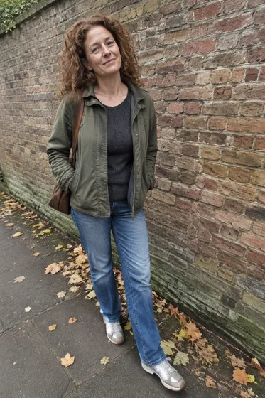
</td><td valign="top"><a href="https://dearsketch.com/de/intent/i261-create-podcast-cover-art.html?utm_source=github&amp;utm_medium=gallery&amp;utm_campaign=dearsketch-public-cases&amp;utm_content=i261_image">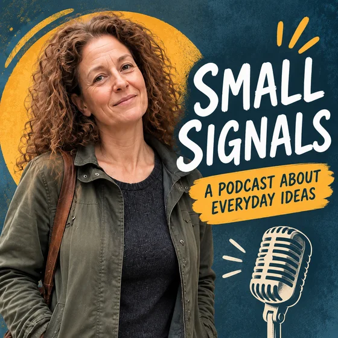</a></td></tr></tbody>
</table>

- **Eingabetyp:** Enthält eine Vorschau des Referenzmaterials und ein Ergebnisbeispiel
- **Materialanforderungen:** Optionales Host-Porträt (0 oder 1) + erforderlicher Programmname, Thema und Zielplattform (1 Kopie) + erforderlicher Programmname und erforderlicher Untertitel (1 Satz)
- **Beschreibung:** Es wird jeweils nur ein Bild generiert.

[ Überprüfen Sie die spezifischen Anforderungen in dearsketch und erstellen Sie ](https://dearsketch.com/de/intent/i261-create-podcast-cover-art.html?utm_source=github&utm_medium=gallery&utm_campaign=dearsketch-public-cases&utm_content=i261_cta)

---

## I262 · Erstellen Sie Illustrationen für Jahresberichte, Whitepapers oder Fallstudien

<strong>Beispiel für Ergebnisse</strong>

<a href="https://dearsketch.com/de/intent/i262-create-illustrations-for-an-annual-report-white-paper-or-case-study.html?utm_source=github&amp;utm_medium=gallery&amp;utm_campaign=dearsketch-public-cases&amp;utm_content=i262_image">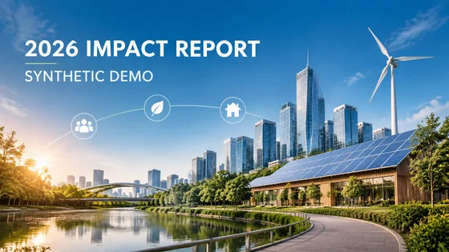</a>

Dieses Beispiel enthält keine Bildreferenz und die Eingabevorschau muss abgeschlossen werden. siehe unten die Materialanforderungen.

- **Eingabetyp:** Dieses Beispiel zeigt nur Ergebnisbeispiele; Es soll eine Bildeingabevorschau hinzugefügt werden
- **Materialanforderungen:** Optionale Markenspezifikationen oder vorhandene Berichtsillustrationsanker (0 bis mehrere) + erforderliche Kapitelliste und Zusammenfassung jedes Kapitels (1 Kopie) + zustandsverifizierte Daten (1 Kopie) + optionale Markenspezifikationen (0 oder 1 Kopie)
- **Beschreibung:** Es wird jeweils nur die aktuell ausgewählte generiert. andere Bilder der Serie werden separat ausgeführt.

[ Überprüfen Sie die spezifischen Anforderungen in dearsketch und erstellen Sie ](https://dearsketch.com/de/intent/i262-create-illustrations-for-an-annual-report-white-paper-or-case-study.html?utm_source=github&utm_medium=gallery&utm_campaign=dearsketch-public-cases&utm_content=i262_cta)

---

## I263 · Erstellen Sie einheitliche Konzeptillustrationen und Diagramme für Pitch-Decks

<strong>Beispiel für Ergebnisse</strong>

Dieses Beispiel enthält keine Bildreferenz und die Eingabevorschau muss abgeschlossen werden. siehe unten die Materialanforderungen.

- **Eingabetyp:** Dieses Beispiel zeigt nur Ergebnisbeispiele; Es soll eine Bildeingabevorschau hinzugefügt werden
- **Materialanforderungen:** Optionaler visueller Marken- oder Roadshow-Anker (0 oder 1 Foto) + erforderliche Seitenliste und Kerninformationen jeder Seite (1 Kopie) + erforderliches Geschäftsmodell oder Benutzerprozess (1 Kopie) + optionale Markenspezifikationen (0 oder 1 Kopie)
- **Beschreibung:** Es wird jeweils nur die aktuell ausgewählte generiert. andere Bilder der Serie werden separat ausgeführt.

[ Überprüfen Sie die spezifischen Anforderungen in dearsketch und erstellen Sie ](https://dearsketch.com/de/intent/i263-create-consistent-illustrations-and-diagrams-for-a-pitch-deck.html?utm_source=github&utm_medium=gallery&utm_campaign=dearsketch-public-cases&utm_content=i263_cta)
