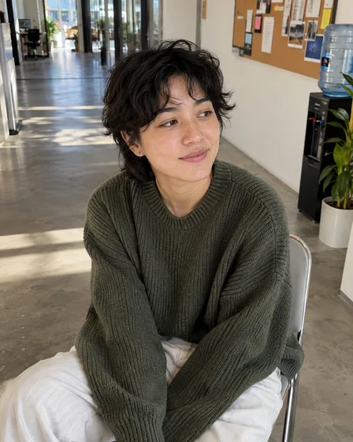

# Marketing-, Werbe- und Social-Media-Inhalte

[中文](../../../README.md) · [English](../../../README.en.md) · [Português](../../../README.pt.md) · [Español](../../../README.es.md) · [Français](../../../README.fr.md) · [Deutsch](../../../README.de.md) · [عربي](../../../README.ar.md) · [русский](../../../README.ru.md) · [日本語](../../../README.ja.md) · [हिंदी](../../../README.hi.md)

6 Fälle außerhalb des vorgestellten Katalogs. Die Aufforderungsworte werden hier nicht offengelegt, es werden lediglich die vorhandenen Referenzmaterialien, Ergebnisanweisungen und Mindestmaterialanforderungen angezeigt.

[Zurück zu weiteren Kofferkatalogen](./index.md) · [Zurück zur Lager-Homepage](../../../README.de.md)

> Referenzmaterialien und Ergebnisbilder dienen nur zur visuellen Orientierung; Es gibt keine Garantie dafür, dass der gleiche Effekt mit den gleichen Materialien reproduziert werden kann.

## I110 · Generieren Sie Performance-Creatives aus Produktbildern

<table>
<thead><tr><th width="50%">Referenzmaterial</th><th width="50%">Beispiel für Ergebnisse</th></tr></thead>
<tbody><tr><td valign="top">
<strong>Produktbilder, Verkaufsargumente und Zielgruppe</strong> 
</td><td valign="top"></td></tr></tbody>
</table>

- **Eingabetyp:** Enthält eine Vorschau des Referenzmaterials und ein Ergebnisbeispiel
- **Materialanforderungen:** Produktbilder, Verkaufsargumente und Zielgruppe + Produktverkaufsargumente, Zielgruppe → Kombination von Szenen, Texten und Markenelementen → aktuelles einzelnes Werbebild
- **Beschreibung:** Es wird jeweils nur ein Bild generiert.

[ Überprüfen Sie die spezifischen Anforderungen in dearsketch und erstellen Sie ](https://dearsketch.com/de/intent/i110-create-performance-ad-creative-from-a-product-image.html?utm_source=github&utm_medium=gallery&utm_campaign=dearsketch-public-cases&utm_content=i110_cta)

---

## I125 · Ändern Sie dasselbe Werbevisual in verschiedene Sprach- und Kulturversionen

<table>
<thead><tr><th width="50%">Referenzmaterial</th><th width="50%">Beispiel für Ergebnisse</th></tr></thead>
<tbody><tr><td valign="top">
<strong>Vollständige Originalanzeige</strong> 
</td><td valign="top"></td></tr></tbody>
</table>

- **Eingabetyp:** Enthält eine Vorschau des Referenzmaterials und ein Ergebnisbeispiel
- **Materialanforderungen:** 1 vollständige Originalanzeige + Zielland oder -region (angegebene Sprache, kulturelle Präferenz oder überarbeitete Übersetzung können hinzugefügt werden)
- **Beschreibung:** Es wird jeweils nur ein Bild generiert.

[ Überprüfen Sie die spezifischen Anforderungen in dearsketch und erstellen Sie ](https://dearsketch.com/de/intent/i125-adapt-one-ad-visual-for-different-languages-and-cultures.html?utm_source=github&utm_medium=gallery&utm_campaign=dearsketch-public-cases&utm_content=i125_cta)

---

## I260 · Verwandeln Sie Ihre Bekleidungskollektion in ein Lookbook oder einen Modekatalog

<table>
<thead><tr><th width="50%">Referenzmaterial</th><th width="50%">Beispiel für Ergebnisse</th></tr></thead>
<tbody><tr><td valign="top">
<strong>L02-Modell trägt Bild</strong> 

<strong>L02 vollständiges Produktbild vorne</strong> 
</td><td valign="top"></td></tr></tbody>
</table>

- **Eingabetyp:** Enthält eine Vorschau des Referenzmaterials und ein Ergebnisbeispiel
- **Materialbedarf:** Erforderliche Modellbilder und Produktbilder (mehrere Bilder der kompletten Serie) + erforderliches Serienthema, Stilnummer, Reihenfolge und Seitenzahl (1 Exemplar)
- **Beschreibung:** Diesmal wird eine einzelne visuelle Vorschau generiert. Datenberechnung, präziser Satz, Vektor- oder Produktionsdateien müssen noch durch entsprechende Tools überprüft werden.

[ Überprüfen Sie die spezifischen Anforderungen in dearsketch und erstellen Sie ](https://dearsketch.com/de/intent/i260-turn-a-clothing-collection-into-a-lookbook-or-fashion-catalog.html?utm_source=github&utm_medium=gallery&utm_campaign=dearsketch-public-cases&utm_content=i260_cta)

---

## I261 · Erstellen Sie ein Podcast-Cover

<table>
<thead><tr><th width="50%">Referenzmaterial</th><th width="50%">Beispiel für Ergebnisse</th></tr></thead>
<tbody><tr><td valign="top">
<strong>Gastgeberporträt</strong> 
</td><td valign="top"></td></tr></tbody>
</table>

- **Eingabetyp:** Enthält eine Vorschau des Referenzmaterials und ein Ergebnisbeispiel
- **Materialanforderungen:** Optionales Host-Porträt (0 oder 1) + erforderlicher Programmname, Thema und Zielplattform (1 Kopie) + erforderlicher Programmname und erforderlicher Untertitel (1 Satz)
- **Beschreibung:** Es wird jeweils nur ein Bild generiert.

[ Überprüfen Sie die spezifischen Anforderungen in dearsketch und erstellen Sie ](https://dearsketch.com/de/intent/i261-create-podcast-cover-art.html?utm_source=github&utm_medium=gallery&utm_campaign=dearsketch-public-cases&utm_content=i261_cta)

---

## I262 · Erstellen Sie Illustrationen für Jahresberichte, Whitepapers oder Fallstudien

<strong>Beispiel für Ergebnisse</strong>

Dieses Beispiel enthält keine Bildreferenz und die Eingabevorschau muss abgeschlossen werden. siehe unten die Materialanforderungen.

- **Eingabetyp:** Dieses Beispiel zeigt nur Ergebnisbeispiele; Es soll eine Bildeingabevorschau hinzugefügt werden
- **Materialanforderungen:** Optionale Markenspezifikationen oder vorhandene Berichtsillustrationsanker (0 bis mehrere) + erforderliche Kapitelliste und Zusammenfassung jedes Kapitels (1 Kopie) + zustandsverifizierte Daten (1 Kopie) + optionale Markenspezifikationen (0 oder 1 Kopie)
- **Beschreibung:** Es wird jeweils nur die aktuell ausgewählte generiert. andere Bilder der Serie werden separat ausgeführt.

[ Überprüfen Sie die spezifischen Anforderungen in dearsketch und erstellen Sie ](https://dearsketch.com/de/intent/i262-create-illustrations-for-an-annual-report-white-paper-or-case-study.html?utm_source=github&utm_medium=gallery&utm_campaign=dearsketch-public-cases&utm_content=i262_cta)

---

## I263 · Erstellen Sie einheitliche Konzeptillustrationen und Diagramme für Pitch-Decks

<strong>Beispiel für Ergebnisse</strong>

Dieses Beispiel enthält keine Bildreferenz und die Eingabevorschau muss abgeschlossen werden. siehe unten die Materialanforderungen.

- **Eingabetyp:** Dieses Beispiel zeigt nur Ergebnisbeispiele; Es soll eine Bildeingabevorschau hinzugefügt werden
- **Materialanforderungen:** Optionaler visueller Marken- oder Roadshow-Anker (0 oder 1 Foto) + erforderliche Seitenliste und Kerninformationen jeder Seite (1 Kopie) + erforderliches Geschäftsmodell oder Benutzerprozess (1 Kopie) + optionale Markenspezifikationen (0 oder 1 Kopie)
- **Beschreibung:** Es wird jeweils nur die aktuell ausgewählte generiert. andere Bilder der Serie werden separat ausgeführt.

[ Überprüfen Sie die spezifischen Anforderungen in dearsketch und erstellen Sie ](https://dearsketch.com/de/intent/i263-create-consistent-illustrations-and-diagrams-for-a-pitch-deck.html?utm_source=github&utm_medium=gallery&utm_campaign=dearsketch-public-cases&utm_content=i263_cta)
