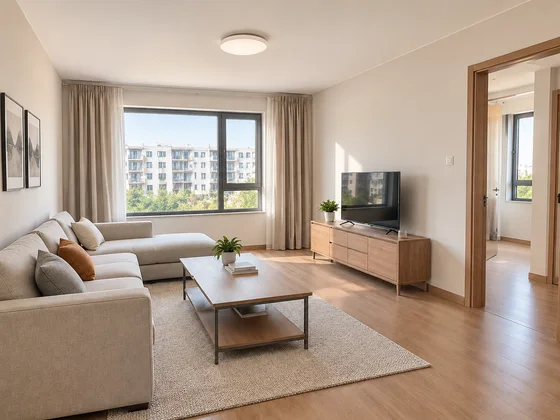

# Raum, Architektur und Immobilien

[中文](../../../README.md) · [English](../../../README.en.md) · [Português](../../../README.pt.md) · [Español](../../../README.es.md) · [Français](../../../README.fr.md) · [Deutsch](../../../README.de.md) · [عربي](../../../README.ar.md) · [русский](../../../README.ru.md) · [日本語](../../../README.ja.md) · [हिंदी](../../../README.hi.md)

2 Fälle außerhalb des vorgestellten Katalogs. Die Aufforderungsworte werden hier nicht offengelegt, es werden lediglich die vorhandenen Referenzmaterialien, Ergebnisanweisungen und Mindestmaterialanforderungen angezeigt.

[Zurück zu weiteren Kofferkatalogen](./index.md) · [Zurück zur Lager-Homepage](../../../README.de.md)

> Referenzmaterialien und Ergebnisbilder dienen nur zur visuellen Orientierung; Es gibt keine Garantie dafür, dass der gleiche Effekt mit den gleichen Materialien reproduziert werden kann.

## I170 · Probieren Sie verschiedene Möbelplatzierungen und -kombinationen aus

<table>
<thead><tr><th width="50%">Referenzmaterial</th><th width="50%">Beispiel für Ergebnisse</th></tr></thead>
<tbody><tr><td valign="top">
<strong>Fotos von verfügbaren oder vorhandenen Zimmern</strong> 
</td><td valign="top"></td></tr></tbody>
</table>

- **Eingabetyp:** Enthält eine Vorschau des Referenzmaterials und ein Ergebnisbeispiel
- **Materialbedarf:** Fotos von leerstehenden oder bestehenden Räumen → Passen Sie nur die Platzierung vorhandener Wohnelemente im Originalbild an → Vorschau des aktuellen Einzelmöbellayouts
- **Beschreibung:** Es wird jeweils nur ein Bild generiert.

[ Überprüfen Sie die spezifischen Anforderungen in dearsketch und erstellen Sie ](https://dearsketch.com/de/intent/i170-try-different-furniture-arrangements-and-combinations.html?utm_source=github&utm_medium=gallery&utm_campaign=dearsketch-public-cases&utm_content=i170_cta)

---

## I180 · Generieren Sie mehrere Materialien und Lichtrichtungen im selben Raum

<table>
<thead><tr><th width="50%">Referenzmaterial</th><th width="50%">Beispiel für Ergebnisse</th></tr></thead>
<tbody><tr><td valign="top">
<strong>Datumsraumkarte</strong> 
</td><td valign="top"></td></tr></tbody>
</table>

- **Eingabetyp:** Enthält eine Vorschau des Referenzmaterials und ein Ergebnisbeispiel
- **Materialanforderungen:** 1 Referenzraumzeichnung + angestrebte Designrichtung, Oberflächenmaterial und Beleuchtungsanforderungen
- **Beschreibung:** Es wird jeweils nur ein Bild generiert.

[ Überprüfen Sie die spezifischen Anforderungen in dearsketch und erstellen Sie ](https://dearsketch.com/de/intent/i180-create-material-and-lighting-variations-for-the-same-space.html?utm_source=github&utm_medium=gallery&utm_campaign=dearsketch-public-cases&utm_content=i180_cta)
