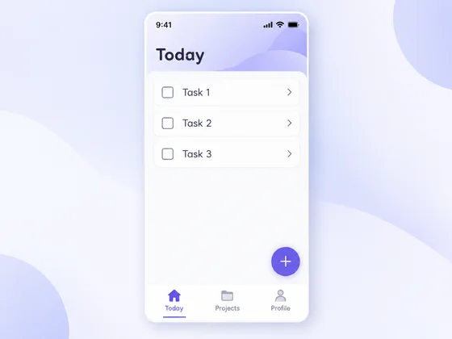

# Produktkonzept und Industriedesign

[中文](../../../README.md) · [English](../../../README.en.md) · [Português](../../../README.pt.md) · [Español](../../../README.es.md) · [Français](../../../README.fr.md) · [Deutsch](../../../README.de.md) · [عربي](../../../README.ar.md) · [русский](../../../README.ru.md) · [日本語](../../../README.ja.md) · [हिंदी](../../../README.hi.md)

4 Fälle außerhalb des vorgestellten Katalogs. Die Aufforderungsworte werden hier nicht offengelegt, es werden lediglich die vorhandenen Referenzmaterialien, Ergebnisanweisungen und Mindestmaterialanforderungen angezeigt.

[Zurück zu weiteren Kofferkatalogen](./index.md) · [Zurück zur Lager-Homepage](../../../README.de.md)

> Referenzmaterialien und Ergebnisbilder dienen nur zur visuellen Orientierung; Es gibt keine Garantie dafür, dass der gleiche Effekt mit den gleichen Materialien reproduziert werden kann.

## I184 · Konvertieren Sie Produktskizzen in realistische Produktdarstellungen

<table>
<thead><tr><th width="50%">Referenzmaterial</th><th width="50%">Beispiel für Ergebnisse</th></tr></thead>
<tbody><tr><td valign="top">
<strong>Handgezeichnete Produktskizzen</strong> 
</td><td valign="top"></td></tr></tbody>
</table>

- **Eingabetyp:** Enthält eine Vorschau des Referenzmaterials und ein Ergebnisbeispiel
- **Materialanforderungen:** Handgezeichnete Produktskizze + Produktnutzung, unveränderliche Merkmale in der Skizze → Form beibehalten und Materialien, Licht und Schatten und Hintergrund generieren → aktuelle Einzelproduktdarstellung
- **Beschreibung:** Es wird jeweils nur ein Bild generiert.

[ Überprüfen Sie die spezifischen Anforderungen in dearsketch und erstellen Sie ](https://dearsketch.com/de/intent/i184-turn-a-product-sketch-into-a-realistic-product-render.html?utm_source=github&utm_medium=gallery&utm_campaign=dearsketch-public-cases&utm_content=i184_cta)

---

## I186 · Produktvorschau in verschiedenen Farben, Materialien und Oberflächenbehandlungen

<table>
<thead><tr><th width="50%">Referenzmaterial</th><th width="50%">Beispiel für Ergebnisse</th></tr></thead>
<tbody><tr><td valign="top">
<strong>Produktbilder oder 3D-Renderings</strong> 
</td><td valign="top"></td></tr></tbody>
</table>

- **Eingabetyp:** Enthält eine Vorschau des Referenzmaterials und ein Ergebnisbeispiel
- **Materialanforderungen:** Produktzeichnung oder 3D-Rendering + Zielfarbe oder -material → Farbe, Material und Textur ersetzen → Aktuelle einzelne CMF-Planzeichnung
- **Beschreibung:** Es wird jeweils nur ein Bild generiert.

[ Überprüfen Sie die spezifischen Anforderungen in dearsketch und erstellen Sie ](https://dearsketch.com/de/intent/i186-preview-product-colors-materials-and-finishes.html?utm_source=github&utm_medium=gallery&utm_campaign=dearsketch-public-cases&utm_content=i186_cta)

---

## I188 · Erstellen Sie Möbelprodukt-Renderings aus Skizzen

<table>
<thead><tr><th width="50%">Referenzmaterial</th><th width="50%">Beispiel für Ergebnisse</th></tr></thead>
<tbody><tr><td valign="top">
<strong>Möbelskizzen</strong> 
</td><td valign="top"></td></tr></tbody>
</table>

- **Eingabetyp:** Enthält eine Vorschau des Referenzmaterials und ein Ergebnisbeispiel
- **Materialbedarf:** Möbelskizze + Möbelverwendung, Struktur, die erhalten bleiben muss → Holz-, Stoff- und Nutzungsszenen generieren → Aktuelle Einzelmöbelproduktdarstellung
- **Beschreibung:** Es wird jeweils nur ein Bild generiert.

[ Überprüfen Sie die spezifischen Anforderungen in dearsketch und erstellen Sie ](https://dearsketch.com/de/intent/i188-turn-a-furniture-sketch-into-a-product-render.html?utm_source=github&utm_medium=gallery&utm_campaign=dearsketch-public-cases&utm_content=i188_cta)

---

## I192 · Konvertieren Sie Schnittstellenskizzen in vollständigere UI-Modelle

<table>
<thead><tr><th width="50%">Referenzmaterial</th><th width="50%">Beispiel für Ergebnisse</th></tr></thead>
<tbody><tr><td valign="top">
<strong>Wireframes oder Screenshots vorhandener Schnittstellen</strong> 
</td><td valign="top"></td></tr></tbody>
</table>

- **Eingabetyp:** Enthält eine Vorschau des Referenzmaterials und ein Ergebnisbeispiel
- **Materialanforderungen:** Wireframes oder Screenshots bestehender Schnittstellen + Produkttyp und unveränderliche Informationsarchitektur → Ergänzender visueller Stil, Komponenten und Geräteszenarien → Aktuelle Single-UI-Konzeptkarte
- **Beschreibung:** Es wird jeweils nur ein Bild generiert.

[ Überprüfen Sie die spezifischen Anforderungen in dearsketch und erstellen Sie ](https://dearsketch.com/de/intent/i192-turn-a-ui-sketch-into-a-polished-interface-mockup.html?utm_source=github&utm_medium=gallery&utm_campaign=dearsketch-public-cases&utm_content=i192_cta)
