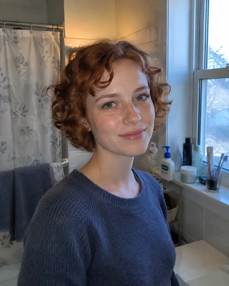
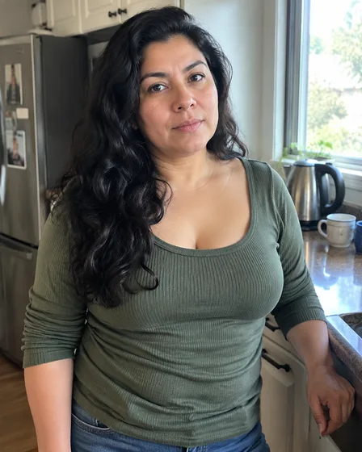

# Eingabeaufforderungen für die Bearbeitung von Porträts und persönlichen Fotos · Porträtbearbeitung und persönliches Bild

[中文](../../../README.md) · [English](../../../README.en.md) · [Português](../../../README.pt.md) · [Español](../../../README.es.md) · [Français](../../../README.fr.md) · [Deutsch](../../../README.de.md) · [عربي](../../../README.ar.md) · [русский](../../../README.ru.md) · [日本語](../../../README.ja.md) · [हिंदी](../../../README.hi.md)

Wählen Sie zwischen einem professionellen Porträtfoto, einer gezielten Bearbeitung der Kleidung, einer virtuellen Anprobe oder einer illustrierten Identität. Bei einem Porträtfoto sollten die natürlichen Gesichtszüge erhalten bleiben. Ein Cartoon kann das Medium verändern und gleichzeitig die Erkennbarkeit der Person beibehalten.

Entscheiden Sie zunächst, ob Sie Kleidung, Accessoires, Hintergrund oder die Darstellung des gesamten Bildes ändern möchten. Beim Anprobieren bestimmter Brillen und Tattoo-Designs müssen Sie die entsprechenden Originale zur Verfügung stellen, nicht nur ein vages Stilwort.

## Wählen Sie die richtige Aufgabe

Benennen Sie bei einer lokalen Bearbeitung den genauen Bereich, der geändert werden soll, und was unberührt bleiben darf. Fügen Sie für ein bestimmtes Accessoire oder Tattoo die Referenz sowie das Personenfoto bei.

| Aufgabe | Bewahren | Ändern | Eingabeaufforderung und Eingaben |
| --- | --- | --- | --- |
| Professionelles Porträtfoto von einem Selfie / Vom Selfie zum professionellen Porträtfoto | Behalten Sie Identität, Gesichtsgeometrie, Hautton, Altersmerkmale und natürliche Textur bei. | Ändern Sie den Zuschnitt, den Hintergrund, die Beleuchtung und das professionelle Styling Ihrer Garderobe. | [I001](../cases/i001-create-a-professional-linkedin-headshot-from-a-selfie.md#public-prompt) |
| Ersetzen Sie Freizeitkleidung durch Berufskleidung / Freizeitkleidung durch Berufskleidung | Behalten Sie Identität, Gesicht, Haare, Pose, Körperform, Hände und Hintergrund bei, sofern nicht anders gewünscht. | Ändern Sie den Kleidungsstücktyp, die Farbe, die Passform und die sichtbaren Accessoires. | [I015](../cases/i015-replace-casual-clothing-with-professional-attire.md#public-prompt) |
| Historisch inspiriertes persönliches Porträt / königliche und Vintage-Porträts | Behalten Sie die Identität, das Alter, den Hautton und die Gesichtsstruktur der Person bei. | Ändern Sie Kostüme, Hintergrund, Requisiten, Licht und eine von der Zeit inspirierte Atmosphäre. | [I052](../cases/i052-turn-yourself-into-a-royal-vintage-or-historical-portrait.md#public-prompt) |
| Virtuelle Brillenvorschau/Vorschau zur Brillenanprobe | Behalten Sie Identität, Gesichtsform, Haut, Augen und die bereitgestellten Rahmendetails für den ausgewählten Zweig bei. | Ändern Sie nur die Platzierung des Rahmens, das Erscheinungsbild der Linse und die minimale Beleuchtungsintegration. | [I036](../cases/i036-virtually-try-on-glasses.md#public-prompt) |
| Vorschau der Tattoo-Platzierung / Vorschau des Tattoo-Oberkörpers | Behalten Sie die Person, die Hautbeschaffenheit, die Körperanatomie und das Tattoo-Kunstwerk bei. | Ändern Sie nur Platzierung, Skalierung, Krümmung, Deckkraft und Integration. | [I038](../cases/i038-preview-a-tattoo-on-a-body-photo.md#public-prompt) |
| Cartoon-Avatar vom Porträt/Foto zum Cartoon-Avatar | Behalten Sie Gesichtsform, Haare, Hautton und sichtbare charakteristische Accessoires bei. | Ändern Sie die Rendering-Sprache, die Vereinfachung, den Hintergrund und die Palette. | [I047](../cases/i047-turn-a-portrait-photo-into-a-cartoon-avatar.md#public-prompt) |
| Anime-inspirierter Avatar / Foto zum Anime-Charakter | Behalten Sie Gesichtsform, Hautton, Haare, Augenverhältnis und definierende Accessoires bei. | Ändern Sie Linienführung, Schattierung, Palette, Hintergrund und Stilisierungsgrad. | [I048](../cases/i048-turn-a-portrait-photo-into-an-anime-character.md#public-prompt) |
| Konzept für verpackte Actionfiguren / verpackte Actionfiguren | Bewahren Sie die Identität der Person und die Liste der angeforderten Zubehörteile auf. | Verwandeln Sie den Körper in eine spielzeugähnliche Figur, die Verpackung, das Farbsystem und das Display-Layout. | [I050](../cases/i050-turn-a-person-into-a-packaged-action-figure.md#public-prompt) |
| Einzelner Chat-Aufkleber / Foto-zu-Chat-Aufkleber | Sorgen Sie dafür, dass das Motiv erkennbar ist, und behalten Sie die charakteristischen Markierungen oder Merkmale bei. | Ändern Sie Ausdruck, Posenbetonung, Kontur, Hintergrundentfernung und Aufkleberstil. | [I056](../cases/i056-turn-a-photo-into-chat-stickers.md#public-prompt) |
| Personalisiertes Filmplakat / Persönliche und Paar-Filmplakate | Bewahren Sie die Identität jeder Person und alle bestätigten Rechnungstexte auf. | Ändern Sie das filmische Setting, die Genrebehandlung, die Beleuchtung, die Komposition und das Typografiekonzept. | [I252](../cases/i252-turn-a-personal-or-couple-photo-into-a-movie-poster.md#public-prompt) |

## Referenzmaterial und Ergebnisrichtung

### Professioneller Headshot von einem Selfie

<table>
<thead><tr><th width="50%">Referenzmaterial</th><th width="50%">Ergebnisbeispiel</th></tr></thead>
<tbody><tr><td valign="top">
<strong>Ich kenne das Originalfoto</strong> 
</td><td valign="top"></td></tr></tbody>
</table>

[Lesen Sie die Eingabeaufforderung und Eingabeanforderungen](../cases/i001-create-a-professional-linkedin-headshot-from-a-selfie.md#public-prompt) · [Versuchen Sie es mit Ihrem eigenen Material](https://dearsketch.com/de/intent/i001-create-a-professional-linkedin-headshot-from-a-selfie.html?utm_source=github&utm_medium=guide&utm_campaign=dearsketch-public-cases&utm_content=i001_cta)

### Cartoon-Avatar aus einem Porträt

<table>
<thead><tr><th width="50%">Referenzmaterial</th><th width="50%">Ergebnisbeispiel</th></tr></thead>
<tbody><tr><td valign="top">
<strong>Ich habe ein klares Bild von meinem Kopf</strong> 
</td><td valign="top"></td></tr></tbody>
</table>

[Lesen Sie die Eingabeaufforderung und Eingabeanforderungen](../cases/i047-turn-a-portrait-photo-into-a-cartoon-avatar.md#public-prompt) · [Versuchen Sie es mit Ihrem eigenen Material](https://dearsketch.com/de/intent/i047-turn-a-portrait-photo-into-a-cartoon-avatar.html?utm_source=github&utm_medium=guide&utm_campaign=dearsketch-public-cases&utm_content=i047_cta)

Dies sind visuelle Beispiele. Die öffentlichen Vorlagen sind neu geschrieben und wurden nicht anhand der abgebildeten Eingaben getestet. Überprüfen Sie Identitäts-, Inhalts- und Dateianforderungen, bevor Sie eine Ausgabe verwenden. Bildbedingungen: [Inhaltsrichtlinie](../content-policy.md).
