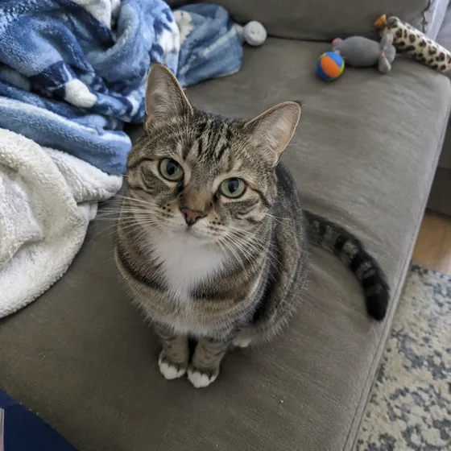
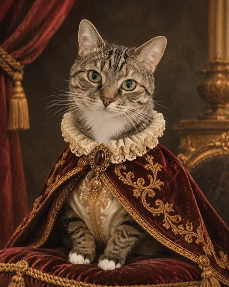
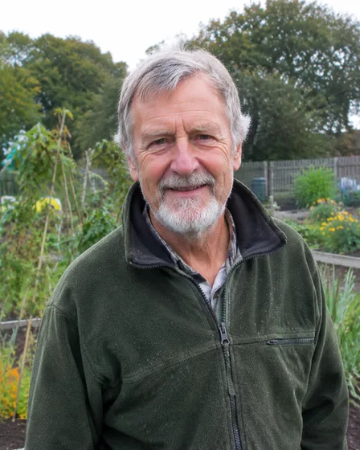
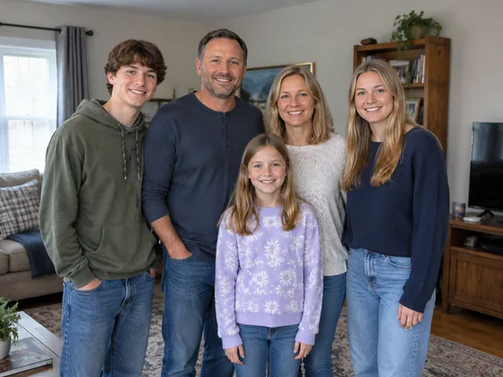
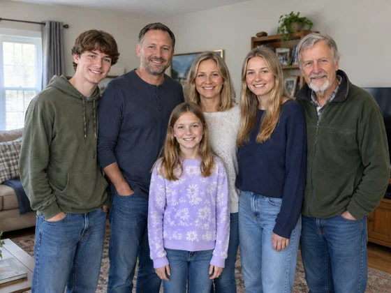

# Anregungen für Tierporträts und Familienfotos · Tierporträts und Familienerinnerungen

[中文](../../../README.md) · [English](../../../README.en.md) · [Português](../../../README.pt.md) · [Español](../../../README.es.md) · [Français](../../../README.fr.md) · [Deutsch](../../../README.de.md) · [عربي](../../../README.ar.md) · [русский](../../../README.ru.md) · [日本語](../../../README.ja.md) · [हिंदी](../../../README.hi.md)

Verwandeln Sie Haustier- und Familienfotos in Porträts und Erinnerungsstücke, wobei jedes Motiv erkennbar bleibt. Wählen Sie ein Einzelporträt, ein paar Kunstwerke oder eine Komposition, die einzelne Fotos zusammenfügt.

Bei Tierporträts sollten zunächst die Augen, Ohrformen und Muster erhalten bleiben; Bei der Mehrpersonensynthese sollten zunächst alle Mitglieder, Beziehungen und Vereinbarungen aufgelistet werden. Das Gedenkdatum und die Inschrift werden von Ihnen bereitgestellt, raten Sie nicht anhand der Fotos.

## Wählen Sie die richtige Aufgabe

Für ein Tierportrait reicht ein Haustierfoto. In einer Familiengruppe muss jede Person oder jedes Haustier enthalten sein, die Sie möchten. Geben Sie bei einem Andenken mit Namen oder Daten den genauen Wortlaut separat an.

| Aufgabe | Bewahren | Ändern | Eingabeaufforderung und Eingaben |
| --- | --- | --- | --- |
| Individuelles Haustierportrait / individuelles Haustierportrait | Behalten Sie die Identität, Markierungen, Augenfarbe, Ohrform und Körperproportionen des Haustiers bei. | Ändern Sie die Umgebung, Beleuchtung, Palette und künstlerische Behandlung. | [I026](../cases/i026-turn-a-pet-photo-into-a-custom-portrait.md#public-prompt) |
| Königliches Haustierporträt / Königliches Haustierporträt | Behalten Sie das Gesicht, das Fellmuster, die Augenfarbe und die artspezifische Anatomie des Haustiers bei. | Ändern Sie Kleidung, Requisiten, Hintergrund und die von der Zeit inspirierte Atmosphäre. | [I028](../cases/i028-turn-a-pet-into-a-royal-or-historical-portrait.md#public-prompt) |
| Verspielte Haustierszene / Haustierspaß-Szenenmalerei | Halten Sie Identität, Fellzeichnung, Anatomie und Maßstab konsistent. | Ändern Sie die Umgebung, den Posenkontext und spielerische Requisiten. | [I029](../cases/i029-place-a-pet-in-a-playful-bathroom-or-kitchen-scene.md#public-prompt) |
| Haustier-Gedenkportrait / Haustier-Gedenkgemälde | Halten Sie die Identität des Haustiers sowie alle angegebenen Namen und Daten genau fest. | Ändern Sie Hintergrund, Licht, florale Details und Gedenkstimmung. | [I027](../cases/i027-create-a-pet-memorial-portrait.md#public-prompt) |
| Familienporträt mit Haustieren / Familienporträt von Menschen und Haustieren | Sorgen Sie dafür, dass jede Person und jedes Haustier individuell erkennbar ist, und achten Sie auf die korrekte Zählung und Kennzeichnung. | Ändern Sie die gemeinsame Umgebung, die Koordination der Garderobe, das Licht und die Anordnung. | [I021](../cases/i021-create-a-family-portrait-with-pets.md#public-prompt) |
| Jubiläumspaar-Kunstwerk / Paar-Jubiläums-Kunstgemälde | Behalten Sie beide Identitäten, Beziehungen, Posenlogiken und bestätigten Namen oder Daten bei. | Ändern Sie künstlerisches Medium, Hintergrund, Palette und feierliche Details. | [I022](../cases/i022-turn-a-couple-s-photo-into-anniversary-artwork.md#public-prompt) |
| Zusammengesetztes Familienporträt / Verstreute Fotos zu einem Familienporträt | Behalten Sie alle bereitgestellten Identitäten, die angeforderte Anzahl, Beziehungen und Vereinbarungen bei. | Ändern Sie die gemeinsame Einstellung, die Posenintegration, das Licht und das koordinierte Styling. | [I017](../cases/i017-combine-separate-family-photos-into-one-family-portrait.md#public-prompt) |
| Feiertags-Familienporträt / Familienporträt zum Thema Urlaub | Behalten Sie alle Personen, Identitäten, Zahlen und Gesichtszüge bei. | Ändern Sie Dekor, Garderobenakzente, Hintergrund und Urlaubsatmosphäre. | [I020](../cases/i020-create-a-christmas-or-holiday-family-portrait.md#public-prompt) |
| Paarporträt im Hochzeitsstil / Porträt im Hochzeits- und Hochzeitsstil | Behalten Sie beide Identitäten, natürliche Beziehungen und Körperproportionen bei. | Ändern Sie Garderobe, Ambiente, Blumenstil und zeremonielle Stimmung. | [I023](../cases/i023-create-a-wedding-portrait-or-bridal-style-photo.md#public-prompt) |
| Baby-Meilenstein-Portrait / Fotos von Baby-Meilenstein-Wachstumsmeilensteinen | Behalten Sie die Identität des Babys, die altersgerechte Anatomie und den bestätigten Meilensteintext bei. | Ändern Sie Hintergrund, Requisiten, Farbpalette und feierliches Layout. | [I025](../cases/i025-create-baby-milestone-or-monthly-growth-photos.md#public-prompt) |

## Referenzmaterial und Ergebnisrichtung

### Königliches Haustierporträt

<table>
<thead><tr><th width="50%">Referenzmaterial</th><th width="50%">Ergebnisbeispiel</th></tr></thead>
<tbody><tr><td valign="top">
<strong>Haustierfotos</strong> 
</td><td valign="top"></td></tr></tbody>
</table>

[Lesen Sie die Eingabeaufforderung und Eingabeanforderungen](../cases/i028-turn-a-pet-into-a-royal-or-historical-portrait.md#public-prompt) · [Versuchen Sie es mit Ihrem eigenen Material](https://dearsketch.com/de/intent/i028-turn-a-pet-into-a-royal-or-historical-portrait.html?utm_source=github&utm_medium=guide&utm_campaign=dearsketch-public-cases&utm_content=i028_cta)

### Zusammengesetztes Familienporträt

<table>
<thead><tr><th width="50%">Referenzmaterial</th><th width="50%">Ergebnisbeispiel</th></tr></thead>
<tbody><tr><td valign="top">
<strong>Fotos einzelner Mitglieder, die zusammengeführt werden sollen</strong> 

<strong>Es gibt bereits Familienmitglieder, die Fotos machen</strong> 
</td><td valign="top"></td></tr></tbody>
</table>

[Lesen Sie die Eingabeaufforderung und Eingabeanforderungen](../cases/i017-combine-separate-family-photos-into-one-family-portrait.md#public-prompt) · [Versuchen Sie es mit Ihrem eigenen Material](https://dearsketch.com/de/intent/i017-combine-separate-family-photos-into-one-family-portrait.html?utm_source=github&utm_medium=guide&utm_campaign=dearsketch-public-cases&utm_content=i017_cta)

Dies sind visuelle Beispiele. Die öffentlichen Vorlagen sind neu geschrieben und wurden nicht anhand der abgebildeten Eingaben getestet. Überprüfen Sie Identitäts-, Inhalts- und Dateianforderungen, bevor Sie eine Ausgabe verwenden. Bildbedingungen: [Inhaltsrichtlinie](../content-policy.md).
