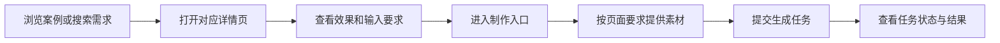
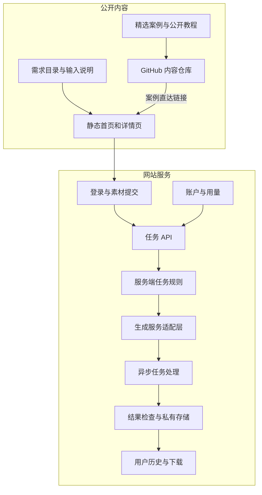

# dearsketch product architecture

[中文](../../README.md) · [English](../../README.en.md) · [Português](../../README.pt.md) · [Español](../../README.es.md) · [Français](../../README.fr.md) · [Deutsch](../../README.de.md) · [عربي](../../README.ar.md) · [русский](../../README.ru.md) · [日本語](../../README.ja.md) · [हिंदी](../../README.hi.md)


dearsketch organizes "What pictures do I want to complete" into a browsable directory of requirements. Each requirement has an independent page that explains the purpose, required materials and result requirements; users enter the production process from the corresponding page.

This description describes module responsibilities and data flow. The public content library, website services and generated models each undertake different tasks; this warehouse provides public cases, 50 newly edited templates and Agent Skill, and online production is performed on the website.

## User path



Different assignments may require photos, designated design manuscripts, accurate copywriting, or multiple character assets. Series drawings and multiple plans are produced separately on a single basis; when precise text, vectors or production files are required, corresponding tools are required after visual preview.

## Content and generation layering



Static content pages are responsible for discovery, interpretation, and search inclusion. Task API is responsible for validating user input and creating tasks. The server-side rule and generation adaptation layer is responsible for executing selected requirements. The history and storage layer is responsible for returning the results to the corresponding users.

The modules in the figure reflect the division of responsibilities in the current source code, and are not a commitment to all online functions, payment status or service levels; when using them, the actual entrance and instructions provided by the website shall prevail.

## Module responsibilities

| module | Problem solved |
| --- | --- |
| Requirements Catalog | Organize picture tasks with purposes, inputs, outputs, and scenarios |
| Page construction | Generate stable addresses, page content and search metadata for your needs |
| Enter the contract | Explain which materials are required, which are optional, and what are the relationships between the materials. |
| Accounts and Tasks API | Verify identity, input integrity and request duplication |
| Server task rules | Organize execution content based on needs and current input |
| Generate adaptation layer | Connect to external build services and handle asynchronous tasks |
| Results and history | Check results, save resources, and provide access to appropriate users |
| Account and Usage | Handle usage qualifications, points, and order-related status |

## Implementation method

| layer | The method in the current source code |
| --- | --- |
| Content construction | Node.js script generates HTML, detail page and search metadata from structured requirements |
| Browser interaction | JavaScript handles filtering, material input, and task status; some interactions use React and are packaged by Vite |
| Server | Node.js modules handle authentication, uploads, build tasks, history and usage |
| data | Relational database records accounts, resource ownership and task status |
| document | Private object storage separated from business data, accessed through controlled addresses |
| generate | The server adapts to externally generated services and processes asynchronous tasks and results. |

These technical choices can explain how the system divides work without exposing production account numbers, project IDs, bucket names, or environment variable values.

## Public data example

```json
{
  "id": "I026",
  "title": "宠物定制肖像",
  "input": "1张宠物照片",
  "output": "宠物肖像图片",
  "roles": [
    { "kind": "image", "label": "宠物照片", "requirement": "required", "quantity": "1张" }
  ]
}
```

These fields explain user tasks and do not contain full server-side generation instructions. See [cases.json](../../data/cases.json) for selected case data, see [gallery.json](../../data/gallery.json) for other result examples, and see [public-prompts.json](../../data/public-prompts.json) for the new public template. Public skills are only responsible for preparing input lists and prompt words, and do not have access to internal generation rules.

## Access and content boundaries

Public case pictures and user-uploaded resources are two types of content. Cases are used to illustrate visual direction; original user images, task results, and account records do not belong to the public case library. The generation service needs to verify the material type, size and ownership, and user input cannot override the execution constraints of the server.

Module diagrams, responsibilities, abstract data structures, input specifications, and general reliability principles can be exposed. Exposing a piece of server-side implementation or a set of database structures is an area of ​​open source that can be decided independently; they are not automatically secret just because they are on the server side.

The scope of this warehouse is cases, basic tutorials and product architecture descriptions, and does not include production service source code, internal complete skills or deployment resources. Credentials, sessions, real user records, and private resource addresses are not public content.

## How to connect GitHub to the website

Each featured image and "make the same" link leads to the corresponding demand page. Links use source parameters to distinguish README, case details, and tutorial entries; these parameters only express the source and cannot alone prove that a statistical system has been deployed.

The website does not have any prompt word input boxes for visitors. Basic tutorials are made public for users to try out the tools of their choice; the website provides corresponding material entrances based on selected needs.
