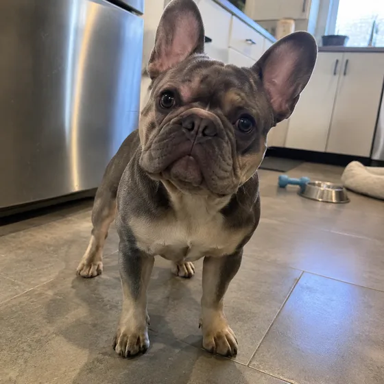
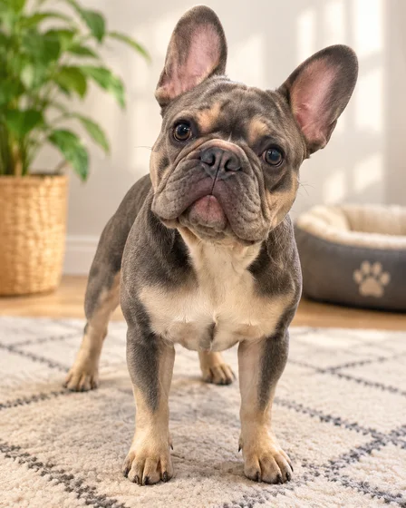

# Custom Pet Portrait·Pet custom portrait

[中文](../../../README.md) · [English](../../../README.en.md) · [Português](../../../README.pt.md) · [Español](../../../README.es.md) · [Français](../../../README.fr.md) · [Deutsch](../../../README.de.md) · [عربي](../../../README.ar.md) · [русский](../../../README.ru.md) · [日本語](../../../README.ja.md) · [हिंदी](../../../README.hi.md)


Turn one pet photo into a display-ready portrait.

Turn your pet photos into custom portraits. For gifts, home decoration.

[Copy prompt](#public-prompt) · [ is produced by dearsketch / Try online](https://dearsketch.com/en/intent/i026-turn-a-pet-photo-into-a-custom-portrait.html?utm_source=github&utm_medium=case&utm_campaign=dearsketch-public-cases&utm_content=i026_cta) · [Return to topic / Collection](../guides/pets-family.md)

## Reference material and result direction

<table>
<thead><tr><th width="50%">Reference material</th><th width="50%">Example of results</th></tr></thead>
<tbody><tr><td valign="top"><p><strong>pet photos</strong><br></p></td><td valign="top"><a href="https://dearsketch.com/en/intent/i026-turn-a-pet-photo-into-a-custom-portrait.html?utm_source=github&amp;utm_medium=case&amp;utm_campaign=dearsketch-public-cases&amp;utm_content=i026_image"></a></td></tr></tbody>
</table>

The reference materials and results are used to illustrate the visual direction. The public template is not the original generation instruction for the accompanying images, and the same results are not guaranteed to be reproduced.

## What to prepare/Inputs

| Material | Type / Type | Quantity / Quantity | Condition / Requirement |
| --- | --- | --- | --- |
| pet photos | Picture/Image | 1 piece | Required / Required |

Only one image is generated at a time.

## Retain and change / Editing brief

- **Preserve / 保留：** Keep the pet’s identity, markings, eye color, ear shape, and body proportions.
- **Change / 改变：** Change the setting, lighting, palette, and artistic treatment.

## Public prompt

**Newly edited public template · Newly authored · Not generation-tested.** Replace the square bracket parameters and attach the required materials in the tool that supports image editing; optional and conditional inputs are prepared according to the table above. This template was not used to generate the examples on this page.

```text
Create one custom pet portrait from [PET PHOTO].
The subject is [PET NAME OR “NO NAME”] and the intended style is [ART STYLE].
Preserve the exact animal identity, facial structure, eye color, coat pattern, ear shape, and body proportions.
Do not invent collars, tags, scars, or markings that are not visible or specified.
Replace the original surroundings with [BACKGROUND OR SETTING].
Use [COLOR PALETTE] and [LIGHTING MOOD] while keeping the pet clearly recognizable.
Compose the animal as [HEADSHOT / HALF BODY / FULL BODY] for [DISPLAY USE].
Keep anatomy natural, with clean paws, whiskers, fur edges, and believable depth.
Do not add text unless [EXACT TEXT] is supplied.
Deliver one finished portrait image; do not create a sheet, sequence, or alternate version.
```

[Make it online with your own materials / Make it online](https://dearsketch.com/en/intent/i026-turn-a-pet-photo-into-a-custom-portrait.html?utm_source=github&utm_medium=case&utm_campaign=dearsketch-public-cases&utm_content=i026_after-prompt) · [Let Agent help you organize it / Use the Skill](../quickstart.md#agent-skill)

## Check the key points/Review

First compare the eyes, ears, patterns and body posture, and then decide whether you like the painting style.

Compare eyes, ears, markings, and silhouette before judging the style.

Results in the direction of: pet portraits. When exact text, transparent files, vectors or print delivery are required, check actual file; available features and fees are subject to website description.

## Related cases / Related tasks

- [Turn a pet into a royal or historical portrait · Pet royal portrait](./i028-turn-a-pet-into-a-royal-or-historical-portrait.md#public-prompt)
- [Place a pet in a playful bathroom or kitchen scene · Pet interesting scene painting ](./i029-place-a-pet-in-a-playful-bathroom-or-kitchen-scene.md#public-prompt)
- [Create a pet memorial portrait · Pet memorial painting ](./i027-create-a-pet-memorial-portrait.md#public-prompt)

## Requirements background reference

- [Etsy AI pet portrait](https://www.etsy.com/market/ai_pet_portrait)

These links are only to aid in understanding the purpose and are not proof of the source or authorization of the images on this page.

For the scope of use of pictures and materials, see [ content description ](../content-policy.md). [View all 50 templates ](../prompts.md).
